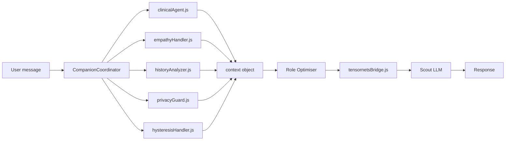
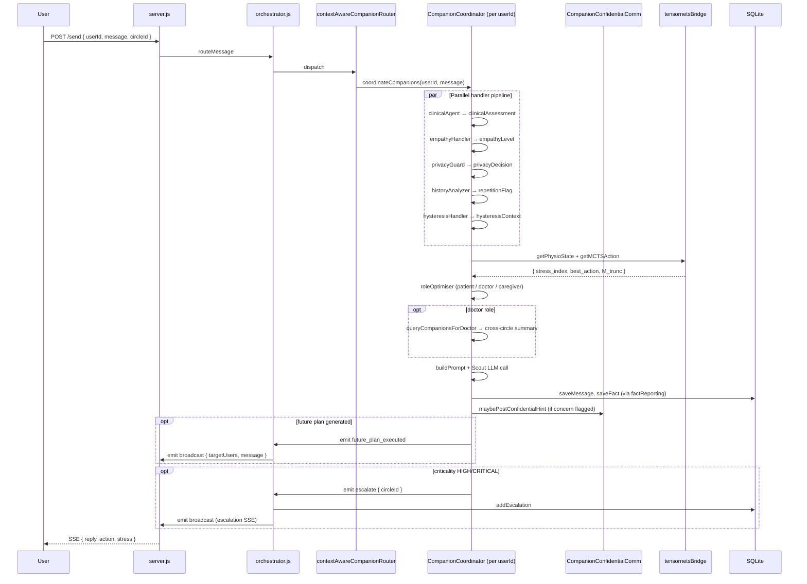

# Care Circle Orchestration Engine

> Modules: `orchestrator.js`, `companions/`, `handlers/`, `agents/social/`, `companions/confidential/`  
> Related: `documentation/tensornets/14_multi_agent.md` (Python tensor layer), `documentation/tensornets/00_architecture.md §3`

---

## 1. What is the Care Circle?

A **Care Circle** is the fundamental unit of the system: a named group of human users (at minimum one patient; optionally one or more caregivers and a clinician) who share a therapeutic context. The care circle is:

- **Persistent** — it has a `circle_id` in the database and survives across sessions
- **Multi-principal** — each member has a different role, different information rights, and a different conversational companion
- **Mediated** — companions never communicate directly with each other or with users in other roles; all cross-role information flow is governed by consent gates and the orchestration engine

The concept of "care circle" exists in the original pre-HTN system (`agents/social/SocialCircle.js`) and in the tensornets Python layer (`agents/shared_tensor_state.py`). This document covers the **JS orchestration layer**.

---

## 2. Architecture: three coordination layers

The JS backend implements care circle coordination across three nested layers:

```
Layer 1: Orchestrator (orchestrator.js)
  ↕ shared EventEmitter, cross-companion plan dispatch
Layer 2: Context-Aware Router (handlers/contextAwareCompanionRouter.js)
  ↕ per-userId CompanionCoordinator instances
Layer 3: Companion (companions/CompanionCoordinator.js)
  ↕ per-turn internal pipeline: clinical → empathy → physio → MCTS → response
```

### Layer 1 — Orchestrator (`orchestrator.js`)

The orchestrator is the **server-side inter-companion coordination engine**. It is not per-user; it runs once per server process. Its responsibilities:

1. Owns the shared `EventEmitter` (`events`) used by all companions and `server.js` for `broadcast`, `escalate`, `clear_db`, and `future_plan_executed` signals.
2. Handles `future_plan_executed` events emitted by any companion's `futurePlanningAgent`, routing the plan action (question / follow_up / reminder / escalation) across the companion layer.
3. Re-exports `handleLogin`, `handleCommand`, `handleMessage`, `routeMessage` as a single import point for `server.js`.

### Layer 2 — Context-Aware Router (`handlers/contextAwareCompanionRouter.js`)

Resolves the correct `CompanionCoordinator` for a given `userId`. Maintains a `Map<userId, CompanionCoordinator>` process-scope cache. Routes messages to the appropriate domain:

| Command prefix | Route |
|---|---|
| `/negotiate`, `/propose`, `/crm`, `/legal`, `/doc`, `/form` | `BusinessCoordinationEngine` |
| `/switch`, `/consent`, `/care`, `/score` | `handleMedicalCommand` |
| `/target`, `/support`, `/expert` | `ProfessionalCircleRouter` |
| Default (plain message) | `CompanionCoordinator.coordinateCompanions()` |

The router also manages a `UserProfile` per user that tracks both medical and business domain state and cross-domain context-sharing preferences (`medicalToBusiness: "filtered"`, `businessToMedical: "filtered"`).

### Layer 3 — CompanionCoordinator (`companions/CompanionCoordinator.js`)

One instance per `userId`, cached by the router. The coordinator is the **intra-companion brain**: it manages the full per-turn pipeline and maintains the conversational state for a single user across turns.

`coordinateCompanions(userId, message, circleId, role)` is the main entry point. It:

1. Loads session state (history, facts, user state, stress level)
2. Peeks the intervention queue (pre-scheduled interventions with physiological gating)
3. Runs all companion handlers in parallel (clinical agent, empathy handler, hysteresis handler, privacy guard)
4. Runs agent optimisers specific to the user's role (patient, doctor, caregiver)
5. Calls the tensornets bridge for physio state update and MCTS action selection
6. Builds and sends the Scout LLM prompt
7. Applies reward modifiers and emits `future_plan_executed` if a future plan was generated

---

## 3. The Companion Handler Pipeline

Each turn, `companions/handlers/` runs a parallel pipeline of handlers. Each handler reads from and writes to a shared `context` object. Handlers are designed to be independent — no handler blocks another.



| Handler | Purpose | Key output |
|---|---|---|
| `clinicalAgent.js` | Single LLM call; assesses message for medical significance, criticality, and symptoms | `clinicalAssessment.criticality` (NONE/LOW/MEDIUM/HIGH/CRITICAL) |
| `empathyHandler.js` | Classifies emotional tone and stress level from conversation cues | `empathyLevel`, `stressLevel` |
| `historyAnalyzer.js` | Detects repetition, topic shifts, conversation patterns | `historyAnalyzer.isRepetitive`, `topicShift` |
| `privacyGuard.js` | LLM-based privacy classifier; gates sharing requests | `privacyDecision.level` (1/2/3) |
| `hysteresisHandler.js` | Tracks persistent emotional/behavioural patterns across turns | `hysteresisContext` (trigger weights, extinction progress) |

---

## 4. Role-Specific Companion Agents

After the parallel handler pipeline, a role-specific optimiser runs to tailor the response:

| Role | Agent | Key function |
|---|---|---|
| `patient` | `companions/agents/patientOptimizer.js` | Builds repetition guidance, topic-shift prompts, blank-turn detection |
| `doctor` | `companions/agents/doctorOptimizer.js` | Queries patient/caregiver companions; aggregates cross-circle insight |
| `caregiver` | *(handled by patientOptimizer with `isProfessionalCircle` flag)* | Business circle: target/support/expert roles |
| Any | `companions/agents/clinicalAgent.js` | Medical assessment (runs in parallel pipeline, not role-specific) |
| Any | `companions/agents/futurePlanningAgent.js` | Multi-turn conversation strategy; emits `future_plan_executed` |
| Any | `companions/agents/escalationManager.js` | High-criticality escalation decisions |

### Doctor → Patient/Caregiver information flow

`doctorOptimizer.queryCompanionsForDoctor()` is the mechanism by which a doctor companion can aggregate information from other companions in the same care circle **within consent bounds**:

1. Looks up all members of the doctor's `circleId`
2. For each `patient`/`caregiver` member, queries recent messages, fact history, escalations
3. Constructs a summary using TTM stages and coping style models (`behavioral_models.js`)
4. Returns the aggregated summary to the doctor's response prompt

This is the JS-side implementation of what `tensornets/agents/shared_tensor_state.py` represents at the tensor level.

---

## 5. Confidential Inter-Companion Communication

`companions/confidential/CompanionConfidentialComm.js` implements the **confidential channel** between companions — information that is shared between AI agents but never shown directly to any human user.

This channel is used for:
- Passing clinical concern flags from one companion to another (e.g., patient companion flags medication non-adherence → caregiver companion adds a gentle follow-up prompt)
- Coordinating future plan scheduling to avoid conflicting outreach from different companions
- Transmitting escalation context to the doctor companion before the formal escalation message is sent

The confidential channel is:
- **Not stored in the main `messages` table** — uses a separate DB path
- **Not accessible via the user-facing SSE stream**
- **Subject to the same consent gates as all other information** (via `privacyGuard.js`)

---

## 6. Social Circle Architecture (`agents/social/`)

`agents/social/SocialCircle.js` and `SpecializedCircleManagers.js` implement the original (pre-companions) social circle abstraction. This layer still underpins parts of the routing logic:

### `SocialCircle`

Represents a care circle as a social graph. Key properties:

- `circleId`, `circleType` (`medical` / `professional`)
- `members`: list of `{userId, role, relationshipType}`
- `sharedContext`: accumulated facts and escalations visible to appropriate roles
- `privacyPolicy`: per-role information rights

### `SpecializedCircleManagers`

Provides role-specific circle management logic:

| Manager | Purpose |
|---|---|
| `PatientCircleManager` | Manages patient-centric context; owns fact extraction from patient conversations |
| `CaregiverCircleManager` | Manages caregiver-patient relationship; filters patient info per consent level |
| `ClinicalCircleManager` | Aggregates clinical data from all members; manages escalation read status |
| `ProfessionalCircleManager` | Business circle variant; maps to target/support/expert roles |

### Relationship to tensornets

The JS social circle layer is the **user-facing, consent-governed view** of the multi-agent system. The tensornets Python layer (`shared_tensor_state.py`, `V_INT_PRIOR`) is the **mathematical representation** of the same social dynamics at the tensor/training level. They operate in parallel:

| Layer | Representation | Purpose |
|---|---|---|
| JS `SocialCircle` | Graph of users + roles + facts | User-facing consent, routing, escalation |
| Python `SharedTensorBuffer` | MPS slots per role + V_int coupling | Training-time physiological state sharing |

In production conversation turns, the JS layer governs all information flow. The Python tensor state is updated alongside it via `tensornetsBridge.js` and feeds back into MCTS action selection.

---

## 7. Message Sharing Pipeline (`handlers/message_logic/sharing/`)

The 8-file sharing pipeline governs how facts, concerns, and escalations flow between companions and roles. This is the **most privacy-sensitive code in the system**.

| File | Function |
|---|---|
| `factReporting.js` | Extracts clinical facts from conversations and writes to `db/queries_facts.js`; facts accumulate in the shared circle context |
| `caregiverProbing.js` | Constructs gentle probing questions for caregivers to surface patient behaviour |
| `adviceSharing.js` | Routes clinical advice from doctor to patient/caregiver with appropriate framing |
| `doctorRequests.js` | Handles requests by the doctor companion for information from other companions |
| `escalationTiers.js` | Defines 3-tier escalation: T1 (info flag) / T2 (concern alert) / T3 (urgent clinical) |
| `criticalEvents.js` | Detects and routes safety-critical events (suicidality, acute medical) |
| `mediation.js` | Reconciles conflicting reports between companions (patient says X, caregiver says Y) |
| `fallbackSharing.js` | Graceful degradation when primary sharing path fails |

### Escalation tiers

`handlers/message_logic/sharing/escalationTiers.js` implements a **4-tier consent-graduated gate**:

| Tier | Condition | Action |
|---|---|---|
| T1 — Ask permission | `MEDIUM` criticality, confidence < 0.6 | Ask patient: "May I share this with your care team?" If denied and confidence < 0.8, denial is respected entirely |
| T2 — Notify caregiver | `MEDIUM`, confidence ≥ 0.6 | Caregiver companion notified anonymously |
| T3 — Anonymous consultation | `MEDIUM`, confidence ≥ 0.8 | Doctor companion notified; **patient identity not disclosed** |
| T4 — Full consultation | `HIGH` or `CRITICAL` (any confidence) | `addEscalation(circleId, ...)` + `events.emit('escalate')` → SSE broadcast to all circle members; patient identity included |

`DOCTOR_REQUEST` intent (e.g. patient asks "Can I speak to a doctor?") bypasses all tiers and immediately triggers Tier 4 via `sharing/doctorRequests.js`.

### Conflict detection (mediation)

`mediation.js` implements the **conflict detection and reconciliation** logic. When intent is `REQUESTING_MEDIATION`:

1. The companion generates a mediated message on behalf of the requesting user
2. The message is broadcast via the **target member's own companion agent** (`getAgentName(targetMember.userId, circleId)`) — never as a direct user-to-user message
3. A confirmation is sent back to the requester

When two companions contain contradictory facts (e.g. `patient: "I took my medication"` vs `caregiver: "he hasn't taken it"`), the `historyAnalyzer` flags the discrepancy; `mediation.js` constructs a neutral reconciliation note for the doctor companion; and `db/queries_facts.js` records both versions with a `conflict_flag`.

---

## 7b. Fact Retrieval Layer (`db/queries_facts.js`)

`queries_facts.js` is the RAG (retrieval-augmented generation) layer that feeds clinical facts into `CompanionCoordinator` context on every turn. Key design decisions:

| Feature | Implementation | Rationale |
|---|---|---|
| **Recency weighting** | Exponential decay with **180-day half-life**: `weight = 0.5^(age_days/180)` | Recent facts are more clinically relevant; older facts fade but are not deleted |
| **Safety-critical bypass** | Categories `medication`, `allergy`, `diagnosis`, `dnr`, etc. bypass decay entirely | A penicillin allergy documented 2 years ago is as dangerous as one documented today |
| **Hysteresis-prone bypass** | Categories `addiction`, `relapse_risk`, `trauma` are never suppressed even when `is_current=0` | Longitudinal patterns (e.g. past relapse history) are clinically essential for the HTN model |
| **MPS semantic hint matching** | Fact relevance scored using keyword overlap against the MCTS semantic hint; mapped to `[0.5, 1.0]` | Off-topic facts are suppressed but never zeroed — any fact may become relevant |

---

## 8. Intervention Queue

`companions/handlers/interventionQueue.js` (also exposed via `peekInterventionQueue()` in `CompanionCoordinator`) implements pre-scheduled therapeutic interventions with **physiological gating**:

- Interventions are created by `futurePlanningAgent.js` or manually via `/log` command
- Each intervention has a `scheduled_turn`, `type`, `content`, and a `stress_gate_max` threshold
- On each turn, `peekInterventionQueue()` checks whether a due intervention passes the gate: if `stress_index > stress_gate_max`, the intervention is deferred to the next turn
- This ensures confrontational or challenging interventions (e.g., pointing out a relapse) are not delivered when the patient is in a physiological CRITICAL state

---

## 9. The `CareCircleOrchestrator` in training

In the Python A3C training context, `CareCircleOrchestrator` (referenced in `04_training_system.md §5`) is a lightweight multi-user session manager within the `SyntheticParticipant` framework. It handles:

- Speaker selection for multi-role scenarios (`family_care_circle_coordination`, `multi_agent_relapse_prevention`)
- Assigning the correct persona prompt to each role (patient / caregiver / clinician)
- Logging a warning if a role-specific persona prompt is missing (rather than silently collapsing to the patient prompt)

This is distinct from the JS `SocialCircle` / `CompanionCoordinator` stack — it is a training-time simulation of multi-user sessions.

---

## 10. Session Lifecycle Diagram



---

## 11. Relationship to tensornets HTN framework

The JS care circle engine and the Python HTN tensornets framework are **parallel systems** that share data via the tensornets bridge (`companions/handlers/tensornetsBridge.js`):

| Dimension | JS Care Circle Engine | Python HTN Tensornets |
|---|---|---|
| State representation | Conversation history + SQLite facts | MPS tensor + V_int coupling matrix |
| Action selection | `ActionSelector` log-bias table + FRAMES heuristics | A3C Actor + MCTS tree search |
| Physio integration | Text summary in prompt | `PhysioModel` OU process + ReactivityProfile |
| Multi-agent coordination | `SocialCircle` + `CompanionCoordinator` per user | `SharedTensorBuffer` + `V_INT_PRIOR` |
| Privacy/consent | `privacyGuard.js` (LLM classifier, Level 1/2/3) | `privacy_layer.py` (InfoClass I–IV) |
| Escalation | `escalationTiers.js` → `orchestrator.events.emit('escalate')` | `EscalationBridge` → Node.js IPC |

The JS layer is the **production system** (always running, handles all real user conversations). The Python layer is the **research system** (running alongside in the A3C training loop, feeding MCTS guidance back into the JS layer via the bridge). In production turns, the two layers cooperate: JS calls Python for physio state and MCTS action, then Python's output is injected into the JS prompt pipeline.

---

## 12. Known gaps

| Gap | Impact | Tracking |
|---|---|---|
| `handlers/message_logic/sharing/` (8 files) — no detailed documentation of individual sharing handlers | High — most privacy-sensitive code | `vision_goals.md §7` |
| `db/schema.js` + `db/queries_facts.js` — no schema reference | High — no authoritative field-level reference | `vision_goals.md §7` |
| `agents/social/SocialCircle.js` + `SpecializedCircleManagers.js` — documented above at overview level; no method-level reference | Medium | New |
| `companions/confidential/CompanionConfidentialComm.js` — documented above at concept level; schema and method details need expansion | High | New |
| `CareCircleOrchestrator` in Python training — documented in `04_training_system.md §5` only | Low (training-only) | Covered |
