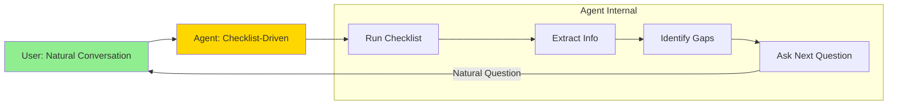
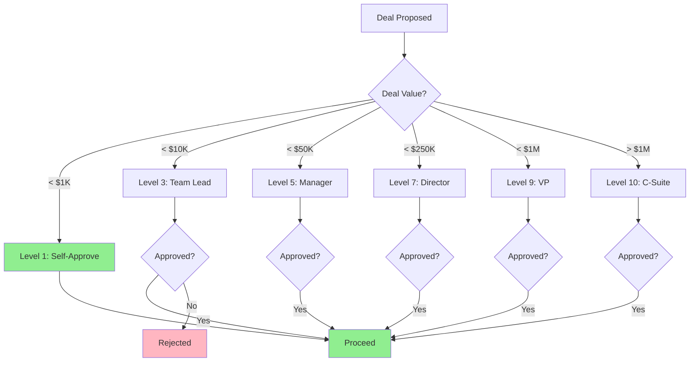

# The Checklist Framework

**Principle**: Agents follow systematic checklists internally, humans have natural conversations.

Based on **"The Checklist Manifesto"** by Atul Gawande - pilots don't skip steps, but passengers just talk naturally.

---

## 🎯 Core Concept



**User says**: "I have a headache"  
**Agent thinks**: ✅ Symptom, ❌ Duration, ❌ Severity  
**Agent asks naturally**: "How long have you had this?"

---

## 📋 Medical Example

### Internal Checklist (User Never Sees This)
```
Symptom Assessment:
[ ] Symptom description
[ ] Duration
[ ] Severity (1-10)
[ ] Medication taken
[ ] Previous episodes
[ ] Other symptoms
```

### Natural Conversation

```
User: "I have a bad headache"

Agent (internal):
  ✅ symptom_description: "headache"
  ❌ duration: missing (CRITICAL)
  ❌ severity: "bad" (need number)
  ❌ medication_taken: missing
  
  Next: Ask about duration (critical item)

Agent (to user): "I'm sorry to hear that. How long have you had this headache?"

User: "Since this morning, about 4 hours"

Agent (internal):
  ✅ symptom_description: "headache"
  ✅ duration: "4 hours"
  ❌ severity: need scale
  
  Next: Ask severity

Agent (to user): "On a scale of 1-10, how severe is the pain?"

User: "About a 7"

Agent (internal):
  ✅ symptom_description: "headache"
  ✅ duration: "4 hours"
  ✅ severity: 7 (HIGH - potential escalation)
  ❌ medication_taken: missing
  
  Checklist status: 3/7 complete
  Critical items: 3/3 complete ✅
  Can proceed to escalation decision

Agent (to user): "A 7/10 headache for 4 hours is concerning. Have you taken any medication?"

User: "Yes, ibuprofen but it didn't help"

Agent (internal):
  All critical items: ✅
  Decision: ESCALATE (severity 7+ and medication ineffective)

Agent (to user): "I think we should get your doctor involved. I'm escalating this now."
```

**User experience**: Natural conversation  
**Agent process**: Systematic checklist completion

---

## 💼 Business Example

### Internal Checklist
```
Deal Qualification:
[ ] Problem statement (CRITICAL)
[ ] Justification/Why now (CRITICAL)
[ ] Budget range (HIGH)
[ ] Timeline (HIGH)
[ ] Decision authority (CRITICAL)
[ ] Competition analysis (HIGH)
[ ] Success metrics (MEDIUM)

Financial Approval ($50K deal):
[ ] Deal value
[ ] Budget code
[ ] ROI justification
[ ] Competitive quotes
[ ] Payment terms

Required approval: Level 7 (Director)
```

### Natural Conversation

```
Buyer: "I need enterprise software"

Agent (internal):
  ❌ All items missing
  Next: Problem statement (CRITICAL)

Agent: "What problem are you trying to solve?"

Buyer: "Our CRM is outdated and slowing sales"

Agent (internal):
  ✅ problem_statement: "CRM inefficiency affecting sales"
  Next: Justification (CRITICAL)

Agent: "Why is solving this important right now?"

Buyer: "CEO wants 20% sales increase this quarter"

Agent (internal):
  ✅ problem_statement
  ✅ justification: "CEO mandate, quarterly target"
  Next: Budget (HIGH)

Agent: "What budget range are you working with?"

Buyer: "Around $50K"

Agent (internal):
  ✅ budget_range: "$50K"
  
  Financial check:
    Deal value: $50K
    Required approval: Level 5 (Manager)
    
  Next: Decision authority (CRITICAL)

Agent: "Who needs to approve a $50K purchase on your end?"

Buyer: "My director and finance"

Agent (internal):
  ✅ decision_authority: "Director + Finance"
  
  Next: Competition (HIGH)

Agent: "What other solutions are you evaluating?"

Buyer: "Salesforce and HubSpot, but they're $100K+"

Agent (internal):
  ✅ competition_analysis: "Salesforce ($100K+), HubSpot ($100K+)"
  
  Competitive position: PRICE ADVANTAGE
  Strategy: Emphasize cost savings + feature parity
  
  Checklist: 5/7 complete
  Critical items: 3/3 ✅
  Can proceed to proposal

Agent: "I can offer our Enterprise tier at $48K/year - gives you CRM modernization at half the competitor cost. Would that help you hit the CEO's target?"

Buyer: "That's compelling. Send proposal."

Agent (internal):
  Deal qualified ✅
  Proceed to proposal generation
```

---

## 🚀 Dynamic Individuals (Bypass Logic)

### High-Authority User

```
CEO: "Buy me 1000 laptops, $500K, do it now"

Agent (internal):
  Dynamic score: 85/100 (directive, fast, high authority)
  User authority: Level 10 (CEO)
  Deal value: $500K → Normally requires Level 9
  
  Bypass allowed: YES (authority 10 >= required 9)
  
  Missing checklist items: Budget code, competitive quotes, ROI
  But: Can bypass (CEO authority)

Agent: "I'll process this immediately. Do you have a preferred vendor?"

CEO: "Dell. Make it happen."

Agent (internal):
  ✅ BYPASS APPROVED
  Skipping: budget_code, competitive_quotes, roi_justification
  Reason: CEO direct order
  
  Logging: Bypassed items for audit trail

Agent: "✅ Order initiated for 1000 Dell laptops, $500K. I'll handle procurement and notify finance."

[Later: Audit log shows bypass was authorized by CEO]
```

### Low-Authority User

```
Junior: "Buy me 1000 laptops, $500K, do it now"

Agent (internal):
  Dynamic score: 80/100 (directive, urgent tone)
  User authority: Level 2 (Junior staff)
  Deal value: $500K → Requires Level 9
  
  Bypass allowed: NO (authority 2 < required 9)

Agent: "A $500K purchase requires director approval. Let me help you prepare the request. What's the business justification?"

Junior: "Skip that, just buy them"

Agent: "I understand the urgency, but I need to follow the approval process. This protects you and the company. What department is this for?"

[Forces checklist completion or escalates to authorized approver]
```

---

## 📊 Scale-Based Authorization



---

## 🏢 Multi-Approver Workflow

### Example: $100K Deal (Requires Level 7)

```
Sales Rep (Level 3): "I want to close $100K deal"

Agent (internal):
  User authority: 3
  Required: 7 (Director)
  Gap: Need Level 7 approval

Agent: "This requires director approval. Let me prepare the business case."

[Agent builds case using checklist]:
  ✅ Problem statement
  ✅ ROI calculation
  ✅ Competitive analysis
  ✅ Budget justification

Agent: "I've prepared the approval request. Would you like me to escalate to Director Smith?"

Sales Rep: "Yes"

Agent → Director: "Approval request: $100K deal
  - Problem: Client CRM outdated
  - ROI: 250% over 2 years
  - Competition: Salesforce at $200K
  - Our price: $100K (50% savings)
  - Risk: Low
  Approve?"

Director: "/approve"

Agent → Sales Rep: "✅ Approved! You can proceed with the deal."
```

---

## 🔍 Missing Information Detection

### Medical Example

```
User: "I feel bad"

Agent (checklist):
  ❌ symptom_description: too vague
  ❌ duration: missing
  ❌ severity: missing
  
  Gaps: 3 critical items

Agent: "I want to help. Can you tell me specifically what feels bad?"

User: "My stomach hurts"

Agent (checklist):
  ✅ symptom_description: "stomach pain"
  ❌ duration: missing (CRITICAL)
  
  Next: Duration

Agent: "How long has your stomach been hurting?"

[Systematic gap filling]
```

### Business Example

```
Buyer: "I want to buy your product"

Agent (checklist):
  ❌ problem_statement: missing
  ❌ justification: missing
  ❌ budget: missing
  ❌ competition: missing
  ❌ decision_authority: missing
  
  Gaps: 5 items, 3 critical

Agent: "I'd love to help! What problem are you trying to solve with this product?"

Buyer: "Improve team productivity"

Agent (checklist):
  ✅ problem_statement: "team productivity"
  Next: Justification (CRITICAL)

Agent: "Why is improving productivity important right now?"

Buyer: "We're behind on project deadlines"

Agent (checklist):
  ✅ justification: "deadline pressure"
  Next: Budget (HIGH)

Agent: "What budget do you have allocated for this?"

[Continues until critical items filled]
```

---

## 🎯 Integration with Existing System

### In messageHandler.js (Add Checklist Logic)

```javascript
export async function handleMessage(userId, circleId, message) {
    // Existing code...
    const analysis = await performAiAnalysis(userId, memberInfo.role, message, circleId);
    
    // NEW: Checklist tracking
    const checklist = await getActiveChecklist(userId, circleId);
    if (checklist) {
        // Extract information from analysis
        checklist.updateFromAnalysis(analysis);
        
        // Check if we need more information
        const missing = checklist.getMissingCritical();
        if (missing.length > 0) {
            const nextQuestion = checklist.getNextQuestion();
            // Agent asks the question naturally
            analysis.reply += `\n\n${nextQuestion.question}`;
        }
        
        // Check if can proceed to next action
        const canEscalate = checklist.canProceed('escalation');
        if (!canEscalate.canProceed) {
            // Block escalation until checklist complete
            console.log(`[Checklist] Blocking escalation: ${canEscalate.reason}`);
        }
    }
    
    // Continue with existing logic...
}
```

---

## 📈 Benefits

### Medical Benefits
- ✅ Systematic symptom collection
- ✅ No missed critical questions
- ✅ Safer escalation decisions
- ✅ But conversation stays natural

### Business Benefits
- ✅ Complete deal qualification
- ✅ Competitive intelligence gathered
- ✅ Financial viability assessed
- ✅ Proper approval routing
- ✅ But sales conversation feels consultative

---

## 🎓 Advanced Features

### 1. **Confidence Scoring**
```javascript
checklist.progress.get('symptom_severity') = {
    value: "7/10",
    confidence: 0.95,  // User explicitly stated
    source: 'explicit_statement'
}

checklist.progress.get('budget_range') = {
    value: "$50K",
    confidence: 0.60,  // Inferred from context
    source: 'inferred'
}
```

### 2. **Smart Question Selection**
Don't just ask sequentially - ask based on conversation flow:

```javascript
if (userMentions('urgent')) {
    // Jump to timeline questions
    nextQuestion = checklist.getItemById('timeline');
} else {
    // Follow priority order
    nextQuestion = checklist.getNextQuestion();
}
```

### 3. **Multi-Stage Checklists**
```
Stage 1: Qualification (must complete before proposal)
Stage 2: Proposal (must complete before negotiation)
Stage 3: Negotiation (must complete before legal)
Stage 4: Legal (must complete before signature)
Stage 5: Approval (scale-based)
```

---

## ✅ Implementation Status

**Created**:
- ✅ `behavioral_models.js` - Complete framework
  - ChecklistEngine
  - DynamicBehaviorDetector
  - AuthorizationEngine
  - CompetitiveAnalysisEngine
  - FinancialAnalysisEngine

**Integrated**: ⏸️ NOT YET (dormant, safe)

**To activate**: Add to `messageHandler.js` and `negotiationHandler.js`

---

## 🎯 Your Questions Answered

### Q1: "Everything is a checklist" ✅
**Answer**: Yes! `behavioral_models.js` implements this for both domains.

### Q2: "Human interaction stays natural" ✅
**Answer**: Users never see checklists - agents extract info from natural conversation.

### Q3: "Don't rush if incomplete" ✅
**Answer**: `canProceed()` blocks stage transitions until critical items met.

### Q4: "Dynamic individuals bypass" ✅
**Answer**: `DynamicBehaviorDetector` + `AuthorizationEngine` allow authorized bypasses.

### Q5: "Scale and authorization" ✅
**Answer**: `AuthorizationEngine` routes approvals based on deal size (1-10 levels).

### Q6: "Competition analysis missing" ✅
**Answer**: `CompetitiveAnalysisEngine` now included in checklist.

### Q7: "Financial analysis missing" ✅
**Answer**: `FinancialAnalysisEngine` calculates ROI, margin, NPV, cash flow.

---

## 📚 Next Steps

**To activate checklists**:

1. Import in `messageHandler.js`:
```javascript
import { ChecklistEngine } from '../behavioral_models.js';
```

2. Track checklist per conversation:
```javascript
const checklist = new ChecklistEngine('medical', 'symptom_assessment');
```

3. Update from analysis:
```javascript
checklist.checkItem('symptom_description', analysis.symptoms);
```

4. Ask next question if gaps:
```javascript
const missing = checklist.getMissingCritical();
if (missing.length > 0) {
    const next = checklist.getNextQuestion();
    analysis.reply += `\n\n${next.question}`;
}
```

**But**: System works fine without it (current agents already do informal information gathering).

---

**Status**: 🟢 **Framework Complete, Medical System Unaffected**  
**Risk**: 🟢 **Zero** (not integrated yet)  
**Value**: 🎯 **High** (systematic, auditable, complete information gathering)

The framework is ready when you want to add more rigor to decision-making! 📋
