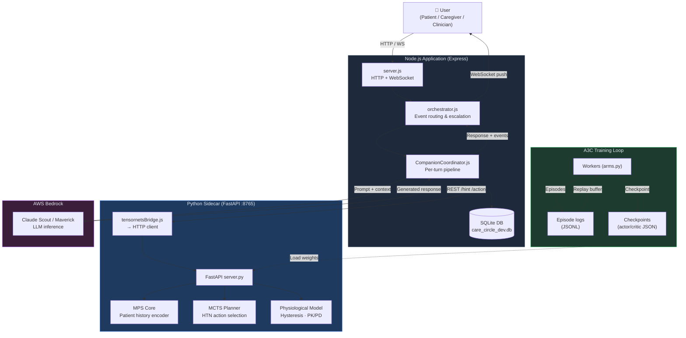

# Brainwasher 3 — Documentation Index

> **Entry point for the full documentation suite.**  
> Start here before reading any other document.  
> Last updated: 2026-06-04

---

## 1. System Overview

Brainwasher 3 is a multi-agent AI health companion system designed for chronic care and deaddiction contexts. The platform serves three classes of users — patients, caregivers, and clinicians — through a conversational interface backed by clinically-grounded AI reasoning. Each patient is paired with a named companion agent that maintains longitudinal context across sessions, tracks therapeutic progress through evidence-based frameworks (TTM, FRAMES, OARS), and escalates to human-in-the-loop (HITL) oversight whenever risk thresholds or ambiguity criteria are met. The Node.js backend orchestrates companion state, session routing, and real-time notifications, while a Python FastAPI sidecar provides the physiological intelligence layer.

The research contribution of Brainwasher 3 is the **Hysteretic Tensor Negotiation (HTN)** framework: a physiologically-constrained Monte Carlo Tree Search (MCTS) planner operating over a Matrix Product State (MPS) encoding of patient history. HTN is designed to make long-horizon therapeutic decisions that account for path-dependent hysteresis in patient physiology and behaviour — the insight being that a patient's current state cannot be fully described by a snapshot of biomarkers alone, but depends on the trajectory through which that state was reached. The MPS representation compresses this exponentially large history into a tractable tensor network, while a hysteresis operator Γ modulates the effective value of states based on prior exposure. This combination allows the MCTS planner to reason about intervention sequences whose future value is genuinely history-dependent, something standard Markov-assumption planners cannot do.

The system is simultaneously a clinical product and a PhD research platform. The production codebase — approximately 69,300 lines of JavaScript and 19,400 lines of Python — handles real patient interactions, while the `tensornets/` subsystem runs controlled three-arm A3C training experiments comparing baseline, physiologically-augmented, and full HTN-enhanced policy networks. Experimental runs are logged in structured JSONL episode files with full tensorboard integration. The documentation suite you are reading now covers both the production architecture and the research methodology in sufficient depth to support both clinical deployment decisions and academic peer review.

---

## 2. Reading Guide

| Document | What it covers | Read if you need to… |
|---|---|---|
| [`tensornets/00_architecture.md`](tensornets/00_architecture.md) | Full 4+1 architectural views, data flows, mathematical reference | Understand the complete system structure end-to-end |
| [`tensornets/01_overview.md`](tensornets/01_overview.md) | HTN research overview, motivation, key claims | Get a research-level summary of the HTN contribution |
| [`tensornets/02_tensornets_reference.md`](tensornets/02_tensornets_reference.md) | Python package API reference: classes, methods, type signatures | Implement or extend `tensornets` Python modules |
| [`tensornets/03_physiological_model.md`](tensornets/03_physiological_model.md) | Physiological model, hysteresis operators, PK/PD dynamics | Understand how patient biomarkers enter the state representation |
| [`tensornets/04_training_system.md`](tensornets/04_training_system.md) | A3C training loop, three-experiment comparison design, worker architecture | Set up or debug training runs; understand experiment arms |
| [`tensornets/05_benchmarking.md`](tensornets/05_benchmarking.md) | How to run benchmarks, metric definitions, dashboard usage | Execute benchmarks or interpret benchmark output |
| [`tensornets/06_results.md`](tensornets/06_results.md) | Experimental results from run_013; reward curves, convergence analysis | Review empirical evidence for HTN claims |
| [`tensornets/07_future_work.md`](tensornets/07_future_work.md) | Research roadmap, open problems, planned extensions | Plan next research phase or thesis chapter scope |
| [`tensornets/08_HTN_framework.md`](tensornets/08_HTN_framework.md) | PhD novelty claims, theoretical foundations, formal proofs | Write or review the thesis chapter on HTN |
| [`tensornets/09_MPS_core.md`](tensornets/09_MPS_core.md) *(pending)* | MPS encoding deep-dive, tensor contraction operators, bond dimension analysis | Implement or tune the MPS core |
| [`tensornets/10_MCTS.md`](tensornets/10_MCTS.md) *(pending)* | MCTS algorithm, UCB1 variant, hysteresis-aware rollout, worked example | Modify or extend the MCTS planner |
| [`tensornets/11_RL_environment.md`](tensornets/11_RL_environment.md) | POMDP-H environment specification, observation/action spaces, reward shaping | Reproduce the RL environment or port to another framework |
| [`tensornets/12_A3C_comparison.md`](tensornets/12_A3C_comparison.md) *(pending)* | Three-arm trial design: statistical methodology, arm definitions | Critically evaluate the experimental design |
| [`tensornets/13_A3C_MPS_integration.md`](tensornets/13_A3C_MPS_integration.md) *(pending)* | Full A3C + MPS integration design, gradient flow through tensor network | Extend the actor-critic with MPS-aware gradients |
| [`tensornets/14_multi_agent.md`](tensornets/14_multi_agent.md) *(pending)* | Multi-agent architecture: companion negotiation, shared world model | Build or scale the multi-companion layer |
| [`tensornets/15_evaluation.md`](tensornets/15_evaluation.md) *(pending)* | Evaluation framework: clinical metrics, ablation protocol, fairness analysis | Design or run formal evaluation studies |
| [`tensornets/16_experiments.md`](tensornets/16_experiments.md) *(pending)* | PhD experiment register: run log, hypotheses, outcomes, status | Track research progress and experiment provenance |
| [`tensornets/17_distillation.md`](tensornets/17_distillation.md) *(pending)* | Distillation track: compressing HTN policy into deployable model | Deploy a lightweight inference version |
| [`VARIABLE_GLOSSARY.md`](VARIABLE_GLOSSARY.md) | Symbol and variable reference for all mathematical notation used across docs | Look up the meaning of any symbol (Γ, V_int, H_eff, etc.) |
| [`uml_diagrams/`](uml_diagrams/) | All architecture diagrams — see [`DIAGRAMS.md`](DIAGRAMS.md) for the full index with image locations and paper figure assignments | Trace runtime interaction sequences visually; find the right image for a paper section |
| [`privacy_policy.md`](privacy_policy.md) | Data classification, consent policy, retention rules, HIPAA/GDPR mapping | Handle patient data or review compliance posture |
| [`vision_goals.md`](vision_goals.md) | Mission, strategic goals, and operationalised success metrics | Align feature development with product and research mission |

> **Pending documents** are planned but not yet written. Their filenames and scope are reserved; do not create files with these names without coordinating with the lead author.

---

## 3. 4+1 Architecture View Summary

The system documentation is organised around Kruchten's 4+1 View Model. Each view answers a different architectural question; together they give a complete picture of the system.

### Logical View — What are the subsystems and their responsibilities?

The logical view describes the major subsystems, their internal class structure, and the interfaces between them. Brainwasher 3 has three logical tiers: the **Node.js application layer** (server, orchestrator, companion coordinators, route handlers), the **Python intelligence layer** (FastAPI server, A3C workers, MPS core, MCTS planner, physiological model), and the **data layer** (SQLite via better-sqlite3, session stores, training episode logs).

- Primary reference: [`tensornets/00_architecture.md §2`](tensornets/00_architecture.md)
- API detail: [`tensornets/02_tensornets_reference.md`](tensornets/02_tensornets_reference.md)

### Process View — How do components interact at runtime?

The process view documents the runtime interaction flows: how an incoming patient message traverses the companion coordinator pipeline, how the tensornetsBridge makes a synchronous call to the FastAPI sidecar, how MCTS action selection feeds back into response generation, and how training workers consume episode data asynchronously.

- Primary reference: [`tensornets/00_architecture.md §3`](tensornets/00_architecture.md)
- Training process detail: [`tensornets/04_training_system.md`](tensornets/04_training_system.md)
- Sequence diagrams: [`uml_diagrams/`](uml_diagrams/)

### Development View — How is the codebase organised?

The development view covers module organisation, package boundaries, naming conventions, and build/test tooling. The JavaScript codebase is structured around domain-scoped route handlers, a companion abstraction layer, and a shared `db/` query module. The Python codebase uses a `tensornets` namespace package with sub-packages for `a3c`, `mps`, `mcts`, and `physio`.

- Primary reference: [`tensornets/00_architecture.md §4`](tensornets/00_architecture.md)
- JavaScript training pipeline: [`js/18_training_pipeline.md`](js/18_training_pipeline.md)
- JavaScript GUI: [`19_GUI.md`](19_GUI.md)
- Care circle orchestration engine: [`js/20_care_circle_orchestration.md`](js/20_care_circle_orchestration.md)

### Physical View — How is the system deployed?

The physical view documents the deployment topology: the Node.js process, the co-located Python FastAPI sidecar (port 8765), the SQLite database file, and the external AWS Bedrock endpoint (Claude Scout/Maverick). In production the Node and Python processes run on the same host; the API boundary between them is a localhost HTTP socket, not a network call.

- Primary reference: [`tensornets/00_architecture.md §5`](tensornets/00_architecture.md)

### +1 Scenarios — What are the key use cases?

The scenario view provides concrete end-to-end stories that exercise multiple architectural views simultaneously. Scenarios include: patient sends a high-risk message → MCTS selects a de-escalation action → HITL alert is raised; caregiver logs a relapse event → physiological model updates hysteresis state → companion adjusts intervention trajectory.

- Primary reference: [`tensornets/00_architecture.md §1`](tensornets/00_architecture.md)
- Research scenarios: [`tensornets/16_experiments.md`](tensornets/16_experiments.md) *(pending)*

---

## 4. Two-Coordinator Architecture

> **Important:** The system uses two distinct coordinator layers. Confusing them is the single most common source of architecture misreads. Read this section carefully before modifying either file.

```
┌─────────────────────────────────────────────────────────────────────┐
│  orchestrator.js  —  INTER-companion / system level                 │
│                                                                     │
│  • Central EventEmitter (exported as `events`)                      │
│  • Listens for `future_plan_executed` → dispatches escalations      │
│    and broadcasts to connected clients                              │
│  • Re-exports handleLogin, handleCommand, handleMessage,            │
│    routeMessage for server.js                                       │
│  • Does NOT perform AI analysis or conversation decisions           │
│  • Scope: routing, escalation, cross-companion coordination         │
└─────────────────────────────────────────────────────────────────────┘

┌─────────────────────────────────────────────────────────────────────┐
│  companions/CompanionCoordinator.js  —  INTRA-companion / per-req   │
│                                                                     │
│  • Per-turn brain: handler fan-out, MCTS action selection,          │
│    response generation                                              │
│  • Pipeline steps:                                                  │
│      loadSession → peekInterventionQueue → handlers                 │
│        → tensornetsBridge → action select → optimiser → response   │
│  • Calls tensornetsBridge.js (Python FastAPI :8765) for             │
│    physiological hint and MCTS guidance                             │
│  • Scope: single companion, single conversation turn                │
└─────────────────────────────────────────────────────────────────────┘
```

**Rule of thumb:** if a concern spans more than one companion, it belongs in `orchestrator.js`. If it is scoped to a single turn of a single companion, it belongs in `CompanionCoordinator.js`. The bridge between them is the `events` EventEmitter: `CompanionCoordinator` emits domain events; `orchestrator` listens and fans out system-level consequences.

---

## 5. System Architecture Diagram



---

## 6. Codebase Scale

| Layer | Substantive lines | Files |
|---|---|---|
| JavaScript (Node.js application) | ~69,300 | 403 |
| Python (tensornets + FastAPI) | ~19,400 | 70 |
| Documentation (active suite) | 48+ files | — |
| Documentation (design specs in `docs/`) | 7 files | — |

The JavaScript codebase is the production surface; the Python codebase is the research surface. Both are active and co-evolve. Do not treat `tensornets/` as a throwaway research prototype — it is called synchronously in the production request path via `tensornetsBridge.js`.

---

## 7. Key Acronyms

| Acronym | Expansion | Where defined |
|---|---|---|
| **HTN** | Hysteretic Tensor Negotiation | [`tensornets/08_HTN_framework.md`](tensornets/08_HTN_framework.md), [`tensornets/01_overview.md`](tensornets/01_overview.md) |
| **MPS** | Matrix Product State | [`tensornets/09_MPS_core.md`](tensornets/09_MPS_core.md) *(pending)*, [`VARIABLE_GLOSSARY.md`](VARIABLE_GLOSSARY.md) |
| **MCTS** | Monte Carlo Tree Search | [`tensornets/10_MCTS.md`](tensornets/10_MCTS.md) *(pending)* |
| **A3C** | Asynchronous Advantage Actor-Critic | [`tensornets/04_training_system.md`](tensornets/04_training_system.md) |
| **POMDP-H** | Partially Observable Markov Decision Process with Hysteresis | [`tensornets/11_RL_environment.md`](tensornets/11_RL_environment.md) |
| **OU** | Ornstein-Uhlenbeck (noise process used in exploration) | [`VARIABLE_GLOSSARY.md`](VARIABLE_GLOSSARY.md) |
| **UCB1** | Upper Confidence Bound (MCTS node selection criterion) | [`tensornets/10_MCTS.md`](tensornets/10_MCTS.md) *(pending)* |
| **V_int** | Intrinsic value (curiosity-weighted value estimate) | [`VARIABLE_GLOSSARY.md`](VARIABLE_GLOSSARY.md) |
| **Γ** | Hysteresis operator (modulates state value by trajectory) | [`tensornets/03_physiological_model.md`](tensornets/03_physiological_model.md), [`VARIABLE_GLOSSARY.md`](VARIABLE_GLOSSARY.md) |
| **H_eff** | Effective entropy (information-theoretic uncertainty in patient state) | [`VARIABLE_GLOSSARY.md`](VARIABLE_GLOSSARY.md) |
| **RMSSD** | Root Mean Square of Successive Differences (HRV metric) | [`tensornets/03_physiological_model.md`](tensornets/03_physiological_model.md) |
| **EDA** | Electrodermal Activity (galvanic skin response biomarker) | [`tensornets/03_physiological_model.md`](tensornets/03_physiological_model.md) |
| **TTM** | Transtheoretical Model of behaviour change | [`tensornets/01_overview.md`](tensornets/01_overview.md) |
| **FRAMES** | Feedback, Responsibility, Advice, Menu, Empathy, Self-efficacy | Clinical framework referenced throughout companion logic |
| **OARS** | Open questions, Affirmations, Reflections, Summaries (motivational interviewing) | Clinical framework referenced throughout companion logic |
| **HITL** | Human-in-the-Loop | Escalation architecture in `orchestrator.js` |
| **PK/PD** | Pharmacokinetics / Pharmacodynamics | [`tensornets/03_physiological_model.md`](tensornets/03_physiological_model.md) |

---

## 8. Deprecated Files

Superseded documents are archived in **`documentation/deprecated/`** (see its [`README.md`](deprecated/README.md) for the full policy). They are retained for historical traceability only — **do not use them as authoritative references for the current architecture.**

| File | Reason archived | Superseded by |
|---|---|---|
| [`deprecated/architecture.md`](deprecated/architecture.md) | Pre-companions design; Gemini monolith, old rl/ paths | [`tensornets/00_architecture.md`](tensornets/00_architecture.md) |
| [`deprecated/reinforcement_learning_framework.md`](deprecated/reinforcement_learning_framework.md) | Pre-MPS RL design using Gemini/GPT judge | [`tensornets/04_training_system.md`](tensornets/04_training_system.md), [`tensornets/11_RL_environment.md`](tensornets/11_RL_environment.md) |
| [`deprecated/advancedRL.md`](deprecated/advancedRL.md) | Speculative §5 fragment; Gemini "small RL model" replaced by A3C | [`tensornets/08_HTN_framework.md`](tensornets/08_HTN_framework.md) |
| [`deprecated/llama4_integration.md`](deprecated/llama4_integration.md) | Wrong project (EMM SageMaker); Brainwasher 3 uses AWS Bedrock | [`tensornets/02_tensornets_reference.md`](tensornets/02_tensornets_reference.md) |
| [`deprecated/training_GETTING_STARTED.md`](deprecated/training_GETTING_STARTED.md) | 2024 Gantt-phase CLI guide; pipeline superseded | [`training/18_training_pipeline.md`](training/18_training_pipeline.md) |

> **Deprecation procedure:** add a `> ⚠️ DEPRECATED` callout → move file to `documentation/deprecated/` → update this table → update any inbound links. See [`deprecated/README.md`](deprecated/README.md) for the full protocol.

---

## 9. Diagram Index

A complete index of all diagrams — source files, exported images, scale, and suggested PDF figure assignments — is maintained in [`DIAGRAMS.md`](DIAGRAMS.md).

There are two diagram sets:

- **`uml_diagrams/`** — 16 large system diagrams covering deployment, interaction sequences (v1 original vs. v2 real modules), environment/training views, and care circle topology.
- **`uml_diagrams/htn_architecture/`** — 11 focused small-scale diagrams (one idea per file) at system-context, deployment, DFD, component, and algorithm levels. Designed for embedding in individual paper sections.

Exported PNG images live in `figures/uml/` and `figures/uml/htn_architecture/`. Re-export all with:

```bash
python scripts/export_mermaid.py
```

---

## 11. FastAPI Sidecar — Startup and Bridge Contract

The Python intelligence layer is a separate OS process managed independently of the Node.js application. It must be running before any companion turn that requires MCTS guidance. The bridge call is **synchronous from Node's perspective** (awaited inside `CompanionCoordinator`), so a cold or crashed sidecar will stall the response pipeline.

**Startup:**
```bash
# From the tensornets/ directory
uvicorn tensornets.server:app --host 127.0.0.1 --port 8765 --reload
```

**Key endpoints consumed by `tensornetsBridge.js`:**

| Endpoint | Method | Purpose |
|---|---|---|
| `/hint` | POST | Returns a physiological state vector and hysteresis score for the current patient |
| `/action` | POST | Runs MCTS and returns the recommended therapeutic action |
| `/checkpoint` | GET | Returns current actor/critic checkpoint metadata |
| `/health` | GET | Liveness probe; returns `{"status": "ok"}` |

The request/response schemas for `/hint` and `/action` are the primary interface contract between the two layers. Any change to these schemas requires coordinated updates in both `tensornetsBridge.js` (Node) and `tensornets/server.py` (Python). See [`tensornets/02_tensornets_reference.md`](tensornets/02_tensornets_reference.md) for full schema definitions.

---

## 12. Document Status Legend

| Badge | Meaning |
|---|---|
| *(no badge)* | Document exists and is current |
| *(pending)* | Filename and scope reserved; document not yet written |
| *(deprecated)* | Document exists but should not be used for current architecture |
| *(draft)* | Document exists but is incomplete or under active revision |

---

## 10. Contributing to This Documentation Suite

All documentation lives in `documentation/` (this folder). The `tensornets/` subdirectory contains the research-layer documents; top-level files cover product, policy, and vision.

**When adding a new document:**
1. Choose the next available index number in the `tensornets/` sequence, or a descriptive name for top-level docs.
2. Remove the *(pending)* marker from the entry in this INDEX.md.
3. Add an entry to [`VARIABLE_GLOSSARY.md`](VARIABLE_GLOSSARY.md) for any new symbols introduced.
4. Cross-reference the new document from the most relevant existing documents.

**When deprecating a document:**
1. Add a `> ⚠️ **DEPRECATED**` callout at the top of the file with the reason and the replacement document.
2. Move the file to `documentation/deprecated/`.
3. Add a row to the deprecated-files table in §8 of this INDEX.md (use the new `deprecated/` path).
4. Update any inbound links in other documents to point to the replacement.
5. Do not hard-delete deprecated documents — they contain research history.

**House style:**
- Use `##` for top-level sections, `###` for subsections.
- All mathematical notation must be defined in [`VARIABLE_GLOSSARY.md`](VARIABLE_GLOSSARY.md) before use.
- Mermaid diagrams are preferred over raster images for architecture figures.
- Code blocks use triple backticks with a language tag.

---

*This index is maintained by the lead author. If you find a broken link, a missing pending document, or an outdated description, update this file at the same time as the document it references.*
