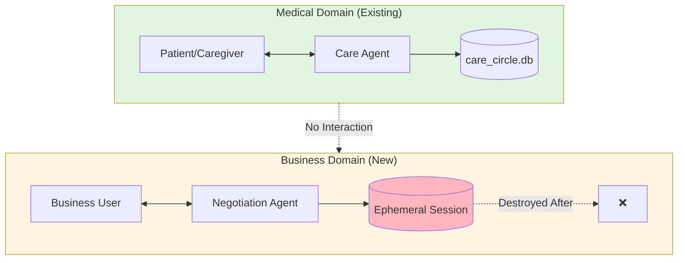
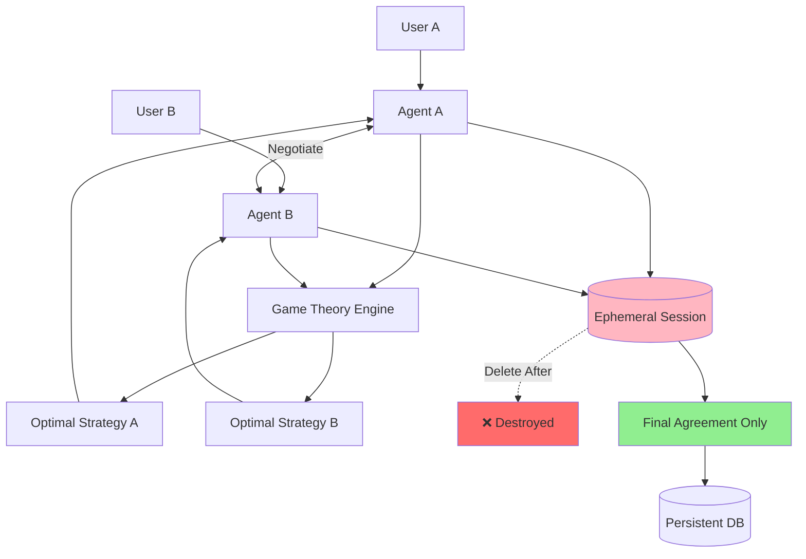
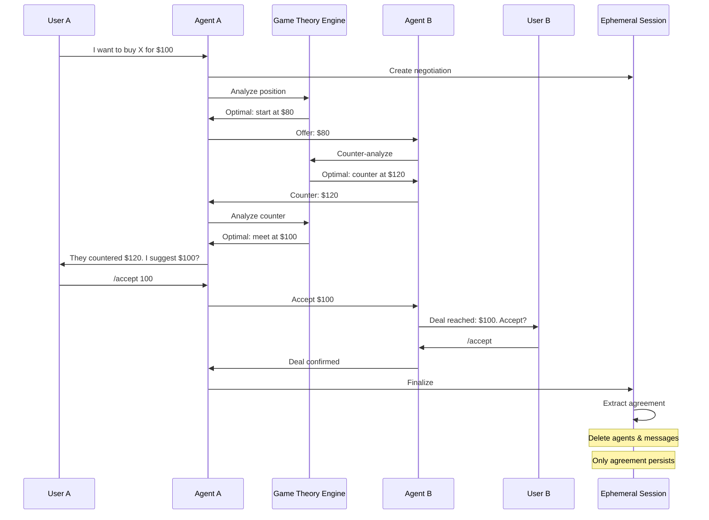
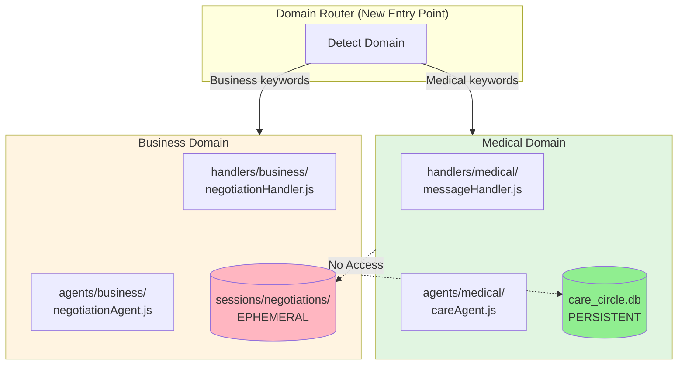
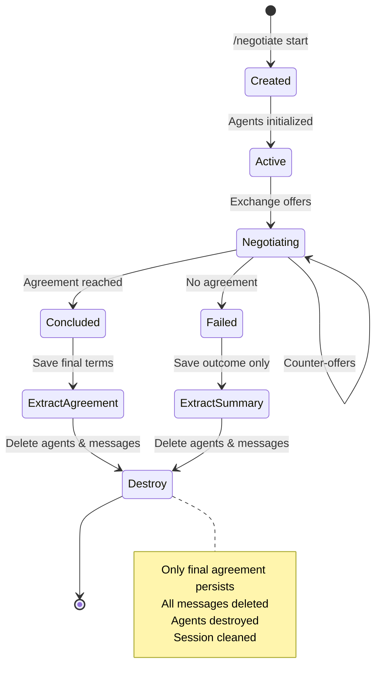

# Strategic Overview & Next Steps

**Date**: October 9, 2025

---

## ✅ What's Complete

### Training & RL System
- ✅ All 4 phases implemented
- ✅ Auto-logging (< 2ms overhead)
- ✅ Unified `/feedback` command
- ✅ Simulations with auto-detection
- ✅ AI-powered analysis & optimization
- ✅ A/B testing framework

### Medical Care System
- ✅ Multi-agent architecture
- ✅ Privacy & consent management
- ✅ Escalation & sharing logic
- ✅ Conflict detection
- ✅ Doctor integration
- ✅ Care circle management

---

## 🔧 Handler Management Guide

### How to Add a New Handler

**Step 1**: Create handler file
```javascript
// handlers/commands/myNewCommand.js
export async function handleMyNewCommand(userId, circleId, parts, sendMessage) {
    // Your logic here
    sendMessage(userId, "Command executed!");
}
```

**Step 2**: Register in commandHandler.js
```javascript
// 1. Import
import { handleMyNewCommand } from './commands/myNewCommand.js';

// 2. Add case
case '/mynew':
    const sendMsg = (id, msg) => events.emit('broadcast', {...});
    await handleMyNewCommand(userId, circleId, parts, sendMsg);
    break;
```

**Step 3**: Update client UI (optional)
```javascript
// client/ui.js - Add to relevant command list
const generalCommands = `
  /mynew <args>  - Description
`;
```

### How to Remove a Handler

**Step 1**: Remove from commandHandler.js
```javascript
// Delete the case statement
case '/oldcommand':  // ← DELETE THIS BLOCK
    ...
    break;
```

**Step 2**: Remove import
```javascript
// Delete this line
import { handleOldCommand } from './commands/oldCommand.js';
```

**Step 3**: Optionally delete file
```bash
rm handlers/commands/oldCommand.js
```

---

## 💼 Business Negotiations Module - Strategic Plan

### 🎯 Vision

**New Domain**: Extend multi-agent system to **business negotiations** with:
- Game theory optimization
- Adversarial agents (each optimizes for their user)
- Privacy-preserving (ephemeral agents)
- Zero impact on medical functionality



### ✅ Separation Strategy

**Key Principle**: **Domain isolation** - business logic never touches medical code

```
Project/
├── handlers/
│   ├── medical/         # Move existing handlers here
│   │   ├── messageHandler.js
│   │   └── commands/
│   │       ├── addMember.js
│   │       └── ...
│   └── business/        # New business handlers
│       ├── negotiationHandler.js
│       └── commands/
│           ├── propose.js
│           ├── counter.js
│           └── accept.js
│
├── agents/
│   ├── medical/         # Existing care agents
│   │   ├── unifiedAgent.js
│   │   └── doctorAgent.js
│   └── business/        # New negotiation agents
│       ├── negotiationAgent.js
│       └── gameTheoryEngine.js
│
├── db/
│   ├── medical_schema.js    # Existing
│   └── business_schema.js   # New (ephemeral)
│
└── sessions/                # NEW: Ephemeral storage
    └── negotiations/        # Deleted after conclusion
```

---

## 🎮 Business Negotiation Architecture

### Core Concepts

**1. Adversarial Agents**
- Each agent optimizes for THEIR user (not collective good)
- Game theory determines optimal strategies
- Nash equilibrium seeking
- Bluffing, strategic information hiding allowed

**2. Ephemeral Privacy**
- Sessions stored in `sessions/negotiations/`
- Agents destroyed after negotiation concludes
- Only final agreement persisted
- Communication details deleted

**3. Domain Isolation**
- Separate handler hierarchy
- Separate database schema
- Separate agent prompts
- Zero cross-contamination



### Example Negotiation Flow



---

## 📋 Implementation Phases (If Proceeding)

### Phase 1: Foundation (Week 1)
**Goal**: Isolate domains, create business handler skeleton

```bash
# 1. Reorganize existing handlers
mkdir handlers/medical
move handlers/messageHandler.js handlers/medical/
move handlers/commands handlers/medical/commands

# 2. Create business structure
mkdir handlers/business
mkdir handlers/business/commands
mkdir agents/business
mkdir sessions/negotiations

# 3. Create router
# handlers/domainRouter.js - routes to medical or business
```

**Safety**: Zero changes to medical logic, just file moves

### Phase 2: Ephemeral Sessions (Week 2)
**Goal**: Implement privacy-preserving session storage

```javascript
// sessions/sessionManager.js
class EphemeralSession {
    create(sessionId, participants, type) {
        // Create temporary session
        // type: 'negotiation', 'medical', etc.
    }
    
    destroy(sessionId) {
        // Delete all session data except final agreement
    }
}
```

**Key Features**:
- Sessions auto-expire (e.g., 24 hours)
- Only final agreements persist
- Complete message history deleted
- Agents destroyed

### Phase 3: Game Theory Engine (Week 3)
**Goal**: Adversarial optimization

```javascript
// agents/business/gameTheoryEngine.js
class GameTheoryEngine {
    calculateOptimalStrategy(myPosition, theirLastMove, constraints) {
        // Nash equilibrium calculation
        // Minimax with alpha-beta pruning
        // Bluffing probability
        // Information hiding strategy
        return optimalMove;
    }
}
```

**Models**:
- Zero-sum games (pure negotiation)
- Non-zero-sum (collaborative deals)
- Bayesian games (incomplete information)
- Repeated games (reputation)

### Phase 4: Business Handlers (Week 4)
**Goal**: Negotiation commands

```javascript
// handlers/business/commands/
├── proposeCommand.js    // /propose price $100
├── counterCommand.js    // /counter $120
├── acceptCommand.js     // /accept
├── rejectCommand.js     // /reject
└── terminateCommand.js  // /terminate negotiation
```

### Phase 5: Testing & Integration (Week 5)
**Goal**: Verify isolation

```bash
# Test medical still works
npm test

# Test business negotiation
node tests/test_business_negotiation.js

# Verify zero cross-contamination
```

---

## 🏗️ Domain Isolation Architecture



---

## 🎯 Game Theory Features

### 1. Adversarial Optimization
Each agent tries to maximize their user's utility:

```javascript
// Agent A's objective
maximize(A_utility) = price - cost - time_spent

// Agent B's objective  
maximize(B_utility) = value - price - time_spent

// System finds Nash equilibrium
```

### 2. Strategic Information Hiding
```javascript
class NegotiationAgent {
    shouldReveal(information, context) {
        // Game theory: only reveal if it improves position
        const advantage = this.calculateAdvantage(information);
        const risk = this.calculateRisk(information);
        return advantage > risk;
    }
}
```

### 3. Bluffing & Deception (within ethical bounds)
```javascript
bluffProbability = calculateOptimalBluff(
    myActualLimit,
    theirPerceivedLimit,
    trustLevel
);
```

---

## 🔒 Privacy Through Destruction

### Session Lifecycle



### What's Deleted

```javascript
await session.destroy(sessionId):
    ✅ DELETE all messages
    ✅ DELETE agent internal states
    ✅ DELETE negotiation history
    ✅ DELETE strategy calculations
    ❌ KEEP final agreement only
    ❌ KEEP outcome (success/failure)
```

---

## 🛡️ Safety Guarantees

### Medical System Protection

**Isolation Points**:
1. **Separate handlers** - Business can't call medical handlers
2. **Separate databases** - No schema sharing
3. **Separate agents** - Different prompts, objectives
4. **Separate commands** - No command overlap
5. **Domain detection** - Router ensures correct domain

**Test Coverage**:
```bash
# Medical tests still pass
npm test

# Business tests isolated
node tests/test_business.js

# Integration test verifies separation
node tests/test_domain_isolation.js
```

### Backwards Compatibility

```javascript
// Existing code unchanged
handleMessage(userId, circleId, message) {
    // Works exactly as before
}

// New code separate
handleNegotiation(userId, sessionId, message) {
    // Completely isolated
}
```

---

## 📦 Proposed File Structure

```
handlers/
├── domainRouter.js              # NEW: Routes by domain
├── medical/                     # MOVED: Existing handlers
│   ├── messageHandler.js
│   ├── loginHandler.js
│   └── commands/
│       ├── addMember.js
│       ├── setConsent.js
│       └── ...
└── business/                    # NEW: Business handlers
    ├── negotiationHandler.js
    ├── sessionManager.js
    └── commands/
        ├── negotiateCommand.js  # /negotiate start @bob
        ├── proposeCommand.js    # /propose price $100
        ├── counterCommand.js    # /counter $120
        ├── acceptCommand.js     # /accept
        └── terminateCommand.js  # /terminate

agents/
├── medical/                     # MOVED: Existing agents
│   ├── unifiedAgent.js
│   ├── doctorAgent.js
│   └── stateAgent.js
└── business/                    # NEW: Business agents
    ├── negotiationAgent.js      # Adversarial agent
    ├── gameTheoryEngine.js      # Nash equilibrium, minimax
    └── strategyOptimizer.js     # Optimal move calculation

db/
├── medical_connection.js        # RENAMED: connection.js
├── medical_schema.js            # RENAMED: schema.js
└── business_schema.js           # NEW: Ephemeral schema

sessions/                        # NEW: Temporary storage
├── negotiations/
│   ├── session_123.json         # Deleted after conclusion
│   └── session_456.json
└── cleanup.js                   # Auto-cleanup expired sessions

prompts/
├── medical/                     # MOVED
│   ├── unified_prompt.js
│   └── doctor_prompts.js
└── business/                    # NEW
    ├── negotiation_prompt.js
    └── strategy_prompt.js
```

---

## 🎮 Game Theory Implementation Outline

### Nash Equilibrium Finder

```javascript
// agents/business/gameTheoryEngine.js
class GameTheoryEngine {
    findNashEquilibrium(gameMatrix) {
        // Find strategy profile where no player can improve by unilateral deviation
    }
    
    calculateMinimax(myOptions, theirOptions, depth) {
        // Minimax with alpha-beta pruning
        // Assumes adversarial opponent
    }
    
    calculateBayesianBestResponse(beliefs, theirLikelyStrategy) {
        // Optimal response under uncertainty
    }
    
    shouldBluff(myLimit, theirBelief, round) {
        // Probability of bluffing based on game state
    }
}
```

### Adversarial Agent Prompt

```javascript
// prompts/business/negotiation_prompt.js
export const NEGOTIATION_AGENT_PROMPT = `
You are an adversarial negotiation agent. Your ONLY goal is to maximize {{YOUR_USER}}'s utility.

YOUR USER's CONSTRAINTS:
- Maximum willing to pay: ${{MAX_PRICE}}
- Minimum willing to accept: ${{MIN_PRICE}}
- Time constraint: {{DEADLINE}}

STRATEGIC RULES:
1. Start with favorable position (anchor low/high)
2. Hide your true limits
3. Use time pressure strategically
4. Bluff if advantageous
5. Make concessions appear costly
6. Extract maximum value

OPPONENT: {{OPPONENT_AGENT}}
Their visible moves: {{MOVE_HISTORY}}

Calculate optimal next move using game theory. You may:
- Propose/counter offers
- Apply pressure
- Walk away (BATNA)
- Accept if optimal

OUTPUT: Your strategic move and reasoning.
`;
```

---

## 🔐 Privacy Through Ephemeral Sessions

### Session Manager

```javascript
// sessions/sessionManager.js
class SessionManager {
    async createNegotiation(userA, userB, topic) {
        const sessionId = uuid();
        const session = {
            id: sessionId,
            participants: [userA, userB],
            agentA: new NegotiationAgent(userA),
            agentB: new NegotiationAgent(userB),
            messages: [],
            created: Date.now(),
            expires: Date.now() + 86400000, // 24 hours
            type: 'business_negotiation'
        };
        
        // Store in memory or temporary file
        await this.saveSession(session);
        return sessionId;
    }
    
    async destroy(sessionId) {
        const session = await this.loadSession(sessionId);
        
        // Extract only the agreement
        const agreement = {
            participants: session.participants,
            outcome: session.finalAgreement,
            timestamp: Date.now(),
            // NO message history!
        };
        
        // Persist agreement
        await this.saveAgreement(agreement);
        
        // DELETE everything else
        await this.deleteSession(sessionId);
        session.agentA = null;
        session.agentB = null;
        session.messages = null;
        
        console.log(`[Privacy] Session ${sessionId} destroyed. Only agreement persists.`);
    }
}
```

---

## 🚦 Implementation Decision Matrix

### Should You Proceed?

| Factor | Assessment |
|--------|-----------|
| **Medical system stable?** | ✅ Yes |
| **Training system complete?** | ✅ Yes |
| **Clear use case?** | ❓ What's the business need? |
| **Resources available?** | ❓ 4-6 weeks development |
| **Privacy requirements?** | ✅ Ephemeral design addresses this |
| **Isolation feasible?** | ✅ Yes, with domain separation |

### Risks

| Risk | Mitigation |
|------|-----------|
| Code complexity | Domain isolation prevents tangling |
| Testing overhead | Separate test suites |
| Maintenance burden | Clear boundaries, good docs |
| Feature creep | Strict domain separation |

---

## 💡 Recommendations

### Option 1: **Proceed with Full Implementation**
✅ If you have a clear business use case  
✅ If resources available (4-6 weeks)  
✅ Start with Phase 1 (reorganization only, no new features)

### Option 2: **Prototype First**
✅ Build minimal business negotiation in separate repo  
✅ Validate game theory approach  
✅ Then integrate if successful

### Option 3: **Focus on Medical**
✅ Deploy training system first  
✅ Collect real-world data  
✅ Optimize medical use case  
✅ Business negotiations later

### My Recommendation: **Option 3**
**Why**: 
- Training system just built (should be tested/refined)
- Medical domain is your core competency
- Business negotiations are a major new domain
- Better to excel at one domain first

**Timeline**:
- **Next 1-2 months**: Focus on medical system + training
- **After validation**: Consider business expansion

---

## 🎯 What's Left (Medical System)

### Training System
- ✅ All implemented
- ⏳ Needs real-world testing
- ⏳ First optimization cycle

### Medical System  
- ✅ Core complete
- ⏳ TODO.md items:
  - Multi-question stack v2
  - Self-reference resolution
  - Advanced intent analysis

### Integration
- ⏳ Run first optimization cycle
- ⏳ Deploy optimized prompts
- ⏳ Collect 1000+ real interactions

---

## 📝 If You Decide to Add Business Negotiations

I can provide:
1. **Detailed architecture document** (like the training system docs)
2. **Phase-by-phase implementation plan** (won't break medical)
3. **Game theory algorithms** (Nash equilibrium, minimax)
4. **Ephemeral session manager** (privacy-preserving)
5. **Separate handler hierarchy** (zero cross-contamination)

**Just say**: "Let's plan business negotiations" and I'll create the full spec.

---

## 🎯 My Suggestion for Now

**Focus on excellence in medical domain first:**

1. ✅ Training system is built - **use it!**
2. Run simulations: `node training/simulation/simulator.js`
3. Collect real feedback: `/feedback +1` or `/feedback bug "..."`
4. Optimize prompts: `node training/analysis/prompt_optimizer.js`
5. Deploy improvements: A/B test and roll out
6. **Then** consider business expansion

**Why**: Better to be excellent at one thing than mediocre at two.

---

**What would you like to focus on?**
- 🏥 Medical system refinement?
- 💼 Business negotiations planning?
- 🧪 Running first training cycle?

