# Chain of Thought & Agentic Framework Architecture

This document provides a comprehensive overview of the multi-agent system's chain of thought process and agentic framework, focusing on the present implementation and clear agent responsibilities.

## 1. System Overview

The multi-agent healthcare system uses a sophisticated chain of thought approach where multiple specialized agents collaborate to process user messages, make decisions, and coordinate actions. Each agent has distinct responsibilities and operates within a well-defined framework.

### 1.1 Component Definitions

Before diving into the architecture, it's crucial to understand the different types of components in our system:

**Agents** 🤖
- **Purpose**: AI-powered conversational entities that interact with users
- **Examples**: PersonalAgent, CareAgent, DoctorAgent
- **Function**: Generate natural language responses, build rapport, elicit information
- **Location**: `agents/` directory

**Handlers** ⚙️
- **Purpose**: Business logic modules that process specific types of requests
- **Examples**: SharingHandler, ConflictHandler, ActionExecutor
- **Function**: Execute rules, make decisions, coordinate actions
- **Location**: `handlers/` directory

**Prompts** 📝
- **Purpose**: Templates that guide AI agent behavior and responses
- **Examples**: unified_prompt.js, doctor_prompts.js
- **Function**: Define conversation style, safety rules, response patterns
- **Location**: `prompts/` directory

**Modules** 📦
- **Purpose**: Reusable code components that provide specific functionality
- **Examples**: Database queries, utility functions, state management
- **Function**: Data access, calculations, state tracking
- **Location**: Various directories (`db/`, `utils/`, etc.)

**Key Distinction**: Agents are the "personalities" that talk to users, Handlers are the "brains" that make decisions, Prompts are the "instructions" that guide agent behavior, and Modules are the "tools" that provide functionality.

## 2. Agent Architecture

### 2.1 Agent Types & Responsibilities

#### PersonalAgent
- **Purpose**: Serves as the primary conversational interface for the patient
- **Context**: Active when the user is the primary patient in their own care circle
- **Responsibilities**:
  - Builds trust and rapport with the patient
  - Elicits health information and concerns
  - Provides empathetic responses
  - Facilitates self-reporting of symptoms and behaviors

#### CareAgent
- **Purpose**: Serves as the conversational interface for caregivers and family members
- **Context**: Active when the user is in someone else's care circle (as a caregiver)
- **Responsibilities**:
  - Provides context-aware responses about the patient's health
  - Facilitates caregiver-patient communication
  - Offers support and guidance to caregivers
  - Mediates sensitive conversations

#### DoctorAgent
- **Purpose**: Specialized agent for medical professionals
- **Context**: Active when a doctor is interacting with the system
- **Responsibilities**:
  - Provides clinical context and medical insights
  - Handles escalation management
  - Facilitates doctor-patient communication
  - Manages medical decision-making processes

### 2.2 Agent Identity Management

The system dynamically determines which agent to use based on the user's context:

```javascript
// Agent Identity Logic
async function getAgentName(userId, circleId) {
    const currentCircle = await findCircleByPatientId(circleId);
    return userId === currentCircle.primary_patient_id ? 'PersonalAgent' : 'CareAgent';
}
```

## 3. Chain of Thought Process

### 3.1 Message Processing Flow

This diagram shows the complete chain of thought process from when a user sends a message to when they receive a response. Each color represents a different type of component:

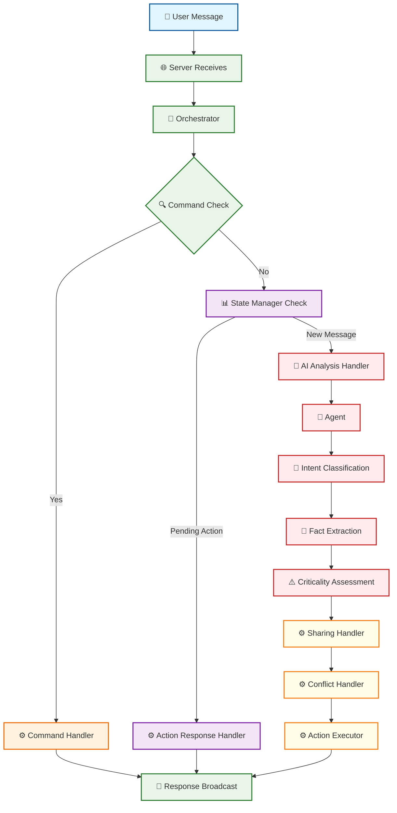

**Legend:**
- 🔵 **User Input**: Messages from users
- 🟢 **Orchestration**: Core workflow management
- 🟠 **Command Processing**: Direct user commands
- 🟣 **State Management**: Conversation state tracking
- 🔴 **AI Processing**: LLM analysis and decision making
- 🟡 **Business Logic**: Specialized handlers for different scenarios
- 🟢 **Output**: Response delivery to users

### 3.2 AI Analysis Chain

This diagram details the AI processing steps that occur within the "AI Analysis Handler" box from the main flow diagram above. It shows how the Unified Agent processes messages through multiple analysis stages:

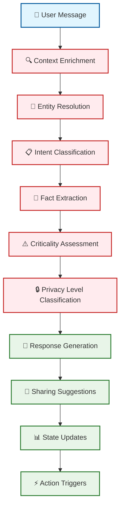

**This section explains the AI Analysis Chain** (referring to the red boxes in the main diagram):

- **Context Enrichment**: Gathers user history, care circle context, and behavioral models
- **Entity Resolution**: Identifies people, places, and medical terms mentioned
- **Intent Classification**: Determines what the user wants (question, statement, command)
- **Fact Extraction**: Pulls out factual information about health, behavior, or events
- **Criticality Assessment**: Evaluates urgency (LOW, MEDIUM, HIGH)
- **Privacy Level Classification**: Determines sensitivity (PUBLIC, PRIVATE, SENSITIVE)
- **Response Generation**: Creates the agent's conversational reply
- **Sharing Suggestions**: Identifies information that should be shared with others
- **State Updates**: Modifies user's behavioral state and preferences
- **Action Triggers**: Initiates specific system actions (escalation, consent requests)

## 4. Specialized Handlers

**This section explains the Business Logic components** (referring to the yellow boxes in the main diagram). These handlers implement the decision-making rules that determine how information flows between users.

### 4.1 Sharing Handler Package

The sharing logic has been modularized into specialized handlers. This diagram shows how the "Sharing Handler" from the main flow branches into different specialized processors:

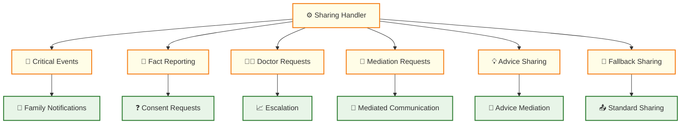

**Why this section exists**: The main diagram shows "Sharing Handler" as a single yellow box, but this section breaks down what actually happens inside that box. Each specialized handler processes different types of sharing scenarios.

#### Handler Responsibilities

**Critical Events Handler**:
- Detects HIGH criticality events
- Triggers immediate doctor escalation
- Notifies family members of urgent health concerns
- Provides confirmation to the reporting user

**Fact Reporting Handler**:
- Processes facts about other people in the care circle
- Determines if escalation or consent is needed
- Handles cross-circle fact reporting
- Manages consent workflows

**Doctor Requests Handler**:
- Handles explicit requests to speak with doctors
- Creates doctor consultation escalations
- Provides confirmation of doctor notification

**Mediation Requests Handler**:
- Facilitates communication between care circle members
- Generates mediated messages
- Confirms mediation initiation

**Advice Sharing Handler**:
- Processes advice given by one user for another
- Mediates advice through the target user's agent
- Ensures appropriate context delivery

**Fallback Sharing Handler**:
- Handles standard sharing suggestions
- Manages consent-based information sharing
- Provides contextual messages to target users

### 4.2 Conflict Detection & Resolution

This section details the specific conflict resolution process that occurs when users report contradictory information. The main diagram shows "Conflict Handler" as a yellow box, but this section explains what happens inside that box.

**How Conflict Detection Works:**
1. **Conflict Check**: When a new fact is reported, the system compares it against existing facts about the same topic from other users
2. **Conflict Detection**: If contradictory information exists (e.g., Patient says "took medication", Caregiver says "didn't take medication"), a conflict is flagged
3. **Mediated Question Generation**: The system generates a neutral, clarifying question to help resolve the conflict

**What is a Mediated Question?**
A mediated question is a carefully crafted, neutral question that the AI agent asks to help resolve conflicting information. It's designed to:
- Avoid taking sides or showing bias
- Ask for specific, factual clarification
- Use gentle, non-confrontational language
- Focus on observable facts rather than opinions

**Example Mediated Questions:**
- "I'd like to clarify about the medication - can you tell me what you observed about [patient's] medication routine today?"
- "There seems to be different information about [patient's] symptoms. Could you describe what you noticed about their condition this morning?"
- "I want to make sure I understand correctly - when did you last see [patient] take their medication?"

**Clarification Generation Process:**
The system uses the `generateMediatedClarification` function to create these questions by:
1. Analyzing the conflicting facts
2. Identifying the specific discrepancy
3. Generating a neutral question that asks for clarification
4. Ensuring the question doesn't reveal who reported what conflicting information

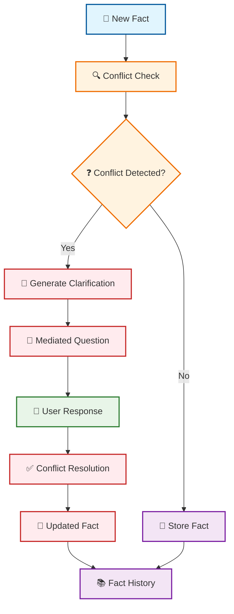

**Fact Update Behavior**: When facts are updated, the system **creates a log entry** rather than overwriting. This maintains a complete history of all reported information, allowing the system to track how facts change over time and identify patterns in conflicting reports.

## 5. State Management

**This section explains the State Management components** (referring to the purple boxes in the main diagram). These components track conversation state and manage pending actions that require user responses.

### 5.1 Pending Actions System

This section explains how the system tracks and resolves pending actions like consent requests. The main diagram shows "State Manager Check" and "Action Response Handler" as purple boxes, but this section details what happens inside those boxes.

**How Pending Actions are Stored:**
Pending actions are stored in the database with the following structure:
```json
{
  "action_id": "uuid",
  "user_id": "user_who_must_respond",
  "circle_id": "care_circle_context",
  "action_type": "share_consent",
  "details": {
    "originatingUser": "who_wants_to_share",
    "target": "who_will_receive_info",
    "reason": "why_sharing_is_needed",
    "content_to_share": "what_will_be_shared",
    "full_question": "complete_question_text_for_matching"
  },
  "created_at": "timestamp",
  "status": "pending"
}
```

**How User Responses are Parsed:**
When a user responds to a pending action, the system:
1. **Intent Classification**: Uses AI to determine if the response is "yes", "no", or "unclear"
2. **Action Matching**: Compares the response against the stored `full_question` text
3. **Context Analysis**: Considers the user's response in context of the original question

**Example Parsing:**
- Question: "Would you like me to share information about your medication adherence with your doctor?"
- User Response: "I can't right now" → Parsed as "no" (decline)
- User Response: "Sure, go ahead" → Parsed as "yes" (approve)
- User Response: "What information exactly?" → Parsed as "unclear" (needs clarification)

**How the Decision is Made:**
The decision-making process uses the `matchResponseToAction` function:
1. **Question Matching**: Compares user response against the `full_question` stored in the action
2. **Intent Analysis**: Uses AI to classify the user's intent (approve/decline/clarify)
3. **Confidence Scoring**: Determines how confident the system is in the interpretation
4. **Action Resolution**: If confidence is high, resolves the action; if low, asks for clarification

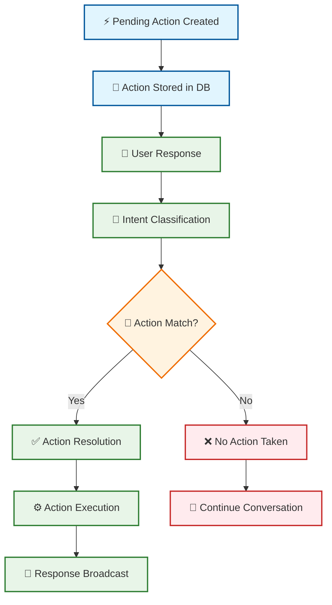

### 5.2 Context Switching

This section explains how users can move between different care circles (e.g., from their own circle to their spouse's circle), which changes which agent they interact with (PersonalAgent vs CareAgent).

**Context Switching Process:**
1. **Circle Validation**: System checks if the user has permission to access the requested care circle
2. **Agent Identity Update**: Changes the user's active agent from PersonalAgent to CareAgent (or vice versa)
3. **Role Assignment**: Updates the user's role context (patient vs caregiver)
4. **Context Confirmation**: Provides feedback to the user about the successful switch

**Grouped Steps**: The context switch involves multiple related operations that happen together:
- Agent Identity Update + Role Assignment + Context Confirmation are all part of a single context switch operation

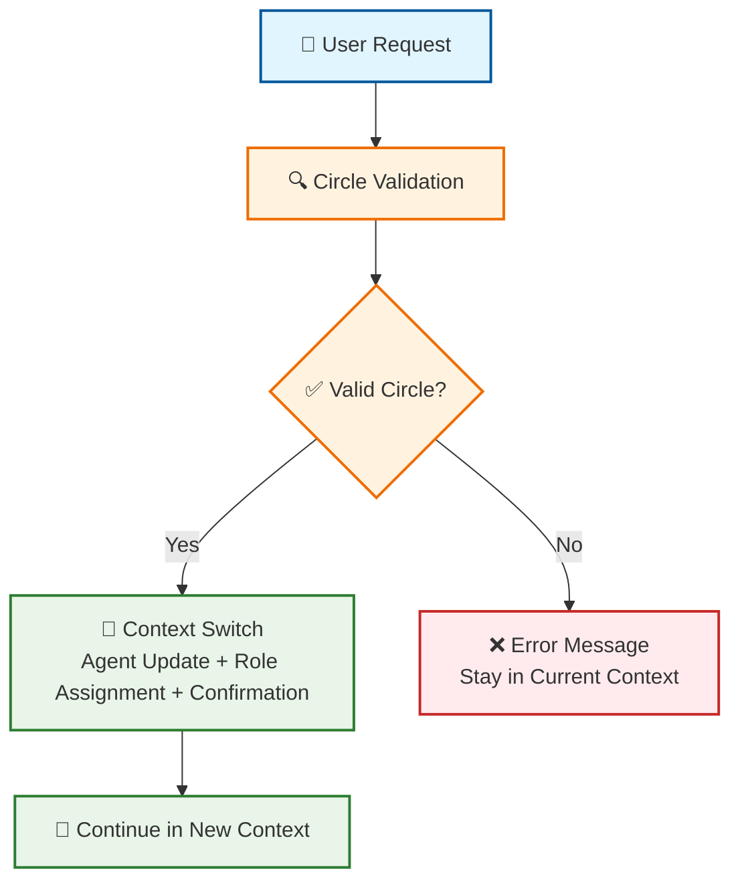

## 6. Decision-Making Framework

This section explains the Orchestrator's decision logic (referring to the green "Orchestrator" box in the main diagram). This shows how the system decides which handler to use based on the message content.

### 6.1 Orchestrator Decision Tree

The main diagram shows "Orchestrator" as a single green box, but this section details the specific decision logic that determines which specialized handler processes the message.

**Decision Tree Logic:**
The orchestrator uses a priority-based decision tree that prioritizes reliability for critical events:
1. **Critical Events First**: HIGH criticality events take a direct, reliable path to ensure guaranteed completion
2. **Complex Handler Bypass**: Critical events skip complex handler logic to improve reliability and speed
3. **Essential Processing**: Fact processing runs separately/parallel for critical events to capture important data
4. **Intent-Based Routing**: Non-critical messages are routed through complex handlers based on detected intents
5. **Fallback Handling**: Messages that don't match specific intents use the standard sharing flow

**Reliability Design**: Different handlers work differently - critical path is simplified for reliability while complex handlers are avoided for critical events.

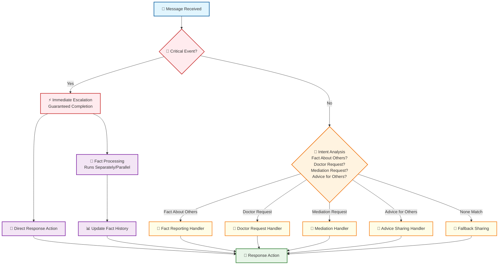

### 6.2 Consent Management

This section explains the consent logic that runs within multiple handlers, showing how the system determines whether to share information directly or ask for permission first.

**Consent Decision Process:**
1. **Implied Consent Check**: System first checks if user has given implied consent for similar topics
2. **Explicit Consent Level**: If no implied consent, checks user's explicit consent level (none, limited, full)
3. **Consent Request**: If neither implied nor full consent exists, creates a pending action for explicit consent
4. **User Response**: User responds to consent request (approve/decline/clarify)
5. **Action Execution**: Based on response, either shares information or denies the request

**Grouped Operations**: Consent checking and sharing are grouped as they represent a single decision flow:
- Implied Consent Check + Explicit Consent Level Check are part of the same consent evaluation
- Consent Request + User Response + Action Execution are part of the same consent workflow

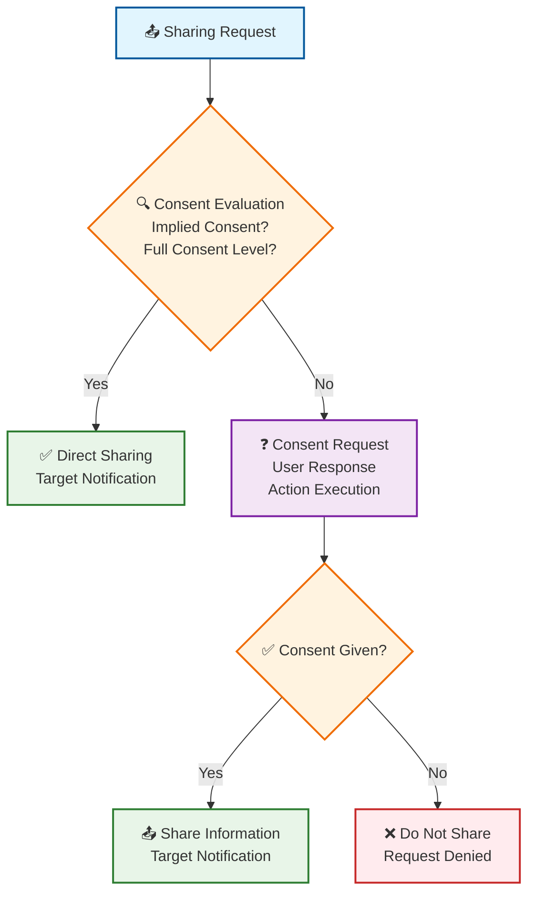

## 7. Agent Communication Patterns

This section explains how different agents communicate with each other (referring to the overall system flow from the main diagram). It shows the patterns of information flow between users and their respective agents.

### 7.1 Inter-Agent Communication

This section shows the complete communication flow between users and their agents, demonstrating how the system facilitates mediated communication between care circle members.

**Communication Flow:**
1. **User A Message**: Patient or caregiver sends a message to their agent
2. **Agent Processing**: PersonalAgent or CareAgent processes the message through the orchestrator
3. **Analysis & Decision**: System analyzes the message and decides on appropriate actions
4. **Agent-to-Agent Communication**: Information flows from one agent to another (e.g., PersonalAgent to CareAgent)
5. **User B Notification**: Target user receives mediated information through their agent

**Grouped Operations**: Analysis, decision, and action are grouped as they represent a single processing phase:
- Analysis + Decision + Action are all part of the same message processing workflow
- Conflict Detection + Mediated Question + Resolution are part of the same conflict resolution workflow

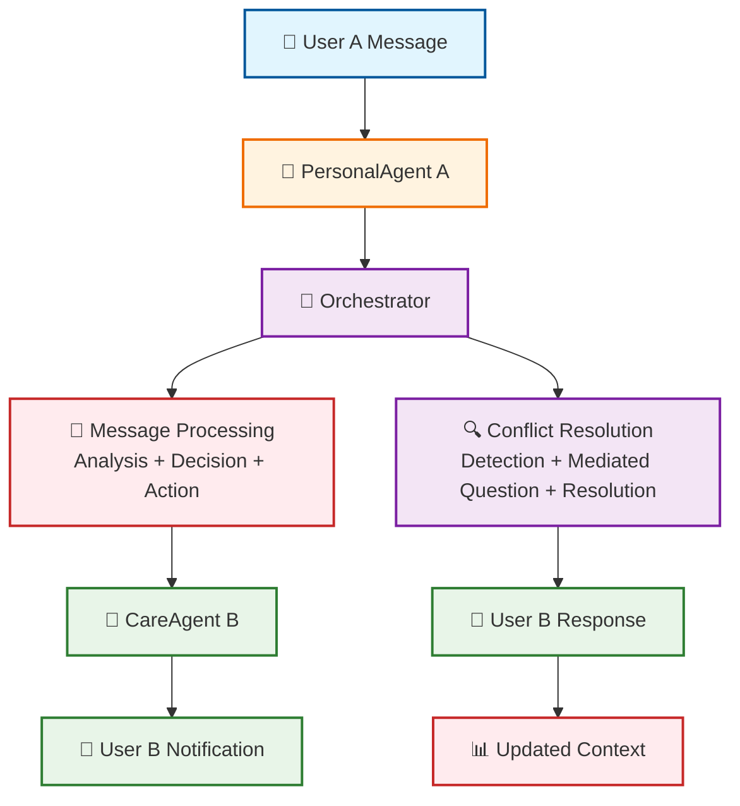

### 7.2 Escalation Flow

This section shows the specific escalation process that occurs when the "Critical Events Handler" detects HIGH criticality events, demonstrating how the system ensures urgent health issues reach the right people quickly.

**Escalation Process:**
1. **Critical Event Detection**: System identifies HIGH criticality health events
2. **Escalation Creation**: Creates escalation record in database
3. **Multi-Channel Notification**: Simultaneously notifies doctor, family members, and updates dashboards
4. **User Confirmation**: Provides feedback to the reporting user
5. **Status Tracking**: Updates system status and logs all actions

**Grouped Operations**: Notification and logging are grouped as they represent parallel processes:
- Doctor Notification + Family Notification + User Confirmation are part of the same notification workflow
- Escalation Log + Doctor Dashboard + Caregiver Alerts + Status Update are part of the same logging workflow

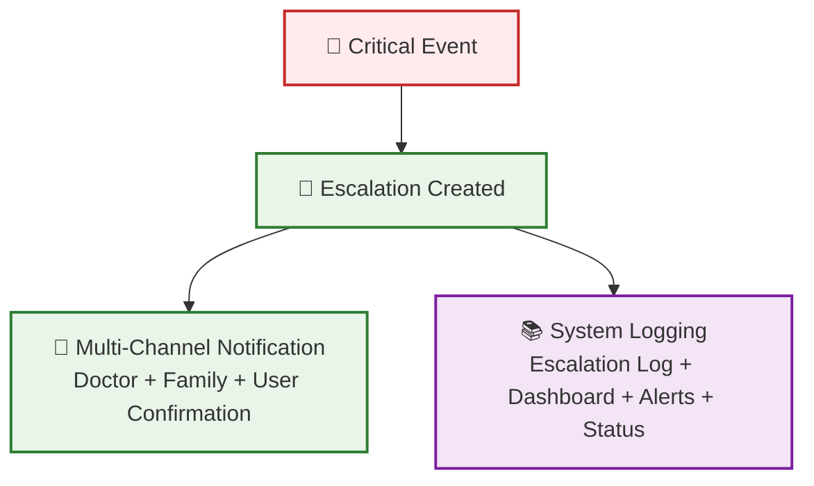

## 8. Current Implementation Status

### 8.1 Implemented Components
- ✅ Multi-agent identity management
- ✅ Chain of thought message processing
- ✅ Specialized sharing handlers
- ✅ Conflict detection and resolution
- ✅ Consent management system
- ✅ Context switching
- ✅ Escalation handling
- ✅ Mediated communication

### 8.2 Key Features
- **Dynamic Agent Selection**: Agents are selected based on user context
- **Modular Sharing Logic**: Specialized handlers for different sharing scenarios
- **Conflict Resolution**: Automated detection and mediation of conflicting information
- **Privacy Protection**: Multi-level consent and privacy classification
- **Real-time Communication**: Event-driven architecture for immediate responses

## 9. Future Enhancements

### 9.1 Planned Improvements
- **Reinforcement Learning Integration**: Replace rule-based decisions with learned models
- **Advanced Conflict Resolution**: More sophisticated mediation strategies
- **Predictive Escalation**: Proactive identification of potential health issues
- **Enhanced Privacy Controls**: More granular consent management
- **Performance Optimization**: Improved response times and accuracy

### 9.2 Scalability Considerations
- **Horizontal Scaling**: Support for multiple care circles
- **Load Balancing**: Distributed agent processing
- **Caching**: Optimized context retrieval
- **Monitoring**: Comprehensive system health tracking

## 9. Diagram Navigation Guide

### 9.1 How to Use This Document

**Main Diagram Reference**: The main "Message Processing Flow" diagram (Section 3.1) serves as the central reference point. Each subsequent section explains what happens inside specific boxes from this main diagram:

- **Section 3.2**: Explains the red "AI Analysis Handler" box
- **Section 4**: Explains the yellow "Sharing Handler" and "Conflict Handler" boxes  
- **Section 5**: Explains the purple "State Manager Check" and "Action Response Handler" boxes
- **Section 6**: Explains the green "Orchestrator" decision logic
- **Section 7**: Shows overall communication patterns between all components

### 9.2 Color Coding Legend

Throughout all diagrams, colors represent different types of components:

- 🔵 **Blue**: User input and user interactions
- 🟢 **Green**: Orchestration, output, and successful operations
- 🟠 **Orange**: Decision points and command processing
- 🟣 **Purple**: State management and data storage
- 🔴 **Red**: AI processing, critical events, and error states
- 🟡 **Yellow**: Business logic handlers and specialized processors

### 9.3 Component Type Indicators

Each diagram uses emojis to quickly identify component types:

- 👤 **Users**: Human participants in the system
- 🤖 **Agents**: AI conversational entities
- ⚙️ **Handlers**: Business logic processors
- 🧠 **AI Processing**: LLM analysis and decision making
- 📊 **State Management**: Conversation state tracking
- 🎯 **Orchestration**: Central workflow coordination
- 📡 **Output**: Response delivery and notifications

## 10. Role Reciprocity and Care Circle Fluidity

This section explains how users and agents adapt their roles based on context, creating fluid care circles where individuals can be both patients and caregivers.

### 10.1 Role Reciprocity Framework

This diagram shows how users and agents dynamically adapt their roles based on the care circle context:

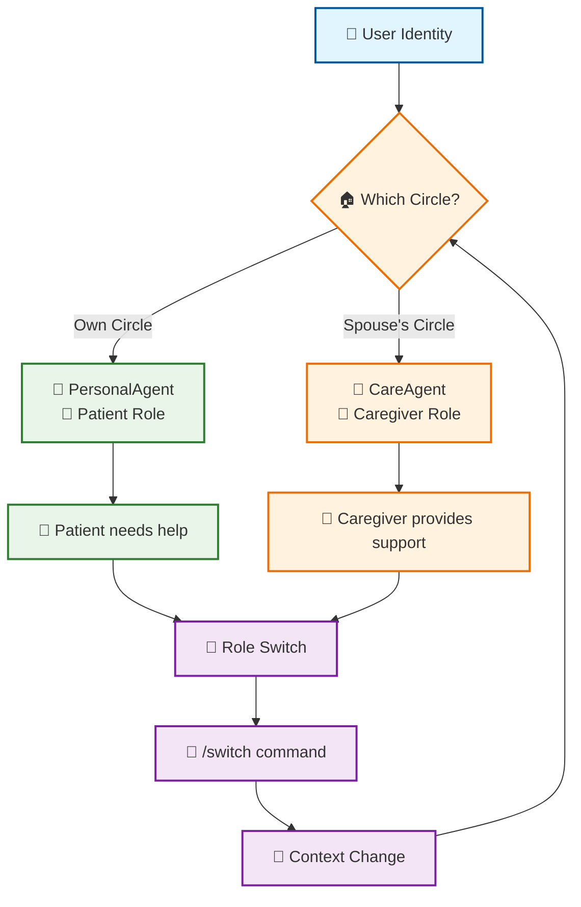

**Role Reciprocity Explained:**
- **Same Person, Different Roles**: A user can be a patient in their own circle and a caregiver in their spouse's circle
- **Agent Adaptation**: The same user gets PersonalAgent (patient) or CareAgent (caregiver) based on context
- **Dynamic Switching**: Users can switch between circles using `/switch` commands
- **Context-Aware Responses**: Agents adapt their language and capabilities based on the user's role

### 10.2 Care Circle Fluidity

This diagram shows how care circles overlap with spouses and siblings as caregivers:

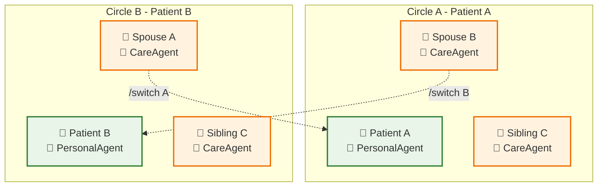

**Care Circle Fluidity Explained:**
- **Two Patients**: Patient A and Patient B each have their own care circles
- **Spouse Caregivers**: Spouse A cares for Patient B, Spouse B cares for Patient A
- **Sibling Caregivers**: Sibling C provides care in both circles
- **Role Switching**: Spouses can switch between patient and caregiver roles
- **Shared Caregivers**: Siblings can be caregivers in multiple circles

This framework provides a robust foundation for the multi-agent healthcare system, ensuring clear responsibilities, effective communication, and reliable decision-making processes.
