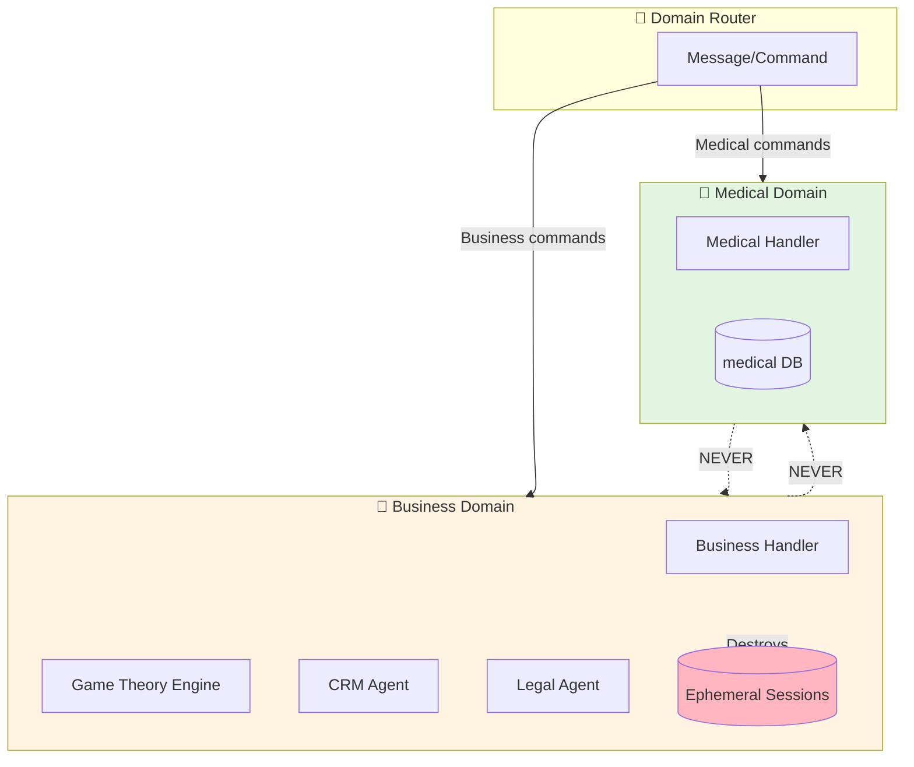
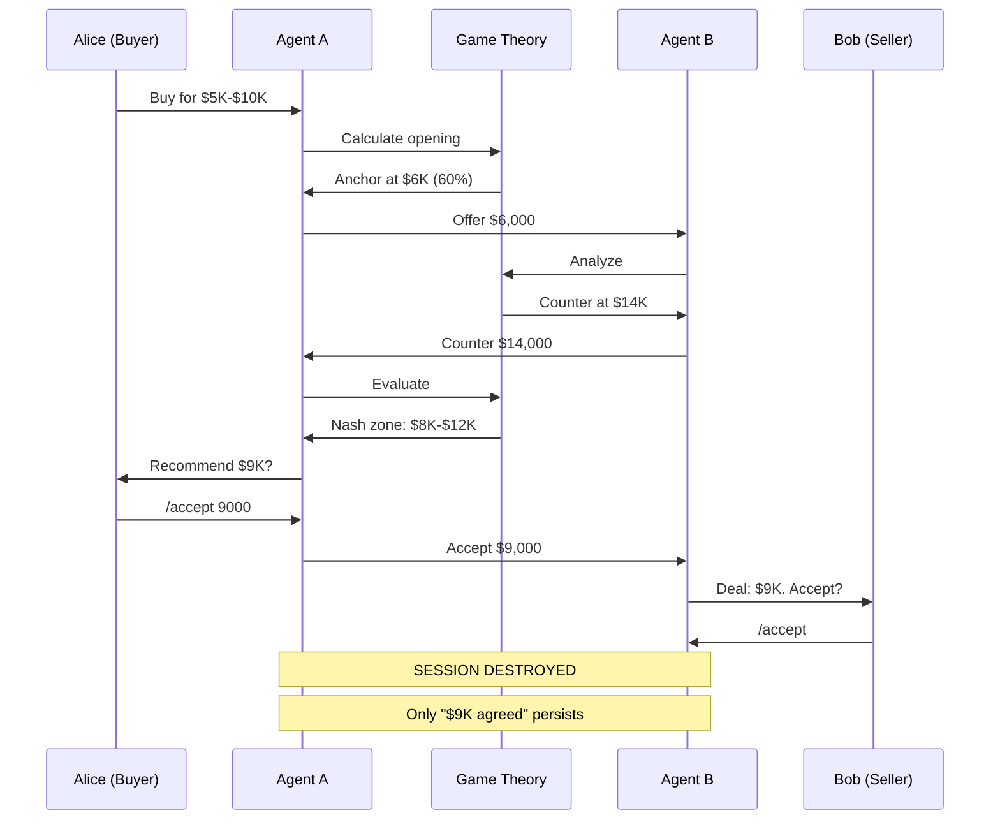
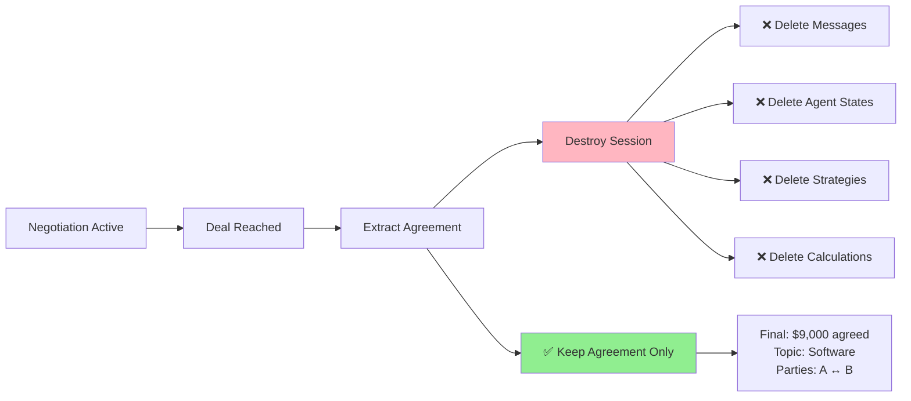
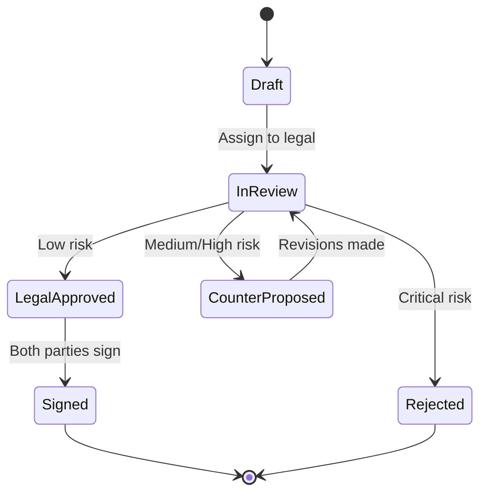

# Business Negotiation System

**A game theory-driven, privacy-preserving business negotiation platform**

---

## 🎯 Overview

The Business Negotiation System extends the multi-agent architecture to support:
- 💼 **Adversarial negotiations** with game theory optimization
- 📊 **CRM**: Leads, opportunities, sales pipeline
- 📦 **ERP**: Inventory, orders, invoicing
- ⚖️ **Legal**: Contract review and risk assessment
- 🔒 **Privacy**: Ephemeral sessions (messages destroyed after deal)

**CRITICAL**: Completely isolated from medical domain - zero cross-contamination.

---

## 🏗️ Architecture



---

## 🎮 Game Theory Negotiation

### How It Works

1. **Each agent optimizes for THEIR user** (adversarial)
2. **Nash equilibrium seeking** (stable outcomes)
3. **Strategic moves**: Anchoring, concessions, bluffing
4. **Bayesian learning**: Agents model each other
5. **BATNA-aware**: Walk away if deal is worse than alternatives

### Example Negotiation



---

## 📋 Commands

### Negotiation Commands

```bash
# Start negotiation
/negotiate start @bob "Software license" min:5000 max:10000

# Make proposal
/propose $7000 "Best price for annual license"

# Counter-offer
/counter $9000

# Accept deal
/accept

# View negotiations
/negotiate list

# Terminate
/negotiate terminate <session_id>
```

### CRM Commands

```bash
# Add lead
/crm lead add "Acme Corp" @john value:50000

# View pipeline
/crm pipeline

# Convert to opportunity
/crm convert <lead_id> "Enterprise Deal"

# Update stage
/crm stage <opp_id> negotiation
```

### Legal Commands

```bash
# Review contract
/legal review <contract_id>

# Approve
/legal approve <contract_id>

# Flag clause
/legal flag <contract_id> "problematic liability clause"

# Show pending
/legal pending

# Create contract
/legal create <opp_id> MSA
```

### ERP Commands

```bash
# Inventory
/inventory list
/inventory add "Product X" qty:100
/inventory check SKU-123

# Orders
/order create <opp_id> items:[...]
/order list
/order approve <order_id>

# Invoicing
/invoice generate <order_id>
/invoice send <invoice_id>
/invoice status
```

---

## 👥 Roles

| Role | Permissions | Commands |
|------|-------------|----------|
| **Sales** | Create leads, negotiate deals | /negotiate, /crm, /propose |
| **Buyer** | Initiate purchases, negotiate | /negotiate, /inventory, /order |
| **Legal** | Review contracts, assess risk | /legal (all) |
| **Finance** | Approve orders, manage invoices | /order approve, /invoice |
| **Executive** | All permissions | All commands |

---

## 🔒 Privacy Through Destruction

### What Happens After a Deal



### Privacy Guarantee

After negotiation:
- ✅ Final agreement saved
- ❌ All messages deleted
- ❌ Agent reasoning destroyed
- ❌ Game theory calculations erased
- ❌ Strategic state removed

**Why**: Protects negotiation tactics, prevents reverse-engineering strategy

---

## 📊 CRM Features

### Lead Management
- Track prospects
- Qualify leads
- Estimate deal value
- Assign owners

### Sales Pipeline
- Stages: Prospect → Qualified → Opportunity → Negotiation → Legal → Closed
- Forecast revenue
- Track conversion rates
- Activity logging

### Opportunity Tracking
- Deal value and probability
- Expected close dates
- Stage transitions
- Win/loss analysis

---

## 📦 ERP Features

### Inventory Management
- Product catalog
- SKU tracking
- Quantity management
- Pricing and cost tracking

### Order Management
- Create from opportunities
- Approval workflows
- Status tracking
- Fulfillment

### Invoicing
- Generate from orders
- Payment tracking
- Overdue management
- Revenue reporting

---

## ⚖️ Legal Workflow

### Contract Review Process



### Risk Levels
- 🟢 **LOW**: Standard terms, approve
- 🟡 **MEDIUM**: Some concerns, negotiate
- 🟠 **HIGH**: Significant risks, require changes
- 🔴 **CRITICAL**: Unacceptable, reject

---

## 🤖 Agent Personalities (Simulations)

### 9 Business Personas

**Buyers**:
- `aggressive_buyer` - Pushes hard, low offers
- `time_pressured_buyer` - Quick decisions, fair prices
- `finance_controller` - Data-driven, ROI-focused

**Sellers**:
- `cautious_seller` - Risk-averse, seeks middle ground
- `sales_shark` - Aggressive, high-pressure tactics
- `relationship_seller` - Long-term focus, consultative

**Support**:
- `strategic_negotiator` - Game theory driven
- `tough_legal_counsel` - Highly risk-averse
- `pragmatic_legal` - Balances risk and business

---

## 🛡️ Domain Isolation Verification

### Safety Checks

```javascript
// Verify no cross-contamination
import { verifyDomainIsolation } from './handlers/domainRouter.js';

const isolated = await verifyDomainIsolation();
// Returns true if:
//   ✅ Business doesn't import medical handlers
//   ✅ Separate database schemas
//   ✅ No shared state
```

### File Separation

```
✅ handlers/messageHandler.js      (medical only)
✅ handlers/business/               (business only)
✅ agents/medical/                  (never imported by business)
✅ agents/business/                 (never imported by medical)
✅ db/schema.js                     (medical)
✅ db/business/schema.js            (business, separate)
```

---

## 🚀 Getting Started

### 1. Initialize Business Database

```bash
# Run once
node -e "import('./db/business/schema.js').then(s => s.initializeBusinessSchema(require('./db/connection.js').getDb()))"
```

### 2. Assign Business Role

```sql
INSERT INTO business_roles (user_id, role, authority_level)
VALUES ('alice_id', 'sales', 7);
```

### 3. Start First Negotiation

```
/negotiate start @bob "Product purchase" min:5000 max:10000
```

### 4. Use CRM

```
/crm lead add "Acme Corp" @contact value:50000
/crm pipeline
```

### 5. Legal Review

```
/legal pending
/legal review <contract_id>
/legal approve <contract_id>
```

---

## 📊 Database Schema

### Key Tables

- `crm_leads` - Prospect tracking
- `crm_opportunities` - Active deals
- `crm_pipeline` - Stage transitions
- `erp_inventory` - Product catalog
- `erp_orders` - Order management
- `erp_invoices` - Billing
- `legal_contracts` - Contract tracking
- `legal_clauses` - Risk assessment
- `negotiation_sessions` - Ephemeral sessions
- `negotiation_messages` - Deleted after conclusion
- `business_roles` - User permissions

---

## 🎓 Examples

### Example 1: Software License Negotiation

```bash
Alice: /negotiate start @bob "SaaS annual license" min:8000 max:15000
# Alice wants between $8K-$15K

Bob (receives): "Negotiation request from @alice"
Bob: /setrange min:12000 max:20000
Bob: /propose $18000 "Premium tier"

Alice (receives): "Bob proposed: $18,000"
Alice: /counter $10000

Bob: /counter $14000

Alice: /accept
# Deal closed at $14,000

System: "🔒 All negotiation data destroyed. Agreement saved."
```

### Example 2: With Legal Review

```bash
Alice: /negotiate start @bob "Enterprise contract" min:50000 max:100000
# Negotiation happens...
Bob: /accept

System: "Deal reached: $75,000. Creating contract..."

# Auto-assign to legal
Legal: /legal review contract_123
System: "🟡 MEDIUM risk - some clauses need attention"

Legal: /legal flag contract_123 "Unlimited liability clause"
Legal: Request changes to Alice & Bob

# After revisions
Legal: /legal approve contract_123

Alice & Bob: /sign contract_123
System: "✅ Contract executed!"
```

### Example 3: CRM Pipeline

```bash
# Start with lead
/crm lead add "TechCorp" @jane value:100000

# Qualify and convert
/crm convert lead_123 "Enterprise Platform Deal"

# Start negotiation
/negotiate start @jane "Platform license" min:80000 max:120000

# After close
/crm stage opp_456 closed_won

# View pipeline
/crm pipeline
# Output:
#   📝 proposal: 2 deals ($50K)
#   💬 negotiation: 5 deals ($300K)
#   ⚖️ legal_review: 1 deal ($100K)
#   🎉 closed_won: 10 deals ($1.2M)
```

---

## 🔐 Privacy Model

### Data Lifecycle

| Data Type | Storage | Retention |
|-----------|---------|-----------|
| Negotiation messages | Ephemeral session | Deleted after deal |
| Agent strategies | Ephemeral session | Deleted after deal |
| Game theory calculations | Ephemeral session | Deleted after deal |
| Final agreement | Persistent DB | Forever |
| CRM data | Persistent DB | Forever |
| Legal contracts | Persistent DB | Forever (compliance) |

### Compliance

- ✅ **GDPR**: Right to deletion (ephemeral by default)
- ✅ **Trade secrets**: Negotiation tactics not discoverable
- ✅ **Legal**: Contracts retained for compliance
- ✅ **Audit**: Agreement history preserved

---

## 🎯 Game Theory Features

### Nash Equilibrium
- Finds stable agreement zone
- Both parties can't improve unilaterally
- Guides agents toward deal closure

### Minimax Algorithm
- Assumes rational opponent
- Minimizes maximum loss
- Alpha-beta pruning for efficiency

### Bayesian Learning
- Updates belief about opponent
- Based on their moves
- Adapts strategy dynamically

### Strategic Bluffing
- Calculated misrepresentation
- Based on trust level and round
- Reduced near deadline

---

## 📚 Documentation

- **This File**: Overview and commands
- **Architecture**: `BUSINESS_ARCHITECTURE.md` (detailed diagrams)
- **Integration**: `BUSINESS_INTEGRATION.md` (how it plugs in)
- **API**: See code in `handlers/business/` and `agents/business/`

---

## ✅ Safety & Isolation

### Domain Separation

**Medical → Business**: ❌ IMPOSSIBLE  
**Business → Medical**: ❌ IMPOSSIBLE  

**Enforced by**:
- Separate handler hierarchies
- Separate database schemas
- Domain router validation
- No shared state

### Testing

```bash
# Verify isolation
node -e "import('./handlers/domainRouter.js').then(r => r.verifyDomainIsolation())"

# Test medical still works
npm test

# Test business
node tests/test_business_negotiation.js
```

---

## 🚀 Status

- ✅ Core architecture complete
- ✅ Game theory engine implemented
- ✅ CRM features functional
- ✅ Legal workflow operational
- ✅ ERP basics in place
- ✅ Privacy guarantees enforced
- ✅ 9 simulation personas ready
- ⏳ Needs integration testing
- ⏳ Server.js update pending

---

**Next**: Update `server.js` to use domain router instead of direct handlers.

