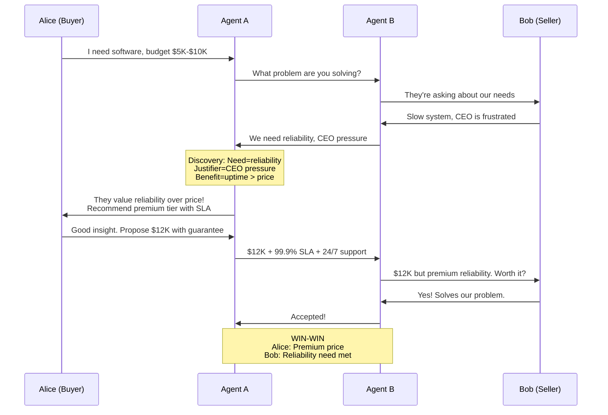
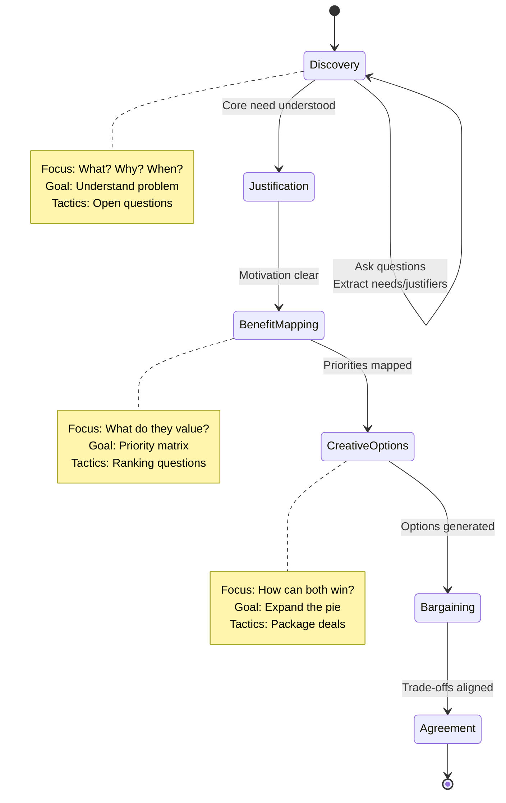

# Integrative Negotiation - Information Discovery First

> **Status**: Design document for the integrative negotiation subsystem. Implementation is pending (business negotiation track deferred). See `business/BUSINESS_SYSTEM_COMPLETE.md` for current status.

**Key Insight**: Real negotiations are about discovering needs, justifications, and benefits - NOT just haggling over price.

---

## 🎯 The Problem with Pure Game Theory

### What I Built First (Too Simplistic):
```
Alice: "I want to buy for $5K-$10K"
Agent: [Game theory] "Anchor at $6K"
Agent → Bob: "I offer $6,000"
Bob: "Counter at $14K"
[Price haggling continues...]
```

**Issues**:
- ❌ Leads with price (positional bargaining)
- ❌ Ignores underlying needs
- ❌ Misses value-creating opportunities
- ❌ Zero-sum thinking

### Enhanced Approach (Integrative):
```
Alice: "I need software for our team"
Agent: "Let me understand your needs first..."

Agent → Bob: "What problem are you trying to solve?"
Bob: "Our current system is slow and unreliable"

Agent: "Why is that critical now?"
Bob: "CEO is frustrated, competitor launched faster product"

Agent: "Beyond price, what matters - speed, reliability, support?"
Bob: "Reliability is critical. Speed is nice. Price is secondary."

Agent → Alice: "They value reliability (10/10) > speed (6/10) > price (4/10)"
Agent → Alice: "We can win by emphasizing reliability, even at premium price"

Alice: "Propose $12K with 99.9% uptime guarantee + premium support"
Bob: "Perfect! That solves my problem. Accepted."
```

**Result**:
- ✅ Discovered true need (reliability, not price!)
- ✅ Found justifier (CEO pressure, competitor threat)
- ✅ Created value (support package)
- ✅ Win-win outcome

---

## 🔍 Four Discovery Dimensions

### 1. **The Need** - What problem are they solving?

**Questions**:
- "What brings you to this negotiation?"
- "What problem are you trying to solve?"
- "What happens if you don't solve this?"

**Example**:
```
Bob: "We need to reduce server costs"
→ Need discovered: Cost reduction
→ Agent strategy: Emphasize cost savings in proposal
```

### 2. **The Justifier** - WHY now? What's the pressure?

**Questions**:
- "Why is this important right now?"
- "What's driving your timeline?"
- "Who else is involved in this decision?"

**Example**:
```
Bob: "Because our CFO mandated 20% budget cut by Q3"
→ Justifier: Executive pressure + deadline
→ Agent strategy: "We can hit that target" + "Close before Q3"
```

### 3. **The Benefits** - What do they value beyond price?

**Questions**:
- "What matters most: price, speed, quality, or terms?"
- "Beyond cost, what would make this a win for you?"
- "What would your ideal outcome look like?"

**Example**:
```
Bob: "Reliability is critical. We can't afford downtime."
→ Benefit priorities: Reliability (10), Uptime (9), Price (5)
→ Agent strategy: Compete on reliability, not price
```

### 4. **The Trade-offs** - What can we exchange for mutual gain?

**Questions**:
- "If we improve X, would you be flexible on Y?"
- "What could we add that would create value?"
- "Volume discount for longer commitment?"

**Example**:
```
Bob: "We'd pay more for guaranteed uptime"
Alice: "We need predictable revenue"
→ Trade-off: Alice gets 2-year contract, Bob gets SLA guarantee
→ Both win!
```

---

## 📊 Negotiation Flow (Information-First)



---

## 🎯 Benefit Priority Matrix

### Before Discovery (Assumptions):
| Benefit | Alice Values | Bob Values | Trade? |
|---------|--------------|------------|--------|
| Low Price | ? | ? | ? |
| Fast Delivery | ? | ? | ? |
| Reliability | ? | ? | ? |

### After Discovery (Data):
| Benefit | Alice Values | Bob Values | Trade? |
|---------|--------------|------------|--------|
| Low Price | 8/10 | 4/10 | ✅ Alice concedes higher price |
| Fast Delivery | 3/10 | 6/10 | ✅ Alice offers fast delivery |
| Reliability | 5/10 | 10/10 | ✅ Alice emphasizes this |
| Long Contract | 9/10 | 6/10 | ✅ Trade: Alice gets commitment, Bob gets reliability |

**Creative Package**:
- Alice: "I'll give you 99.9% SLA + priority support (high value to you, manageable cost to me)"
- Bob: "I'll commit to 2-year contract (high value to you, acceptable to me)"
- **Result**: Both parties better off than pure price negotiation!

---

## 💡 Examples

### Example 1: Tech Deal

**Bad (Price-First)**:
```
Seller: "$100K for the software"
Buyer: "$60K"
Seller: "$90K"
Buyer: "$70K"
[... haggling continues ...]
Settlement: $80K (both unhappy)
```

**Good (Discovery-First)**:
```
Seller: "What's your biggest tech challenge?"
Buyer: "System keeps crashing, costing us $50K/month in downtime"
Seller: "So uptime is worth $600K/year to you?"
Buyer: "Yes, that's our pain point"

Seller: "I can guarantee 99.99% uptime for $120K/year"
Buyer: "That's a $480K net gain for us. Deal!"

Result: $120K price (higher than $80K haggle price)
But buyer is HAPPIER (solves $600K problem)
```

### Example 2: Service Contract

**Discovery**:
```
Agent: "Why do you need this service?"
Client: "Our team wastes 10 hours/week on manual work"
Agent: "What's the cost of that time?"
Client: "About $5K/month in lost productivity"

Agent: "So you'd break even at $5K/month service cost?"
Client: "Yes, and gain time for strategic work"

Solution: $6K/month service (above budget)
But: Saves $5K + frees up strategic time
Client: Happy to pay premium
```

### Example 3: Consulting Deal

**Justifier Discovery**:
```
Agent: "What's driving the timeline?"
Client: "Board meeting in 2 weeks, need to show progress"
→ Justifier: Political pressure + deadline

Agent to User: "They have board pressure. Timeline is more valuable than price."

User: "Offer premium price but 10-day delivery"
Client: "Perfect! Board will love it. Accepted."

Result: Higher price justified by solving time problem
```

---

## 🔄 Negotiation Phases



---

## 🎓 Information Extraction

### Agent Analyzes Messages For:

**Explicit Information**:
- "We need it by June" → Timeline discovered
- "Budget is $50K" → Constraint discovered
- "Because our CEO wants..." → Justifier discovered

**Implicit Information**:
- "That's expensive" → Price sensitivity high
- "When can you deliver?" → Timeline is priority
- "Who would support this?" → Risk aversion high

**Strategic Signals**:
- Quick responses → High interest
- Slow responses → Multiple options / low urgency
- Detailed questions → Serious buyer
- Vague answers → Hiding constraints

---

## 💡 Reusing Medical Patterns

**Medical agents already do this well!**

```javascript
// Medical domain (existing):
class UnifiedAgent {
    async elicitInformation(message) {
        // Ask about symptoms
        // Understand context
        // Build trust
        // Extract facts
    }
}

// Business domain (reuse pattern):
class NegotiationAgent {
    async elicitInformation(message) {
        // Ask about needs  ✅ Same pattern!
        // Understand context  ✅ Same pattern!
        // Build trust  ✅ Same pattern!
        // Extract benefits  ✅ Same pattern!
    }
}
```

**Same core capability**, different domain!

---

## ✅ Enhanced Agent Behavior

### Old (Price-Focused):
```
Turn 1: "I offer $6,000"
Turn 2: "Counter: $8,000"
Turn 3: "Counter: $7,000"
```

### New (Information-Focused):
```
Turn 1: "Help me understand - what problem are you solving?"
Turn 2: "Why is [their need] important to your organization?"
Turn 3: "What matters more: cost, speed, or quality?"
Turn 4: "If I can guarantee [their priority], would you commit to [my priority]?"
Turn 5: "Here's a package that addresses your [justifier] with our [creative solution]"
```

**Result**: Better deals through better information.

---

## 🎯 Key Differences from Medical

| Aspect | Medical | Business |
|--------|---------|----------|
| **Objective** | Cooperative (health) | Adversarial (profit) |
| **Information** | Symptoms & facts | Needs & justifiers |
| **Trust** | Build unconditionally | Strategic (game theory) |
| **Outcome** | Optimal care | Optimal deal |
| **Privacy** | Permanent records | Ephemeral (deleted) |

But **same elicitation patterns**!

---

## 📚 Next Steps

The code now supports:
- ✅ Information discovery phase
- ✅ Justification extraction
- ✅ Benefit priority mapping
- ✅ Creative option generation
- ✅ Multi-issue trade-offs
- ✅ Strategic questioning

**Try it**: When you `/negotiate start`, the agent will ASK QUESTIONS FIRST, not lead with price!

