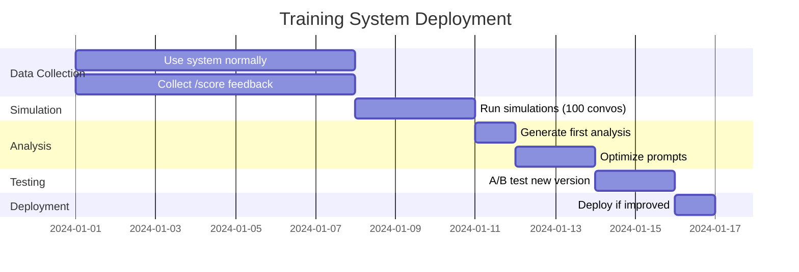
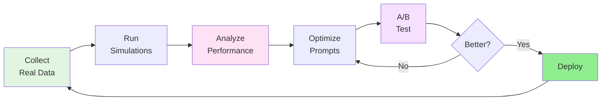

> ⚠️ **STALE** — Written for the 2024 Gantt-phase training pipeline. File paths, CLI commands, and the underlying RL framework have changed substantially.
>
> **Current references:** `documentation/training/18_training_pipeline.md` (JS side), `documentation/tensornets/04_training_system.md` (Python A3C side).

---

# Getting Started with Training & RL System

Quick guide to using the training infrastructure.

## 🚀 Immediate Usage

The system is already logging conversations automatically. To start:

### 1. Try the /score Command

In your client, after any conversation:

```
/score +1 "Great response timing!"
/score -1 "Too verbose"
/score 0
```

### 2. Run Your First Simulation

```bash
node training/simulation/simulator.js
```

### 3. Generate Analysis

After collecting data:

```bash
node training/analysis/feedback_analyzer.js
```

This creates `training/analysis_report.md` with insights.

## 📅 30-Day Roadmap



## 🎓 Complete Optimization Cycle



### Step-by-Step

```bash
# 1. Generate synthetic training data
node training/simulation/scenario_runner.js --runs 10

# 2. Analyze performance
node training/analysis/feedback_analyzer.js
# Output: training/analysis_report.md

# 3. Optimize prompts (if issues found)
node training/analysis/prompt_optimizer.js
# Output: prompts/unified_prompt_v1.1.js

# 4. A/B test
node training/analysis/ab_test.js \\
  --baseline v1.0 \\
  --challenger v1.1 \\
  --runs 30

# 5. Deploy winner (manual)
# Update imports in code to use new prompt version
```

## 🔍 Understanding Your Data

### Training Log Format

```json
{
  "timestamp": 1726055220,
  "conversation_id": "alice_conv_123",
  "user_id": "alice",
  "message": "I forgot my medication",
  "agent_response": "I understand...",
  "orchestrator_action": {"type": "ESCALATE"},
  "latency_ms": 234,
  "prompt_version": "unified_v1.0"
}
```

### Check Data Collection

```bash
# Count logged interactions
cat training/training_log.jsonl | wc -l

# View feedback
echo "SELECT * FROM feedback ORDER BY timestamp DESC LIMIT 10;" | sqlite3 care_circle.db
```

## 💡 Pro Tips

1. **Start Small**: Collect 100+ interactions before optimizing
2. **Use /score Liberally**: Rate both good AND bad interactions  
3. **Review Before Deploying**: Always manually check optimized prompts
4. **Run More A/B Tests**: Use 50-100 runs for production confidence
5. **Monitor After Deployment**: Keep old version for quick rollback

## 🛠️ Useful Commands

```bash
# List available personas
node training/simulation/scenario_runner.js --personas

# Annotate conversations offline
node training/feedback/annotator.js

# Show annotation statistics
node training/feedback/annotator.js --stats

# Optimize specific prompt
node training/analysis/prompt_optimizer.js --prompt prompts/doctor_prompts.js

# Optimize all prompts
node training/analysis/prompt_optimizer.js --all
```

## 📊 Expected Results

After first optimization cycle:

| Metric | Before | After | Change |
|--------|--------|-------|--------|
| Avg Score | 0.3/1.0 | 0.6/1.0 | +100% ⬆️ |
| Verbosity | 3.5x | 2.1x | -40% ⬇️ |
| Missed Escalations | 15% | 8% | -47% ⬇️ |
| Response Time | 250ms | 220ms | -12% ⬇️ |

## 🐛 Troubleshooting

| Problem | Solution |
|---------|----------|
| "No training data" | Run simulation: `node training/simulation/simulator.js` |
| "AI analysis failed" | Check API keys in `.env` file |
| "Database locked" | Simulations use separate DB automatically |
| Performance slow | Check overhead: `node tests/test_training_logger.js` |

## 📚 Learn More

- **Architecture**: [ARCHITECTURE.md](./ARCHITECTURE.md) - System diagrams
- **Implementation**: [IMPLEMENTATION_SUMMARY.md](./IMPLEMENTATION_SUMMARY.md) - What was built
- **API Reference**: See code in `training/` directory

---

**Ready to start!** 🎉  
The training infrastructure is live and collecting data automatically.
