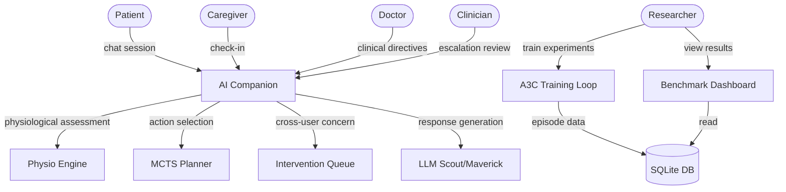
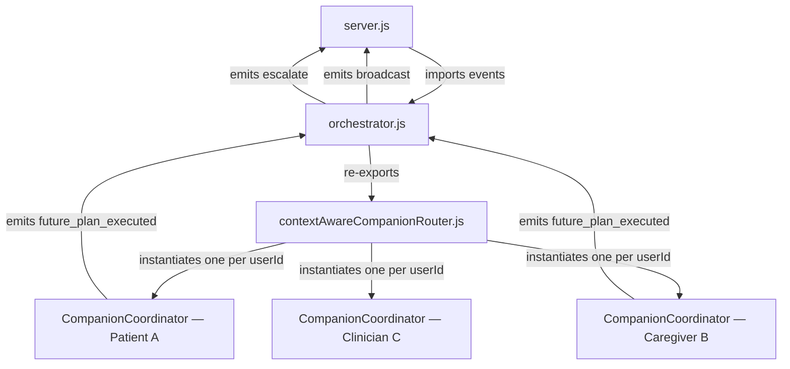
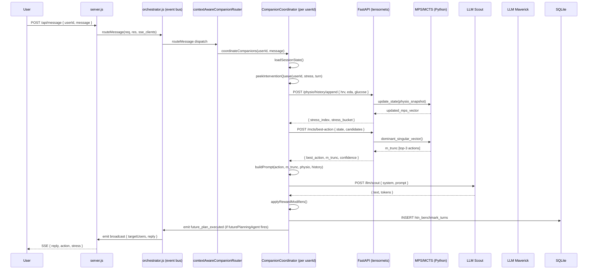
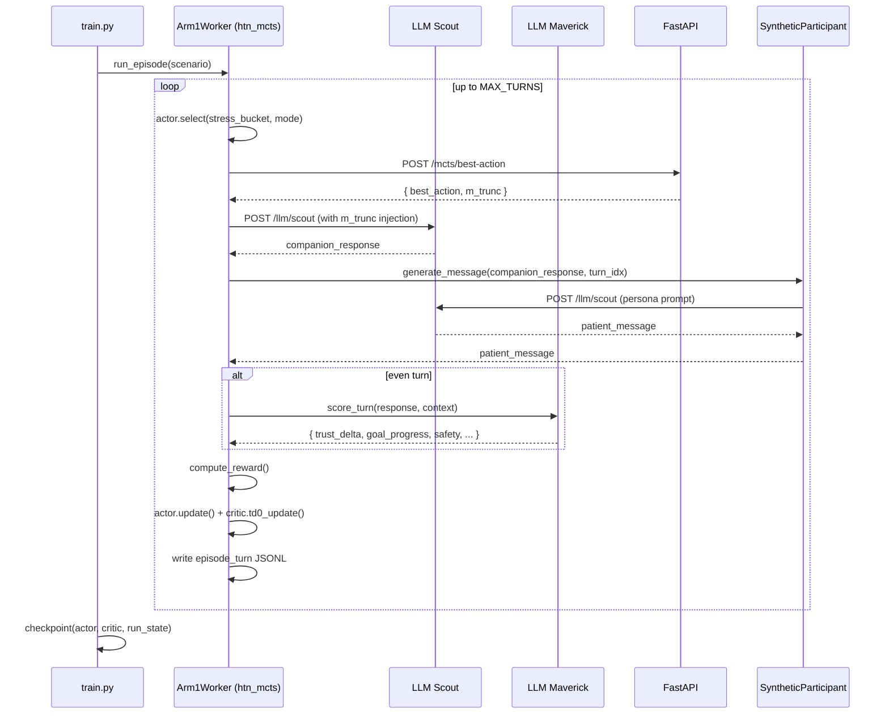
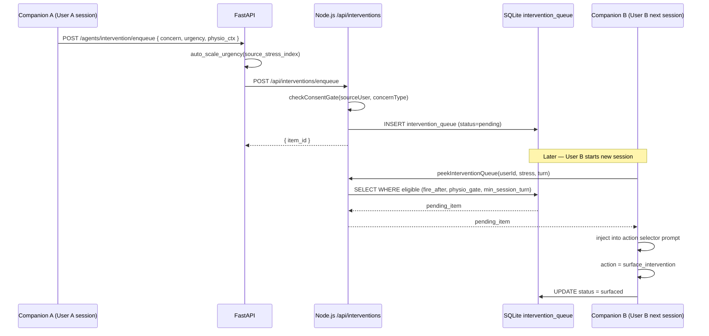
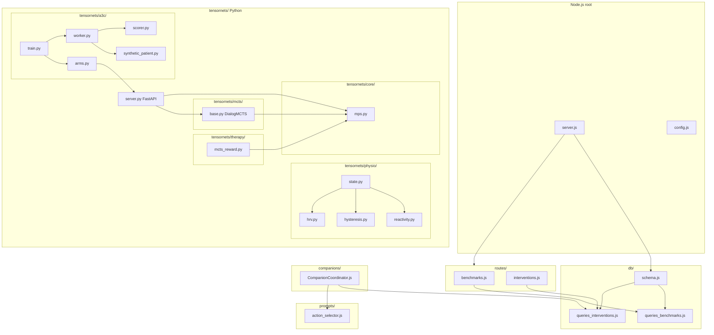
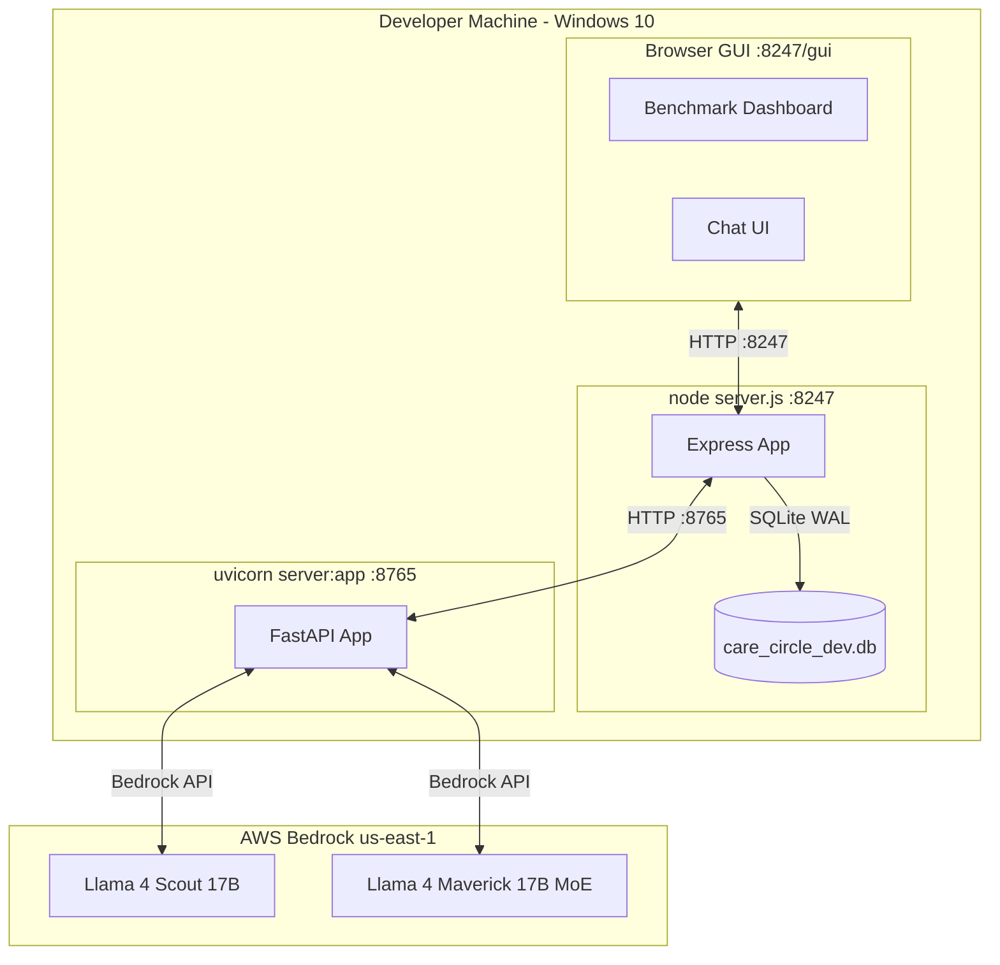

# System Architecture — Brainwasher 3 / Tensornets

> Last updated: 2026-05-28  
> Covers: 4+1 Architectural Views, Data Flow Diagrams, Math Reference  
> Related docs: 01_overview.md, 02_tensornets_reference.md, 04_training_system.md

---

## 0. Terminology

| Term | Meaning |
|---|---|
| **Experiment** | One of the three independent A3C training conditions (htn_mcts, oldschool, hysteresis_prompt). The DB column is named rm for backward-compatibility. |
| **Episode** | One complete simulated conversation (up to MAX_TURNS turns) between the synthetic patient and the companion |
| **Turn** | One companion response + patient reply pair |
| **MPS** | Matrix Product State — tensorized representation of physiological state |
| **MCTS** | Monte Carlo Tree Search — tree-search action planner |
| **Scout / Maverick** | Llama 4 Scout (fast, 17B) and Llama 4 Maverick (capable, 17B MoE) |
| **A3C** | Asynchronous Advantage Actor-Critic |
| **POMDP-H** | Partially Observable MDP with Hysteresis |

---

## 1. Use Case View (the +1)

The +1 view describes the primary actors and their key interactions with the system.



**Primary use cases:**
- UC1: Patient chats with companion (care session)
- UC2: Caregiver receives cross-user welfare notification (intervention queue)
- UC3: Companion escalates to clinician (safety protocol)
- UC4: Researcher trains new experiment run (A3C loop)
- UC5: Researcher reviews learning curves (benchmark dashboard)
- UC6: Companion surfaces queued intervention (deferred concern)

---

## 2. Logical View

The logical view shows the major subsystems and their relationships.

```mermaid
graph LR
    subgraph NodeJS[Node.js Backend]
        ORC[orchestrator.js\ninter-companion engine]
        RTR[contextAwareCompanionRouter\nper-userId dispatcher]
        CC[CompanionCoordinator\nper-user intra-companion brain]
        SC[SocialCircle\ncare circle graph]
        AS[ActionSelector]
        EH[EmpathyHandler]
        HH[HysteresisHandler]
        IQ[InterventionQueue]
        PG[privacyGuard]
        CONF[CompanionConfidentialComm]
        DB2[DB Layer]
    end

    subgraph FastAPI[Python FastAPI Bridge]
        PHYSIO[PhysioModel]
        MCTS2[DialogMCTS]
        LLM2[LLM Passthrough]
        IQP[IQ Proxy]
    end

    subgraph TensornetsPy[Tensornets Core - Python]
        MPS2[MPS State]
        UCB[UCB Tree]
        REACT[ReactivityProfile]
        DRUG[DrugRegimen PK/PD]
        SP[SyntheticParticipant]
    end

    subgraph A3CLoop[A3C Training — 8 experiments]
        WORKER[Exp0-7 Workers\n(arms.py)]
        ACTOR[Actor log-bias table]
        CRITIC[Critic weight vector]
        SCORER[A3CScorer\n(Maverick judge)]
    end

    CC --> AS
    CC --> EH
    CC --> HH
    CC --> IQ
    CC --> PG
    CC --> CONF
    CC --> SC
    CC --> FastAPI
    ORC --> RTR
    RTR --> CC
    SC --> DB2

    PHYSIO --> MPS2
    MCTS2 --> UCB
    MCTS2 --> MPS2

    WORKER --> ACTOR
    WORKER --> CRITIC
    WORKER --> SCORER
    WORKER --> SP
    WORKER --> FastAPI
```

---
## 3. Process View

The process view shows the runtime interaction flows.

### 3.0 Two-coordinator architecture

The Node.js backend is split into two distinct coordination layers. Understanding this split is essential for reading all sequence diagrams below.

| Layer | File | Scope | Lifecycle |
|---|---|---|---|
| **Orchestrator** | `orchestrator.js` | Server-wide; mediates *between* companions | Single process instance, persistent |
| **CompanionCoordinator** | `companions/CompanionCoordinator.js` | Within one companion; coordinates the companion's internal agents | One instance per `userId`, cached in `contextAwareCompanionRouter.js` |

A **Companion** is a logical entity coupled 1-to-1 with a specific human user (patient, caregiver, clinician). Each companion has exactly one `CompanionCoordinator` instance that acts as its internal brain — running the clinical agent, empathy handler, physio bridge, MCTS planner, and response optimiser pipeline.

The **Orchestrator** sits above the companion layer. Its responsibilities are:

1. **Shared event bus** — `export const events = new EventEmitter()` used by `server.js`, all companions, and `contextAwareCompanionRouter.js` for `broadcast`, `escalate`, `clear_db`, `future_plan_executed`.
2. **Cross-companion plan dispatch** — on `future_plan_executed` it inspects the plan type (question / follow_up / reminder / escalation) and routes the resulting action to the correct user(s) via `events.emit('broadcast', …)` or triggers `addEscalation`.
3. **Entry-point re-exporter** — re-exports `handleLogin`, `handleCommand`, `handleMessage`, `routeMessage` so `server.js` has a single import point.
4. **Implicit companion mediator** — `contextAwareCompanionRouter.js` imports `events` from the orchestrator, so cross-companion signals emitted by any `CompanionCoordinator` (e.g. `future_plan_executed`) are automatically picked up by the server-wide event loop.



---

### 3.1 Production conversation turn (sequence)



### 3.2 A3C training turn (sequence)



### 3.3 Intervention queue flow



---

## 4. Development View

The development view shows the module organisation and dependencies.



**Package boundaries:**

| Package | Language | Owns |
|---|---|---|
| 
outes/ | JS | HTTP API surface |
| db/ | JS | All SQLite access |
| companions/ | JS | Conversation orchestration |
| prompts/ | JS | LLM prompt templates |
| 	raining/simulation/ | JS | Production simulation |
| 	ensornets/tensornets/ | Python | MPS, MCTS, physio, A3C training |
| 	ensornets/server.py | Python | FastAPI bridge |

---

## 5. Physical / Deployment View



**Key environment variables:**

| Variable | Default | Purpose |
|---|---|---|
| `PORT` | 8247 | Node.js listen port |
| `TENSORNETS_URL` | http://localhost:8765 | FastAPI bridge URL |
| `NODE_URL` | http://localhost:8247 | Callback from FastAPI to Node |
| `COMPANION_URL` | http://localhost:8247 | A3C Exp 2 production endpoint |
| `AWS_REGION` | us-east-1 | Bedrock region |
| `DB_PATH` | ./data/dbs/care_circle_dev.db | SQLite path |
| `DEBUG_COMPANION` | (unset) | Enables verbose coordinator logs |

---

## 6. Data Flow Diagram

### Level 0 — Context diagram


### Level 1 — Main data flows


### Level 2 — Physiological state pipeline


---

## 7. Mathematical Reference

### 7.1 Physiological stress model

**Composite stress index** sigma:

```
s_HRV     = clamp(1 − HRV_ms / HRV_CALM_THRESHOLD,           0, 1)   # HRV_CALM_THRESHOLD = 60 ms
s_EDA     = clamp(EDA_uS / EDA_MAX,                           0, 1)   # EDA_MAX = 20 μS
s_sleep   = clamp(sleep_deficit_h / 8,                        0, 1)
s_gluc    = clamp((blood_glucose_mmol − 3.5) / 6.5,           0, 1)   # field: blood_glucose_mmol
s_circ    = clamp(|circadian_phase_h − 14| / 14,              0, 1)   # deviation from 14:00 peak

sigma = 0.35·s_HRV + 0.20·s_EDA + 0.15·s_sleep + 0.10·s_gluc + 0.10·s_circ
      + 0.05·s_location + (−0.03)·s_exercise + 0.02·s_caffeine
```

**Stress buckets (ActionBandit):** low (σ < 0.35), moderate (0.35 ≤ σ < 0.65), high (σ ≥ 0.65).
**Critical gate:** σ ≥ 0.85 → only grounding/safety/escalation actions permitted.

### 7.2 Hysteresis model

For trigger t, fear weight w_t:

```
# Extinction (per exposure to non-reinforced cue):
w_k(t+1) = w_k(t) · λ_extinct + Δw_k(t)       # Δw_k < 0 (inhibitory update, Rescorla-Wagner)

# Spontaneous recovery (between sessions, gap = Δweeks):
w_k ← max(W_FLOOR, w_k · (1 − α_rec · Δweeks))   # W_FLOOR = 0.08 (latent inhibition)

# Reinstatement (cue re-exposure):
w_k ← min(1.0, w_k + α_reinstate · (1 − w_k))

# Γ modulation:
scale = 1.0 + (w_k − 0.5) · 0.8               # w=1.0 → ×1.4, w=0.0 → ×0.6
Γ_modulated = Γ · scale
```

Hyperparameters: λ_extinct (per-session decay), α_rec = 0.10 (recovery rate), W_FLOOR = 0.08 (latent inhibition floor), α_reinstate = 0.45. See `physio/hysteresis.py` for full parameter table.

### 7.3 Matrix Product State (MPS)

Physio history of length L encoded as rank-r MPS:

```
|psi> = A^[1]_{s_1} A^[2]_{s_2} ... A^[L]_{s_L}   (tensor contraction)
```

Each A^[k] has shape (r, d, r), r=4 (bond dim), d=8 (feature dim).

**Dominant singular vector** for MCTS action scoring:

```
M = reshape(|psi>, [d^(L/2), d^(L/2)])
U, S, Vt = SVD(M)
m_dominant = U[:, 0]

score_a = dot(e_a, m_dominant)   for each candidate action a
```

### 7.4 MCTS — UCB1

```
UCB1(n) = Q(n)/N(n)  +  c * sqrt(ln N(p) / N(n))

c = sqrt(2) = 1.41  (exploration constant)
MCTS_SIMULATIONS = 50 per call
```

**Leaf reward:**

```
R = 0.30*delta_stress + 0.20*trust_delta + 0.25*goal_progress
  + 0.10*info_coverage + 0.15*safety_score
```

### 7.5 A3C update

**Actor policy** (log-bias table, context key k = stress_bucket x therapeutic_mode):

```
pi(a|k) = softmax(b_{a,k})
```

**Advantage:**

```
A_t = r_t + gamma*V(s_{t+1}) - V(s_t)      gamma = 0.95
```

**Actor update:**

```
b_{a_t, k_t} <- b_{a_t, k_t} + ALPHA_LR * A_t         ALPHA_LR = 0.05
```

**Critic** (linear value function, features phi(s)):

```
V(s) = w^T * phi(s)
w <- w + ALPHA_LR * (r_t + gamma*V(s_{t+1}) - V(s_t)) * phi(s_t)
     ALPHA_LR = 0.05   # single shared learning rate for actor and critic
```

### 7.6 Composite scalar reward

```
r = dot(reward_dict, WEIGHTS)
  - pester_penalty
  + rapport_bonus
  + physio_modifier
  + delivery_quality

pester_penalty = min(0.3, max(0, (redirect_streak - 1) * 0.10))
rapport_bonus  = 0.07  [if patient redirected AND companion engaged personally]
```

### 7.7 LLM judge dimensions and weights

| Dimension | Weight | Range |
|---|---|---|
| trust_delta | 0.20 | -2 to +2 |
| goal_progress | 0.25 | -2 to +2 |
| info_gathering | 0.05 | -2 to +2 |
| generic_response | 0.10 | -2 to 0 (penalty) |
| consistency | 0.10 | -2 to +2 |
| safety | 0.30 | -2 to +2 |

Scalar: `r_judge = sum_d(w_d * score_d / 2.0)`, normalised to [0,1].

### 7.8 ReactivityProfile gamma

```
delta *= reactivity_profile.gamma_modifier(current_stress)   # from ReactivityProfile.gamma_modifier()

# Archetypes defined in tensornets/physio/reactivity.py (ReactivityProfile):
# STOIC: threshold=0.60, gain=0.60  (low reactivity, high HRV baseline +8ms)
# LABILE: threshold=0.30, gain=1.40  (rapidly fluctuating, high alpha_rise=20)
# HYPERSENSITIVE: threshold=0.20, gain=1.80  (activated at low stress, HRV baseline −5ms)
# RUMINANT: threshold=0.35, gain=1.20  (slow ruminant accumulator, β=0.60)
# See 03_physiological_model.md §5 for full parameter table.
```

### 7.9 DrugRegimen PK/PD

```
# One-compartment PK (metoprolol, benzodiazepine):
C(t) = (dose · F / Vd) · e^{−ke·t}      ke = ln(2) / t½
E(C) = Emax · Cⁿ / (EC50ⁿ + Cⁿ)         # E_max Hill equation (Holford & Sheiner, 1981)

# Two-timescale SSRI model:
# Phase 1 (weeks 1–2): serotonin activation → Γ↑ (early HRV suppression)
# Phase 2 (weeks 4–8): receptor downregulation → Γ↓ (HRV restoration)
# Each accumulates in a separate channel (see physio/pkpd.py)

# Safety floor:
gamma_drug >= 0.30   # no drug combination reduces Γ by more than 70%
```

Applied multiplicatively to delta_stress in `_stress_after_response()` (arms.py). See `03_physiological_model.md §6` and `physio/pkpd.py` for full drug parameter tables.

---

## 8. Key hyperparameters

| Parameter | Value | File | Purpose |
|---|---|---|---|
| MAX_TURNS | 50 | worker.py | Episode horizon |
| CHECKPOINT_EVERY | 5 | train.py | Checkpoint frequency (episodes) |
| ALPHA_LR | 0.05 | worker.py | Shared learning rate for actor log-bias and critic weight updates |
| gamma | 0.95 | worker.py | Discount factor |
| c (UCB) | 1.41 | mcts/base.py | MCTS exploration constant |
| MCTS_SIMULATIONS | 50 | mcts/base.py | Tree expansions per call |
| MPS_BOND_DIM | 4 | core/mps.py | MPS bond dimension r |
| MPS_FEATURE_DIM | 8 | core/mps.py | Local feature dimension d |
| HRV_CALM_THRESHOLD | 60 ms | physio/hrv.py | Above = low stress contribution |
| EDA_MAX | 20 uS | physio/state.py | Normalisation ceiling |
| HYSTERESIS_ALPHA | 0.15 | physio/hysteresis.py | Fear weight learning rate |
| HYSTERESIS_BETA | 0.02 | physio/hysteresis.py | Fear weight decay rate |
| PHYSIO_GATE_DEFAULT | 0.70 | queries_interventions.js | Max stress for intervention surfacing |
| MIN_SESSION_TURN | 3 | queries_interventions.js | Earliest turn for intervention |
| URGENCY_BOOST_HIGH | 0.90 | server.py | Auto-urgency at source stress >= 0.85 |

---

## 9. Consent flow


---

## 10. Synthetic user context preservation

The `SyntheticParticipant` (Python A3C) and `SyntheticUser` (JS simulation) both preserve conversation context. They are **not** stateless:

| Feature | SyntheticParticipant (Python) | SyntheticUser (JS) |
|---|---|---|
| History window | Last 4 messages (2 exchanges) | Last 4 messages (2 exchanges) |
| Goal tracking | Coverage-driven: advances when agent response covers required element | Turn-timer: advances every 2 turns |
| Stage awareness | TTM change stage shapes persona prompt each turn | Not modelled |
| Repetition detection | Nudge at turn 4 if no clinical disclosure | Explicit isRepeating check |
| Multi-user support | CareCircleOrchestrator — speaker selection weighted by role targets | multiUserContext block injected |
| Memory scope | Within episode only (reset per episode) | Within session only |

Personas do respond based on conversation — they are not random. Each turn the LLM receives the persona system prompt plus the last 4 exchanges plus the agent's current response, so replies are contextually grounded.

---

## 11. References

| Reference | Section |
|---|---|
| Kaelbling, L.P., Littman, M.L. & Cassandra, A.R. (1998). Planning and acting in partially observable stochastic domains. *Artificial Intelligence*, 101, 99–134. | POMDP-H formulation (§4 POMDP-H, §7) |
| Mnih, V. et al. (2016). Asynchronous methods for deep reinforcement learning. *ICML 2016*, arXiv:1602.01783. | A3C algorithm (§7.5) |
| Silver, D. et al. (2017). Mastering the game of Go without human knowledge. *Nature*, 550, 354–359. | UCB1_modified with policy prior (§7.4); AlphaGo Zero architecture |
| Auer, P., Cesa-Bianchi, N. & Fischer, P. (2002). Finite-time analysis of the multiarmed bandit problem. *Machine Learning*, 47, 235–256. | UCB1 exploration constant c = √2 (§7.4) |
| Schollwöck, U. (2011). The density-matrix renormalization group in the age of matrix product states. *Annals of Physics*, 326, 96–192. | MPS formalism, bond dimension (§7.3) |
| Vidal, G. (2003). Efficient classical simulation of slightly entangled quantum computations. *Physical Review Letters*, 91, 147902. | Tensor network representation of sequential states |
| Bouton, M.E. (2004). Context and behavioral processes in extinction. *Learning & Memory*, 11, 485–494. | Hysteresis extinction/recovery model (§7.2) |
| Rescorla, R.A. & Wagner, A.R. (1972). A theory of Pavlovian conditioning: Variations in the effectiveness of reinforcement and non-reinforcement. In Black & Prokasy (Eds.), *Classical Conditioning II*, Appleton-Century-Crofts, 64–99. | Fear weight update rule (§7.2) |
| Schmidt, P. et al. (2018). Introducing WESAD, a multimodal dataset for wearable stress and affect detection. *ACM ICMI 2018*. | OU process calibration (θ=0.15, σ=3ms), stress signal validation |
| Holford, N.H.G. & Sheiner, L.B. (1981). Understanding the dose-effect relationship: Clinical application of pharmacokinetic-pharmacodynamic models. *Clinical Pharmacokinetics*, 6, 429–453. | E_max Hill equation (§7.9) |
| Thompson, W.R. (1933). On the likelihood that one unknown probability exceeds another in view of the evidence of two samples. *Biometrika*, 25, 285–294. | Thompson Sampling bandit warm-up |
| Russo, D. et al. (2018). A tutorial on Thompson Sampling. *Foundations and Trends in Machine Learning*, 11(1), 1–96. | Thompson Sampling prior specification |
| Safran, J.D. & Muran, J.C. (2000). *Negotiating the Therapeutic Alliance: A Relational Treatment Guide*. Guilford Press. | Alliance rupture-repair asymmetry (companion_hysteresis.py) |
