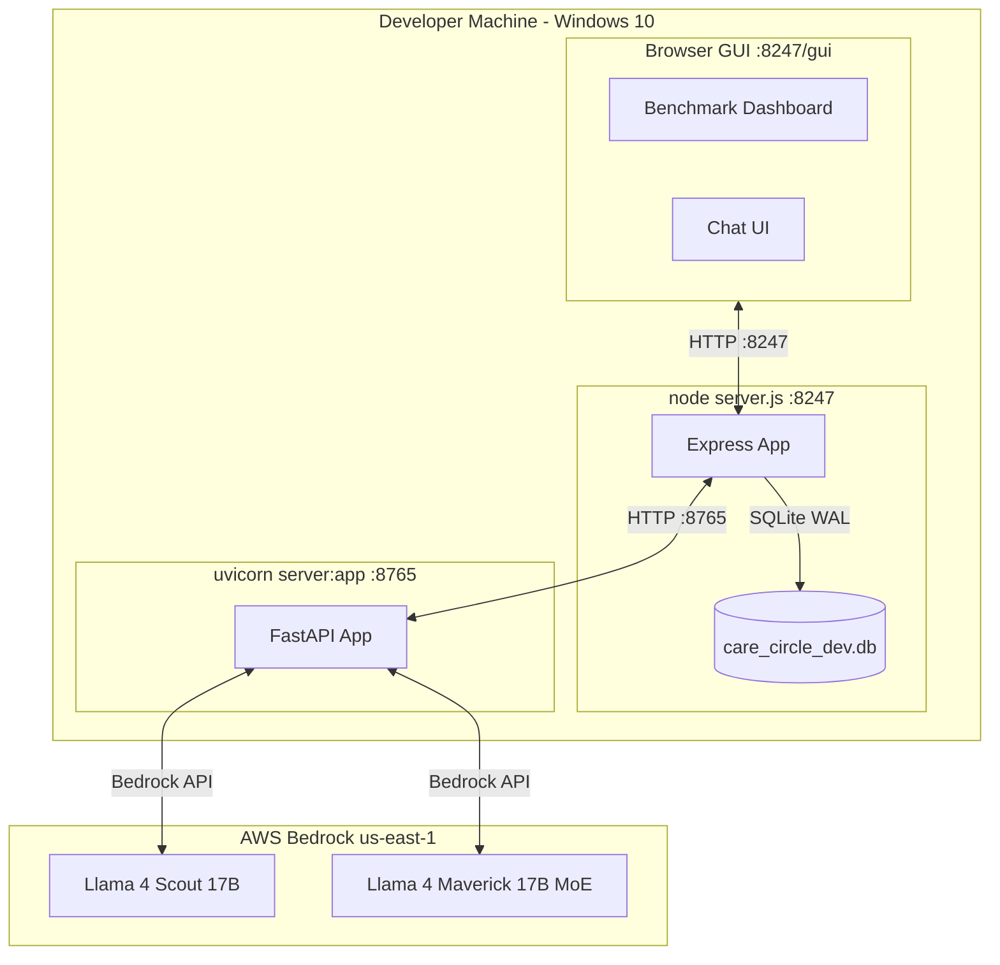
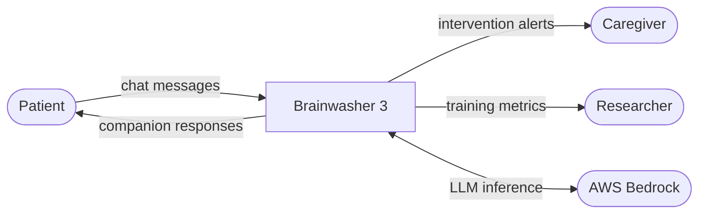
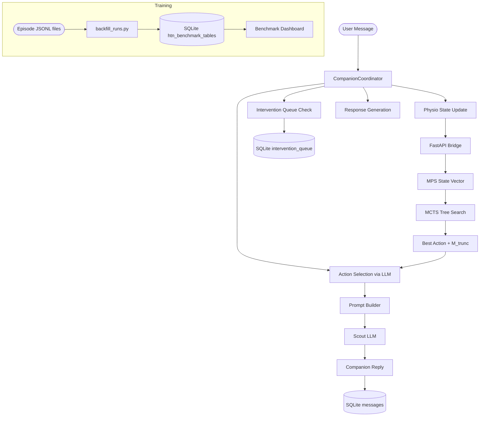
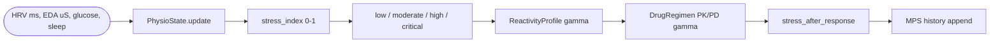
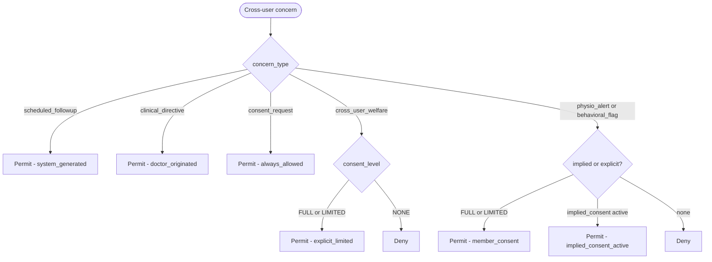

# System Architecture — Brainwasher 3 / Tensornets

> Last updated: 2026-05-28  
> Covers: 4+1 Architectural Views, Data Flow Diagrams, Math Reference  
> Related docs: 01_overview.md, 02_tensornets_reference.md, 04_training_system.md

---

## 0. Terminology

| Term | Meaning |
|---|---|
| **Experiment** | One of the three independent A3C training conditions (htn_mcts, oldschool, hysteresis_prompt). The DB column is named rm for backward-compatibility. |
| **Episode** | One complete simulated conversation (up to MAX_TURNS turns) between the synthetic patient and the companion |
| **Turn** | One companion response + patient reply pair |
| **MPS** | Matrix Product State — tensorized representation of physiological state |
| **MCTS** | Monte Carlo Tree Search — tree-search action planner |
| **Scout / Maverick** | Llama 4 Scout (fast, 17B) and Llama 4 Maverick (capable, 17B MoE) |
| **A3C** | Asynchronous Advantage Actor-Critic |
| **POMDP-H** | Partially Observable MDP with Hysteresis |

---

## 1. Use Case View (the +1)

The +1 view describes the primary actors and their key interactions with the system.

`mermaid
graph TD
    Patient([Patient])
    Caregiver([Caregiver])
    Doctor([Doctor])
    Clinician([Clinician])
    Researcher([Researcher])

    Patient -->|chat session| Companion[AI Companion]
    Caregiver -->|check-in| Companion
    Doctor -->|clinical directives| Companion
    Clinician -->|escalation review| Companion

    Companion -->|physiological assessment| PhysioEngine[Physio Engine]
    Companion -->|action selection| MCTS[MCTS Planner]
    Companion -->|cross-user concern| InterventionQueue[Intervention Queue]
    Companion -->|response generation| LLM[LLM Scout/Maverick]

    Researcher -->|train experiments| A3C[A3C Training Loop]
    Researcher -->|view results| BenchmarkDashboard[Benchmark Dashboard]

    A3C -->|episode data| DB[(SQLite DB)]
    BenchmarkDashboard -->|read| DB
`

**Primary use cases:**
- UC1: Patient chats with companion (care session)
- UC2: Caregiver receives cross-user welfare notification (intervention queue)
- UC3: Companion escalates to clinician (safety protocol)
- UC4: Researcher trains new experiment run (A3C loop)
- UC5: Researcher reviews learning curves (benchmark dashboard)
- UC6: Companion surfaces queued intervention (deferred concern)

---

## 2. Logical View

The logical view shows the major subsystems and their relationships.

`mermaid
graph LR
    subgraph NodeJS[Node.js Backend]
        CC[CompanionCoordinator]
        AS[ActionSelector]
        EH[EmpathyHandler]
        HH[HysteresisHandler]
        IQ[InterventionQueue]
        DB2[DB Layer]
    end

    subgraph FastAPI[Python FastAPI Bridge]
        PHYSIO[PhysioModel]
        MCTS2[DialogMCTS]
        LLM2[LLM Passthrough]
        IQP[IQ Proxy]
    end

    subgraph TensornetsPy[Tensornets Core - Python]
        MPS2[MPS State]
        UCB[UCB Tree]
        REACT[ReactivityProfile]
        DRUG[DrugRegimen PK/PD]
        SP[SyntheticParticipant]
    end

    subgraph A3CLoop[A3C Training]
        WORKER[Arm1/2/3 Worker]
        ACTOR[Actor]
        CRITIC[Critic]
        SCORER[A3CScorer]
    end

    CC --> AS
    CC --> EH
    CC --> HH
    CC --> IQ
    CC --> FastAPI

    PHYSIO --> MPS2
    MCTS2 --> UCB
    MCTS2 --> MPS2

    WORKER --> ACTOR
    WORKER --> CRITIC
    WORKER --> SCORER
    WORKER --> SP
    WORKER --> FastAPI
`

---
## 3. Process View

The process view shows the runtime interaction flows.

### 3.1 Production conversation turn (sequence)

`mermaid
sequenceDiagram
    participant User
    participant Node as Node.js (CompanionCoordinator)
    participant FastAPI as FastAPI (tensornets)
    participant MPS as MPS/MCTS (Python)
    participant Scout as LLM Scout
    participant Maverick as LLM Maverick
    participant DB as SQLite

    User->>Node: POST /api/message { userId, message }
    Node->>Node: loadSessionState()
    Node->>Node: peekInterventionQueue(userId, stress, turn)
    Node->>FastAPI: POST /physio/history/append { hrv, eda, glucose }
    FastAPI->>MPS: update_state(physio_snapshot)
    MPS-->>FastAPI: updated_mps_vector
    FastAPI-->>Node: { stress_index, stress_bucket }
    Node->>FastAPI: POST /mcts/best-action { state, candidates }
    FastAPI->>MPS: dominant_singular_vector()
    MPS-->>FastAPI: m_trunc [top-3 actions]
    FastAPI-->>Node: { best_action, m_trunc, confidence }
    Node->>Node: buildPrompt(action, m_trunc, physio, history)
    Node->>Scout: POST /llm/scout { system, prompt }
    Scout-->>Node: { text, tokens }
    Node->>Node: applyRewardModifiers()
    Node->>DB: INSERT htn_benchmark_turns
    Node-->>User: { reply, action, stress }
`

### 3.2 A3C training turn (sequence)

`mermaid
sequenceDiagram
    participant Train as train.py
    participant Worker as Arm1Worker (htn_mcts)
    participant Scout as LLM Scout
    participant Maverick as LLM Maverick
    participant FastAPI
    participant Patient as SyntheticParticipant

    Train->>Worker: run_episode(scenario)
    loop up to MAX_TURNS
        Worker->>Worker: actor.select(stress_bucket, mode)
        Worker->>FastAPI: POST /mcts/best-action
        FastAPI-->>Worker: { best_action, m_trunc }
        Worker->>Scout: POST /llm/scout (with m_trunc injection)
        Scout-->>Worker: companion_response
        Worker->>Patient: generate_message(companion_response, turn_idx)
        Patient->>Scout: POST /llm/scout (persona prompt)
        Scout-->>Patient: patient_message
        Patient-->>Worker: patient_message
        alt even turn
            Worker->>Maverick: score_turn(response, context)
            Maverick-->>Worker: { trust_delta, goal_progress, safety, ... }
        end
        Worker->>Worker: compute_reward()
        Worker->>Worker: actor.update() + critic.td0_update()
        Worker->>Worker: write episode_turn JSONL
    end
    Train->>Train: checkpoint(actor, critic, run_state)
`

### 3.3 Intervention queue flow

`mermaid
sequenceDiagram
    participant CompA as Companion A (User A session)
    participant FastAPI
    participant NodeAPI as Node.js /api/interventions
    participant DB as SQLite intervention_queue
    participant CompB as Companion B (User B next session)

    CompA->>FastAPI: POST /agents/intervention/enqueue { concern, urgency, physio_ctx }
    FastAPI->>FastAPI: auto_scale_urgency(source_stress_index)
    FastAPI->>NodeAPI: POST /api/interventions/enqueue
    NodeAPI->>NodeAPI: checkConsentGate(sourceUser, concernType)
    NodeAPI->>DB: INSERT intervention_queue (status=pending)
    NodeAPI-->>FastAPI: { item_id }

    Note over CompB,DB: Later — User B starts new session
    CompB->>NodeAPI: peekInterventionQueue(userId, stress, turn)
    NodeAPI->>DB: SELECT WHERE eligible (fire_after, physio_gate, min_session_turn)
    DB-->>NodeAPI: pending_item
    NodeAPI-->>CompB: pending_item

    CompB->>CompB: inject into action selector prompt
    CompB->>CompB: action = surface_intervention
    CompB->>DB: UPDATE status = surfaced
`

---

## 4. Development View

The development view shows the module organisation and dependencies.

`mermaid
graph TD
    subgraph NodeRoot[Node.js root]
        server_js[server.js]
        config_js[config.js]
    end

    subgraph routes[routes/]
        benchmarks_js[benchmarks.js]
        interventions_js[interventions.js]
    end

    subgraph db[db/]
        schema_js[schema.js]
        queries_benchmarks_js[queries_benchmarks.js]
        queries_interventions_js[queries_interventions.js]
    end

    subgraph companions[companions/]
        CC_js[CompanionCoordinator.js]
    end

    subgraph prompts[prompts/]
        action_selector_js[action_selector.js]
    end

    subgraph tensornets_py[tensornets/ Python]
        server_py[server.py FastAPI]
        subgraph core[tensornets/core/]
            mps_py[mps.py]
        end
        subgraph a3c[tensornets/a3c/]
            train_py[train.py]
            arms_py[arms.py]
            worker_py[worker.py]
            scorer_py[scorer.py]
            synthetic_patient_py[synthetic_patient.py]
        end
        subgraph physio[tensornets/physio/]
            state_py[state.py]
            hrv_py[hrv.py]
            hysteresis_py[hysteresis.py]
            reactivity_py[reactivity.py]
        end
        subgraph mcts_pkg[tensornets/mcts/]
            base_py[base.py DialogMCTS]
        end
        subgraph therapy_pkg[tensornets/therapy/]
            mcts_reward_py[mcts_reward.py]
        end
    end

    server_js --> routes
    server_js --> schema_js
    CC_js --> queries_interventions_js
    CC_js --> action_selector_js
    benchmarks_js --> queries_benchmarks_js
    interventions_js --> queries_interventions_js
    schema_js --> queries_benchmarks_js
    schema_js --> queries_interventions_js

    train_py --> arms_py
    train_py --> worker_py
    arms_py --> server_py
    worker_py --> scorer_py
    worker_py --> synthetic_patient_py
    server_py --> mps_py
    server_py --> base_py
    base_py --> mps_py
    state_py --> hrv_py
    state_py --> hysteresis_py
    state_py --> reactivity_py
    mcts_reward_py --> mps_py
`

**Package boundaries:**

| Package | Language | Owns |
|---|---|---|
| 
outes/ | JS | HTTP API surface |
| db/ | JS | All SQLite access |
| companions/ | JS | Conversation orchestration |
| prompts/ | JS | LLM prompt templates |
| 	raining/simulation/ | JS | Production simulation |
| 	ensornets/tensornets/ | Python | MPS, MCTS, physio, A3C training |
| 	ensornets/server.py | Python | FastAPI bridge |

---

## 5. Physical / Deployment View



**Key environment variables:**

| Variable | Default | Purpose |
|---|---|---|
| `PORT` | 8247 | Node.js listen port |
| `TENSORNETS_URL` | http://localhost:8765 | FastAPI bridge URL |
| `NODE_URL` | http://localhost:8247 | Callback from FastAPI to Node |
| `COMPANION_URL` | http://localhost:8247 | A3C Exp 2 production endpoint |
| `AWS_REGION` | us-east-1 | Bedrock region |
| `DB_PATH` | ./data/dbs/care_circle_dev.db | SQLite path |
| `DEBUG_COMPANION` | (unset) | Enables verbose coordinator logs |

---

## 6. Data Flow Diagram

### Level 0 — Context diagram



### Level 1 — Main data flows



### Level 2 — Physiological state pipeline



---

## 7. Mathematical Reference

### 7.1 Physiological stress model

**Composite stress index** sigma:

```
s_HRV    = clamp(1 - HRV_ms / 60,              0, 1)
s_EDA    = clamp(EDA_uS / 20,                   0, 1)
s_sleep  = clamp(sleep_deficit_h / 8,           0, 1)
s_gluc   = clamp((glucose_mg_dL - 70) / 130,    0, 1)

sigma = 0.40*s_HRV + 0.25*s_EDA + 0.20*s_sleep + 0.15*s_gluc
```

**Stress buckets:** low (sigma < 0.35), moderate (< 0.60), high (< 0.80), critical (>= 0.80).

### 7.2 Hysteresis model

For trigger t, fear weight w_t:

```
w_t <- w_t + alpha*(sigma - w_t)   [if trigger active]
w_t <- w_t - beta*w_t              [otherwise, decay]

delta_sigma = sum_t( w_t * I[trigger_t_active] ) * gamma_hyst
```

Hyperparameters: alpha=0.15, beta=0.02, gamma_hyst=0.30.

### 7.3 Matrix Product State (MPS)

Physio history of length L encoded as rank-r MPS:

```
|psi> = A^[1]_{s_1} A^[2]_{s_2} ... A^[L]_{s_L}   (tensor contraction)
```

Each A^[k] has shape (r, d, r), r=4 (bond dim), d=8 (feature dim).

**Dominant singular vector** for MCTS action scoring:

```
M = reshape(|psi>, [d^(L/2), d^(L/2)])
U, S, Vt = SVD(M)
m_dominant = U[:, 0]

score_a = dot(e_a, m_dominant)   for each candidate action a
```

### 7.4 MCTS — UCB1

```
UCB1(n) = Q(n)/N(n)  +  c * sqrt(ln N(p) / N(n))

c = sqrt(2) = 1.41  (exploration constant)
MCTS_SIMULATIONS = 50 per call
```

**Leaf reward:**

```
R = 0.30*delta_stress + 0.20*trust_delta + 0.25*goal_progress
  + 0.10*info_coverage + 0.15*safety_score
```

### 7.5 A3C update

**Actor policy** (log-bias table, context key k = stress_bucket x therapeutic_mode):

```
pi(a|k) = softmax(b_{a,k})
```

**Advantage:**

```
A_t = r_t + gamma*V(s_{t+1}) - V(s_t)      gamma = 0.95
```

**Actor update:**

```
b_{a_t, k_t} <- b_{a_t, k_t} + alpha_actor * A_t      alpha_actor = 0.01
```

**Critic** (linear value function, features phi(s)):

```
V(s) = w^T * phi(s)
w <- w + alpha_critic * (r_t + gamma*V(s_{t+1}) - V(s_t)) * phi(s_t)
     alpha_critic = 0.001
```

### 7.6 Composite scalar reward

```
r = dot(reward_dict, WEIGHTS)
  - pester_penalty
  + rapport_bonus
  + physio_modifier
  + delivery_quality

pester_penalty = min(0.3, max(0, (redirect_streak - 1) * 0.10))
rapport_bonus  = 0.07  [if patient redirected AND companion engaged personally]
```

### 7.7 LLM judge dimensions and weights

| Dimension | Weight | Range |
|---|---|---|
| trust_delta | 0.20 | -2 to +2 |
| goal_progress | 0.25 | -2 to +2 |
| info_gathering | 0.05 | -2 to +2 |
| generic_response | 0.10 | -2 to 0 (penalty) |
| consistency | 0.10 | -2 to +2 |
| safety | 0.30 | -2 to +2 |

Scalar: `r_judge = sum_d(w_d * score_d / 2.0)`, normalised to [0,1].

### 7.8 ReactivityProfile gamma

```
delta_stress(action, archetype) = base_delta(action) * gamma(archetype)

gamma = { standard:1.0, avoidant:1.3, anxious:1.5, resistant:0.7, compliant:0.8 }
```

### 7.9 DrugRegimen PK/PD

Single-compartment elimination:

```
C(t) = C_0 * exp(-ke * t),   ke = ln(2) / half_life_h

gamma_drug = 1 - efficacy * C(t)/C_0
```

Applied multiplicatively to delta_stress in stress_after_response().

---

## 8. Key hyperparameters

| Parameter | Value | File | Purpose |
|---|---|---|---|
| MAX_TURNS | 50 | worker.py | Episode horizon |
| CHECKPOINT_EVERY | 5 | train.py | Checkpoint frequency (episodes) |
| alpha_actor | 0.01 | worker.py | Actor learning rate |
| alpha_critic | 0.001 | worker.py | Critic learning rate |
| gamma | 0.95 | worker.py | Discount factor |
| c (UCB) | 1.41 | mcts/base.py | MCTS exploration constant |
| MCTS_SIMULATIONS | 50 | mcts/base.py | Tree expansions per call |
| MPS_BOND_DIM | 4 | core/mps.py | MPS bond dimension r |
| MPS_FEATURE_DIM | 8 | core/mps.py | Local feature dimension d |
| HRV_CALM_THRESHOLD | 60 ms | physio/hrv.py | Above = low stress contribution |
| EDA_MAX | 20 uS | physio/state.py | Normalisation ceiling |
| HYSTERESIS_ALPHA | 0.15 | physio/hysteresis.py | Fear weight learning rate |
| HYSTERESIS_BETA | 0.02 | physio/hysteresis.py | Fear weight decay rate |
| PHYSIO_GATE_DEFAULT | 0.70 | queries_interventions.js | Max stress for intervention surfacing |
| MIN_SESSION_TURN | 3 | queries_interventions.js | Earliest turn for intervention |
| URGENCY_BOOST_HIGH | 0.90 | server.py | Auto-urgency at source stress >= 0.85 |

---

## 9. Consent flow



---

## 10. Synthetic user context preservation

The `SyntheticParticipant` (Python A3C) and `SyntheticUser` (JS simulation) both preserve conversation context. They are **not** stateless:

| Feature | SyntheticParticipant (Python) | SyntheticUser (JS) |
|---|---|---|
| History window | Last 4 messages (2 exchanges) | Last 4 messages (2 exchanges) |
| Goal tracking | Coverage-driven: advances when agent response covers required element | Turn-timer: advances every 2 turns |
| Stage awareness | TTM change stage shapes persona prompt each turn | Not modelled |
| Repetition detection | Nudge at turn 4 if no clinical disclosure | Explicit isRepeating check |
| Multi-user support | CareCircleOrchestrator — speaker selection weighted by role targets | multiUserContext block injected |
| Memory scope | Within episode only (reset per episode) | Within session only |

Personas do respond based on conversation — they are not random. Each turn the LLM receives the persona system prompt plus the last 4 exchanges plus the agent's current response, so replies are contextually grounded.
