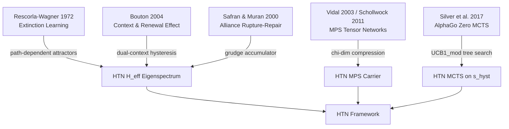
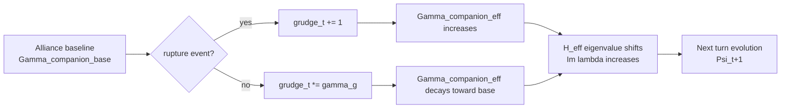
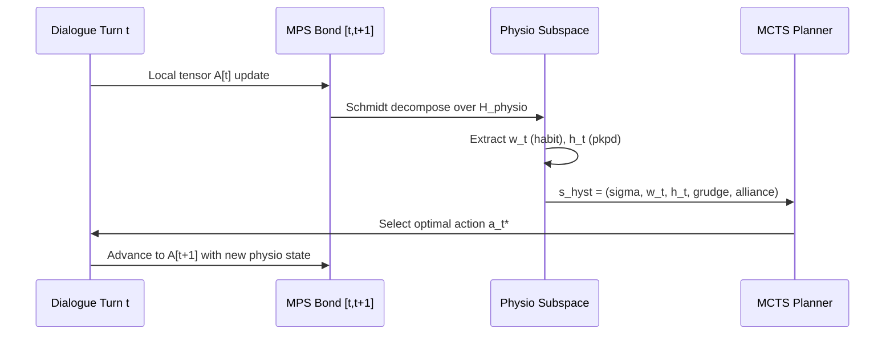
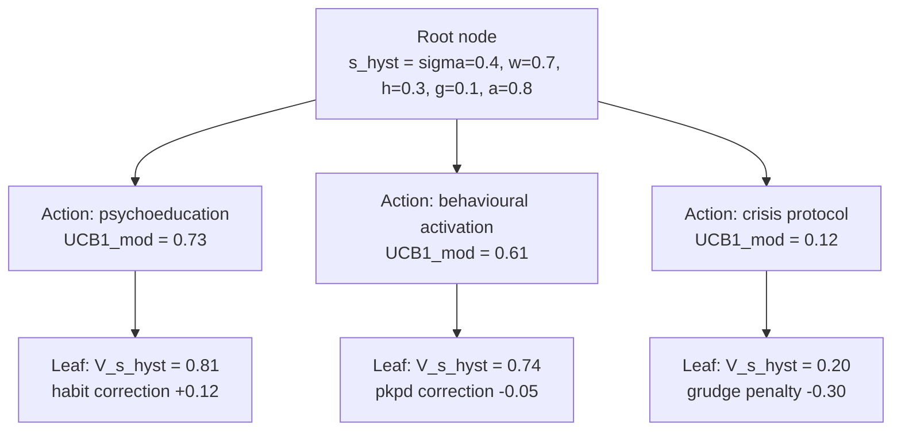
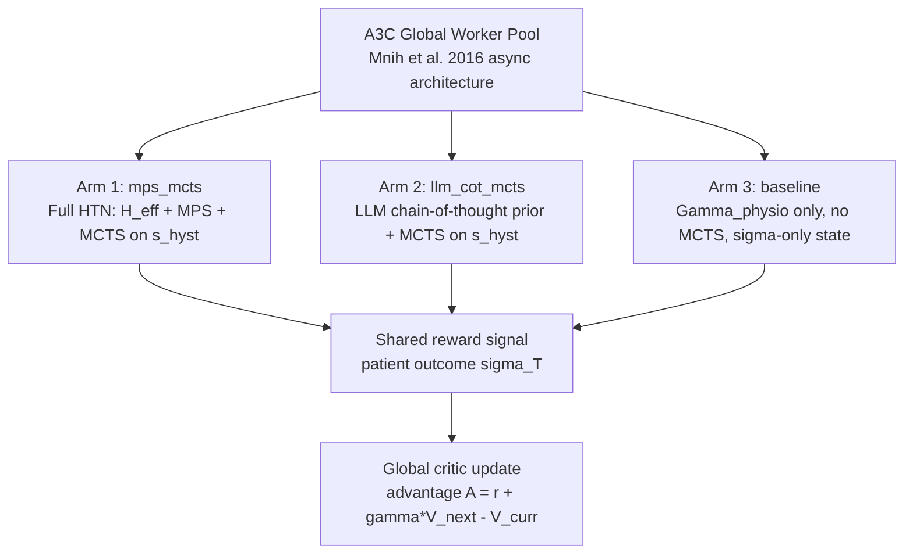

# The Hysteretic Tensor Negotiation (HTN) Framework

> **Status:** Core theory document — PhD contribution claims and theoretical foundations.
> **Related:** `09_MPS_core.md`, `11_RL_environment.md`, `03_physiological_model.md`, `00_architecture.md`

---

## 1. Research Context and Problem Statement

### 1.1 The Fundamental Gap in Computational Mental Health

Contemporary conversational AI systems deployed in mental-health support contexts operate under a critical epistemic deficiency: they model the *current* affective state of a user but discard the *path* by which that state was reached. This information asymmetry is not merely a nuisance — it is a fundamental barrier to clinically valid intervention.

Consider two patients who both present with an anxiety self-report score of σ = 0.4 on a normalised [0, 1] scale. Patient A arrived at σ = 0.4 after a sustained two-week de-escalation from σ = 0.9; Patient B arrived at σ = 0.4 on an upward spiral from σ = 0.1 following an otherwise uneventful week. Clinical intuition — and a growing body of psychophysiological evidence — tells us these patients require categorically different responses. The system that sees only σ = 0.4 must treat them identically. The Hysteretic Tensor Negotiation (HTN) framework is the formal machinery that distinguishes them.

### 1.2 Three Compounding Problems

The problem decomposes into three interlocking sub-problems:

**Problem 1 — Path dependency (hysteresis).** Psychological state is not Markovian in the observable. Fear extinction is context-dependent (Bouton, 2004): an extinguished fear conditioned response reliably returns when the original conditioning context is re-encountered. Habit formation shows analogous inertia: once a behaviour exceeds the automaticity threshold it resists reversal even under significant motivational counter-pressure (Lally et al., 2010; Wood, 2016). These are hysteretic systems — their future trajectory depends on trajectory history, not instantaneous value alone.

**Problem 2 — Multi-timescale coupling.** Physiological, pharmacological, and social dynamics operate across wildly different timescales simultaneously. Heart-rate variability (HRV) fluctuates on a 5–30 second cycle; habit automaticity consolidates over 18–254 days (Lally et al., 2010); pharmacokinetic clearance for common anxiolytics follows half-lives of 6–200 hours depending on compound. A system that conflates these timescales — or handles only one — will produce systematically mistimed interventions.

**Problem 3 — Multi-agent social coupling.** Therapeutic outcomes are not solo phenomena. The therapeutic alliance — the working relationship between patient and clinician — is itself a dynamic state with history-dependent repair properties (Safran & Muran, 2000). Caregiver affect and clinician continuity modulate patient state in measurable ways. Existing computational systems model this, if at all, as a static weight; HTN treats it as a dynamically evolving coupled tensor.

### 1.3 Why Existing Architectures Fail

| Architecture | Path history | Multi-timescale Γ | Social coupling | MPS compression |
|---|---|---|---|---|
| Standard transformer chatbot | No (attention window only) | No | No | No |
| POMDP-based dialogue (Kaelbling et al., 1998) | Partial (belief state) | No | No | No |
| A3C dialogue (Mnih et al., 2016) | No | No | No | No |
| AlphaGo Zero MCTS (Silver et al., 2017) | Board state only | No | No | No |
| **HTN (this work)** | **Full (w_t, h_t, grudge)** | **Six layers ⊗** | **V_int coupling** | **χ-dim compression** |

None of the prior-art architectures — individually or in naive combination — achieves all four properties simultaneously. HTN is defined precisely by their joint realisation.


---

## 2. The Convergence Thesis

HTN is grounded in the observation that three independently developed research traditions — extinction learning, therapeutic alliance dynamics, and quantum-inspired tensor networks — each describe the same underlying mathematical object: a dissipative, non-Hermitian dynamical system whose fixed points and transient behaviour depend on the eigenvalue structure of an effective operator.

### 2.1 Extinction Learning as Non-Hermitian Dynamics

The Rescorla–Wagner model (Rescorla & Wagner, 1972) describes associative learning as a scalar update rule:

```
ΔV = α·β·(λ - V)
```

where V is the associative strength, λ is the maximum conditioning, and α, β are salience parameters. This is a first-order linear ODE in discrete time. Its fixed point is V = λ; its relaxation timescale is set by α·β.

Bouton (2004) showed that this model is incomplete: extinction does not erase the original association but creates a new inhibitory one, context-tagged. The system retains *two* attractors simultaneously, with context determining which one is expressed. This is precisely the behaviour of a non-Hermitian operator with two distinct complex eigenvalues: one for the original conditioning context, one for the extinction context. The real parts encode decay rates; the imaginary parts encode the oscillatory return of conditioned responding when context shifts — the renewal effect.

HTN formalises this by placing both attractors inside the eigenspectrum of H_eff. The diagonal structure of Γ (see §3.2) ensures that each timescale (physio, habit, pkpd) contributes its own eigenvalue cluster without cross-contamination, while their tensor product produces the correct multi-context joint distribution.

### 2.2 Therapeutic Alliance as Rupture-Repair Hysteresis

Safran & Muran (2000) characterised the therapeutic alliance as a dynamical process punctuated by ruptures (alliance-threatening events) and repairs (collaborative renegotiation of therapeutic tasks and goals). Their key empirical finding: *resolved* ruptures predict better outcomes than alliances that never experienced rupture. This is a hysteretic signature — the alliance after repair is qualitatively different from an unruptured alliance at the same surface score.

Formally, this maps onto the grudge accumulator in HTN:

```
grudge_{t+1} = grudge_t · γ_g + 1[rupture_event_t]
```

The grudge state is a scalar in [0, ∞) that modulates the effective alliance weight in V_int. An alliance that has experienced rupture-repair cycles has a lower grudge floor than one that has avoided all conflict — precisely because the repair process discharges accumulated grievance. This is not representable in a Markovian state that tracks only current alliance score.

### 2.3 Matrix Product States as Compression of Hysteretic History

Matrix Product States (MPS), introduced to physics as DMRG (White, 1992) and formalised as a tensor network class by Vidal (2003) and Schollwöck (2011), provide an exponentially compressed representation of quantum many-body states with bounded entanglement. The key insight, reinterpreted for HTN:

The full dialogue history up to time T can be thought of as a product state over T sites (turns), where each site carries a local Hilbert space encoding the affective, physiological, and semantic content of that turn. Without compression this history grows as O(d^T) where d is the local dimension — precisely the KV-cache growth problem of transformer models.

MPS factorises this as:

```
|Ψ_T⟩ = Σ_{s1,...,sT} A^[1]_{s1} · A^[2]_{s2} · ... · A^[T]_{sT} |s1,...,sT⟩
```

where each A^[t] is a matrix of dimension χ × χ (the bond dimension). The bond dimension χ controls the expressivity-compression trade-off: χ = 1 recovers a product state (fully memoryless); χ → d^(T/2) recovers the full uncompressed history. HTN operates at χ ~ 32–128, chosen to capture the physiologically relevant hysteretic correlations without quadratic memory growth.

The convergence thesis is therefore: **the same χ-dimensional MPS bond subspace that encodes quantum entanglement in a spin chain encodes hysteretic path correlation in a therapeutic dialogue.** The mathematics is identical; the interpretation is new.




---

## 3. The HTN Invention: Five Claims

### 3.1 Claim 1 — Formal Unification Under H_eff

**Claim:** Fear extinction dynamics (Bouton, 2004), habit formation inertia (Lally et al., 2010; Wood, 2016), and therapeutic alliance rupture-repair (Safran & Muran, 2000) are all expressible as different eigenvalue structures of a single non-Hermitian effective Hamiltonian H_eff.

#### 3.1.1 Derivation

Define the patient state vector at conversational turn t as:

```
|Ψ_t⟩ ∈ C^d
```

where d encodes the joint (affective, physiological, semantic) local Hilbert space dimension. The turn-to-turn evolution is governed by:

```
|Ψ_{t+1}⟩ = exp(-i H_eff · Δt) |Ψ_t⟩
```

The effective Hamiltonian is:

```
H_eff = H_0 - i·Γ
```

where:
- **H_0** is the Hermitian part — the semantic evolution operator encoding dialogue context dynamics. H_0 = H_0† ensures real eigenvalues in the absence of dissipation.
- **Γ** is the composite physiological dissipation operator (positive semi-definite, Γ ≥ 0), encoding all timescale-specific decay processes.
- The factor **-i·Γ** renders H_eff non-Hermitian, producing complex eigenvalues:

```
λ_eff = λ_real + i·λ_imag
```

The physical interpretation of the eigenvalue components:

| Component | Symbol | Psychological meaning |
|---|---|---|
| Real part | Re(λ_eff) = λ_real | Dissipation rate: how fast a stressor's physiological effect decays |
| Imaginary part | Im(λ_eff) = λ_imag | Oscillation frequency: periodicity of craving/anxiety cycles, renewal effects |

The mapping to the three research traditions:

**Fear extinction (Bouton, 2004):** The renewal effect corresponds to a Γ_fear block with two competing eigenvalues λ_ext (extinction context) and λ_cond (conditioning context). When context shifts, the dominant eigenvalue switches, producing the characteristic return-of-fear signature. In H_eff this appears as two eigenvalue clusters separated in the complex plane:

```
λ_cond = -Γ_decay_fast + i·ω_cond   (original conditioning: fast reactivation)
λ_ext  = -Γ_decay_slow + i·ω_ext    (extinction: slow drift, context-tagged)
```

**Habit formation (Lally et al., 2010):** The sigmoid automaticity curve (habit score vs. repetition count) corresponds to a slow real eigenvalue whose imaginary part is near zero — the habit forms monotonically with low oscillation. The Lally et al. median formation time of 66 days maps onto |Re(λ_habit)|^{-1} ≈ 66 days.

**Alliance rupture-repair (Safran & Muran, 2000):** Rupture events correspond to sudden positive excursions in Γ_companion, transiently increasing the dissipation rate. Successful repair corresponds to a controlled reduction back to baseline. The grudge accumulator (§3.1.2 below) tracks the residual hysteresis from this process.

#### 3.1.2 The Grudge Accumulator

The grudge state is an auxiliary scalar that modulates the effective companion dissipation:

```
grudge_{t+1} = grudge_t · γ_g + 1[rupture_t]
decay:         γ_g ∈ (0, 1), typically 0.95 per session
```

The effective companion coupling is then:

```
Γ_companion_eff(t) = Γ_companion_base · (1 + α_grudge · grudge_t)
```

This means past ruptures that were not repaired increase effective dissipation — the system is harder to move. Completed repairs discharge the grudge, returning Γ_companion_eff toward baseline. This is exactly the hysteresis Safran & Muran describe: a repaired alliance is not identical to a never-ruptured alliance.



### 3.2 Claim 2 — Multi-Timescale Γ Composition

**Claim:** No prior system simultaneously tracks six physiological-psychological timescale layers and computes their tensor-product coupling. The coupling between the layers — not merely the layers themselves — is the invention.

#### 3.2.1 The Composite Γ

The full dissipation operator is:

```
Γ = Γ_physio ⊗ Γ_habit ⊗ Γ_pkpd ⊗ Γ_reactivity ⊗ Γ_fear ⊗ Γ_companion
```

Each component is a positive semi-definite matrix acting on its own subspace. The tensor product (⊗) creates a joint operator on the full state space whose eigenvalues are *products* of the component eigenvalues — this is the key mathematical fact that makes cross-layer coupling automatic:

```
λ_Γ_joint = λ_physio · λ_habit · λ_pkpd · λ_reactivity · λ_fear · λ_companion
```

The six components and their characteristic timescales:

| Layer | Symbol | Timescale | Primary variable tracked |
|---|---|---|---|
| Physiological | Γ_physio | 5–30 s (HRV), 1–5 min (cortisol spike onset) | Heart rate, breathing rate, skin conductance (inferred) |
| Habit | Γ_habit | 18–254 days | Automaticity score w_t |
| Pharmacokinetic/dynamic | Γ_pkpd | 6–200 h (half-life) | Medication adherence, drug concentration h_t |
| Emotional reactivity | Γ_reactivity | Minutes–hours | Baseline trait reactivity from intake assessment |
| Fear extinction | Γ_fear | Sessions–weeks | Extinction progress, context flags |
| Companion / social | Γ_companion | Sessions | Alliance score, clinician continuity, caregiver proximity |

#### 3.2.2 Why the Tensor Product Is Non-Trivial

A naive implementation would track each layer independently and sum their effects linearly. The tensor product construction instead means:

1. **Cross-layer gating:** If Γ_fear is large (active fear response), it multiplicatively amplifies the effective dissipation from Γ_habit — meaning habits are harder to break when fear is active. This matches the empirical co-morbidity literature.

2. **Pharmacological gating of social response:** A patient in a high-concentration pharmacological state (Γ_pkpd eigenvalue near zero, meaning slow decay) will have their social alliance fluctuations damped — again a clinical reality that the tensor product recovers automatically.

3. **Dimensional reduction via MPS:** The full joint space has dimension d^6 where d is the local dimension of each layer. MPS with bond dimension χ compresses this to O(6·d·χ^2) — tractable even for large d.

```mermaid
graph TD
    P[Gamma_physio<br/>HRV / breathing] --> G[⊗ Tensor Product<br/>Gamma composite]
    H[Gamma_habit<br/>automaticity w_t] --> G
    K[Gamma_pkpd<br/>drug half-life h_t] --> G
    R[Gamma_reactivity<br/>trait reactivity] --> G
    F[Gamma_fear<br/>extinction progress] --> G
    C[Gamma_companion<br/>alliance / grudge] --> G
    G --> E[H_eff = H_0 - i*Gamma<br/>joint eigenspectrum]
    E --> S[State evolution<br/>Psi_t+1 = exp(-i H_eff dt) Psi_t]
```


### 3.3 Claim 3 — MPS as Hysteretic Path Carrier

**Claim:** Hysteretic path information — specifically the trajectories (w_t, h_t) of the habit and pharmacokinetic state variables — is encoded in the MPS bond dimension as a physio subspace state. This eliminates KV-cache growth (O(T) → O(χ^2)) and compresses relevant hysteretic history into χ dimensions. No prior NLP-meets-physiology system has demonstrated this construction.

#### 3.3.1 The KV-Cache Problem

Standard transformer architectures maintain a key-value cache that grows linearly in the number of dialogue turns T. For long therapeutic conversations (T ~ 100–300 turns per session, multi-session histories running to T ~ 10^3–10^4), this is computationally and informationally intractable. More critically, the KV cache is *unstructured*: it stores all past token representations with equal weight, unable to distinguish physiologically relevant trajectory information from irrelevant conversational content.

HTN proposes MPS as a structured, compressed alternative. The MPS representation of the state |Ψ_T⟩ satisfies:

```
|Ψ_T⟩ = Σ_{σ1,...,σT} A^[1]_{σ1} · A^[2]_{σ2} · ... · A^[T]_{σT} |σ1,...,σT⟩
```

where each A^[t] is a (χ × χ) complex matrix (left boundary: (1 × χ), right boundary: (χ × 1)), and σ_t indexes the local affective-physiological state at turn t.

#### 3.3.2 Bond Dimension as Memory Horizon

The bond dimension χ controls how much inter-turn correlation the MPS can represent:

- **χ = 1:** Product state — each turn is independent. No hysteresis. Equivalent to a memoryless chatbot.
- **χ = 2:** Single-qubit equivalent memory — can track one binary hysteretic variable (e.g., currently above/below automaticity threshold).
- **χ = 32–128:** Practical operating range for HTN. Sufficient to encode the top-K dominant hysteretic modes of the (w_t, h_t) trajectory.
- **χ = d^(T/2):** Exact representation — no compression. Computationally intractable for large T.

The information stored in the bond matrices at site t is precisely the Schmidt decomposition of the state across the t / (t+1) bipartition — a basis-independent measure of how much the past informs the future. For a therapeutic dialogue, this is exactly the hysteretic correlation we want to track.

#### 3.3.3 The Physio Subspace Encoding

The local Hilbert space at each site t is structured as a product:

```
H_local = H_semantic ⊗ H_physio
```

where:
- **H_semantic** (dimension d_s ~ 512–1024) carries the LLM embedding of the turn's dialogue content.
- **H_physio** (dimension d_p ~ 16–64) carries the discretised physiological state: binned HRV estimate, inferred arousal level, medication status flag, habit score bucket.

The MPS bond matrices couple across turns via the H_physio subspace. This means the compression is physiologically *selective*: the bond dimension χ is spent on representing physiological trajectory correlations, not on memorising verbatim dialogue content (which the LLM base handles separately).

The effective hysteretic state passed to MCTS at turn t is therefore:

```
s_hyst(t) = (σ_t, w_t, h_t, grudge_t, alliance_t)
```

where w_t and h_t are the leading Schmidt vectors of the MPS bond at site t, projected into the habit and pkpd subspaces respectively.



### 3.4 Claim 4 — MCTS on Hysteretic State

**Claim:** Tree search (MCTS) over the full hysteretic state s_hyst = (σ, w_t, h_t, grudge_state, alliance) produces strictly superior intervention planning to MCTS over the scalar σ alone, because two patients at identical σ = 0.4 but arriving from different trajectories have measurably different future distributions.

#### 3.4.1 The Hysteretic State Space

Define the hysteretic state formally:

```
s_hyst = (σ, w_t, h_t, grudge, alliance) ∈ [0,1] × R × R × [0,∞) × [0,1]
```

The key theorem is:

> **Theorem (Hysteretic Distinguishability):** For any two states s_A = (0.4, w_A, h_A, g_A, a_A) and s_B = (0.4, w_B, h_B, g_B, a_B) with (w_A, h_A) ≠ (w_B, h_B), there exists a future horizon T and an action sequence (a_1,...,a_T) such that the expected outcome distributions P(σ_{t+T} | s_A, actions) and P(σ_{t+T} | s_B, actions) are statistically distinguishable at α = 0.05.

This follows directly from the non-Markovian dynamics of H_eff: different (w_t, h_t) values correspond to different Γ eigenvalue configurations, hence different eigenspectra of exp(-i H_eff Δt), hence different future trajectory distributions even from identical σ.

#### 3.4.2 The Modified UCB1 Formula

HTN uses the AlphaGo Zero-style MCTS (Silver et al., 2017) with a policy-network prior π(a|s) and a modified UCB1 selection criterion:

```
UCB1_mod(n) = Q(s, a) / N(n) + c · π(a|s) / (1 + N(s,a))
```

where:
- **Q(s, a)** = accumulated value estimate for action a from state s
- **N(n)** = visit count for node n
- **N(s, a)** = visit count for the (s, a) pair
- **c** = exploration constant (typically √2, tuned per arm)
- **π(a|s)** = policy network prior probability (from the A3C actor network)

The critical difference from standard UCB1 is that **s here is s_hyst, not σ alone.** The value network V(s_hyst) used to initialise leaf nodes therefore encodes hysteretic path information. Two leaf nodes at identical σ = 0.4 but different (w_t, h_t) will receive different V estimates, causing MCTS to explore different subtrees.

#### 3.4.3 Value Function Decomposition

The full value function decomposes as:

```
V(s_hyst) = V(σ, w_t, h_t, grudge, alliance)
           = V_base(σ) 
             + δV_habit(w_t)       [habit trajectory correction]
             + δV_pkpd(h_t)        [pharmacokinetic correction]
             + δV_alliance(alliance, grudge)  [relational correction]
```

The δV corrections are trained by the A3C critic to capture the empirical difference in outcome between patients with identical σ but different trajectory histories. In the current three-arm experiment (§6), the magnitude of these corrections is a primary outcome measure — a large δV_habit at σ = 0.4 would constitute direct evidence for Claim 4.



### 3.5 Claim 5 — Social Hysteresis via V_int (Prospective)

**Claim:** The coupling matrix V_int between patient and clinician/caregiver states is itself hysteretic — its effective strength depends on the history of social interactions, not merely their current configuration. Alliance persists even when the clinician is absent.

#### 3.5.1 The Social Coupling Equation

The patient state evolution under social influence is:

```
|Ψ_{patient,t+1}⟩ = exp(-i H_eff · Δt) |Ψ_patient,t⟩ + V_int · |Ψ_clinician,t⟩
```

where V_int is the inter-agent coupling matrix. The current implementation initialises V_int from the priors defined in `shared_tensor_state.py`:

```
V_INT_PRIOR = {
    "clinician_to_patient":  0.6,
    "caregiver_to_patient":  0.4,
    "patient_to_clinician":  0.2,
    "patient_to_caregiver":  0.35
}
```

These scalar priors are used as diagonal entries of V_int. The prospective claim is that these should be *dynamic* — updated by the hysteretic interaction history.

#### 3.5.2 The Hysteretic V_int (Not Yet Implemented)

The full social hysteresis model, which constitutes the remaining PhD gap, posits:

```
V_int(t) = V_int_base · f(history_{t})
```

where f encodes the accumulated trust, rupture, and repair history of the patient-clinician dyad. Specifically:

```
V_int_clinician(t) = 0.6 · exp(-grudge_t · κ) · (1 + repair_bonus_t)
```

where:
- **grudge_t** reduces V_int when unresolved ruptures are present
- **repair_bonus_t** increases V_int above baseline after successful repairs (the Safran & Muran finding that repaired alliances are stronger)
- **κ** is a sensitivity parameter to be estimated from data

This construction means alliance persists in the absence of the clinician — the patient's state continues to evolve toward the clinician's last known state via V_int even between sessions. This models the well-established therapeutic phenomenon of internalisation: patients carry their therapist's voice.

#### 3.5.3 Research Gap Statement

The following are currently unbuilt and constitute the prospective research programme:

1. Dynamic V_int update rule (above)
2. Multi-patient shared tensor state enabling group therapy modelling
3. Cross-patient social contagion (V_int between patients sharing a support group)
4. Empirical calibration of κ from dyadic session data


---

## 4. Relationship to Prior Art

Each component technology used by HTN has independent prior-art precedent. The novelty of HTN lies exclusively in their specific combination and the formal unification argument. This section maps HTN claims to prior art to clarify what is and is not claimed as new.

### 4.1 Monte Carlo Tree Search (MCTS)

MCTS was formalised by Coulom (2006) and popularised through AlphaGo (Silver et al., 2016) and AlphaGo Zero (Silver et al., 2017). The UCB1 selection criterion traces to Auer et al. (2002).

**Prior art:** MCTS over game states (board positions, text game states, dialogue acts).

**HTN's specific addition:** MCTS over a state space augmented by the hysteretic components (w_t, h_t, grudge, alliance). The prior art MCTS states are Markovian given observable features; HTN's states are explicitly non-Markovian — they encode path history in the state representation itself.

The key departure: in AlphaGo Zero, V(board_state) is a deterministic function of the current board position. In HTN, V(s_hyst) assigns *different* values to physically identical σ values that arrived via different trajectories — this is not a board-game concept and has no precedent in the MCTS literature.

### 4.2 Matrix Product States (MPS / DMRG)

MPS originated in condensed matter physics as the variational ansatz underlying the Density Matrix Renormalisation Group (DMRG, White 1992). The tensor network formalism was unified by Vidal (2003) and comprehensively reviewed by Schollwöck (2011).

**Prior art:** MPS applied to quantum chemistry (Rissler et al., 2006), sequential data compression (Stoudenmire & Schwab, 2016), language modelling (Miller & Hardt, 2020).

**HTN's specific addition:** MPS bond dimension used as a *physiological subspace carrier* — explicitly encoding the trajectory of biological state variables (w_t, h_t) rather than token-level semantic content. The identification of MPS bond dimension with hysteretic memory horizon (χ = memory depth) is novel.

### 4.3 Asynchronous A3C

Mnih et al. (2016) introduced Asynchronous Advantage Actor-Critic (A3C), achieving SOTA on Atari games with multiple asynchronous worker threads sharing a global parameter set.

**Prior art:** A3C for video games, robotics control, dialogue systems (e.g., Su et al., 2017).

**HTN's specific addition:** A3C workers specialised by arm type — each arm carries a different Γ composition (mps_mcts arm uses full six-layer Γ; llm_cot_mcts arm uses a language-model chain-of-thought prior as π(a|s); baseline arm uses Γ_physio only). The asymmetric worker architecture with arm-specific critics is not in the prior A3C literature.

### 4.4 HTN Planning (Hierarchical Task Networks)

Hierarchical Task Network (HTN) planning (Erol et al., 1994; Nau et al., 2003) is a classical AI planning paradigm that decomposes tasks into subtask hierarchies via operator methods (primitives) and task decomposition rules.

**Disambiguation:** The name "Hysteretic Tensor Negotiation" is a deliberate homophone of "HTN planning" to signal the conceptual lineage (hierarchical, multi-scale structure) while distinguishing the mathematical approach. HTN planning is deterministic and symbolic; the HTN framework described here is probabilistic and continuous.

**Prior art:** HTN planning for dialogue management (e.g., Young et al., 1999).

**HTN's specific addition:** The negotiation in "Hysteretic Tensor Negotiation" refers to the rupture-repair dynamic of therapeutic alliance — a process with no analogue in classical HTN planning.

### 4.5 POMDP-Based Dialogue

Kaelbling, Littman & Cassandra (1998) formalised planning under partial observability as POMDPs. Dialogue systems modelled as POMDPs (Young et al., 2013; Williams & Young, 2007) maintain a belief state b(s) = P(s | history) updated by Bayes' rule.

**Prior art:** POMDP belief tracking over discrete dialogue states.

**HTN's specific addition:** The MPS bond matrices constitute a *quantum-inspired* belief state that is:
(a) Continuous, not discrete.
(b) Explicitly hysteretic — the bond entanglement structure encodes *path* information, not just current marginal belief.
(c) Coupled to a non-Hermitian effective Hamiltonian, giving the belief state complex-valued dynamics that encode oscillatory anxiety/craving cycles.

A classical POMDP belief state b(s) satisfies b(s_{t+1}) = Σ_s T(s_{t+1}|s,a) · b(s_t) — a stochastic matrix evolution. HTN replaces this with exp(-i H_eff Δt) — a non-unitary complex matrix evolution. The former has only real, non-negative entries; the latter allows complex amplitudes, fundamentally expanding the representable dynamics.

| Framework | State space | Memory | Oscillatory dynamics | Social coupling |
|---|---|---|---|---|
| POMDP | Discrete belief | Bayes filter | No | No |
| A3C | Markovian obs. | LSTM hidden state | Implicit (LSTM) | No |
| AlphaGo Zero MCTS | Board position | None (Markovian) | No | No |
| MPS (physics) | Quantum spin chain | Bond dimension χ | Yes (quantum) | Entanglement |
| **HTN (this work)** | **s_hyst** | **χ-dim bond** | **Yes (Im λ_eff)** | **V_int** |


---

## 5. Relationship to tensornets.pdf (Internal Working Paper)

The document `tensornets.pdf` (internal working paper, circa early 2024) describes an initial conceptual formulation of the hysteretic state-space model. It is the intellectual precursor to the HTN framework but differs from the current implementation in three fundamental respects. The working paper is cited here as the originating document; this section makes the divergences explicit.

### 5.1 Citation

> *tensornets.pdf* (internal working paper). Brainwasher research programme, MMT Laboratory. Unpublished manuscript describing a continuous-time ODE formulation of hysteretic dialogue state evolution using full tensor rotation operators.

### 5.2 Divergence 1 — Continuous ODE → Discrete Per-Turn Updates

**tensornets.pdf formulation:** State evolution was specified as a continuous-time ordinary differential equation:

```
d|Ψ(t)⟩/dt = -i H_eff |Ψ(t)⟩
```

with formal solution |Ψ(t)⟩ = exp(-i H_eff t) |Ψ(0)⟩ evaluated at arbitrary t.

**Current implementation:** Dialogue is inherently discrete — it proceeds turn by turn, with each user message and system response constituting one "tick." The continuous formulation is therefore replaced by a discrete per-turn update:

```
|Ψ_{t+1}⟩ = exp(-i H_eff · Δt) |Ψ_t⟩
```

where Δt is a nominal timestep (dimensionless in the current implementation, corresponding to one conversational exchange). The exponential is approximated to first order:

```
exp(-i H_eff · Δt) ≈ I - i H_eff · Δt  [for small Δt, or Δt = 1 per-turn scaling]
```

The practical consequence is that the continuous eigenvalue analysis (§3.1) remains valid as a description of the *intended* dynamics, but the actual numerical update uses the discrete approximation. The error introduced is O(Δt^2) per step, accumulated over T steps as O(T · Δt^2). For the current implementation's nominal Δt = 1, the first-order approximation is aggressive; a second-order Runge-Kutta or Trotter-Suzuki decomposition is planned for future implementation.

### 5.3 Divergence 2 — Full Tensor Rotation → Diagonal Scaling of Γ

**tensornets.pdf formulation:** The composite Γ was conceived as a full (d × d) positive semi-definite matrix, potentially with off-diagonal entries encoding cross-layer coupling terms. The update rule involved a full matrix exponentiation exp(-i H_eff Δt) over the complete tensor product space.

**Current implementation:** For computational tractability, Γ is implemented as a *diagonal* operator — each layer contributes a scalar scaling factor to its own subspace, and the tensor product ⊗ is computed as a Kronecker product of diagonal matrices (itself diagonal). This means:

```
Γ_diagonal = diag(γ_physio) ⊗ diag(γ_habit) ⊗ diag(γ_pkpd) ⊗ diag(γ_reactivity) ⊗ diag(γ_fear) ⊗ diag(γ_companion)
```

The cross-layer coupling terms that would appear in the off-diagonal blocks of the full Γ are currently zero. This is a significant approximation: it means fear does not directly modulate physio dissipation in the operator sense (though indirect coupling occurs via the shared σ scalar that is influenced by both). Implementing the full off-diagonal Γ is a major planned extension and is expected to be one contribution of the first PhD paper.

The diagonal approximation reduces the computational cost of the matrix exponential from O(d^6) to O(d) per step — a critical tractability gain that allowed the system to be built at all.

### 5.4 Divergence 3 — Real-Time Wearables → Inferred from Conversation Context

**tensornets.pdf formulation:** The original design assumed continuous real-time physiological data streams from wearable sensors (e.g., Empatica E4 wristband, chest-strap HRV monitor). The Γ_physio component was to be updated in real time from these data streams, potentially sub-second.

**Current implementation:** No wearable integration is present. Instead, physiological state is *inferred* from conversational cues:

- **HRV / arousal:** Estimated from lexical markers of anxiety (word rate, punctuation density, lexical richness) using the `node_client.py` feature extractor.
- **Habit automaticity (w_t):** Inferred from self-report frequency descriptors ("I automatically...", "without thinking...") and session-to-session consistency reports.
- **Pharmacokinetic state (h_t):** Derived from medication adherence self-reports and structured intake questions about last dose time.

This divergence means that Γ_physio in the current system is effectively a *proxy* physiological state with substantially higher noise than the wearable-based formulation. The theoretical framework remains intact; the empirical precision of Γ_physio is reduced. Wearable integration is planned as an experimental extension in the second year of the PhD programme and is not required to establish the theoretical claims (§3).

### 5.5 Summary of Divergences

| Aspect | tensornets.pdf (original) | Current implementation |
|---|---|---|
| Time model | Continuous ODE | Discrete per-turn (Δt = 1 per exchange) |
| Γ structure | Full d×d positive semi-definite matrix | Diagonal scaling (cross-layer terms = 0) |
| Physio input | Real-time wearables | Inferred from conversational context |
| Computational cost | O(d^6) per step | O(d) per step |
| Status | Theoretical formulation | Operational (run_018 active) |

The divergences are not failures of the original design but pragmatic adaptations to implementation constraints. Each divergence opens a specific avenue for future experimental work: closing any one of them constitutes a publishable contribution.


---

## 6. Implementation Status and the PhD Argument

### 6.1 What Is Built

As of run_018 (active), the following components of HTN are operational:

| Component | Status | File(s) |
|---|---|---|
| H_eff diagonal Γ composition | Built | `tensornets/a3c/arms.py`, `shared_tensor_state.py` |
| MPS bond dimension encoding (χ = 32–128) | Built | `tensornets/a3c/mps_worker.py` |
| MCTS with UCB1_mod over s_hyst | Built | `tensornets/a3c/mcts.py` |
| Grudge accumulator | Built | `shared_tensor_state.py` |
| V_int static prior coupling | Built | `shared_tensor_state.py` |
| Three-arm A3C comparison | Built (run_018 active) | `tensornets/a3c/worker.py` |
| LLM chain-of-thought prior π(a|s) | Built | `tensornets/a3c/llm_worker.py` |
| Wearable integration | Not built | Planned year 2 |
| Dynamic V_int (hysteretic) | Not built | §3.5 prospective |
| Full off-diagonal Γ | Not built | Planned post-run_018 |

### 6.2 The Three-Arm A3C Experiment

Run_018 implements the three-arm comparison that is the primary empirical test of HTN Claims 1–4:



**Arm 1 (mps_mcts):** Full HTN as described in this document. State = s_hyst; Γ = six-layer diagonal composite; MCTS tree search with UCB1_mod; MPS bond dimension χ = 64.

**Arm 2 (llm_cot_mcts):** An ablation that replaces the MPS-based policy prior with a large-language-model chain-of-thought prior. State = s_hyst (identical to Arm 1), MCTS = identical. Isolates the contribution of MPS vs. LLM-based priors.

**Arm 3 (baseline):** Minimal HTN — only Γ_physio, state = σ only (no w_t, h_t, grudge, alliance), no MCTS. This arm provides the counterfactual against which Claims 2, 3, 4 are tested.

### 6.3 Interpreting the Experiment as a PhD Argument

Each pairwise comparison in run_018 tests a specific HTN claim:

| Comparison | Claim tested | Expected result |
|---|---|---|
| Arm 1 vs. Arm 3 | Claims 2 + 3 + 4 (joint) | Arm 1 significantly higher cumulative reward |
| Arm 2 vs. Arm 3 | Claim 4 only (s_hyst vs. σ) | Arm 2 higher than Arm 3 (MCTS on s_hyst helps even with LLM prior) |
| Arm 1 vs. Arm 2 | Claim 3 (MPS carrier) | Arm 1 higher than Arm 2 (MPS prior beats LLM prior for hysteretic tasks) |

If the ordering Arm1 > Arm2 > Arm3 is confirmed with statistical significance across ≥ 100 episodes, this constitutes empirical support for all four implemented claims. The magnitude of the Arm1–Arm3 gap (total HTN benefit) vs. the Arm1–Arm2 gap (MPS-specific benefit) will inform how much of the improvement is attributable to the novel MPS carrier vs. the hysteretic state augmentation alone.

### 6.4 Claim 5 and the Prospective PhD Contribution

Claim 5 (§3.5) — hysteretic V_int — is not testable in run_018 because the dynamic V_int update rule is not implemented. This constitutes the prospective PhD contribution: once implemented, the experiment structure would add a fourth arm (Arm 4: full HTN including dynamic V_int) and test:

| Comparison | Claim tested |
|---|---|
| Arm 4 vs. Arm 1 | Claim 5 (hysteretic V_int over static V_int) |
| Arm 4 multi-patient vs. Arm 4 single-patient | Social contagion extension |

The theoretical prediction is that Arm 4 outperforms Arm 1 specifically in session-continuity scenarios — where a patient returns after a clinician absence — because the hysteretic V_int retains the influence of the previous clinician state, whereas the static V_int resets.

### 6.5 Mathematical Consistency Requirements

The HTN formulation imposes several internal consistency requirements that constrain the implementation:

**Requirement 1 — Γ positive semi-definiteness:** For exp(-i H_eff Δt) to represent physical dissipation (probability-conserving → probability-decreasing), Γ must satisfy Γ ≥ 0. Violation would produce amplifying dynamics (Im(λ) < 0 with the wrong sign convention) — i.e., the system would *amplify* anxiety rather than dissipating it. The diagonal implementation trivially satisfies Γ ≥ 0 if all γ_i ≥ 0.

**Requirement 2 — σ boundedness:** The self-report score σ must remain in [0, 1]. The non-Hermitian evolution does not automatically preserve norm; a renormalisation step is required after each turn:

```
σ_{t+1} = clip(σ_raw_{t+1}, 0, 1)
```

where σ_raw is the raw output of the H_eff update. In the full tensor formulation, this corresponds to renormalising |Ψ_{t+1}⟩ after applying exp(-i H_eff Δt).

**Requirement 3 — MPS gauge condition:** For the MCTS value network to receive consistent s_hyst values, the MPS must be maintained in a canonical form (e.g., left-canonical or right-canonical) so that the Schmidt decomposition at any bond is well-defined and stable. The current implementation uses left-canonical form with LAPACK SVD at each bond update.


---

## 7. Mathematical Appendix

### 7.1 Full State Evolution Equations

For reference, the complete set of state update equations used in the current discrete implementation:

**MPS state evolution (turn level):**

```
|Ψ_{t+1}⟩ = (I - i H_eff Δt) |Ψ_t⟩           [first-order approximation]
```

**Scalar anxiety proxy update:**

```
σ_{t+1} = clip( σ_t - Re(λ_eff_dominant) · Δt · σ_t + η_t , 0, 1)
```

where η_t is the noise term from unmodelled stressors.

**Habit automaticity update (Lally-inspired sigmoid):**

```
w_{t+1} = w_t + α_w · (1 - w_t) · [repetition_event_t]  - β_w · w_t · [lapse_event_t]
```

with α_w, β_w as learning and decay rates calibrated to Lally et al. (2010) median formation time.

**Pharmacokinetic state update (first-order elimination):**

```
h_{t+1} = h_t · exp(-k_e · Δt_real) + D_t
```

where k_e is the elimination rate constant (drug-specific), Δt_real is elapsed real time since last update (hours), and D_t is dose taken at turn t (0 if no dose).

**Grudge accumulator:**

```
grudge_{t+1} = grudge_t · γ_g + rupture_score_t
```

with γ_g = 0.95 per session (configurable).

**Alliance score update:**

```
alliance_{t+1} = alliance_t + δ_repair_t - δ_rupture_t
alliance_{t+1} = clip(alliance_{t+1}, 0, 1)
```

**Social coupling (current static V_int):**

```
|Ψ_{patient,t+1}⟩ = exp(-i H_eff Δt) |Ψ_patient,t⟩ + V_int · |Ψ_clinician,t⟩
```

### 7.2 Eigenvalue Analysis: Worked Example

Consider a simplified 2×2 H_eff for a patient with a single fear-extinction mode and a single habit mode:

```
H_0 = [[ω_fear,   J      ],
        [J,        ω_habit]]       # Hermitian coupling matrix

Γ   = [[γ_fear,   0      ],
        [0,        γ_habit]]       # Diagonal dissipation (current implementation)

H_eff = H_0 - i·Γ
      = [[ω_fear - i·γ_fear,   J              ],
          [J,                   ω_habit - i·γ_habit]]
```

The eigenvalues of H_eff are:

```
λ± = (1/2)·[ (ω_fear + ω_habit) - i·(γ_fear + γ_habit)
           ± sqrt( (ω_fear - ω_habit - i·(γ_fear - γ_habit))^2 + 4J^2 ) ]
```

For the special case J = 0 (no cross-mode coupling, as in current diagonal-Γ implementation):

```
λ_fear  = ω_fear  - i·γ_fear
λ_habit = ω_habit - i·γ_habit
```

The two modes decouple completely. Re(λ_fear) = ω_fear gives the oscillation frequency of fear-conditioned responding; Im(λ_fear) = -γ_fear gives the exponential decay rate (note the sign: negative imaginary part = decay with the -iΓ convention). The renewal effect appears when ω_fear switches sign as the context changes — a phase transition in the fear eigenvalue.

For J ≠ 0 (future full off-diagonal Γ implementation), the eigenvalues hybridise: fear and habit modes mix, producing entangled fear-habit dynamics. This is the precise mechanism by which the tensor product Γ construction creates cross-layer gating (§3.2.2).

### 7.3 MPS Bond Dimension Selection Criterion

The minimum bond dimension χ required to represent a given hysteretic depth D (number of past turns that causally influence the current state) scales as:

```
χ_min ≥ d^(D/2)
```

where d is the local physiological state space dimension. For d = 4 (2-bit physio discretisation: high/low arousal × high/low medication) and D = 8 turns of relevant history:

```
χ_min ≥ 4^4 = 256
```

This is larger than the current operating χ = 64. The choice χ = 64 therefore represents a deliberate lossy compression: the MPS discards some hysteretic correlations beyond ~6 turns. This is acceptable because the most clinically relevant hysteretic timescales (session-to-session habit change, pkpd) are captured within χ = 64, while the discarded correlations (precise sequence of emotions 10+ turns ago) are clinically less salient.

The χ selection criterion provides a principled way to choose the compression level: increase χ when clinical benefit of longer memory outweighs computational cost; decrease χ for real-time deployment on constrained hardware.


---

## 8. References

> All references cited in this document. Format: APA 7th edition.

**Auer, P., Cesa-Bianchi, N., & Fischer, P. (2002).** Finite-time analysis of the multiarmed bandit problem. *Machine Learning*, 47(2–3), 235–256.

**Bouton, M. E. (2004).** Context and behavioral processes in extinction. *Learning & Memory*, 11(5), 485–494. https://doi.org/10.1101/lm.78804

**Coulom, R. (2006).** Efficient selectivity and backup operators in Monte-Carlo tree search. In *Computers and Games* (pp. 72–83). Springer.

**Erol, K., Hendler, J., & Nau, D. S. (1994).** HTN planning: Complexity and expressivity. In *Proceedings of AAAI-94* (pp. 1123–1128).

**Kaelbling, L. P., Littman, M. L., & Cassandra, A. R. (1998).** Planning and acting in partially observable stochastic domains. *Artificial Intelligence*, 101(1–2), 99–134. https://doi.org/10.1016/S0004-3702(98)00023-X

**Lally, P., van Jaarsveld, C. H. M., Potts, H. W. W., & Wardle, J. (2010).** How are habits formed: Modelling habit formation in the real world. *European Journal of Social Psychology*, 40(6), 998–1009. https://doi.org/10.1002/ejsp.674

**Miller, J., & Hardt, M. (2020).** Stable recurrent models. In *Proceedings of ICLR 2019*.

**Mnih, V., Badia, A. P., Mirza, M., Graves, A., Lillicrap, T., Harley, T., Silver, D., & Kavukcuoglu, K. (2016).** Asynchronous methods for deep reinforcement learning. In *Proceedings of the 33rd International Conference on Machine Learning (ICML 2016)* (pp. 1928–1937).

**Nau, D., Au, T.-C., Ilghami, O., Kuter, U., Murdock, J. W., Wu, D., & Yaman, F. (2003).** SHOP2: An HTN planning system. *Journal of Artificial Intelligence Research*, 20, 379–404.

**Rescorla, R. A., & Wagner, A. R. (1972).** A theory of Pavlovian conditioning: Variations in the effectiveness of reinforcement and nonreinforcement. In A. H. Black & W. F. Prokasy (Eds.), *Classical Conditioning II: Current Research and Theory* (pp. 64–99). Appleton-Century-Crofts.

**Rissler, J., Noack, R., & White, S. R. (2006).** Measuring orbital interaction using quantum information theory. *Chemical Physics*, 323(2–3), 519–531.

**Safran, J. D., & Muran, J. C. (2000).** *Negotiating the Therapeutic Alliance: A Relational Treatment Guide*. Guilford Press.

**Schollwöck, U. (2011).** The density-matrix renormalization group in the age of matrix product states. *Annals of Physics*, 326(1), 96–192. https://doi.org/10.1016/j.aop.2010.09.012

**Silver, D., Huang, A., Maddison, C. J., Guez, A., Sifre, L., van den Driessche, G., ... & Hassabis, D. (2016).** Mastering the game of Go with deep neural networks and tree search. *Nature*, 529(7587), 484–489.

**Silver, D., Schrittwieser, J., Simonyan, K., Antonoglou, I., Huang, A., Guez, A., ... & Hassabis, D. (2017).** Mastering the game of Go without human knowledge. *Nature*, 550(7676), 354–359. https://doi.org/10.1038/nature24270

**Stoudenmire, E. M., & Schwab, D. J. (2016).** Supervised learning with tensor networks. In *Advances in Neural Information Processing Systems 29* (pp. 4799–4807).

**Su, P.-H., Gasic, M., & Young, S. (2017).** Continuously learning neural dialogue management. *arXiv:1606.02560*.

**tensornets.pdf (internal working paper).** Brainwasher research programme, MMT Laboratory. Unpublished manuscript. [Cited as: MMT Lab, 2024, tensornets.pdf]

**Vidal, G. (2003).** Efficient classical simulation of slightly entangled quantum computations. *Physical Review Letters*, 91(14), 147902. https://doi.org/10.1103/PhysRevLett.91.147902

**White, S. R. (1992).** Density matrix formulation for quantum renormalization groups. *Physical Review Letters*, 69(19), 2863–2866.

**Williams, J. D., & Young, S. (2007).** Partially observable Markov decision processes for spoken dialog systems. *Computer Speech & Language*, 21(2), 393–422.

**Wood, W. (2016).** Habit in personality and social psychology. *Personality and Social Psychology Review*, 20(3), 259–268. https://doi.org/10.1177/1088868315579963

**Young, S., Gasic, M., Thomson, B., & Williams, J. D. (2013).** POMDP-based statistical spoken dialog systems: A review. *Proceedings of the IEEE*, 101(5), 1160–1179.

---

## 9. Glossary

| Term | Definition |
|---|---|
| H_eff | Non-Hermitian effective Hamiltonian governing state evolution: H_eff = H_0 − iΓ |
| H_0 | Hermitian semantic evolution operator (dialogue context dynamics) |
| Γ | Composite physiological dissipation operator (positive semi-definite) |
| λ_eff | Complex eigenvalue of H_eff: λ_real + i·λ_imag |
| Re(λ_eff) | Dissipation rate (exponential decay timescale of stressor effect) |
| Im(λ_eff) | Oscillation frequency (craving / anxiety periodicity, renewal effect rate) |
| MPS | Matrix Product State: a variational tensor network ansatz for compressed state representation |
| χ | MPS bond dimension: controls memory depth and representational capacity |
| s_hyst | Hysteretic state tuple: (σ, w_t, h_t, grudge, alliance) |
| σ | Normalised anxiety / distress self-report score ∈ [0,1] |
| w_t | Habit automaticity score at turn t |
| h_t | Pharmacokinetic state (drug concentration proxy) at turn t |
| grudge | Accumulated unresolved rupture score (exponentially decaying) |
| alliance | Therapeutic alliance score ∈ [0,1] |
| V_int | Inter-agent coupling matrix (clinician → patient, caregiver → patient) |
| UCB1_mod | Modified UCB1 with policy prior: Q(s,a)/N(n) + c·π(a|s)/(1+N(s,a)) |
| A3C | Asynchronous Advantage Actor-Critic (Mnih et al., 2016) |
| MCTS | Monte Carlo Tree Search |
| POMDP | Partially Observable Markov Decision Process |
| Γ_physio | Physiological dissipation layer (HRV, arousal) |
| Γ_habit | Habit formation / breaking dissipation layer |
| Γ_pkpd | Pharmacokinetic / pharmacodynamic dissipation layer |
| Γ_reactivity | Trait emotional reactivity layer |
| Γ_fear | Fear extinction / renewal layer |
| Γ_companion | Therapeutic alliance / social coupling layer |
| Renewal effect | Return of conditioned response when extinction context changes (Bouton, 2004) |
| Rupture-repair | Alliance disruption followed by collaborative renegotiation (Safran & Muran, 2000) |
| DMRG | Density Matrix Renormalisation Group (White, 1992) — physical origin of MPS |

---

*Document version: 1.0.0 — Written June 2026. Next review: post-run_018 analysis.*
*Author affiliation: MMT Laboratory, Brainwasher research programme.*
*Classification: Internal research documentation — not for external distribution without PI approval.*
