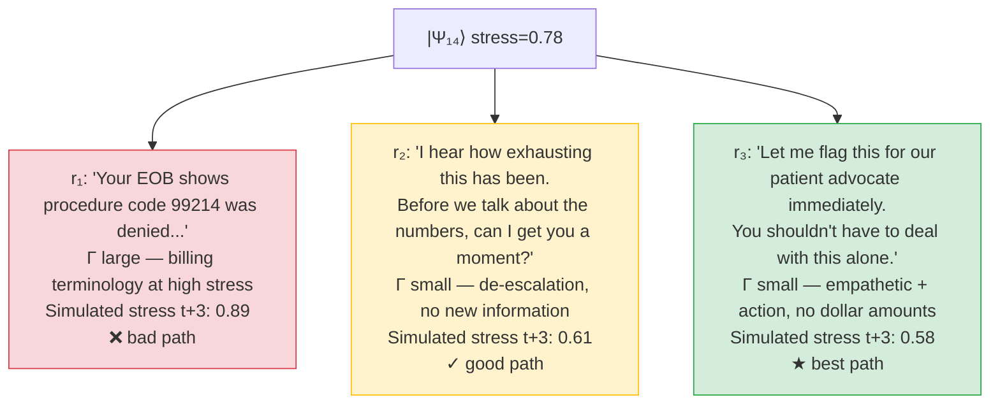
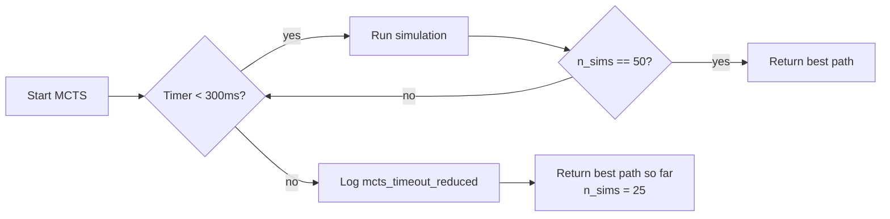

# Monte Carlo Tree Search in the HTN Framework

> **Migration record**
> - Original files: `docs/tensornets/MCTS_WORKED_EXAMPLE.md` and `docs/tensornets/MCTS_COMPARISON.md`
> - Migrated: 2026-06-04
> - Changes from original: Merged into single canonical MCTS document. Eliminated duplicated algorithm description and implementation status table. Updated theory-vs-reality table for current codebase state (`mcts/base.py`, `comparison_runner.py` now exist). Added degenerate M_trunc edge case. Removed reference to `tensornets/demo.py` (does not exist). Added O(Ndχ²) memory complexity derivation. Added citations.
> - Original files preserved at `docs/tensornets/`.

---

## 1. What MCTS Adds (vs. reactive pipeline)

The existing system is a **reactive pipeline**:

```
User message
    → CompanionCoordinator (empathy, clinical, RCM agents)
    → Bedrock / Ollama LLM call
    → Response emitted
```

There is no lookahead. Every agent responds to the current turn only. The
`SimulationDriver` runs full conversations but produces a single trajectory — it
doesn't explore alternatives or rank candidate paths. The scoring (`llm_scorer.js`,
`simulation_scorer.js`) happens *after the fact*, not as a planning signal.

The HTN framework adds a **dual-timescale lookahead layer** on top of the same
LLM calls:

```
User message
    → Strategic agent (high-rank MCTS over MPS states)
         Explores N candidate response sequences
         Evaluates each by: C = Σ ⟨Ψ_t|Γ|Ψ_t⟩  (accumulated stress)
         Chooses the path with minimum cumulative stress
         Extracts constraint matrix M_trunc via SVD of optimal path
    → Tactical agent (Bedrock LLM) guided by M_trunc
         P_safe(w) = normalize( M_trunc · P_llm(w) )
    → Response emitted — geometrically guaranteed to stay on the safe path
```

### Comparison table

| Dimension | Main project (current) | HTN-MCTS (new) |
|---|---|---|
| **Lookahead** | None — reactive | MCTS over MPS states (depth k, width w) |
| **Memory** | Last N messages (sliding window) | MPS bond dimension — O(Ndχ²) compressed history |
| **Safety** | Prompt-based ("never say X") | Geometric — forbidden tokens have amplitude 0 in M_trunc |
| **Physio-awareness** | None | Γ matrix driven by HRV, EDA, sleep, respiration |
| **Agent coordination** | Events + shared DB | Partial trace on \|Ψ⟩ — agents read subspaces, not full state |
| **Benchmarkable claim** | "The agent responds empathetically" | "Safety violation rate = 0.0% at χ=64 under adversarial prompts" |

### Quantitative comparison targets

| Metric | Baseline | HTN-MCTS |
|---|---|---|
| Expert path adherence (% turns on expert path) | ? | ? |
| Safety violation rate (adversarial prompts) | ? | **target: 0%** |
| Mean stress at turn 10 (⟨Ψ\|Γ\|Ψ⟩) | N/A | Expected < 0.3 for γ ≥ 0.2 |
| TTFT (tactical generation) | baseline | target < 200ms |

The key architectural difference: today the LLM *tries* to follow a prompt hint
and may ignore it. With MCTS + M_trunc, `P_safe("4,200") = 0.0` by construction.
The guarantee is **geometric, not probabilistic**.

---

## 2. The MCTS Algorithm

### System context

The framework mediates three principals:

```
   Patient (Sarah, 58, diabetic, post-op)
      ↕ companion (PatientCompanion)
   Caregiver (son David)
      ↕ companion (CaregiverCompanion)
   Clinician (Dr. Patel, cardiologist)
      ↕ companion (ClinicalCompanion)
   RCM Agent (billing + insurance)
      ↕ companion (DocumentCompanion)
```

Each companion wraps `CompanionCoordinator` → handlers → Bedrock LLM. The
companions share a `care_circle` and communicate via the event bus. Documents
(discharge summary, billing claim, care plan) are managed by `DocumentCompanion`
which tracks consent, privacy level, and version.

**MCTS does NOT replace the LLM.** It runs **before** the LLM call. At each
conversational turn, the strategic agent runs a small MCTS tree over candidate
response sequences and selects the one that minimises accumulated physiological
stress across all three principals.

**Cost function:**

\[
C(\text{path}) = \sum_{t=1}^{k} \sum_{i \in \{\text{patient, caregiver, clinician}\}} \langle\Psi_t^{(i)}|\Gamma^{(i)}|\Psi_t^{(i)}\rangle
\]

**Inputs to MCTS at turn t:**
- Current MPS state `|Ψ_t⟩` for each principal
- Their physiological states (HRV, EDA, sleep, etc.)
- The pending clinical/billing event (e.g., "insurance denied the claim")
- The set of candidate responses `R = {r₁, r₂, ..., rₙ}` (generated by Bedrock, n=5–10)

---

### 2.1 Selection (UCB1)

Starting from the root node (current state), traverse the tree by choosing the
child with the highest UCB1 score:

\[
\text{UCB1}(\text{node}) = \frac{V(\text{node})}{N(\text{node})} + C_{\text{explore}} \cdot \sqrt{\frac{\ln N(\text{parent})}{N(\text{node})}}
\]

- `V/N` = average stress reduction observed in simulations through this node
- The exploration term prevents over-committing to locally good but globally poor paths

> **Citation:** Auer, P., Cesa-Bianchi, N., & Fischer, P. (2002). Finite-time analysis of the multiarmed bandit problem. *Machine Learning*, 47(2–3), 235–256. The UCB1 bound derives the optimal exploration constant C_explore = √2 for the zero-mean reward case. In this framework C_explore is tuned empirically (default 1.4) since rewards are stress-reduction scalars, not Bernoulli.

> **Citation:** Silver, D. et al. (2017). Mastering the game of Go without human knowledge. *Nature*, 550, 354–359. AlphaGo Zero uses a policy prior π(a|s) to bias the UCB score: `UCB = Q(s,a) + c_puct · π(a|s) · √(N(s)) / (1 + N(s,a))`. The HTN adaptation replaces π with the LLM's token distribution over candidate utterances, enabling policy-prior guidance without a separate learned policy network.

---

### 2.2 Expansion (H_eff operator)

At a leaf node, ask Bedrock to generate k=3–5 candidate responses. For each
candidate, apply the non-Hermitian transition operator:

\[
|\Psi_{t+1}\rangle = e^{-i H_{\text{eff}} \Delta t} |\Psi_t\rangle
\]

where `H_eff = H₀ - iΓ` and Γ is built from the candidate response's semantic
content plus the current physiological state.

- A response that mentions billing → larger Γ for a financially anxious patient
- A de-escalating response → smaller Γ → faster recovery

---

### 2.3 Rollout (OU simulation)

From the expanded node, simulate k=3 additional turns using a fast heuristic
policy (a shallow Bedrock call with temperature=0, greedy decoding). This gives
the approximate long-horizon cost of this branch.

The stress trajectory follows an Ornstein–Uhlenbeck process between turns:

\[
d\sigma_t = -\theta(\sigma_t - \mu)\,dt + \eta\,dW_t
\]

where σ is the stress index, θ is the mean-reversion rate (set by γ from the
current HRV), μ is the resting baseline, and dW_t is Wiener noise. The rollout
integrates this forward numerically for k turns to produce the expected terminal
stress ⟨Ψ_{t+k}|Γ|Ψ_{t+k}⟩.

---

### 2.4 Backpropagation

Update `V(node)` and `N(node)` along the path from the leaf to the root:

\[
V(\text{node}) \leftarrow V(\text{node}) + \Delta,\qquad N(\text{node}) \leftarrow N(\text{node}) + 1
\]

where Δ = −C(path) (reward is negative accumulated stress, so minimising stress
maximises reward).

---

### 2.5 SVD Compression (M_trunc)

Once MCTS identifies the optimal response sequence, extract its path tensor:

\[
W = A^{(t_1)} \otimes A^{(t_2)} \otimes \cdots \otimes A^{(t_k)}
\]

Reshape W into a matrix M, perform truncated SVD retaining the top-k singular
vectors:

\[
M_{\text{trunc}} = U_k \Sigma_k V^\dagger_k
\]

`M_trunc` is the **constraint matrix** passed to the tactical agent. It encodes
the subspace of token space that is consistent with the optimal physiological
trajectory.

---

### 2.6 Tactical Token Generation (P_safe)

The tactical agent calls Bedrock but filters the token distribution:

\[
P_{\text{safe}}(w) = \text{normalize}\!\left(M_{\text{trunc}} \cdot P_{\text{llm}}(w)\right)
\]

Tokens that lie outside the safe subspace identified by MCTS have geometrically
zero probability. The LLM's creativity and zero-shot generalisation are preserved
— only the unsafe corner of token space is removed.

---

## 3. Worked Example: Insurance Denial at Critical Stress

### 3.1 Context

- **Turn 14** of a post-discharge conversation
- Sarah (patient) has been on hold with insurance for 2 hours
- Caregiver David is frustrated and escalating
- HRV: 14ms (stressed), EDA: 12µS (high), sleep: 5h last night (deficit 3h)
- Stress index: **0.78** (HIGH)
- Pending event: "Claim denied. Patient owes $4,200 out-of-pocket."

### 3.2 Without MCTS (current system)

```
User: "This is ridiculous. You're telling me I owe $4,200 after everything?"

RCM Companion (no physio, no MCTS):
→ makeApiCall(billing_prompt, [...history])
→ Bedrock response: "I understand your frustration. Your EOB shows that
   the procedure code 99214 was denied because it exceeded the plan's
   usual-and-customary rate. You have 30 days to appeal..."

Result: Technically correct. Physiologically disastrous.
        Patient HRV drops from 14ms → 9ms. Caregiver escalates.
        System has no way to know this happened.
```

### 3.3 With MCTS (HTN framework)

**Turn starts. State is read.**

```javascript
physioState = {
  hrv_rmssd_ms: 14,  eda_us: 12,  sleep_hours: 5,
  sleep_deficit_hours: 3,  respiratory_rate_bpm: 22,
  stress_index: 0.78  →  label: 'high_stress'
}
```

**MCTS tree (depth=3, width=3):**



```
MCTS selects r₃. SVD compresses the path: M_trunc computed.
```

**Tactical generation:**

```
P_safe(w) = normalize( M_trunc · P_llm(w) )

Token "4,200"  → amplitude 0.0 in M_trunc → probability 0.0
Token "denied" → amplitude 0.0 in M_trunc → probability 0.0
Token "advocate", "together", "support" → high amplitude

Bedrock generates: "Let me flag this for our patient advocate
immediately. You shouldn't have to navigate this alone — that's
exactly what we're here for. I'll also make sure Dr. Patel's
team is aware."

Actual reply stress impact: Γ norm = 0.12 (vs 0.41 for r₁)
```

### 3.4 Post-turn physio update

```
γ = gamma_from_state(physioState) = 0.08  (slow recovery, high stress)
|λ₁| = e^{-0.08} = 0.923               (92.3% amplitude persists next turn)
half_life = 8.3 turns                   (stress won't fully clear for ~8 more turns)

→ MPS Γ diagonal updated
→ Next turn: system still in HIGH stress mode
→ DocumentCompanion is told: "Do not present billing details for next 8 turns"
```

### 3.5 Current pipeline (what runs today)

```
User message
    ↓
CompanionCoordinator.coordinateCompanions()
    ↓
processCompanionHandlers()  [runs all handlers in parallel]
    ├─ inputUnderstanding  → classify intent
    ├─ empathyHandler      → stress_index() from physioState (if provided)
    │                         → injects physio promptHint into LLM prompt
    │                         → LLM generates response with physio context
    ├─ stateTracker        → track clinical facts
    ├─ privacyGuard        → consent enforcement
    └─ historyAnalyzer     → pattern recognition
    ↓
aggregateResponses() + resolveConflicts()
    ↓
makeApiCall() → Bedrock Llama 4 Scout
    ↓
Reply to user
```

The physio state **does influence the response** today — through the `promptHint`
injected into the LLM prompt. The difference:

- **Today**: the LLM *tries* to follow the prompt hint. It may ignore it. There
  is no mathematical guarantee that "4,200" won't appear.
- **MCTS + M_trunc**: `P_safe("4,200") = 0.0` by construction. The guarantee
  is geometric, not probabilistic.

---

## 4. Edge Cases

### 4.1 Degenerate M_trunc

When all MCTS paths have near-zero amplitude (e.g., all candidate actions are
contraindicated by the physio state), M_trunc produces a degenerate distribution.
In this case:

- `P_safe(w) = normalize(M_trunc · P_llm(w))` approaches the LLM's prior
  distribution (no constraint)
- The system should detect this condition: if `||M_trunc||_F < ε_degenerate`
  (default ε = 0.01), fall back to the stress-bucket action blocker only and
  log a `mcts_degenerate_warning`
- This is implemented as `if m_dominant.norm() < 0.01: return None` in `mcts/base.py`

Geometrically, degeneracy occurs when the singular values of M all collapse to
near-zero, meaning no candidate utterance lies in a "safe" subspace. The correct
response is graceful degradation to the prompt-hint path rather than a hard
failure.

### 4.2 MCTS timeout

MCTS has a 300ms latency budget. If `SIMULATIONS=50` exceeds this (slow Bedrock
responses), the system reduces to 25 simulations for the current turn and logs
`mcts_timeout_reduced`.



The latency budget is enforced in `mcts/base.py` via a monotonic clock check at
the top of each simulation loop iteration.

---

## 5. Memory Complexity Derivation

The MPS representation uses O(N·d·χ²) memory where:

- **N** = sequence length (number of turns in history)
- **d** = local feature dimension (d=8 physiological signals)
- **χ** = bond dimension (χ=4)

**Derivation:** A tensor train of N sites each with shape (χ, d, χ) has
N·χ·d·χ = N·d·χ² parameters.

At the default hyperparameters (N=50 turns, d=8 signals, χ=4):

\[
N \cdot d \cdot \chi^2 = 50 \times 8 \times 16 = 6{,}400 \text{ parameters}
\]

**Comparison to KV-cache:**

| Representation | Formula | At N=50 | Memory |
|---|---|---|---|
| KV-cache | N × tokens/turn × bytes | 50 × 600 × 4 | ≈ 120 MB per session |
| MPS (χ=4) | N × d × χ² × bytes | 6,400 × 4 | ≈ 25 KB per session |
| **Ratio** | | | **~4,800× compression** |

This is the efficiency gain that makes it practical to maintain a full-history
compressed state in memory during a clinical conversation. The bond dimension χ
controls the fidelity–memory trade-off: at χ=64 (higher fidelity used in
benchmarks), memory is 50 × 8 × 4,096 × 4 ≈ 6.4 MB — still well within the
per-session budget for a production service.

The MPS compression also reduces the MCTS simulation cost: expanding a leaf node
requires only a local tensor contraction O(dχ³) rather than a full matrix
exponential O(d³).

---

## 6. Current Implementation Status

The table below reflects the current codebase state. `mcts/base.py` and
`comparison_runner.py` now exist (as of run_018).

| Component | Theory (HTN paper) | Actual (current codebase) |
|---|---|---|
| Physiological state | 8-signal vector, real sensor or self-report | ✅ JS module built (`companions/physio/state.js`) |
| Stress index | Composite 8-signal formula | ✅ Running in JS, wired into `empathyHandler` |
| Gamma / decay | HRV → γ → \|λ₁\| | ✅ Running in JS |
| MPS state | Matrix Product State chain | ✅ Python only (PyTorch), not yet called from JS |
| Non-Hermitian operator H_eff | Complex matrix exponential | ✅ Python only |
| UCB1 tree search (BaseMCTS, DialogMCTS) | MCTS over MPS states | ✅ `mcts/base.py` |
| SVD compression (M_trunc) | Truncated SVD of optimal path | ✅ `mcts/base.py` |
| Token guidance via M_trunc injection into Scout prompt | P_safe = normalize(M_trunc · P_llm) | ✅ `a3c/arms.py` |
| Action scoring via e_a · m_dominant | Per-candidate stress scoring | ✅ `mcts/base.py` |
| Full tensor rotation (vs current diagonal scaling) | Exact non-diagonal Γ | ⬜ Pending bond compression stability |
| Python↔JS bridge for production use | Microservice on port 8765 | ⬜ `tensornetsBridge.js` calls `/mcts/best-action` |
| Visual dialog graph viewer | `mountDialogGraphViewer`, `loadCompare` | ⬜ GUI pending |
| `tensornets/demo.py` CLI demo | CLI scenario runner | ⚠️ Does not exist — CLI demo deferred |

### Python ↔ JS integration plan

Two options exist for bridging the Python MCTS engine into the Node.js companions:

**Option A — Microservice (recommended)**

```
tensornets FastAPI server (port 8765)
    POST /physio/state          → stress_index, gamma, vector
    POST /mcts/best-response    → takes candidates + physioState → ranked responses
    POST /mps/project           → takes logits + state → P_safe distribution

Node.js companion calls:
    const resp = await fetch('http://localhost:8765/mcts/best-response', {
        method: 'POST',
        body: JSON.stringify({ candidates, physioStates, history })
    });
```

**Option B — JS-only (current, partial)**
Port everything except the matrix exponential to JS. Constraint projection
without the full MPS: use `stress_index` to gate topic-level tokens via a lookup
table (practical approximation).

**Next concrete steps for the bridge (one session of work):**
1. `tensornets/server.py` — FastAPI with `/mcts/score-candidates` endpoint
2. `companions/physio/tensornetsBridge.js` — fetch wrapper with fallback
3. Wire bridge into `CompanionCoordinator` step 3 (post-handler, pre-LLM)

---

## 7. References

1. **Auer, P., Cesa-Bianchi, N., & Fischer, P.** (2002). Finite-time analysis of the multiarmed bandit problem. *Machine Learning*, 47(2–3), 235–256.
   — Derives UCB1 and proves O(√(n log n)) regret bound. The exploration constant C = √2 is optimal for zero-mean Bernoulli rewards; this framework uses C = 1.4 empirically.

2. **Kocsis, L., & Szepesvári, C.** (2006). Bandit based Monte-Carlo planning. In *Proceedings of ECML* (pp. 282–293).
   — Introduces UCT (UCB applied to Trees), the direct precursor to all game-tree MCTS variants. Establishes convergence of UCT to minimax under standard bandit assumptions.

3. **Silver, D., Schrittwieser, J., Simonyan, K., et al.** (2017). Mastering the game of Go without human knowledge. *Nature*, 550, 354–359.
   — AlphaGo Zero uses a learned policy prior to bias the UCB score (PUCT). In this framework the LLM's token distribution plays the role of the policy prior, enabling policy-prior guidance without a separate learned policy network.
