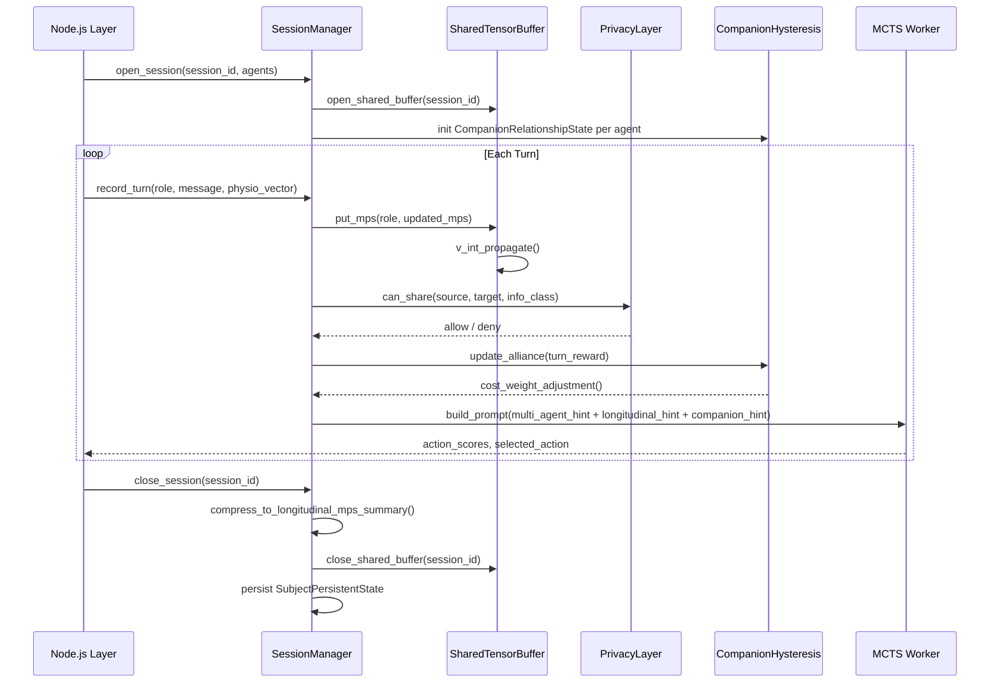

# Multi-Agent Architecture

---

## 1. Overview

The care circle is a **multi-principal system**: a patient, one or more caregivers, and a clinician share a therapeutic context but have different information rights, different levels of influence, and different session cadences. Naively treating each agent as an independent conversational session loses the inter-agent dynamics that are clinically meaningful — a caregiver's distress at home predicts a patient's next check-in state; a clinician's intervention changes the caregiver's coping style.

Tensornets represents this as a **shared tensor buffer** in which each agent occupies a named MPS slot, and inter-agent influence is mediated through the V_int coupling matrix (§2) rather than through raw message passing. This gives:

1. **Bounded information leakage**: coupling magnitude is a parameter, not a hard copy.
2. **Physiological privacy**: partial traces over the physiological subspace (§3.3) allow sharing aggregated signals without exposing raw sensor data.
3. **Audit trail**: every inter-agent propagation is a named operation logged to the session record (§4).

---

## 2. Shared Tensor Buffer

`agents/shared_tensor_state.py` exposes three public lifecycle functions and one data class:

```
open_shared_buffer(session_id)  →  SharedTensorBuffer
get_shared_buffer(session_id)   →  SharedTensorBuffer | None
close_shared_buffer(session_id) →  None
```

A `SharedTensorBuffer` holds a dictionary of `AgentMPSSlot` entries keyed by agent role string (`"clinician"`, `"caregiver"`, `"patient"`).

**`AgentMPSSlot` fields:**

| Field | Type | Description |
|---|---|---|
| `agent_id` | str | Unique agent identifier |
| `role` | str | `"clinician"` / `"caregiver"` / `"patient"` |
| `mps_state` | CoreTensor list | Current MPS chain for this agent |
| `last_updated` | float | Unix timestamp of last write |

**Buffer operations:**

| Method | Description |
|---|---|
| `put_mps(role, mps)` | Write an agent's updated MPS into the buffer |
| `get_mps(role)` | Retrieve an agent's current MPS |
| `v_int_propagate()` | Apply the V_INT_PRIOR coupling matrix across all slots |
| `partial_trace_physio(role)` | Trace out the physiological subspace → semantic-only reduced state |
| `consistency_hint()` | Return a natural-language hint for the MCTS prompt reflecting current inter-agent coherence |

`V_INT_PRIOR` is a 3×3 matrix (role → role) with the asymmetric coupling values documented in `09_MPS_core.md §5`. It is loaded once at buffer open time and is immutable for the session lifetime.

---

## 3. Inter-Agent Communication

### 3.1 AgentCommitment Protocol

`inter_agent_comm.py` defines `AgentCommitment`, a lightweight typed record encoding a public commitment made by one agent in a session:

| Field | Type | Description |
|---|---|---|
| `source_role` | str | Committing agent's role |
| `commitment_text` | str | Natural-language commitment string |
| `turn_index` | int | Turn at which commitment was made |
| `fulfilled` | bool | Whether commitment was subsequently honoured |
| `confidence` | float | MCTS-estimated probability of fulfilment |

Commitments are stored in `SharedDialogueState` alongside the current MPS buffer. The `SharedDialogueState` acts as a lightweight shared scratchpad — it does **not** hold full MPS tensors (those live in `SharedTensorBuffer`) but holds structured metadata: commitment lists, escalation flags, and the current inter-agent coherence score.

### 3.2 `multi_agent_mcts_hint()` — Prompt Injection

```python
multi_agent_mcts_hint(shared_state: SharedDialogueState, role: str) -> str
```

Returns a natural-language hint string injected into the MCTS simulation prompt for `role`. The hint summarises:

1. **Pending commitments** made by other agents that are relevant to `role`.
2. **Inter-agent coherence score** from `consistency_hint()`.
3. **V_int influence summary** — which agents are currently most strongly influencing `role`'s MPS state.

This function is the primary bridge between the tensor-level multi-agent dynamics and the LLM-level MCTS rollout. The hint is prepended to the system prompt segment in `worker.py:_build_mcts_prompt()`.

### 3.3 `partial_trace_physio()` — Phase 4 Pending

```python
partial_trace_physio(role: str) -> ReducedDensityMatrix
```

**Currently raises `NotImplementedError`.** Planned for Phase 4.

When implemented, this will compute the reduced state of agent `role` by tracing out the χ_physio bond subspace, yielding a semantic-only density matrix. The intended use case is cross-agent sharing under `LIMITED` consent (see §5): the caregiver can receive the clinician's semantic state without receiving raw physiological measurements.

The implementation will require the MPS to be in mixed-canonical form centred on the bond separating χ_semantic from χ_physio, followed by a partial trace over the physical indices associated with the physiological features.

---

## 4. Session Management

`agents/session_manager.py` provides the longitudinal memory layer on top of the per-session MPS buffer.

### 4.1 SubjectPersistentState (Cross-Session Memory)

`SubjectPersistentState` persists between sessions for a given subject (patient or caregiver). It stores:

| Field | Description |
|---|---|
| `subject_id` | Anonymised identifier |
| `role` | Agent role |
| `session_records` | List of `SessionRecord` (one per completed session) |
| `longitudinal_mps_summary` | Compressed MPS averaged over recent sessions |
| `alliance_score` | Current therapeutic alliance estimate (companion_hysteresis) |
| `contact_permission` | Whether cross-session contact is permitted |

A `SessionRecord` contains a list of `TurnRecord` entries plus session-level metadata (start/end timestamps, escalation flags, outcome codes).

A `TurnRecord` captures:
- `turn_index`, `role`, `message_text`
- `mps_snapshot` (CoreTensor list at turn end)
- `action_taken`, `reward_signal`
- `physio_vector` (8-dimensional, stored under consent gate)

### 4.2 `longitudinal_mcts_hint()`

```python
longitudinal_mcts_hint(subject: SubjectPersistentState, current_role: str) -> str
```

Generates a hint for the current MCTS rollout incorporating the subject's cross-session history. Concretely, it:

1. Retrieves the `longitudinal_mps_summary` and computes its dominant singular vector.
2. Compares the dominant vector against the current session's MPS dominant vector.
3. Returns a drift summary: whether the subject's physiological-semantic state is **converging** toward historical baseline or **diverging** (potential relapse signal).

This is injected as a second hint block in the MCTS system prompt, after `multi_agent_mcts_hint()`.

### 4.3 `check_contact_permission()`

```python
check_contact_permission(subject: SubjectPersistentState, requestor_role: str) -> bool
```

Returns `True` only if:
- `subject.contact_permission` is `True`, **and**
- The requestor's role has a non-zero V_int coupling to the subject's role (i.e. contact is consistent with the care-circle structure).

This gate is checked before any cross-session hint is injected.

### 4.4 `simulate_multi_session()`

A development/testing utility that runs a synthetic multi-session trajectory for a given subject configuration. Used in the benchmarks suite to validate that `longitudinal_mcts_hint()` degrades gracefully when session history is sparse (≤ 2 sessions).

---

## 5. Privacy Layer

`agents/privacy_layer.py` implements the information governance layer that controls what each agent can observe about the others.

### 5.1 InfoClass Taxonomy (I–IV)

| InfoClass | Contents | Default sharing |
|---|---|---|
| I | Public conversational content | Freely shareable |
| II | Aggregated/anonymised physiological signals | Share with LIMITED consent |
| III | Raw physiological sensor data | Share with FULL consent only |
| IV | Clinically sensitive derived signals (e.g. HRV-based depression risk) | Share with FULL consent + clinician role |

### 5.2 PrivacyLayer Gate

```python
PrivacyLayer.allow(info_class: InfoClass, consent_level: ConsentLevel) -> bool
PrivacyLayer.can_share(source_role: str, target_role: str, info_class: InfoClass) -> bool
PrivacyLayer.filter_hrv_prediction(consent_level: ConsentLevel) -> bool
```

`allow()` checks whether the current consent level permits sharing a given InfoClass. `can_share()` adds role-based access control: a caregiver cannot receive InfoClass IV signals even under FULL consent — that requires clinician role. `filter_hrv_prediction()` specifically gates the HRV-derived depression risk score (a high-sensitivity derived feature).

### 5.3 DisclosureAdvantagePlanner (Strategic Withholding)

`DisclosureAdvantagePlanner` computes whether **withholding** a piece of information is strategically advantageous from the perspective of long-term therapeutic outcome, as modelled by the MCTS value function. This is not about violating consent — it is about deciding, *within* consent bounds, whether proactively volunteering a signal now versus deferring to a later turn maximises expected alliance outcome.

The planner returns a `(disclose_now: bool, deferred_turn: int | None)` pair. If `disclose_now=False`, the information is queued for injection at `deferred_turn`.

### 5.4 EscalationBridge (tensornets → JS Escalation Codes)

`TENSORNETS_ESCALATION_TRIGGERS` is a dict mapping internal tensornets event types (e.g. `"hrv_acute_suppression"`, `"alliance_rupture_severe"`) to JS escalation codes consumed by the Node.js routing layer.

`EscalationBridge.emit(trigger: str) -> EscalationCode` converts a tensornets trigger to its JS counterpart and posts it to the Node.js event queue via the IPC bridge in `tensornets/server.py`.

### 5.5 Dual Consent Taxonomy (Cross-Reference Table)

The JS `privacy_policy.md` and Python `privacy_layer.py` use parallel but not identical consent level vocabularies. When the JS layer sends a consent level to the Python API, the mapping below must be applied:

| Level (JS canonical) | Level (Python legacy) | Meaning |
|---|---|---|
| `NONE` | `NONE` | No information sharing permitted |
| `LIMITED` | `LIMITED` | Share aggregated/anonymised signals only (InfoClass I–II) |
| `FULL` | `FULL` | Full sharing permitted (InfoClass I–IV, subject to role) |
| `EMERGENCY` | *(mapped to `FULL` at Python layer)* | Override for critical health safety; bypasses normal gates |
| — | `implied_consent: bool` | Auto-granted for system-generated concerns; not a level, a flag |

**Important:** The JS taxonomy is **canonical for user-facing contexts** (consent banners, audit logs, UI strings). The Python taxonomy is the **tensornets-internal legacy name** for the same concepts. Any new code adding consent level checks in Python should accept both strings for backward compatibility and log a deprecation warning if the legacy name is used directly.

`EMERGENCY` does not exist in the Python `ConsentLevel` enum; it is translated to `FULL` before reaching `privacy_layer.py`. Downstream Python code that needs to distinguish emergency overrides from standard FULL consent should check the `emergency_override: bool` flag on the session record rather than the consent level.

---

## 6. Companion Hysteresis

`agents/companion_hysteresis.py` models the **therapeutic alliance** between the AI companion and each human agent as a scalar state variable with asymmetric dynamics, grounded in Safran & Muran (2000).

`CompanionRelationshipState` fields:

| Field | Description |
|---|---|
| `alliance_score` | Current alliance ∈ [0, 1] |
| `rupture_count` | Number of detected ruptures this session |
| `repair_count` | Number of successful repairs this session |
| `ema_alpha_rupture` | EMA decay for rupture events: **α = 0.30** |
| `ema_alpha_repair` | EMA decay for repair events: **α = 0.04** |

The **asymmetry** (α_rupture = 0.30 >> α_repair = 0.04) is the core empirical finding of Safran & Muran (2000): therapeutic alliance ruptures are fast and salient, while repairs are slow and require sustained engagement. A single hostile or dismissive exchange can drop alliance rapidly, while repair requires many consistent warm interactions.

Alliance update rules:

```
# Rupture detected:
alliance ← (1 − α_rupture) · alliance + α_rupture · 0.0

# Repair signal detected:
alliance ← (1 − α_repair) · alliance + α_repair · 1.0
```

**`cost_weight_adjustment(alliance: float) -> float`** returns a multiplicative weight applied to the MCTS cost function: when alliance is low, the cost of aggressive or confrontational actions is increased, steering the agent toward repair-oriented responses.

**`prompt_hint(state: CompanionRelationshipState) -> str`** returns a natural-language hint summarising the current alliance state, injected into the MCTS system prompt as a third hint block (after multi-agent and longitudinal hints).

---

## 7. Session Lifecycle Diagram



---

## 8. References

- **Safran, J. D., & Muran, J. C. (2000).** *Negotiating the Therapeutic Alliance: A Relational Treatment Guide.* Guilford Press. — empirical basis for rupture (α=0.30) / repair (α=0.04) asymmetry.
- **Kaelbling, L. P., Littman, M. L., & Cassandra, A. R. (1998).** Planning and acting in partially observable stochastic domains. *Artificial Intelligence*, 101(1–2), 99–134. — POMDP foundations underlying the multi-agent MCTS formulation.
- **Vidal, G. (2003).** Efficient Classical Simulation of Slightly Entangled Quantum Computations. *Physical Review Letters*, 91(14), 147902. — MPS formalism underlying SharedTensorBuffer state representation.
- **Doshi-Velez, F., & Kim, B. (2017).** Towards a rigorous science of interpretable machine learning. *arXiv:1702.08608.* — motivation for the partial-trace approach to privacy-preserving state sharing.
