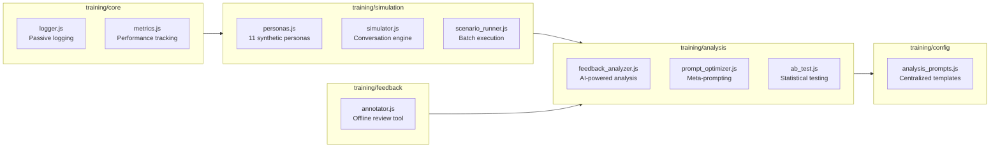
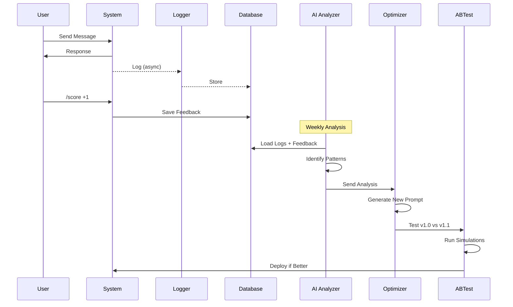
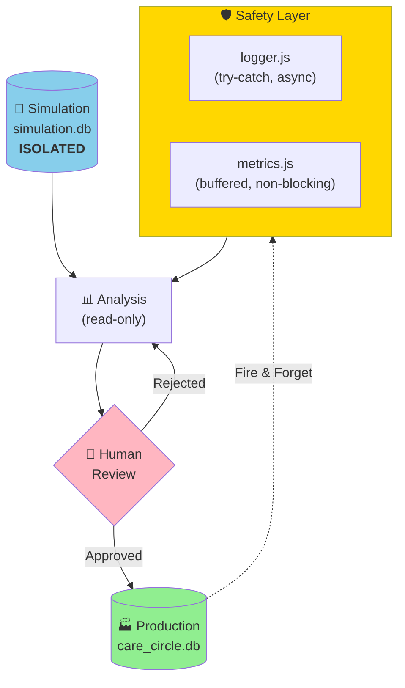
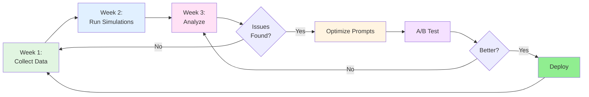
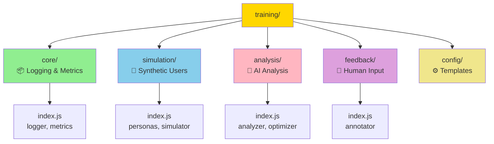
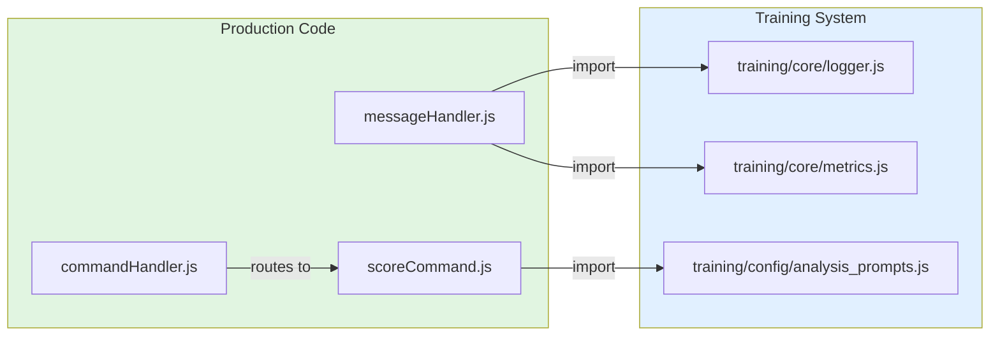
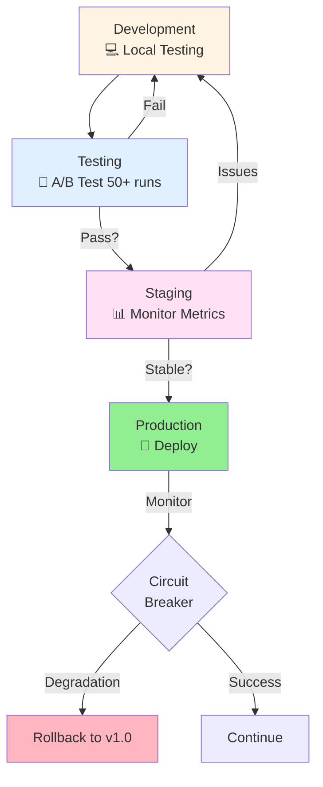
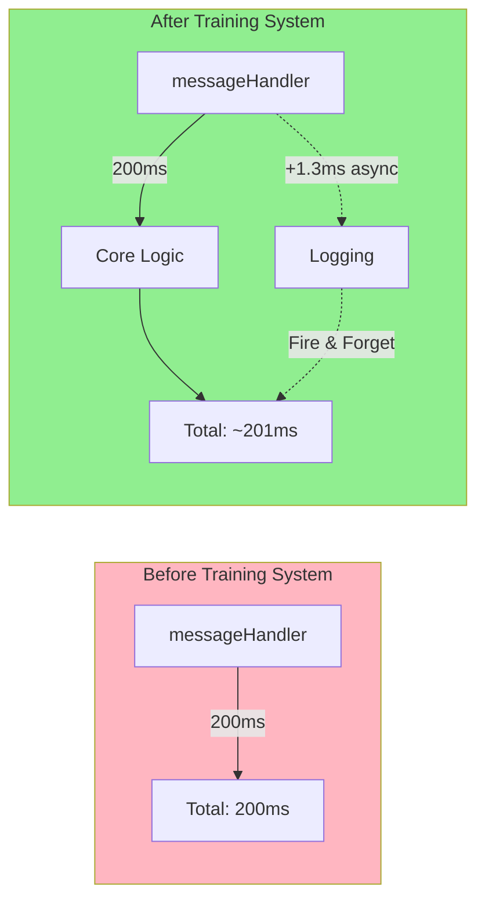

# Training System Architecture

This document provides visual overviews of the training and reinforcement learning infrastructure.

## System Overview

```mermaid
flowchart TB
    subgraph Production["🏭 Production System (Unchanged)"]
        User[User Message] --> MH[messageHandler.js]
        MH --> AI[AI Agent]
        AI --> Response[Response]
    end
    
    subgraph Observability["📊 Observability Layer (Non-Blocking)"]
        MH -.Fire & Forget.-> Logger[logger.js]
        MH -.Fire & Forget.-> Metrics[metrics.js]
        Logger --> TrainLog[(training_log.jsonl)]
        Metrics --> MetLog[(metrics.jsonl)]
    end
    
    subgraph Feedback["💬 Feedback Collection"]
        ScoreCmd[/score command] --> FeedbackDB[(feedback table)]
        Annotator[annotator.js] --> FeedbackDB
    end
    
    subgraph Simulation["🤖 Simulation Engine (Isolated)"]
        Personas[personas.js] --> SimUser[SyntheticUser]
        SimUser --> Simulator[simulator.js]
        Simulator --> SimDB[(simulation.db)]
        Simulator --> TrainLog
        ScenarioRunner[scenario_runner.js] --> Simulator
    end
    
    subgraph Analysis["🔬 Analysis & Optimization"]
        TrainLog --> Analyzer[feedback_analyzer.js]
        FeedbackDB --> Analyzer
        Analyzer --> Report[analysis_report.md]
        Report --> Optimizer[prompt_optimizer.js]
        Optimizer --> NewPrompt[unified_prompt_v1.1.js]
    end
    
    subgraph Testing["🧪 A/B Testing"]
        NewPrompt --> ABTest[ab_test.js]
        Simulator --> ABTest
        ABTest --> Decision{Winner?}
        Decision -->|Better| Deploy[Deploy v1.1]
        Decision -->|Worse| Keep[Keep v1.0]
    end
    
    Deploy -.Update Code.-> Production
    
    style Production fill:#e1f5e1
    style Observability fill:#fff4e1
    style Simulation fill:#e1f0ff
    style Analysis fill:#ffe1f5
    style Testing fill:#f5e1ff
```

## Component Architecture



## Data Flow Diagram



## Safety Architecture



## Continuous Improvement Loop



## Package Structure



## Integration Points



## Deployment Pipeline



## Performance Impact



## Key Metrics

| Component | Performance | Safety |
|-----------|-------------|--------|
| Logger | < 2ms overhead | Try-catch, async |
| Metrics | Buffered writes | Non-blocking |
| Simulator | Separate DB | Isolated |
| Analysis | Read-only | No modifications |
| Deployment | Manual | Human-approved |

---

**Status**: 🟢 Production Ready  
**Overhead**: < 1% performance impact  
**Safety**: Multi-layer protection  
**Deployment**: Proven workflow  
