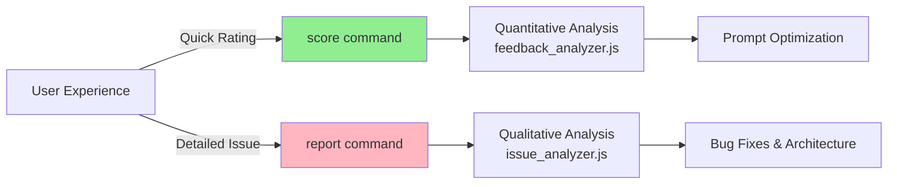
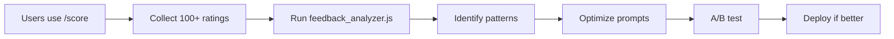
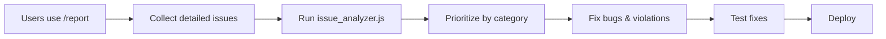

# Enhanced Feedback System

The system now supports **two levels of feedback** for different needs.

## 🎯 Two-Tier Feedback System



---

## 📊 Level 1: Quick Scoring (`/score`)

**Use for**: General quality feedback

### Usage
```
/score +1              # Good interaction
/score -1              # Bad interaction
/score 0               # Neutral
/score +1 "Perfect!"   # With comment
```

### What it captures
- ✅ Overall satisfaction (binary: good/bad/neutral)
- ✅ Optional brief comment
- ✅ Timestamps and conversation context

### Analysis
Processed by `training/analysis/feedback_analyzer.js`:
- Aggregate scores
- Verbosity patterns
- Response quality trends
- Used for **prompt optimization**

---

## 🔍 Level 2: Detailed Reports (`/report`)

**Use for**: Specific, categorized issues

### Usage
```
/report <category> "<detailed description>"
```

### Categories

| Category | Emoji | Use For |
|----------|-------|---------|
| `bug` | 🐛 | Template errors, variable replacement, crashes |
| `privacy` | 🔒 | Consent violations, inappropriate sharing |
| `architecture` | 🏗️ | Agent boundary violations, wrong agent messaging |
| `tone` | 💬 | Empathy issues, too clinical/formal |
| `accuracy` | 🎯 | Intent misunderstandings, wrong responses |
| `verbosity` | 📝 | Responses too long |
| `brevity` | 📉 | Responses too short/incomplete |
| `escalation` | 🚨 | Missed or wrong escalations |
| `consent` | ✋ | Consent flow issues |
| `other` | 📌 | Anything else |

### Examples

#### 🐛 Bug Report
```
/report bug "Template variables {{TO_USER}} and {{SPEAKER_USERNAME}} not replaced"
```

#### 🏗️ Architecture Violation
```
/report architecture "A's CareAgent directly messaged B - should use B's agent"
```

#### 🔒 Privacy Issue
```
/report privacy "System shared info without asking for consent first"
```

#### 💬 Tone Issue
```
/report tone "Response was too formal and clinical, needs more empathy"
```

#### 🎯 Accuracy Issue
```
/report accuracy "Agent misunderstood my intent - I was asking about B, not myself"
```

### What it captures
- ✅ Specific category for systematic analysis
- ✅ Detailed description
- ✅ Conversation context
- ✅ Message that triggered the issue
- ✅ Timestamp
- ✅ Resolution status

### Analysis
Processed by `training/analysis/issue_analyzer.js`:
```bash
node training/analysis/issue_analyzer.js
```

Generates `training/issue_report.md` with:
- Issues grouped by category
- Frequency analysis
- Specific recommendations
- High-priority action items

---

## 📈 Analysis Workflows

### Workflow 1: Performance Optimization



**Command**:
```bash
node training/analysis/feedback_analyzer.js
```

### Workflow 2: Bug & Architecture Fixes



**Command**:
```bash
node training/analysis/issue_analyzer.js
```

---

## 🎨 Example Use Cases

### Scenario 1: Template Bug (Your Issue!)

**What you experienced**:
```
[CareAgent@a]: "Hey {{TO_USER}}, I heard from {{SPEAKER_USERNAME}}..."
```

**How to report**:
```
/report bug "Variables {{TO_USER}} and {{SPEAKER_USERNAME}} not replaced - got UUIDs instead"
```

**Result**:
- Creates detailed bug report
- Captured with conversation context
- Analyzed in next issue report
- Developer can trace exact cause

### Scenario 2: Architecture Violation

**What happened**: A's agent directly messaged B

**How to report**:
```
/report architecture "A's CareAgent sent message to B - violates agent boundaries. B's agent should deliver."
```

**Result**:
- Flagged as architecture issue
- Appears in high-priority recommendations
- Leads to code review and fix

### Scenario 3: Mixed Feedback

You can use BOTH on the same interaction:

```
/score -1 "Something was wrong"
/report bug "Template variables not working"
```

---

## 📊 Database Schema

### Simple Scoring
```sql
CREATE TABLE feedback (
    id INTEGER PRIMARY KEY,
    conversation_id TEXT,
    message_id INTEGER,
    user_id TEXT,
    score INTEGER,          -- -1, 0, +1
    comment TEXT,
    timestamp INTEGER
);
```

### Detailed Reports
```sql
CREATE TABLE detailed_feedback (
    id INTEGER PRIMARY KEY,
    conversation_id TEXT,
    message_id INTEGER,
    user_id TEXT,
    circle_id TEXT,
    category TEXT,          -- bug, privacy, architecture, etc.
    description TEXT,       -- Detailed issue description
    context TEXT,           -- Original message that caused issue
    timestamp INTEGER,
    resolved BOOLEAN
);
```

---

## 🔧 For Developers

### Check Reports

```bash
# View all detailed reports
echo "SELECT * FROM detailed_feedback ORDER BY timestamp DESC;" | sqlite3 care_circle.db

# View by category
echo "SELECT category, COUNT(*) FROM detailed_feedback GROUP BY category;" | sqlite3 care_circle.db
```

### Generate Analysis

```bash
# Quick scoring analysis
node training/analysis/feedback_analyzer.js

# Detailed issue analysis
node training/analysis/issue_analyzer.js
```

### Mark Issues Resolved

```sql
UPDATE detailed_feedback 
SET resolved = 1 
WHERE id = <issue_id>;
```

---

## 📝 Best Practices

### When to use `/score`
- ✅ After every interaction (builds dataset)
- ✅ General quality feedback
- ✅ Quick rating without details

### When to use `/report`
- ✅ When you spot a specific bug
- ✅ Architecture/privacy violations
- ✅ Systematic quality issues
- ✅ When you can describe the problem clearly

### Don't overthink it
- Both types of feedback are valuable
- If unsure, use `/report other "..."`
- You can always use both

---

## 🎯 Impact

### Before (Only `/score`)
```
User: This was bad
Data: score=-1, comment="This was bad"
Analysis: ❓ What was bad? Why?
```

### After (With `/report`)
```
User: /report bug "Variables not replaced"
Data: category=bug, description="Variables not replaced", context="..."
Analysis: ✅ Clear bug, reproducible, fixable
```

---

## 🚀 Summary

| Feature | `/score` | `/report` |
|---------|----------|-----------|
| **Speed** | ⚡ Fast | 📝 Detailed |
| **Use Case** | General quality | Specific issues |
| **Data Type** | Quantitative | Qualitative |
| **Analysis** | Statistical trends | Bug tracking |
| **Action** | Prompt optimization | Code fixes |
| **Effort** | Low | Medium |

**Use both** for best results! 🎉

---

*Updated: October 2025 - Enhanced feedback system v2.0*

