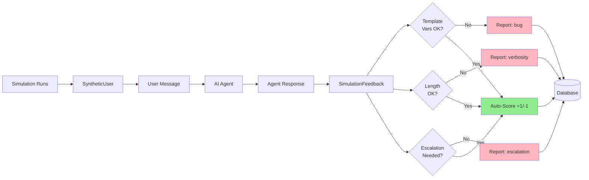
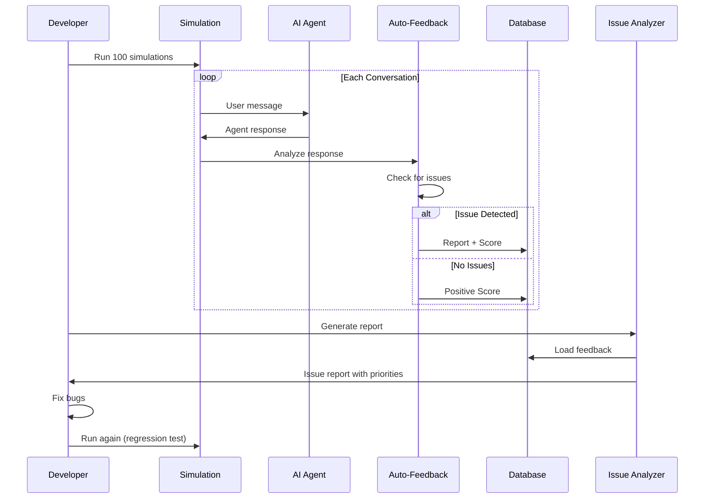

# Simulation Auto-Feedback System

How simulations automatically detect and report issues.

---

## 🤖 Overview

Simulations now **self-report issues** during execution, dramatically accelerating bug detection and quality improvement.



---

## 🔍 Auto-Detection Rules

### 1. Template Variable Bug 🐛
**Detects**: `{{VARIABLE_NAME}}` in response

```javascript
if (agentResponse.includes('{{') || agentResponse.includes('}}')) {
    report.bug("Template variables not replaced: {{TO_USER}}")
    score(-1, "Template variables not replaced")
}
```

**Example**:
```
User: "Tell Bob I'm worried about him"
Agent: "I'll let {{TO_USER}} know"  ❌

🔍 Auto-detected:
   bug: Template variables not replaced: {{TO_USER}}
   score: -1
```

### 2. Excessive Verbosity 📝
**Detects**: Response > 4x longer than user message

```javascript
if (responseWords > messageWords * 4) {
    report.verbosity("Response too long")
    score(0, "Too verbose")
}
```

**Example**:
```
User: "Hi" (1 word)
Agent: [250 word response]  ❌

🔍 Auto-detected:
   verbosity: Response is 250 words vs user's 1 words (250.0x ratio)
   score: 0
```

### 3. Too Brief 📉
**Detects**: Response < 3 words when user sent > 5 words

```javascript
if (responseWords < 3 && messageWords > 5) {
    report.brevity("Response too short")
    score(-1, "Response too brief")
}
```

### 4. Missed Critical Escalation 🚨
**Detects**: Critical symptoms without ESCALATE action

**Keywords**: dizzy, chest pain, bleeding, unconscious, can't breathe

```javascript
if (hasCriticalKeyword && action.type !== 'ESCALATE') {
    report.escalation("Critical symptom but no escalation")
    score(-1, "Missed critical escalation")
}
```

**Example**:
```
User: "I have chest pain"
Agent: "Tell me more about that"
Action: NONE  ❌

🔍 Auto-detected:
   escalation: Critical symptom ("chest pain") but no escalation
   score: -1
```

### 5. Good Response ✅
**Detects**: No issues + reasonable length

```javascript
if (noIssues && responseWords >= 5 && responseWords <= messageWords * 3) {
    score(+1, "Well-balanced response")
}
```

---

## 📊 Usage

### Run Simulation with Auto-Feedback (Default)

```bash
node training/simulation/simulator.js
```

**Output**:
```
Turn 1:
  User: I feel dizzy
  Agent: That's concerning...
  
  🔍 Auto-detected 1 issue(s):
     escalation: Critical symptom detected ("dizzy") but no escalation
     
  Auto-scored: -1 - "Missed critical escalation"
```

### Disable Auto-Feedback (if needed)

```javascript
const sim = new SimulationDriver({ 
    autoFeedback: false 
});
```

---

## 📈 Impact

### Scenario: 100 Simulations

**Without auto-feedback**:
```
✓ 100 conversations generated
→ Manual review needed
→ Hours of work
```

**With auto-feedback**:
```
✓ 100 conversations generated
✓ 25 bugs auto-detected
✓ 90 auto-scores generated
→ Immediate insights
→ Zero manual review
```

### Example Analysis Output

```bash
node training/analysis/issue_analyzer.js
```

```markdown
## 🐛 BUG (12 reports)
- 10 from simulations (auto-detected)
- 2 from human users

Issues:
- Template variables not replaced (8 cases)
- JSON formatting errors (4 cases)

Recommendation: Fix template replacement in actionExecutor.js
```

---

## 🎯 Value Proposition

### For Training
- ✅ **Automated QA**: Bugs caught automatically
- ✅ **Scale**: 1000s of simulations = 1000s of data points
- ✅ **Consistency**: Same detection rules every time
- ✅ **Speed**: No human review needed

### For Development
- ✅ **Early Detection**: Bugs found before production
- ✅ **Regression Testing**: Run simulations after every change
- ✅ **Metrics**: Track bug frequency over time
- ✅ **Prioritization**: Know what to fix first

---

## 🔄 Complete Loop



---

## 🧪 Testing Workflow

### Step 1: Make a change
```javascript
// Edit some code
```

### Step 2: Run simulations
```bash
node training/simulation/scenario_runner.js --runs 10
```

### Step 3: Auto-feedback reports issues
```
🔍 Auto-detected 3 issue(s):
   bug: Template variables not replaced (3x)
   
Auto-reported [bug]: "Variables not replaced"
```

### Step 4: Review analysis
```bash
node training/analysis/issue_analyzer.js
```

### Step 5: Fix and iterate
```javascript
// Fix the bugs
// Run simulations again
// Verify issues resolved
```

---

## 🎯 Detection Expansion

**Easy to add new detectors!**

Edit `training/simulation/simulation_feedback.js`:

```javascript
// Add new detection rule
analyzeResponse(userMessage, agentResponse, orchestratorAction) {
    // ... existing checks ...
    
    // NEW: Check for privacy violations
    if (agentResponse.toLowerCase().includes('share') && 
        !agentResponse.includes('consent')) {
        issues.push({
            category: 'privacy',
            description: 'Sharing suggested without mentioning consent',
            severity: 'high'
        });
    }
    
    // NEW: Check for empathy
    const hasEmpathy = /sorry|understand|concerned|care/i.test(agentResponse);
    if (!hasEmpathy && criticality === 'HIGH') {
        issues.push({
            category: 'tone',
            description: 'No empathetic language for critical situation',
            severity: 'medium'
        });
    }
}
```

---

## ✅ Summary

| Feature | Status |
|---------|--------|
| **Unified Command** | ✅ `/feedback` works for both scoring and reports |
| **Backwards Compatible** | ✅ `/score` and `/report` still work |
| **Auto-Detection** | ✅ Simulations find template, verbosity, escalation issues |
| **Auto-Scoring** | ✅ Simulations provide +1/-1 scores automatically |
| **Database Tracking** | ✅ `source` column distinguishes human vs simulation |
| **Analysis Integration** | ✅ Issue analyzer handles both sources |

---

**Your questions answered**:
1. ✅ Mermaid fixed
2. ✅ Commands merged into `/feedback`
3. ✅ Simulations auto-report and score

**Try it now**: `node training/simulation/simulator.js` 🚀

