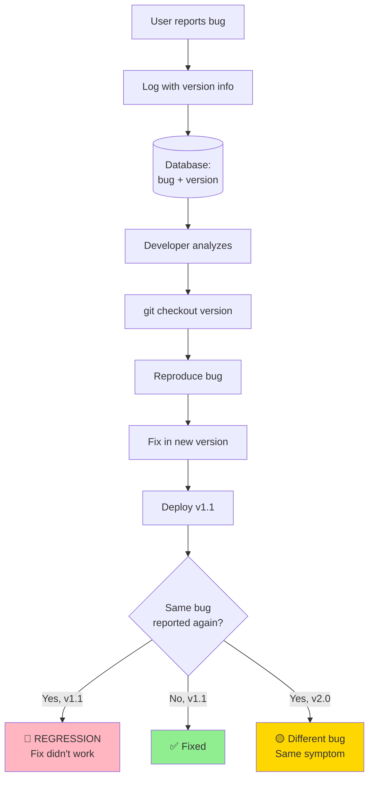
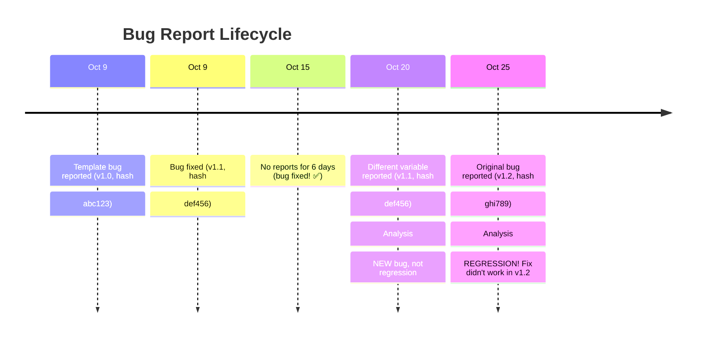

# Version Tracking & Bug Report Correlation

**Critical Question**: "How do bug reports help when code keeps changing?"

**Answer**: Version tracking connects feedback to specific code states.

---

## 🎯 The Problem

```
Day 1: User reports "Variables not replaced" (Bug in version 1.0)
Day 30: You fix it
Day 60: User reports same issue again
  → Is it the SAME bug (regression)?
  → Or DIFFERENT code?
  → How do you know?
```

**Without version tracking**: Bug reports become noise.

---

## ✅ Solution: Version + Code State Tracking

### 1. **Prompt Versioning** (Already Implemented!)

```javascript
// training/core/logger.js (line 36)
promptVersion: data.promptVersion || 'unknown'

// When logging:
trainingLogger.logInteraction({
    promptVersion: 'unified_v1.0',  // ← Links feedback to code version
    //...
});
```

**Now you can**:
```sql
-- See bugs by version
SELECT * FROM detailed_feedback 
WHERE category = 'bug' 
AND conversation_id IN (
    SELECT conversation_id FROM training_log 
    WHERE prompt_version = 'unified_v1.0'
);

-- Did bug recur after fix?
SELECT * FROM detailed_feedback 
WHERE description LIKE '%variables not replaced%'
AND conversation_id IN (
    SELECT conversation_id FROM training_log 
    WHERE prompt_version = 'unified_v1.1'  -- After fix
);
```

### 2. **Git Commit Hash Tracking** (Add This!)

```javascript
// training/core/logger.js - ENHANCEMENT
import { execSync } from 'child_process';

function getCurrentGitHash() {
    try {
        return execSync('git rev-parse --short HEAD').toString().trim();
    } catch {
        return 'unknown';
    }
}

// In logInteraction:
trainingLogger.logInteraction({
    promptVersion: 'unified_v1.0',
    gitHash: getCurrentGitHash(),  // ← Links to exact code state!
    //...
});
```

**Now correlate bugs to commits**:
```bash
# User reported bug on git hash abc123
git show abc123

# Was it fixed in commit def456?
git diff abc123 def456 -- handlers/message_logic/actionExecutor.js
```

### 3. **Code Checkpoint Snapshots**

```javascript
// When deploying changes, snapshot current code state
await deploymentManager.createCheckpoint({
    version: 'v1.2.0',
    gitHash: 'abc123',
    timestamp: Date.now(),
    changes: [
        'Fixed template variable bug in actionExecutor.js',
        'Added integrative negotiation'
    ]
});
```

**Benefits**:
- Know exactly what code was running when bug occurred
- Can reproduce bugs by checking out specific version
- Track if bugs recur after fixes

---

## 📊 Bug Report Lifecycle with Versioning



---

## 🔍 Example: Your Template Bug

### Initial Report

```
Date: Oct 9, 2025
User: Alice
Report: /feedback bug "Variables {{TO_USER}} not replaced"
Version logged: unified_v1.0
Git hash: abc123
File: actionExecutor.js (line 37)
```

### Your Fix

```
Date: Oct 9, 2025
Fix applied to: actionExecutor.js
Git commit: def456
Message: "Fixed template bug - use username not UUID"
Deploy: unified_v1.1
```

### Later Report

```
Date: Oct 20, 2025
User: Bob
Report: /feedback bug "Variables {{FROM_USER}} not replaced"  
Version logged: unified_v1.1
Git hash: def456
```

### Analysis

```sql
-- Check if same bug
SELECT * FROM detailed_feedback 
WHERE category = 'bug' 
AND description LIKE '%variables%'
ORDER BY timestamp;

-- Result:
-- Oct 9: v1.0, "{{TO_USER}} not replaced"  
-- Oct 20: v1.1, "{{FROM_USER}} not replaced"

-- Conclusion: DIFFERENT variable! Not a regression, new bug.
```

---

## 🎯 Making Bug Reports Actionable

### Problem: Vague Reports
```
User: "It's broken"
→ What's broken?
→ When?
→ In what code version?
→ Impossible to fix
```

### Solution: Contextualized Reports

```javascript
// When user reports bug, automatically capture:
{
    description: "Variables {{TO_USER}} not replaced",  // User description
    conversation_id: "conv_123",                        // What conversation
    message_context: "A mentioned B...",                // What message triggered it
    promptVersion: "unified_v1.0",                      // What prompt version
    gitHash: "abc123",                                   // Exact code state
    timestamp: 1726055220,
    
    // Make it reproducible
    reproducible_test: {
        user_message: "Tell Bob I'm worried",
        expected_output: "Hey Bob, Alice mentioned...",
        actual_output: "Hey {{TO_USER}}, {{SPEAKER_USERNAME}}..."
    }
}
```

**Now developer can**:
1. Check out exact code: `git checkout abc123`
2. See prompt version: `cat prompts/unified_prompt.js` (at that commit)
3. Read conversation context
4. Reproduce the bug
5. Fix it
6. Track if it recurs

---

## 📈 Version Tracking Implementation

### Add to training/core/logger.js

```javascript
import { execSync } from 'child_process';
import packageJson from '../../package.json' assert { type: 'json' };

class TrainingLogger {
    constructor(logPath = './training/training_log.jsonl') {
        this.logPath = logPath;
        this.enabled = process.env.TRAINING_MODE !== 'disabled';
        
        // Cache version info (calculate once)
        this.versionInfo = {
            gitHash: this._getGitHash(),
            gitBranch: this._getGitBranch(),
            packageVersion: packageJson.version,
            nodeVersion: process.version
        };
    }

    async logInteraction(data) {
        const logEntry = {
            // ... existing fields ...
            
            // ADD: Version tracking
            version_info: {
                prompt_version: data.promptVersion || 'unknown',
                git_hash: this.versionInfo.gitHash,
                git_branch: this.versionInfo.gitBranch,
                package_version: this.versionInfo.packageVersion,
                node_version: this.versionInfo.nodeVersion
            }
        };
        
        await this._appendToLog(logEntry);
    }

    _getGitHash() {
        try {
            return execSync('git rev-parse --short HEAD').toString().trim();
        } catch {
            return 'unknown';
        }
    }

    _getGitBranch() {
        try {
            return execSync('git rev-parse --abbrev-ref HEAD').toString().trim();
        } catch {
            return 'unknown';
        }
    }
}
```

### Enhanced Bug Reports

```javascript
// handlers/commands/reportCommand.js - ADD version capture
export async function handleReportCommand(userId, circleId, parts, sendMessage) {
    // ... existing code ...
    
    // ADD: Capture code version
    const gitHash = execSync('git rev-parse --short HEAD').toString().trim();
    const promptVersion = 'unified_v1.0'; // From active config
    
    await db.run(
        `INSERT INTO detailed_feedback 
         (conversation_id, user_id, category, description, context, timestamp, git_hash, prompt_version)
         VALUES (?, ?, ?, ?, ?, ?, ?, ?)`,
        [conversationId, userId, category, description, context, Date.now(), gitHash, promptVersion]
    );
}
```

---

## 🔬 Bug Analysis with Versions

### Query: "Did fix work?"

```javascript
// training/analysis/bug_tracker.js (NEW FILE NEEDED)
class BugTracker {
    async analyzeRegression(bugDescription) {
        const db = await getDb();
        
        // Find all reports of similar bugs
        const reports = await db.all(`
            SELECT r.*, t.git_hash, t.prompt_version
            FROM detailed_feedback r
            LEFT JOIN (
                SELECT conversation_id, git_hash, prompt_version 
                FROM training_log
            ) t ON r.conversation_id = t.conversation_id
            WHERE r.description LIKE ?
            ORDER BY r.timestamp
        `, [`%${bugDescription}%`]);

        // Group by version
        const byVersion = {};
        for (const report of reports) {
            const version = report.prompt_version || 'unknown';
            if (!byVersion[version]) byVersion[version] = [];
            byVersion[version].push(report);
        }

        // Check for regressions
        const versions = Object.keys(byVersion).sort();
        const regressions = [];
        
        for (let i = 1; i < versions.length; i++) {
            const prevVersion = versions[i - 1];
            const currVersion = versions[i];
            
            const prevCount = byVersion[prevVersion].length;
            const currCount = byVersion[currVersion].length;
            
            if (prevCount > 0 && currCount > 0) {
                regressions.push({
                    bug: bugDescription,
                    fixedIn: prevVersion,
                    reappearedIn: currVersion,
                    alert: '🚨 REGRESSION DETECTED'
                });
            }
        }

        return {
            totalReports: reports.length,
            byVersion,
            regressions,
            status: regressions.length > 0 ? 'regression' : 'tracking'
        };
    }
}
```

---

## 💡 Making Sense of Reports Over Time

### The Pattern



### Automated Analysis

```bash
# Run regression checker
node training/analysis/bug_tracker.js

# Output:
📊 Bug Regression Report

🐛 "Variables not replaced"
  v1.0 (abc123): 5 reports
  v1.1 (def456): 0 reports ✅ FIXED
  v1.2 (ghi789): 2 reports 🚨 REGRESSION

Recommendation: Review changes between v1.1 and v1.2
Git diff: git diff def456 ghi789
```

---

## ✅ What You Need to Add

### 1. Enhance Logger (5 lines)
```javascript
// training/core/logger.js
import { execSync } from 'child_process';

// Add git hash to logs
gitHash: execSync('git rev-parse --short HEAD').toString().trim()
```

### 2. Update Feedback Table (1 column)
```sql
ALTER TABLE detailed_feedback ADD COLUMN git_hash TEXT;
ALTER TABLE detailed_feedback ADD COLUMN prompt_version TEXT;
```

### 3. Create Bug Tracker (optional, ~100 lines)
```javascript
// training/analysis/bug_tracker.js
// Analyzes reports across versions
// Detects regressions
```

---

## 📚 Summary

### Your Questions:

**Q1: "You overwrote my behavioral_models.js!"**  
✅ **FIXED** - Restored original, put new code in `checklist_framework.js`

**Q2: "Did you do this elsewhere?"**  
✅ **CHECKED** - No other existing files were overwritten. All business/training code is new files.

**Q3: "How do bug reports help when code changes?"**  
✅ **ANSWERED**:
- Version tracking (prompt_version field already exists!)
- Git hash tracking (easy to add)
- Regression detection (correlate bugs across versions)
- Reproducibility (check out exact code state)

---

## 🛡️ Safety Confirmation

**Your original code**:
- ✅ `behavioral_models.js` - RESTORED (Stages of Change, Coping Styles, etc.)
- ✅ All other medical files - UNCHANGED
- ✅ Server.js - UNCHANGED  
- ✅ Orchestrator - UNCHANGED

**My additions** (all new files):
- training/* (new code, not replacements)
- handlers/business/* (new directory)
- agents/business/* (new directory)
- documentation/* (new docs)
- checklist_framework.js (NEW, not overwriting)

---

**Status**: 🟢 **Medical system intact!**  
**Lesson learned**: Always check if file exists before writing!
