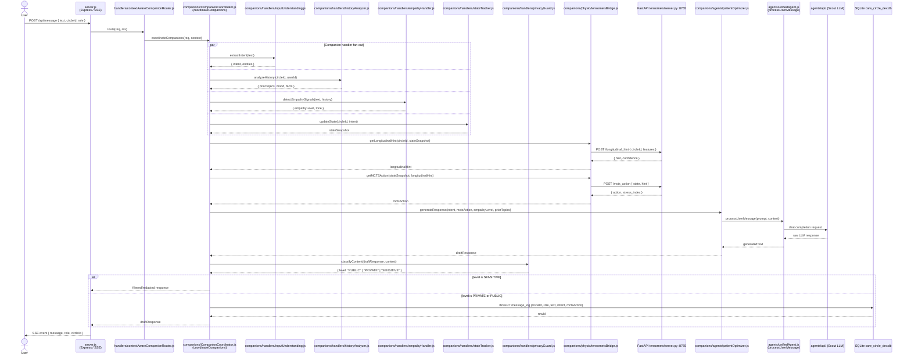

# Basic Message Flow

## Sequence Diagram



## Key Interactions

1. **User → server.js**: HTTP POST carries the raw message, circleId, and role.
2. **server.js → contextAwareCompanionRouter.js**: Routes to the correct domain handler based on circleId metadata.
3. **contextAwareCompanionRouter.js → CompanionCoordinator.js**: Hands off to per-request brain with full context.
4. **CompanionCoordinator fan-out**: Four handlers run in parallel — intent extraction, history analysis, empathy detection, and state tracking — then their results are merged.
5. **tensornetsBridge → FastAPI :8765**: Two sequential calls — longitudinal hint (physiological context) then MCTS action selection.
6. **patientOptimizer → unifiedAgent → Scout LLM**: Response generation pipeline converts the enriched context into a final reply.
7. **privacyGuard gate**: Classifies the draft response; SENSITIVE content is filtered before delivery.
8. **SQLite write**: Message log (including intent and MCTS action) is persisted before the response is sent.
9. **server.js SSE broadcast**: Final reply is streamed back to the user via Server-Sent Events.

## Component Roles

| Module | Role |
|--------|------|
| `server.js` | Express HTTP server; SSE broadcaster to connected clients |
| `handlers/contextAwareCompanionRouter.js` | Routes requests to medical or business domain based on circleId |
| `companions/CompanionCoordinator.js` | Per-request orchestrator; fans out to all companion handlers and merges results |
| `companions/handlers/inputUnderstanding.js` | Extracts intent and named entities from raw text |
| `companions/handlers/historyAnalyzer.js` | Retrieves and analyses prior conversation turns and known facts |
| `companions/handlers/empathyHandler.js` | Detects emotional tone and computes empathy signal level |
| `companions/handlers/stateTracker.js` | Maintains and updates per-circle state snapshot |
| `companions/handlers/privacyGuard.js` | LLM-based classifier that assigns Level 1 / 2 / 3 privacy labels |
| `companions/physio/tensornetsBridge.js` | JS→Python bridge; calls FastAPI for longitudinal hints and MCTS actions |
| `FastAPI tensornets/server.py :8765` | Python inference server; returns longitudinal physiological hint and MCTS action |
| `companions/agents/patientOptimizer.js` | Assembles prompt from enriched context and delegates to unifiedAgent |
| `agents/unifiedAgent.js` | Executes LLM calls; provider-agnostic message processor |
| `agents/api/` | Multi-provider LLM layer (Scout / Maverick / Bedrock) |
| `SQLite care_circle_dev.db` | Persistent store for messages, facts, interventions, and circle state |

## Data Flow

```
User text
  → intent + entities           (inputUnderstanding)
  → history + known facts       (historyAnalyzer)
  → empathy signal              (empathyHandler)
  → state snapshot              (stateTracker)
  → longitudinal hint           (tensornetsBridge → FastAPI)
  → MCTS action                 (tensornetsBridge → FastAPI)
  → enriched prompt             (patientOptimizer)
  → LLM completion              (unifiedAgent → Scout)
  → privacy gate                (privacyGuard)
  → SQLite write
  → SSE response to User
```

---

> **Note:** This diagram uses real module file names from the codebase. Earlier versions of this diagram used fictional participant names (ActionExecutor, FactReportingHandler, CriticalEventsHandler, ConsentManager, SharingHandler) — those have been removed.
