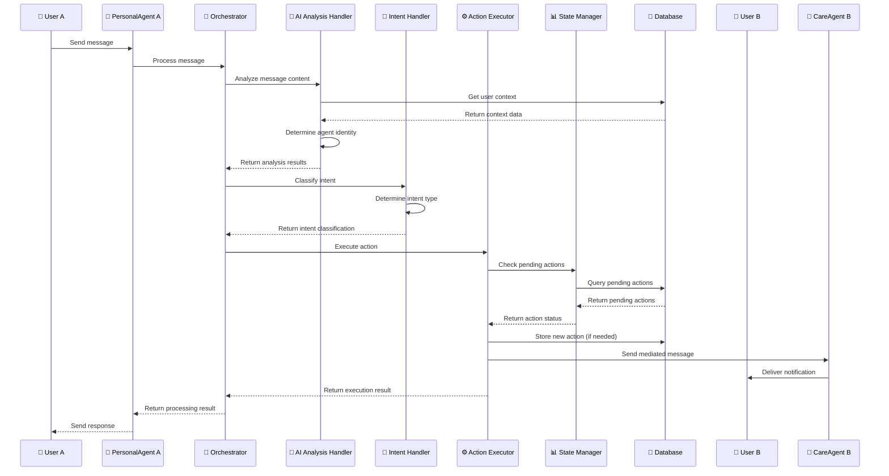

# Basic Message Flow Sequence Diagram

This diagram shows the basic message flow when a user sends a message to their agent and the system processes it through the orchestrator to determine the appropriate response.

## Sequence Diagram

## Key Interactions

### 1. Message Reception
- **User A** sends a message to their **PersonalAgent A**
- The agent forwards the message to the **Orchestrator** for processing

### 2. AI Analysis Phase
- **Orchestrator** delegates to **AI Analysis Handler**
- Handler retrieves user context from database
- Determines agent identity (PersonalAgent vs CareAgent)
- Returns analysis results to orchestrator

### 3. Intent Classification
- **Orchestrator** uses **Intent Handler** to classify the message intent
- Intent types include: fact reporting, doctor requests, mediation, advice sharing
- Returns intent classification to orchestrator

### 4. Action Execution
- **Orchestrator** delegates to **Action Executor**
- **Action Executor** checks for pending actions via **State Manager**
- **State Manager** queries database for pending actions
- New actions are stored in database if needed

### 5. Mediated Communication
- **Action Executor** sends mediated message to **CareAgent B**
- **CareAgent B** delivers notification to **User B**
- **Action Executor** returns execution result to orchestrator

### 6. Response Delivery
- **Orchestrator** returns processing result to **PersonalAgent A**
- **PersonalAgent A** sends response back to **User A**

## Component Roles

- **User A**: Patient or caregiver sending the initial message
- **PersonalAgent A**: User A's personal AI agent
- **Orchestrator**: Central decision-making component
- **AI Analysis Handler**: Analyzes message content and context
- **Intent Handler**: Classifies message intent
- **Action Executor**: Executes the determined action
- **State Manager**: Manages pending actions and state
- **Database**: Stores user context, pending actions, and system state
- **User B**: Target user receiving mediated information
- **CareAgent B**: User B's care agent (when User B is in caregiver role)

## Data Flow

1. **Message**: User input with context
2. **Analysis**: AI analysis results with agent identity
3. **Intent**: Classified intent type
4. **Action**: Executed action with state updates
5. **Mediation**: Mediated message to target user
6. **Response**: Final response to originating user
