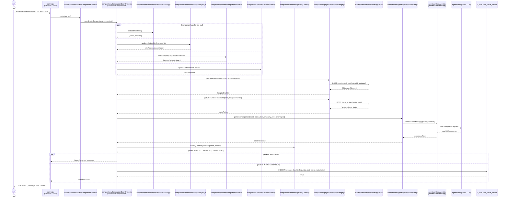

# Basic Message Flow — v2 (real module names)

> **Supersedes:** `basic_message_flow_v1_original.md`  
> **Original source:** Chat-output design sketch using role-abstraction / design-intent names.  
> **This version:** Rewritten to reflect actual codebase module paths verified against `server.js`, `handlers/contextAwareCompanionRouter.js`, `companions/CompanionCoordinator.js`, all companion handler files, `companions/physio/tensornetsBridge.js`, `companions/agents/patientOptimizer.js`, `agents/unifiedAgent.js`, and `companions/handlers/privacyGuard.js`.

## How v2 differs from v1

| Dimension | v1 (original) | v2 (this file) |
|-----------|--------------|----------------|
| Participant names | Role abstractions / design-intent names: `PersonalAgent A`, `Orchestrator`, `AIAnalysisHandler`, `IntentHandler`, `ActionExecutor`, `StateManager`, `CareAgent B`. PersonalAgent/CareAgent correctly represent role-specific agent instances; they are not false — the code implements the same idea via `CompanionCoordinator.js` with a `role` parameter. | Real module paths: `server.js`, `contextAwareCompanionRouter.js`, `CompanionCoordinator.js`, `inputUnderstanding.js`, `historyAnalyzer.js`, `empathyHandler.js`, `stateTracker.js`, `tensornetsBridge.js`, `patientOptimizer.js`, `unifiedAgent.js`, `privacyGuard.js` |
| Handler model | Sequential: analyse → classify intent → execute action | Parallel fan-out via `par` block (all 4 handlers run concurrently), then sequential MPS/MCTS calls |
| Physio/ML layer | Absent — no Python calls | Two sequential FastAPI calls: `/longitudinal_hint` then `/mcts_action` |
| Response generation | `ActionExecutor` sends to `CareAgent B` | `patientOptimizer` → `unifiedAgent` → Scout LLM generates the response for the requesting user |
| Privacy gate | Absent | `privacyGuard.js` classifies the draft response; SENSITIVE content is filtered before delivery |
| Message logging | DB write for "new action" | SQLite write of full message log including intent and MCTS action, only on non-SENSITIVE paths |
| Cross-user mediation | v1 shows `CareAgent B` delivering to `User B` as the primary outcome | v2 focuses on the single-user response path; inter-companion communication is covered in `conflict_resolution_v2_real_modules.md` |

## How v1 and v2 align

Both versions model the same **conceptual request-response cycle**: a user message enters the system, is analysed by AI components, produces an action, and a response is delivered. The abstract components in v1 map to real modules in v2:

| v1 concept | v2 module |
|------------|-----------|
| `PersonalAgent A` | `handlers/contextAwareCompanionRouter.js` + `CompanionCoordinator.js` |
| `Orchestrator` | `CompanionCoordinator.js` (intra-companion brain) |
| `AIAnalysisHandler` | `inputUnderstanding.js` + `historyAnalyzer.js` + `empathyHandler.js` |
| `IntentHandler` | `inputUnderstanding.js` (intent extraction) |
| `ActionExecutor` | `patientOptimizer.js` + `unifiedAgent.js` |
| `StateManager` | `stateTracker.js` |
| `Database` | `SQLite care_circle_dev.db` |

## Sequence Diagram



## Key Interactions

1. **User → server.js**: HTTP POST carries the raw message, circleId, and role.
2. **server.js → contextAwareCompanionRouter.js**: Routes to the correct domain handler based on circleId metadata.
3. **contextAwareCompanionRouter.js → CompanionCoordinator.js**: Hands off to per-request brain with full context.
4. **CompanionCoordinator fan-out**: Four handlers run in parallel — intent extraction, history analysis, empathy detection, and state tracking — then their results are merged.
5. **tensornetsBridge → FastAPI :8765**: Two sequential calls — longitudinal hint (physiological context) then MCTS action selection.
6. **patientOptimizer → unifiedAgent → Scout LLM**: Response generation pipeline converts the enriched context into a final reply.
7. **privacyGuard gate**: Classifies the draft response; SENSITIVE content is filtered before delivery.
8. **SQLite write**: Message log (including intent and MCTS action) is persisted before the response is sent.
9. **server.js SSE broadcast**: Final reply is streamed back to the user via Server-Sent Events.

## Component Roles

| Module | Role |
|--------|------|
| `server.js` | Express HTTP server; SSE broadcaster to connected clients |
| `handlers/contextAwareCompanionRouter.js` | Routes requests to medical or business domain based on circleId |
| `companions/CompanionCoordinator.js` | Per-request orchestrator; fans out to all companion handlers and merges results |
| `companions/handlers/inputUnderstanding.js` | Extracts intent and named entities from raw text |
| `companions/handlers/historyAnalyzer.js` | Retrieves and analyses prior conversation turns and known facts |
| `companions/handlers/empathyHandler.js` | Detects emotional tone and computes empathy signal level |
| `companions/handlers/stateTracker.js` | Maintains and updates per-circle state snapshot |
| `companions/handlers/privacyGuard.js` | LLM-based classifier that assigns Level 1 / 2 / 3 privacy labels |
| `companions/physio/tensornetsBridge.js` | JS→Python bridge; calls FastAPI for longitudinal hints and MCTS actions |
| `FastAPI tensornets/server.py :8765` | Python inference server; returns longitudinal physiological hint and MCTS action |
| `companions/agents/patientOptimizer.js` | Assembles prompt from enriched context and delegates to unifiedAgent |
| `agents/unifiedAgent.js` | Executes LLM calls; provider-agnostic message processor |
| `agents/api/` | Multi-provider LLM layer (Scout / Maverick / Bedrock) |
| `SQLite care_circle_dev.db` | Persistent store for messages, facts, interventions, and circle state |

## Data Flow

```
User text
  → intent + entities           (inputUnderstanding)
  → history + known facts       (historyAnalyzer)
  → empathy signal              (empathyHandler)
  → state snapshot              (stateTracker)
  → longitudinal hint           (tensornetsBridge → FastAPI)
  → MCTS action                 (tensornetsBridge → FastAPI)
  → enriched prompt             (patientOptimizer)
  → LLM completion              (unifiedAgent → Scout)
  → privacy gate                (privacyGuard)
  → SQLite write
  → SSE response to User
```

---

> **Note:** This diagram uses real module file names from the codebase. Earlier versions used role-abstraction / design-intent names (ActionExecutor, FactReportingHandler, CriticalEventsHandler, ConsentManager, SharingHandler). Those names correctly represent the conceptual architecture — the v1 names like `PersonalAgent`, `CareAgent`, `Doctor`, `Caregiver` map to `role` values in the `care_circle_members` table, not to separate module files.
