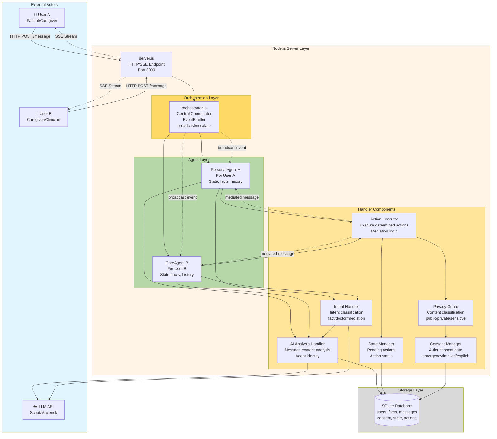
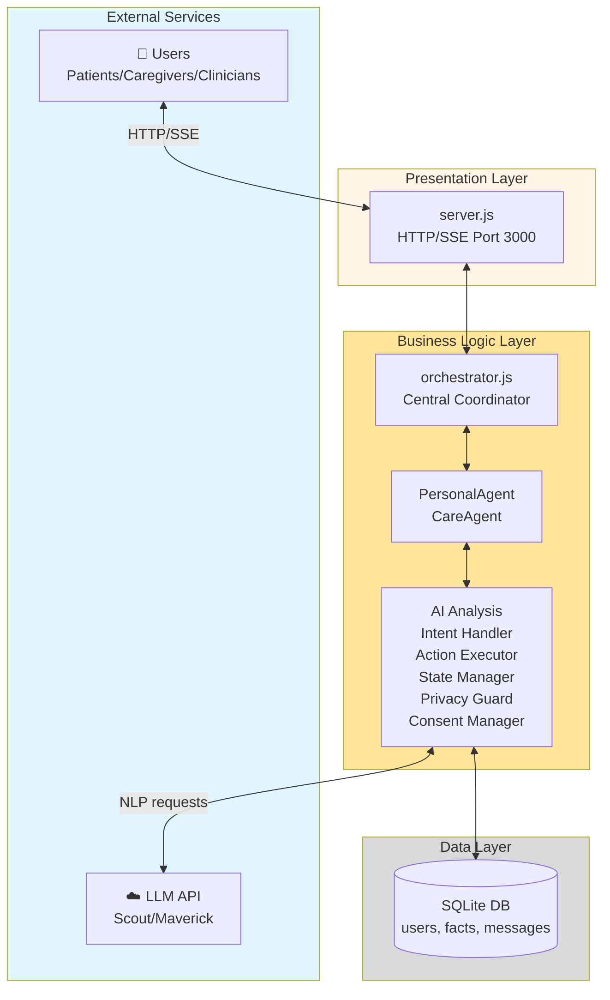

# Logical View - Care Circle Component Diagram (v1 Original)

**Purpose**: Component diagram showing the static structure of the Care Circle framework (JS-only, pre-HTN)

---

## Mermaid Source

Save this as `documentation/uml_diagrams/care_circle_logical_view_v1.md`:

```markdown
# Care Circle Logical View - Component Diagram (v1 Original Design)

This diagram shows the major components and their relationships in the original Care Circle framework (Node.js-only, pre-HTN).

## Component Diagram



## Component Descriptions

### Server Layer
- **server.js**: HTTP/SSE endpoint, port 3000, handles client connections
- **orchestrator.js**: Central coordinator with EventEmitter for broadcast/escalate events

### Agent Layer
- **PersonalAgent**: Per-user agent instance (patient/caregiver), maintains state
- **CareAgent**: Per-user agent for caregivers/clinicians, maintains state

### Handler Components
- **AI Analysis Handler**: Analyzes message content, determines agent identity
- **Intent Handler**: Classifies message intent (fact/doctor/mediation/advice)
- **Action Executor**: Executes determined actions, handles mediation logic
- **State Manager**: Manages pending actions and action status
- **Privacy Guard**: Classifies content as public/private/sensitive
- **Consent Manager**: Enforces 4-tier consent gate (emergency/implied/explicit/full)

### Storage Layer
- **SQLite Database**: Stores users, facts, messages, consent levels, state, pending actions

### External
- **Users**: Patients, caregivers, clinicians
- **LLM API**: Scout/Maverick for natural language processing

## Key Relationships

1. **User → Server**: HTTP POST requests, SSE stream responses
2. **Orchestrator → Agents**: Central coordination, event broadcasting
3. **Agents → Handlers**: Delegation to specialized handlers
4. **Handlers → Database**: State persistence and retrieval
5. **Handlers → LLM**: AI-powered analysis and classification
6. **Cross-Agent**: Mediated messages through Action Executor
```
---

## How to Export to PNG

1. Save the above Mermaid code to:
   ```
   documentation/uml_diagrams/care_circle_logical_view_v1.md
   ```

2. Run the export script:
   ```bash
   python scripts/export_mermaid.py
   ```

3. The PNG will be generated at:
   ```
   figures/uml/care_circle_logical_view_v1.png
   ```

4. Use in Appendix F as **Figure F.3 (Logical View)**

---

## Alternative: Simpler Version

If the above is too complex, here's a simpler 3-tier version with external services:



This shows the classic 3-tier architecture (Presentation → Business Logic → Data) with external services separated out

---

## For Your Thesis

**Use**: The first (detailed) component diagram for Appendix F.3 (Logical View)

**Caption**: 
```latex
\caption{Care Circle Logical View (v1 Original Design) - Component architecture showing the Node.js server layer with orchestration, agent, and handler components. PersonalAgent and CareAgent instances coordinate through the orchestrator, delegating to specialized handlers for AI analysis, intent classification, action execution, and consent management.}
```
