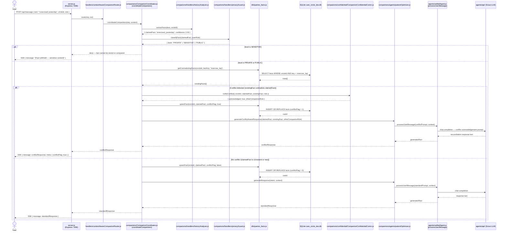

# Conflict Resolution

## Sequence Diagram



## Key Interactions

1. **User → server.js**: User reports a fact embedded in natural language text.
2. **historyAnalyzer**: Extracts the structured fact claim and its confidence score from the message.
3. **privacyGuard gate**: Classifies the fact before it is stored or compared; SENSITIVE facts are blocked immediately.
4. **db/queries_facts.js**: Retrieves existing facts for the same key from `care_circle_dev.db` to check for contradictions.
5. **Conflict detection**: `CompanionCoordinator` compares the incoming fact against stored facts; a mismatch triggers the conflict branch.
6. **CompanionConfidentialComm**: Notifies the peer companion (e.g. doctor companion) that a conflict was detected, so both companions remain in sync.
7. **db/queries_facts.js upsert**: The new fact is stored with `conflictFlag` set appropriately in both branches.
8. **patientOptimizer → unifiedAgent → Scout**: Generates either a conflict-acknowledging response or a standard confirmation.
9. **server.js SSE**: Final reply carries a `conflictFlag` meta field so the client can surface a conflict indicator in the UI.

## Component Roles

| Module | Role |
|--------|------|
| `server.js` | Express HTTP server; SSE broadcaster to connected clients |
| `handlers/contextAwareCompanionRouter.js` | Routes the request to the correct domain companion |
| `companions/CompanionCoordinator.js` | Orchestrates fact extraction, privacy gating, conflict detection, and response generation |
| `companions/handlers/historyAnalyzer.js` | Parses message text to extract structured fact claims with confidence scores |
| `companions/handlers/privacyGuard.js` | LLM-based classifier — Level 1 (PUBLIC) / Level 2 (PRIVATE) / Level 3 (SENSITIVE) |
| `db/queries_facts.js` | Fact retrieval and upsert; surfaces contradicting rows from SQLite |
| `companions/confidential/CompanionConfidentialComm.js` | Companion-to-companion signalling channel; keeps peer companions aware of conflicts |
| `companions/agents/patientOptimizer.js` | Builds conflict-aware or standard prompts and delegates to unifiedAgent |
| `agents/unifiedAgent.js` | Provider-agnostic LLM call executor |
| `agents/api/` | Multi-provider LLM layer (Scout / Maverick / Bedrock) |
| `SQLite care_circle_dev.db` | Persistent store; `facts` table holds keyed fact rows with conflict metadata |

## Data Flow

```
User message
  → fact extraction (historyAnalyzer)
  → privacy classification (privacyGuard)
      SENSITIVE → deny immediately
      PRIVATE / PUBLIC →
          → retrieve existing facts (db/queries_facts.js → SQLite)
          → conflict check (CompanionCoordinator)
              conflict →
                  → notify peer companion (CompanionConfidentialComm)
                  → upsert with conflictFlag=true
                  → conflict-aware response (patientOptimizer → unifiedAgent → Scout)
              no conflict →
                  → upsert with conflictFlag=false
                  → standard response (patientOptimizer → unifiedAgent → Scout)
  → SSE reply to User
```

---

> **Note:** This diagram uses real module file names from the codebase. Earlier versions of this diagram used fictional participant names (ActionExecutor, FactReportingHandler, CriticalEventsHandler, ConsentManager, SharingHandler) — those have been removed.
