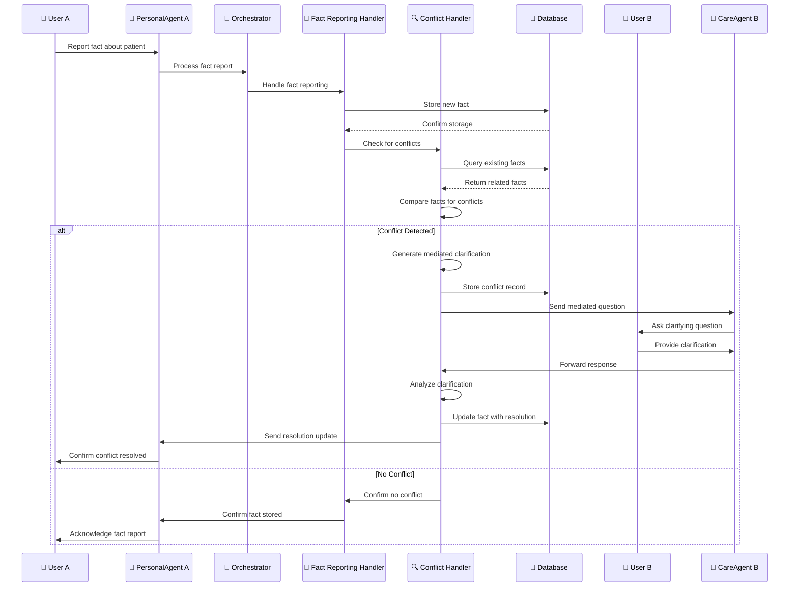

# Conflict Resolution Sequence Diagram

This diagram shows the conflict detection and resolution process when users report contradictory information about the same topic.

## Sequence Diagram

## Key Interactions

### 1. Fact Reporting
- **User A** reports a fact about the patient to their **PersonalAgent A**
- The agent forwards the fact to the **Orchestrator** for processing
- **Orchestrator** delegates to **Fact Reporting Handler**

### 2. Fact Storage
- **Fact Reporting Handler** stores the new fact in the database
- Database confirms successful storage
- Handler then checks for potential conflicts

### 3. Conflict Detection
- **Fact Reporting Handler** delegates to **Conflict Handler**
- **Conflict Handler** queries database for existing facts about the same topic
- Database returns related facts for comparison
- **Conflict Handler** compares the new fact against existing facts

### 4. Conflict Resolution Path (if conflict detected)
- **Conflict Handler** generates a mediated clarification question
- Stores conflict record in database
- Sends mediated question to **CareAgent B** (User B's agent)
- **CareAgent B** delivers the clarifying question to **User B**

### 5. User Response and Resolution
- **User B** provides clarification to their agent
- **CareAgent B** forwards the response to **Conflict Handler**
- **Conflict Handler** analyzes the clarification
- Updates the fact in database with resolution
- Sends resolution update to **PersonalAgent A**
- **PersonalAgent A** confirms conflict resolution to **User A**

### 6. No Conflict Path
- If no conflict is detected, **Conflict Handler** confirms no conflict
- **Fact Reporting Handler** confirms fact storage to **PersonalAgent A**
- **PersonalAgent A** acknowledges the fact report to **User A**

## Component Roles

- **User A**: User reporting the initial fact
- **PersonalAgent A**: User A's personal AI agent
- **Orchestrator**: Central decision-making component
- **Fact Reporting Handler**: Handles fact storage and conflict checking
- **Conflict Handler**: Detects conflicts and manages resolution process
- **Database**: Stores facts, conflict records, and resolution updates
- **User B**: User who may have conflicting information
- **CareAgent B**: User B's care agent (when User B is in caregiver role)

## Conflict Detection Logic

### Fact Comparison
- **Topic Matching**: Facts about the same subject (medication, symptoms, behavior)
- **Time Proximity**: Facts reported within a reasonable time frame
- **Contradiction Analysis**: Direct contradictions (took/didn't take medication)
- **Context Consideration**: Similar situations with different outcomes

### Mediated Question Generation
- **Neutral Language**: Avoids taking sides or showing bias
- **Specific Focus**: Asks for clarification on the specific discrepancy
- **Observable Facts**: Focuses on what can be observed rather than opinions
- **Privacy Protection**: Doesn't reveal who reported what conflicting information

## Data Flow

1. **Fact Report**: Initial fact from User A
2. **Fact Storage**: New fact stored in database
3. **Conflict Check**: Comparison with existing facts
4. **Mediated Question**: Neutral clarifying question (if conflict detected)
5. **User Response**: Clarification from User B
6. **Resolution**: Updated fact with conflict resolution
7. **Confirmation**: Resolution confirmation to User A

## Example Scenarios

### Medication Conflict
- **User A**: "Patient took medication at 8 AM"
- **User B**: "Patient didn't take medication this morning"
- **Mediated Question**: "I'd like to clarify about the medication - can you tell me what you observed about the patient's medication routine this morning?"

### Symptom Conflict
- **User A**: "Patient is feeling better today"
- **User B**: "Patient seems worse, more tired than usual"
- **Mediated Question**: "There seems to be different information about the patient's condition. Could you describe what you noticed about their energy level and overall appearance this morning?"
