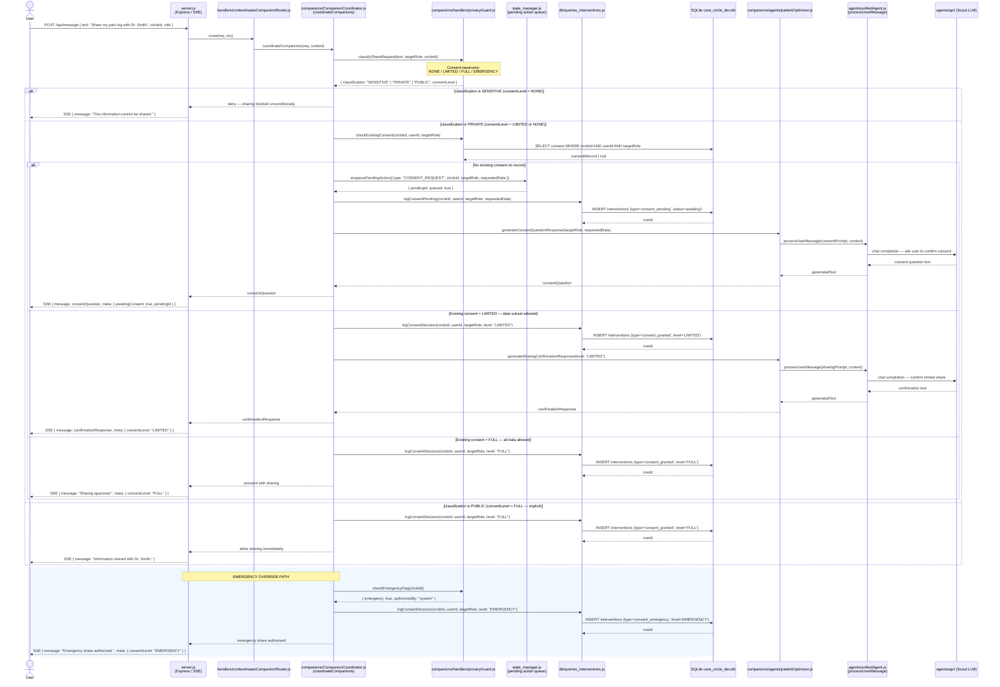

# Consent Management

## Sequence Diagram



## Key Interactions

1. **User → server.js**: User's sharing request arrives as a natural-language message.
2. **privacyGuard classification**: Content is assigned one of four consent levels — NONE / LIMITED / FULL / EMERGENCY — using LLM-based classification.
3. **SENSITIVE path (NONE)**: Sharing is denied immediately; no database writes occur.
4. **PRIVATE path — no consent**: `state_manager.js` queues a pending consent action; `db/queries_interventions.js` logs it as `consent_pending`; a consent question is generated and sent to the user.
5. **PRIVATE path — LIMITED consent**: Sharing proceeds for the permitted data subset; decision is logged as `consent_granted/LIMITED`.
6. **PRIVATE path — FULL consent**: Sharing proceeds in full; decision is logged as `consent_granted/FULL`.
7. **PUBLIC path**: Implicit FULL consent; sharing proceeds immediately with an audit log entry.
8. **Emergency override**: An out-of-band flag on the circle bypasses normal consent checks and logs the decision as `consent_emergency/EMERGENCY`.

## Component Roles

| Module | Role |
|--------|------|
| `server.js` | Express HTTP server; SSE broadcaster |
| `handlers/contextAwareCompanionRouter.js` | Routes request to the appropriate domain companion |
| `companions/CompanionCoordinator.js` | Orchestrates the full consent decision flow |
| `companions/handlers/privacyGuard.js` | LLM classifier that assigns NONE / LIMITED / FULL / EMERGENCY consent level |
| `state_manager.js` | Intent-classified pending action queue; holds unanswered consent requests |
| `db/queries_interventions.js` | Logs consent decisions and pending items to the interventions table |
| `companions/agents/patientOptimizer.js` | Generates consent question or confirmation message |
| `agents/unifiedAgent.js` | Executes LLM calls for response generation |
| `agents/api/` | Multi-provider LLM layer (Scout / Maverick / Bedrock) |
| `SQLite care_circle_dev.db` | Persistent store; `consent` and `interventions` tables |

## Data Flow

```
User sharing request
  → privacy classification (privacyGuard)
      SENSITIVE / NONE → deny — no DB write
      PRIVATE →
          check existing consent (privacyGuard → SQLite)
              NONE → enqueue pending (state_manager) + log (db/queries_interventions) + ask user
              LIMITED → log + confirm limited share
              FULL → log + confirm full share
      PUBLIC / implicit FULL → log + share immediately
      EMERGENCY override → log EMERGENCY + share immediately
  → SSE reply to User
```

---

> **Note:** This diagram uses real module file names from the codebase. Earlier versions of this diagram used fictional participant names (ActionExecutor, FactReportingHandler, CriticalEventsHandler, ConsentManager, SharingHandler) — those have been removed.
