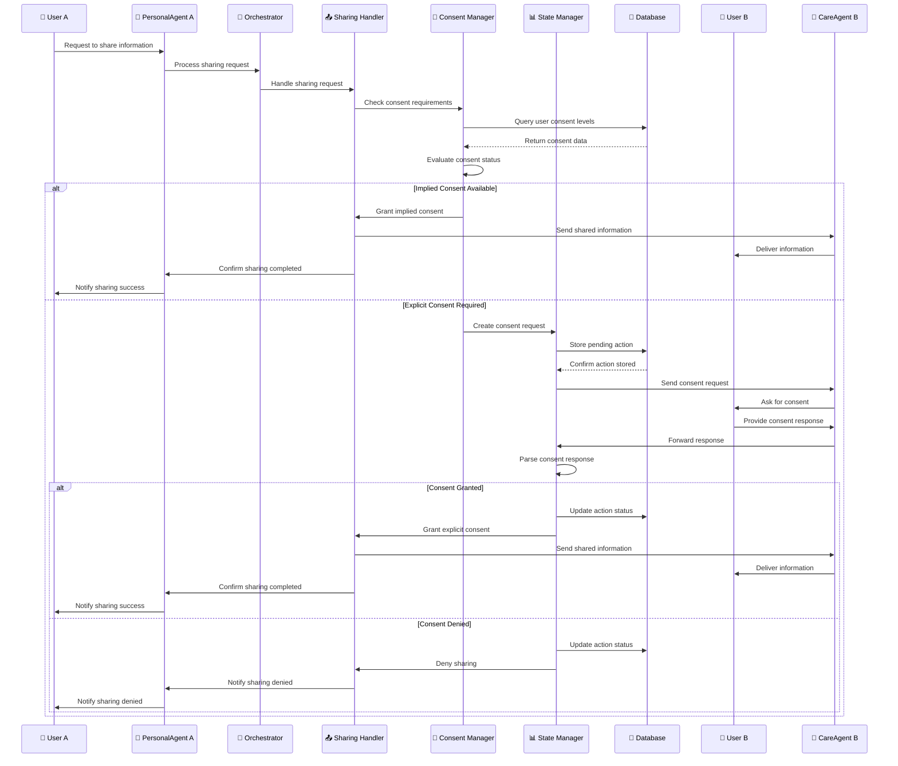

# Consent Management Sequence Diagram

This diagram shows the consent management process when users want to share information with others in their care circle.

## Sequence Diagram

## Key Interactions

### 1. Sharing Request
- **User A** requests to share information with someone in their care circle
- **PersonalAgent A** forwards the request to the **Orchestrator**
- **Orchestrator** delegates to **Sharing Handler**

### 2. Consent Evaluation
- **Sharing Handler** delegates to **Consent Manager**
- **Consent Manager** queries database for user consent levels
- Database returns consent data (implied, explicit, none)
- **Consent Manager** evaluates the consent status

### 3. Implied Consent Path
- If implied consent is available, **Consent Manager** grants consent
- **Sharing Handler** sends information directly to **CareAgent B**
- **CareAgent B** delivers information to **User B**
- **Sharing Handler** confirms sharing completion to **PersonalAgent A**
- **PersonalAgent A** notifies **User A** of successful sharing

### 4. Explicit Consent Path
- If explicit consent is required, **Consent Manager** creates a consent request
- **State Manager** stores the pending action in database
- **State Manager** sends consent request to **CareAgent B**
- **CareAgent B** asks **User B** for consent

### 5. Consent Response Processing
- **User B** provides consent response to their agent
- **CareAgent B** forwards response to **State Manager**
- **State Manager** parses the consent response

### 6. Consent Decision
- **If consent granted**: **State Manager** updates action status and grants explicit consent
- **Sharing Handler** sends information to **CareAgent B**
- **CareAgent B** delivers information to **User B**
- **Sharing Handler** confirms sharing completion to **PersonalAgent A**
- **PersonalAgent A** notifies **User A** of successful sharing

- **If consent denied**: **State Manager** updates action status and denies sharing
- **Sharing Handler** notifies **PersonalAgent A** of denial
- **PersonalAgent A** notifies **User A** that sharing was denied

## Component Roles

- **User A**: User requesting to share information
- **PersonalAgent A**: User A's personal AI agent
- **Orchestrator**: Central decision-making component
- **Sharing Handler**: Manages information sharing requests
- **Consent Manager**: Evaluates consent requirements and status
- **State Manager**: Manages pending consent actions
- **Database**: Stores consent levels, pending actions, and action status
- **User B**: User who must provide consent
- **CareAgent B**: User B's care agent (when User B is in caregiver role)

## Consent Levels

### Implied Consent
- **Automatic Sharing**: Information is shared without explicit permission
- **Topic-Based**: Consent is implied for specific topics (e.g., medication adherence)
- **Relationship-Based**: Consent is implied based on relationship (e.g., spouse, primary caregiver)
- **Context-Based**: Consent is implied based on situation (e.g., emergency situations)

### Explicit Consent
- **Permission Required**: User must explicitly approve sharing
- **Topic-Specific**: Consent is required for specific topics
- **Time-Limited**: Consent may have expiration dates
- **Revocable**: User can withdraw consent at any time

### No Consent
- **Sharing Denied**: Information cannot be shared
- **Privacy Protection**: User's privacy is protected
- **Opt-Out**: User has explicitly denied sharing

## Data Flow

1. **Sharing Request**: User A's request to share information
2. **Consent Check**: Evaluation of consent requirements
3. **Consent Decision**: Implied consent granted or explicit consent required
4. **Consent Request**: Pending action created (if explicit consent needed)
5. **User Response**: User B's consent decision
6. **Action Execution**: Information shared or sharing denied
7. **Confirmation**: Result communicated to User A

## Example Scenarios

### Implied Consent Example
- **User A**: "Share my medication adherence with my doctor"
- **System**: Checks if User A has implied consent for medication topics
- **Result**: If implied consent exists, information is shared directly

### Explicit Consent Example
- **User A**: "Share my mental health status with my spouse"
- **System**: Creates consent request for User B (spouse)
- **User B**: "Yes, I want to know about their mental health"
- **Result**: Information is shared with User B

### Consent Denial Example
- **User A**: "Share my medication adherence with my neighbor"
- **System**: Creates consent request for User B (neighbor)
- **User B**: "No, I don't want to know about their medication"
- **Result**: Information is not shared, User A is notified of denial
