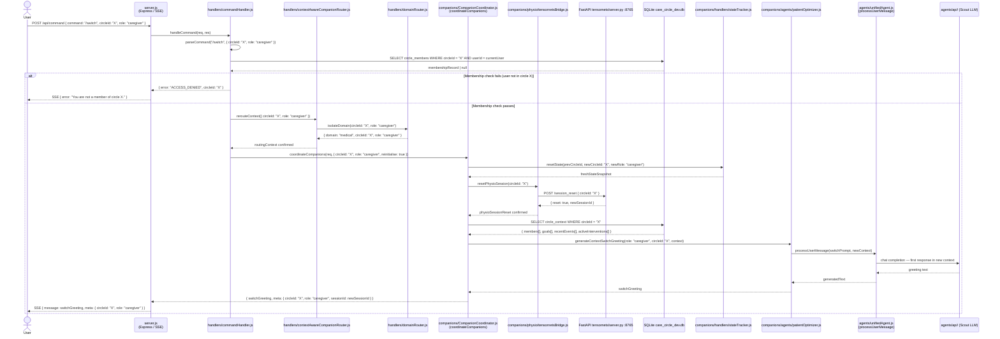

# Context Switching

## Sequence Diagram



## Key Interactions

1. **User → server.js**: `/switch` command arrives with the target `circleId` and the new `role`.
2. **commandHandler**: Parses the command and performs the membership gate check against SQLite before any routing occurs.
3. **Invalid access path**: If the user is not a member of the target circle, an `ACCESS_DENIED` error is returned immediately and the switch is aborted.
4. **contextAwareCompanionRouter re-route**: Routes the session to the new `circleId`/`role` combination in the correct domain.
5. **domainRouter isolation**: Ensures the new circleId maps to the correct domain (medical vs. business) before handing back to the router.
6. **CompanionCoordinator re-initialisation**: `coordinateCompanions` is called with `reinitialise: true`, which resets all in-memory state for the new role.
7. **stateTracker reset**: Clears the prior circle's state snapshot and creates a fresh one for circle X.
8. **tensornetsBridge session reset**: Notifies the FastAPI Python server that the physiological session for the old circle has ended and a new one has started for circle X.
9. **SQLite context load**: Full circle context (members, goals, recent events, active interventions) is fetched for the new circle.
10. **First response**: `patientOptimizer` generates a greeting tailored to the new caregiver role and circle context.

## Component Roles

| Module | Role |
|--------|------|
| `server.js` | Express HTTP server; SSE broadcaster |
| `handlers/commandHandler.js` | Processes `/commands`; validates membership before routing |
| `handlers/contextAwareCompanionRouter.js` | Re-routes session to the new circleId and role |
| `handlers/domainRouter.js` | Domain isolation gate — maps circleId to medical or business domain |
| `companions/CompanionCoordinator.js` | Per-request brain; re-initialises with new role and circleId |
| `companions/handlers/stateTracker.js` | Resets per-circle state snapshot on context switch |
| `companions/physio/tensornetsBridge.js` | JS→Python bridge; sends physio session reset to FastAPI |
| `FastAPI tensornets/server.py :8765` | Python inference server; resets MCTS session for the new circle |
| `companions/agents/patientOptimizer.js` | Generates the first response in the new context |
| `agents/unifiedAgent.js` | Executes LLM calls |
| `agents/api/` | Multi-provider LLM layer (Scout / Maverick / Bedrock) |
| `SQLite care_circle_dev.db` | Circle membership records and full circle context |

## Data Flow

```
/switch command { circleId: "X", role: "caregiver" }
  → membership check (commandHandler → SQLite)
      FAIL → ACCESS_DENIED → SSE error to User
      PASS →
          → re-route (contextAwareCompanionRouter → domainRouter)
          → re-initialise CompanionCoordinator (role=caregiver, circleId=X)
          → reset state (stateTracker)
          → physio session reset (tensornetsBridge → FastAPI :8765)
          → load new circle context (SQLite)
          → first response (patientOptimizer → unifiedAgent → Scout LLM)
  → SSE greeting to User in new context
```

---

> **Note:** This diagram uses real module file names from the codebase. Earlier versions of this diagram used fictional participant names (ActionExecutor, FactReportingHandler, CriticalEventsHandler, ConsentManager, SharingHandler) — those have been removed.
