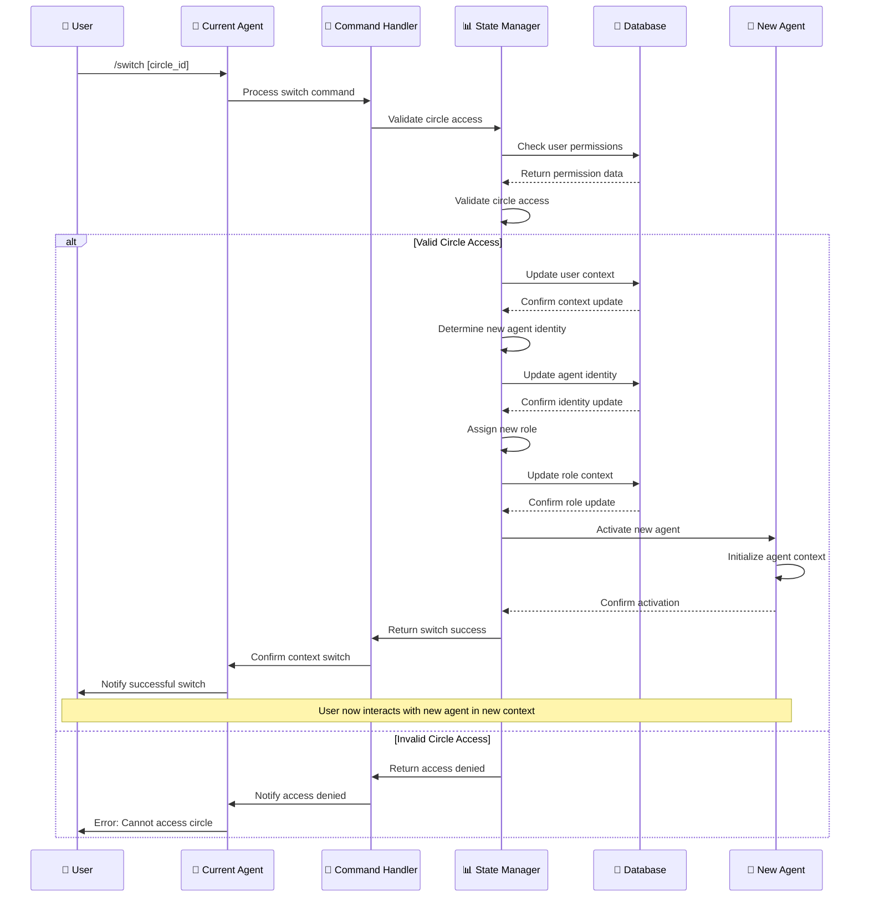

# Context Switching Sequence Diagram

This diagram shows the context switching process when users move between different care circles, changing their agent identity and role context.

## Sequence Diagram

## Key Interactions

### 1. Context Switch Request
- **User** sends `/switch [circle_id]` command to their **Current Agent**
- **Current Agent** forwards the command to **Command Handler**
- **Command Handler** delegates to **State Manager** for validation

### 2. Circle Access Validation
- **State Manager** validates circle access permissions
- Queries database for user permissions
- Database returns permission data
- **State Manager** validates if user can access the requested circle

### 3. Valid Access Path
If the user has valid access to the circle:

#### Context Update
- **State Manager** updates user context in database
- Database confirms context update
- User's active circle is changed

#### Agent Identity Update
- **State Manager** determines new agent identity
- **PersonalAgent** if user is the primary patient
- **CareAgent** if user is a caregiver
- Updates agent identity in database
- Database confirms identity update

#### Role Assignment
- **State Manager** assigns new role based on circle context
- **Patient** role if user is the primary patient
- **Caregiver** role if user is a caregiver
- Updates role context in database
- Database confirms role update

#### Agent Activation
- **State Manager** activates the new agent
- **New Agent** initializes agent context
- **New Agent** confirms activation
- **State Manager** returns switch success to **Command Handler**
- **Command Handler** confirms context switch to **Current Agent**
- **Current Agent** notifies **User** of successful switch

### 4. Invalid Access Path
If the user doesn't have access to the circle:
- **State Manager** returns access denied to **Command Handler**
- **Command Handler** notifies **Current Agent** of access denial
- **Current Agent** sends error message to **User**
- User remains in their current context

## Component Roles

- **User**: User requesting context switch
- **Current Agent**: User's current active agent (PersonalAgent or CareAgent)
- **Command Handler**: Processes switch commands
- **State Manager**: Manages user context and agent identity
- **Database**: Stores user permissions, context, and agent identity
- **New Agent**: User's new agent after context switch

## Context Types

### Personal Context
- **Agent**: PersonalAgent
- **Role**: Patient
- **Circle**: User's own care circle
- **Permissions**: Full access to own health information
- **Responsibilities**: Managing own health and care

### Care Context
- **Agent**: CareAgent
- **Role**: Caregiver
- **Circle**: Someone else's care circle
- **Permissions**: Limited access based on consent
- **Responsibilities**: Supporting patient's care

## Agent Identity Logic

### PersonalAgent
- **Trigger**: User is the primary patient in the circle
- **Context**: User's own care circle
- **Role**: Patient
- **Capabilities**: Full access to own health information
- **Responsibilities**: Managing own health and care

### CareAgent
- **Trigger**: User is a caregiver in the circle
- **Context**: Someone else's care circle
- **Role**: Caregiver
- **Capabilities**: Limited access based on consent
- **Responsibilities**: Supporting patient's care

## Data Flow

1. **Switch Command**: User requests context switch
2. **Access Validation**: System validates circle access permissions
3. **Context Update**: User's active circle is updated
4. **Agent Identity**: New agent identity is determined and updated
5. **Role Assignment**: New role is assigned based on circle context
6. **Agent Activation**: New agent is activated and initialized
7. **Confirmation**: User receives confirmation of successful switch

## Example Scenarios

### Patient to Caregiver Switch
- **User**: Patient in their own circle (PersonalAgent)
- **Command**: `/switch spouse_circle_id`
- **Result**: Switches to CareAgent in spouse's circle
- **New Role**: Caregiver supporting spouse's care

### Caregiver to Patient Switch
- **User**: Caregiver in spouse's circle (CareAgent)
- **Command**: `/switch own_circle_id`
- **Result**: Switches to PersonalAgent in own circle
- **New Role**: Patient managing own health

### Invalid Access Attempt
- **User**: Patient in their own circle
- **Command**: `/switch stranger_circle_id`
- **Result**: Access denied, remains in current context
- **Error**: "Cannot access circle: insufficient permissions"

## Context Persistence

### Session Management
- **Context Storage**: User's current context is stored in database
- **Session Tracking**: Active sessions are tracked per user
- **Context Restoration**: Context is restored when user reconnects
- **Timeout Handling**: Context expires after inactivity

### State Synchronization
- **Real-time Updates**: Context changes are synchronized in real-time
- **Multi-device Support**: Context is consistent across devices
- **Conflict Resolution**: Handles concurrent context changes
- **Backup and Recovery**: Context state is backed up and recoverable
