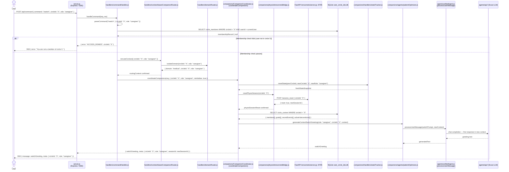

# Context Switching — v2 (real module names)

> **Supersedes:** `context_switching_v1_original.md`  
> **Original source:** Chat-output design sketch using role-abstraction / design-intent names.  
> **This version:** Rewritten to reflect actual codebase module paths verified against `handlers/commandHandler.js`, `handlers/contextAwareCompanionRouter.js`, `handlers/domainRouter.js`, `companions/CompanionCoordinator.js`, `companions/handlers/stateTracker.js`, `companions/physio/tensornetsBridge.js`, and `companions/agents/patientOptimizer.js`.

## How v2 differs from v1

| Dimension | v1 (original) | v2 (this file) |
|-----------|--------------|----------------|
| Participant names | Fictional: `CurrentAgent`, `CommandHandler`, `StateManager`, `NewAgent` | Real module paths: `server.js`, `commandHandler.js`, `contextAwareCompanionRouter.js`, `domainRouter.js`, `CompanionCoordinator.js`, `stateTracker.js`, `tensornetsBridge.js`, `patientOptimizer.js`, `unifiedAgent.js` |
| Access validation | `StateManager` queries database for permissions | `commandHandler.js` performs a direct SQLite `SELECT circle_members` query as a membership gate check before any routing |
| Domain isolation | Not modelled | `handlers/domainRouter.js` explicitly shown: maps `circleId` to `medical` or `business` domain before handing back to the router |
| Agent identity logic | 3-step: (1) update context, (2) determine identity (PersonalAgent vs CareAgent), (3) assign role | Single `coordinateCompanions(req, { reinitialise: true })` call — identity is determined by the `role` field passed in the request |
| Physio session reset | Not modelled | `tensornetsBridge.js` calls FastAPI `POST /session_reset` to discard the prior circle's physiological state and start a new session |
| Circle context load | Not modelled | SQLite fetch of `circle_context` (members, goals, recent events, active interventions) after re-initialisation |
| First response | Not modelled | `patientOptimizer` generates a greeting tailored to the new role and circle context |
| Error path | Returns "Cannot access circle" | Returns structured `{ error: "ACCESS_DENIED", circleId }` SSE event |

## How v1 and v2 align

Both versions model the same **conceptual context switch**: the user requests a role/circle change, the system validates access, updates state, and confirms success. The abstract components in v1 map to real modules in v2:

| v1 concept | v2 module |
|------------|-----------|
| `CurrentAgent` | `handlers/contextAwareCompanionRouter.js` + `CompanionCoordinator.js` |
| `CommandHandler` | `handlers/commandHandler.js` |
| `StateManager` | `companions/handlers/stateTracker.js` |
| `NewAgent` | `CompanionCoordinator.js` re-initialised with `reinitialise: true` |
| `Database` | `SQLite care_circle_dev.db` |

## Sequence Diagram



## Key Interactions

1. **User → server.js**: `/switch` command arrives with the target `circleId` and the new `role`.
2. **commandHandler**: Parses the command and performs the membership gate check against SQLite before any routing occurs.
3. **Invalid access path**: If the user is not a member of the target circle, an `ACCESS_DENIED` error is returned immediately and the switch is aborted.
4. **contextAwareCompanionRouter re-route**: Routes the session to the new `circleId`/`role` combination in the correct domain.
5. **domainRouter isolation**: Ensures the new circleId maps to the correct domain (medical vs. business) before handing back to the router.
6. **CompanionCoordinator re-initialisation**: `coordinateCompanions` is called with `reinitialise: true`, which resets all in-memory state for the new role.
7. **stateTracker reset**: Clears the prior circle's state snapshot and creates a fresh one for circle X.
8. **tensornetsBridge session reset**: Notifies the FastAPI Python server that the physiological session for the old circle has ended and a new one has started for circle X.
9. **SQLite context load**: Full circle context (members, goals, recent events, active interventions) is fetched for the new circle.
10. **First response**: `patientOptimizer` generates a greeting tailored to the new caregiver role and circle context.

## Component Roles

| Module | Role |
|--------|------|
| `server.js` | Express HTTP server; SSE broadcaster |
| `handlers/commandHandler.js` | Processes `/commands`; validates membership before routing |
| `handlers/contextAwareCompanionRouter.js` | Re-routes session to the new circleId and role |
| `handlers/domainRouter.js` | Domain isolation gate — maps circleId to medical or business domain |
| `companions/CompanionCoordinator.js` | Per-request brain; re-initialises with new role and circleId |
| `companions/handlers/stateTracker.js` | Resets per-circle state snapshot on context switch |
| `companions/physio/tensornetsBridge.js` | JS→Python bridge; sends physio session reset to FastAPI |
| `FastAPI tensornets/server.py :8765` | Python inference server; resets MCTS session for the new circle |
| `companions/agents/patientOptimizer.js` | Generates the first response in the new context |
| `agents/unifiedAgent.js` | Executes LLM calls |
| `agents/api/` | Multi-provider LLM layer (Scout / Maverick / Bedrock) |
| `SQLite care_circle_dev.db` | Circle membership records and full circle context |

## Data Flow

```
/switch command { circleId: "X", role: "caregiver" }
  → membership check (commandHandler → SQLite)
      FAIL → ACCESS_DENIED → SSE error to User
      PASS →
          → re-route (contextAwareCompanionRouter → domainRouter)
          → re-initialise CompanionCoordinator (role=caregiver, circleId=X)
          → reset state (stateTracker)
          → physio session reset (tensornetsBridge → FastAPI :8765)
          → load new circle context (SQLite)
          → first response (patientOptimizer → unifiedAgent → Scout LLM)
  → SSE greeting to User in new context
```

---

> **Note:** This diagram uses real module file names from the codebase. Earlier versions used role-abstraction / design-intent names (ActionExecutor, FactReportingHandler, CriticalEventsHandler, ConsentManager, SharingHandler). Those names correctly represent the conceptual architecture — the v1 names like `PersonalAgent`, `CareAgent`, `Doctor`, `Caregiver` map to `role` values in the `care_circle_members` table, not to separate module files.
