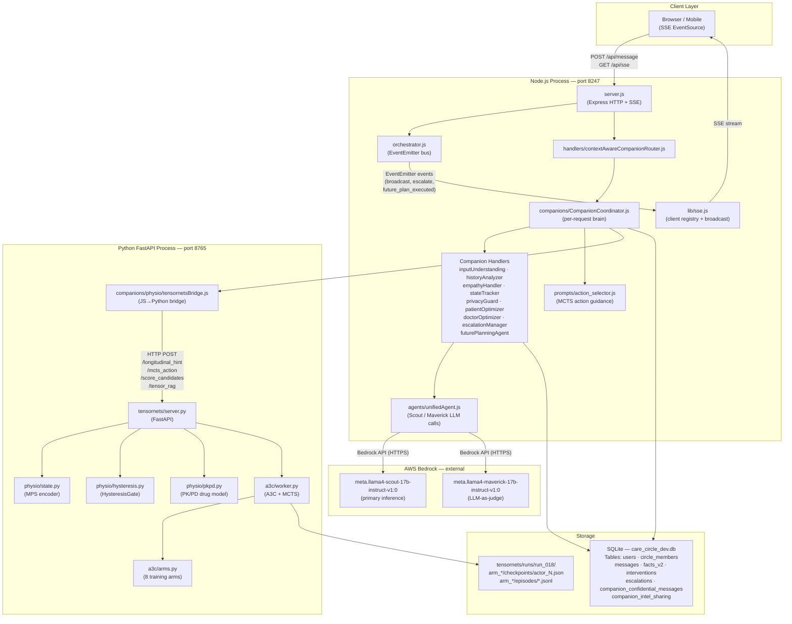

# Environment Diagram 1 — Physical Deployment

> **View:** 4+1 Physical View (Kruchten)  
> **Purpose:** Shows where processes run, how they communicate, and what
> stores data. This is the "machine map" of the system.

## Deployment Diagram

## Component Ownership

| Layer | Process | Port | Language |
|-------|---------|------|----------|
| Client | Browser / Mobile | — | HTML / JS |
| Application | `server.js` (Express + SSE) | 8247 | Node.js |
| Inference bridge | `tensornetsBridge.js` | — | Node.js (HTTP client) |
| ML server | `tensornets/server.py` (FastAPI) | 8765 | Python |
| LLM provider | AWS Bedrock | 443 (HTTPS) | External API |
| Persistence | SQLite `care_circle_dev.db` | — | SQLite |
| Training artefacts | `runs/run_018/` | — | JSON / JSONL |

## Known Gaps (see `documentation/DISCREPANCIES.md`)

- Escalation SSE broadcast does not currently fan out to all care circle members — it only sends to `payload.userId`. Family/caregiver notification requires a `getCircleMembers()` call on escalation, which is not yet wired.
- No production-grade process manager (PM2, Docker) in place; both Node.js and Python servers are started manually.
