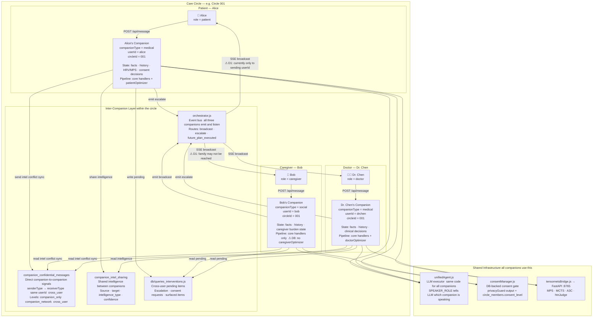
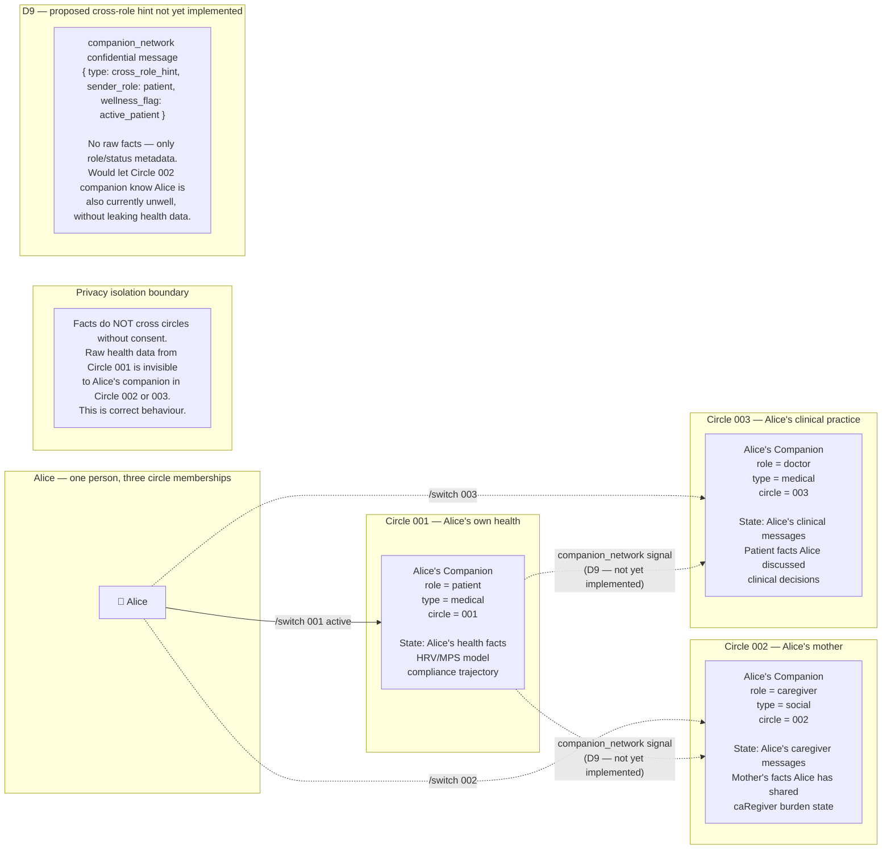
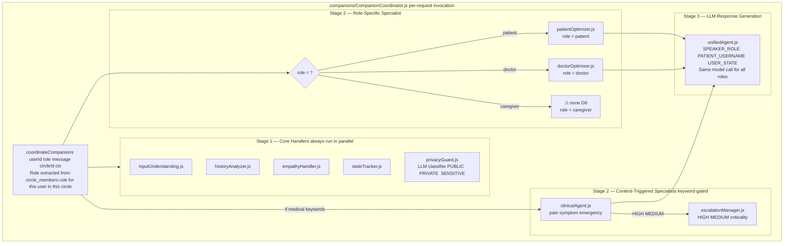

# Environment Diagram 2 — Agent and User Topology

> **View:** 4+1 Logical View (Kruchten) — who are the actors and what
> processes serve them.
>
> ## Companion model — one companion per user
>
> Each user has a **dedicated companion** — a logical agent whose
> identity is `(companionType, userId)`. The companion's state (facts,
> history, messages, physiological model, consent decisions) is
> permanently keyed to that user. It persists across sessions.
>
> The companion is **not** a class instance held in memory — it is a
> collection of DB-backed state tables and a stateless pipeline that
> reads and writes that state on every request. The pipeline code is
> shared; the state is per-user.
>
> A companion's **type** reflects the primary domain it operates in:
>
> | Companion type | Domain | Activated for roles |
> |---------------|--------|---------------------|
> | `medical` | Health, physiology, clinical | `patient`, `doctor` |
> | `professional` | Business, organisational | (currently unused in routing) |
> | `social` | Social dynamics, relationships | `caregiver` (partially) |
>
> Within a care circle, multiple users each have their own companion.
> The companions within a circle communicate with each other via
> `companion_confidential_messages` and `companion_intel_sharing`,
> mediated by `orchestrator.js` and `CompanionCoordinator.js`.
>
> ## Multi-role user — one companion per circle membership
>
> A single human holds one companion **per care circle they belong to**:
>
> ```
> Person "Alice"
>   Circle 001 (her own health)    → Alice's companion in Circle 001 (type=medical, role=patient)
>   Circle 002 (her mother)        → Alice's companion in Circle 002 (type=social,   role=caregiver)
>   Circle 003 (her practice)      → Alice's companion in Circle 003 (type=medical,  role=doctor)
> ```
>
> The companion adapts its **active role** from the circle membership
> record (`circle_members.role`). `/switch [circleId]` changes which
> companion is active. The companions in different circles are isolated
> by default (privacy) but can exchange signals via `companion_network`
> confidential messages (D9 — not yet implemented).

---

## Diagram A — Per-user companion topology within one care circle

This shows one care circle with three members, each with their own
companion, and how the companions relate to each other.



---

## Diagram B — Multi-role user: one person, multiple companions

Alice has three companion instances — one in each circle she belongs to.
Each is an independent logical agent with its own state. They are
isolated by default (privacy). Cross-role hints via `companion_network`
are the proposed (D9) but unimplemented bridge.



---

## Diagram C — The companion pipeline (same code, different role context)

The pipeline code is **shared across all companions**. What differs per
companion is the `role` parameter and the DB state it reads/writes.



---

## Role → Pipeline mapping (ground truth from `CompanionCoordinator.js:390–413`)

| Human role | `role` value | Specialist activated | Core handlers |
|-----------|-------------|---------------------|---------------|
| Patient | `patient` | `patientOptimizer.js` | All 5 |
| Caregiver / Family | `caregiver` | **none** ⚠ D8 | All 5 |
| Doctor / Clinician | `doctor` | `doctorOptimizer.js` | All 5 |
| Any (medical content) | any | `clinicalAgent.js` added | All 5 |
| Any (urgent content) | any | `escalationManager.js` added | All 5 |

---

## Confidentiality levels — `companion_confidential_messages`

| Level | Scope | Example use |
|-------|-------|-------------|
| `companion_only` | Originating companion's LLM context only | Internal reasoning trace |
| `companion_network` | All companions **for the same user** across all their circles | Cross-role wellness hint (D9) |
| `cross_user` | Companions of **other users** | Conflict notification between Alice's and Bob's companions |

The `cross_user` level is how companions belonging to **different people
in the same care circle** communicate — e.g. Alice's companion sends a
conflict notification to Bob's companion.

The `companion_network` level is how one user's companions across
**different circles** can share metadata (D9 — not yet used).

---

## Known Gaps (cross-referenced to `documentation/DISCREPANCIES.md`)

| ID | Severity | Status | Summary |
|----|----------|--------|---------|
| D1 | HIGH | 🔴 Open | Escalation SSE broadcast reaches only the sending `userId`, not all circle members |
| D2 | LOW | 🟢 Resolved | `consentManager.js` now separated from `privacyGuard.js` |
| D8 | MEDIUM | 🔴 Open | No `caregiverOptimizer.js` — caregivers have no specialist response generator |
| D9 | LOW | 🟡 Documented | No cross-role longitudinal awareness for multi-role users; `companion_network` channel exists but unused for this purpose |
