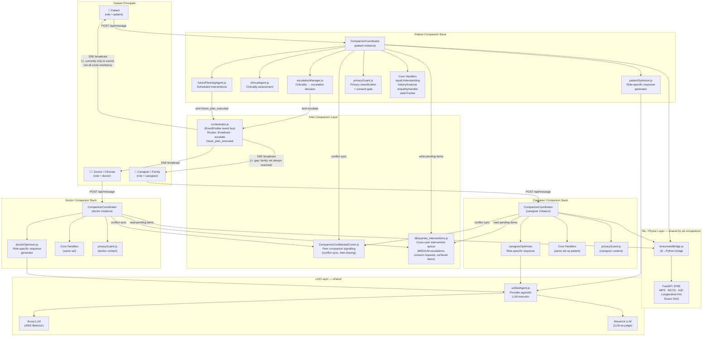

# Environment Diagram 2 — Agent and User Topology

> **View:** 4+1 Logical View (Kruchten) — who are the actors and what
> processes serve them.  
> **Purpose:** Shows the three human principals, their companion agents,
> the inter-companion coordination layer, and the ML inference layer.

## Topology Diagram

## Role → Agent mapping

| Human role | `role` value | Primary agent | Response optimizer |
|-----------|-------------|---------------|--------------------|
| Patient | `patient` | `CompanionCoordinator` (patient instance) | `patientOptimizer.js` |
| Caregiver / Family | `caregiver` | `CompanionCoordinator` (caregiver instance) | `caregiverOptimizer` |
| Doctor / Clinician | `doctor` | `CompanionCoordinator` (doctor instance) | `doctorOptimizer.js` |

> **Note:** "Patient Companion" and "Doctor Companion" are not separate
> files — they are the same `CompanionCoordinator.js` module instantiated
> per-request with a different `role` value. The `getRelevantHandlers()`
> function selects role-specific sub-agents based on `role`.

## Confidentiality levels (CompanionConfidentialComm)

| Level | Meaning | Example use |
|-------|---------|-------------|
| `companion_only` | Only the sending companion's own LLM context | Internal reasoning trace |
| `companion_network` | All companions for the same user | Role switch sync |
| `cross_user` | May be shared with companions of other users | Conflict notification, intel sharing |

## Known Gaps (see `documentation/DISCREPANCIES.md`)

- Escalation SSE broadcast does not fan out to all circle members — Caregiver/Family and Doctor only receive escalation if their `userId` is known to the orchestrator at the time of the event.
- No dedicated `consentManager.js` — consent logic is embedded in `privacyGuard.js` (see `DISCREPANCIES.md` §D2).
