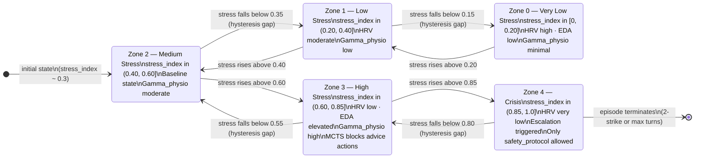
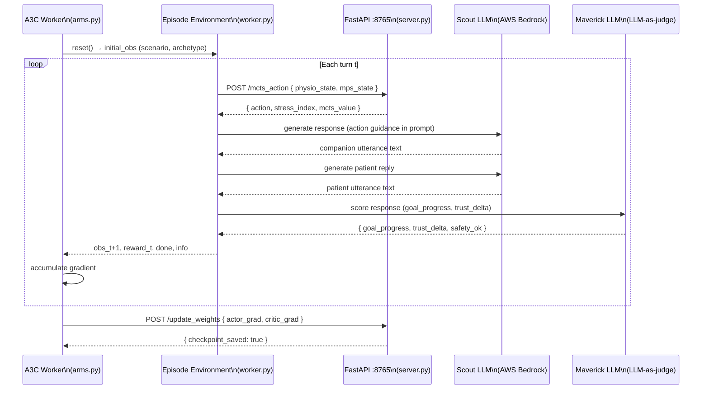

# Environment Diagram 3 — RL Environment (POMDP-H)

> **View:** Process / Scenario View — the training environment as a
> formal dynamical system.  
> **Purpose:** Shows the POMDP-H state space, the observation and action
> interfaces, the reward function decomposition, and how the A3C workers
> interact with it.

## State Space — HysteresisGate Zones

> **Hysteresis property:** Entry threshold > exit threshold for each zone
> boundary. A patient who reaches Zone 3 requires a larger stress reduction
> to leave it than was needed to enter — modelling psychological inertia
> (Bouton, 2004; Foa & Kozak, 1986).

## POMDP-H Formal Structure

```mermaid
graph LR
    subgraph state_space [State Space S]
        PhysioState["Physiological state\ns = (hrv_ms, eda_us,\nsleep_deficit,\nglucose_mg_dl,\nstress_index)"]
        MPSState["MPS history\n|ψ⟩ over T=10 turns\nbond dim χ=4"]
        HystState["HysteresisGate zone\nZone 0–4\nasymmetric thresholds"]
        TherState["Therapeutic state\n(phase, alliance,\ninfo_coverage,\nreadiness_stage)"]
    end

    subgraph obs_space [Observation Space Ω]
        Utterance["Patient utterance text\n(Scout LLM generates)"]
        IntentFeats["Extracted features\nintent · facts · empathy\n(inputUnderstanding)"]
    end

    subgraph action_space [Action Space A — 22 actions]
        ActionsCore["Core MI actions\nreflect · validate · probe\nacknowledge · affirm\nsummarise"]
        ActionsClin["Clinical actions\nprovide_info · suggest_resource\nsafety_protocol\nescalate"]
        ActionsNav["Navigational\nchange_topic · topic_from_stack\nsurface_intervention\ndefer_intervention"]
        ActionsAdv["Advanced MI\ndevelop_discrepancy\nreframe · explore_ambivalence\nhighlight_strength"]
    end

    subgraph reward [Reward r_t]
        R1["r_progress\n= Δinfo_coverage × 1.5"]
        R2["r_stress\n= -stress_index × 0.3"]
        R3["r_trust\n= Δtrust × 0.5"]
        RGoal["goal_progress ∈ [0,1]\n(Maverick LLM judge\nindependent of MCTS)"]
    end

    subgraph transition [Transition T]
        OUProcess["HRV: OU process\ndX = θ(μ-X)dt + σdW\nθ=0.3, μ=38ms, σ=5ms"]
        GammaDecay["Γ matrix update\n6 components\nΓ_physio + Γ_habit\n+ Γ_pkpd + Γ_reactivity\n+ Γ_fear + Γ_companion"]
        MPSUpdate["MPS truncation\nSVD, keep χ=4\nsingular values"]
    end

    Utterance --> IntentFeats
    IntentFeats --> state_space
    state_space --> obs_space
    state_space --> action_space
    action_space --> reward
    state_space --> transition
    transition --> state_space
```

## A3C Worker — Environment Interface

## Stress Gate — Action Availability by Zone

| Zone | stress_index | Blocked actions | Rationale |
|------|-------------|-----------------|-----------|
| 0–1 | 0–0.40 | none | Full action space available |
| 2 | 0.40–0.60 | none | Baseline; mild caution |
| 3 | 0.60–0.85 | `provide_info`, `develop_discrepancy` | High stress → advice/challenge contraindicated |
| 4 | 0.85–1.0 | all except `safety_protocol`, `escalate`, `validate` | Crisis mode; only de-escalation actions |

## Episode termination conditions

| Condition | Mechanism |
|-----------|-----------|
| Goal achieved | `goal_progress ≥ 0.75` (Maverick judge) |
| 2-strike | Two consecutive turns with safety concern flag |
| Max turns | `MAX_TURNS = 20` (configurable per scenario) |
| Stress ceiling | Stress reaches Zone 4 and stays there for 3 turns |
