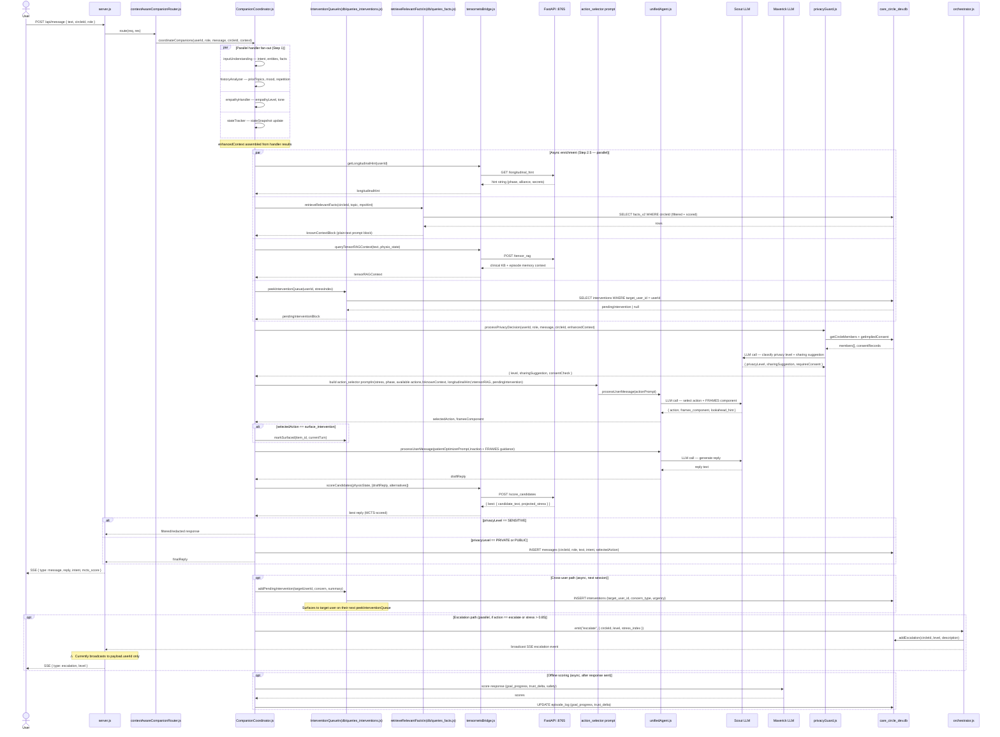

# Environment Diagram 4 — Information Flow (Logical View)

> **View:** 4+1 Logical View  
> **Purpose:** Traces a single message from the user's browser through
> every processing stage to the SSE response. Shows parallel vs sequential
> steps, the physio/ML side-channel, and the cross-user intervention path.

## Full Request Lifecycle



## Key data objects passed through the pipeline

| Stage | Object | Contents |
|-------|--------|----------|
| Handler fan-out output | `enhancedContext` | intent, entities, facts, priorTopics, mood, repetitionFlag, empathyLevel, stateSnapshot |
| Fact RAG output | `knownContextBlock` | Plain-text block of top-6 scored facts, session-local facts separated |
| Longitudinal hint | `longitudinalHint` | Short string: therapeutic phase, alliance score, session secrets |
| Action selector output | `selectedAction` | One of 22 actions; `framesComponent` (FRAMES letter) |
| Privacy guard output | `sharingSuggestion` | `{ target, content_to_share, requiresConsent }` or null |
| MCTS candidate scoring | `mcts_score` | Projected stress index for the chosen response candidate |
| Intervention queue item | `pendingIntervention` | `{ concern_type, urgency_score, concern_summary, suggested_action }` |

## Parallel vs sequential summary

```
PARALLEL (fan-out):
  inputUnderstanding | historyAnalyzer | empathyHandler | stateTracker

PARALLEL (enrichment):
  getLongitudinalHint | retrieveRelevantFacts | queryTensorRAGContext | peekInterventionQueue

SEQUENTIAL (must be in order):
  → privacyGuard (needs enhancedContext from fan-out)
  → action_selector (needs all enrichment + privacy result)
  → patientOptimizer / role optimizer (needs selectedAction + FRAMES)
  → scoreCandidates (needs draft reply)
  → DB write + SSE response
```
