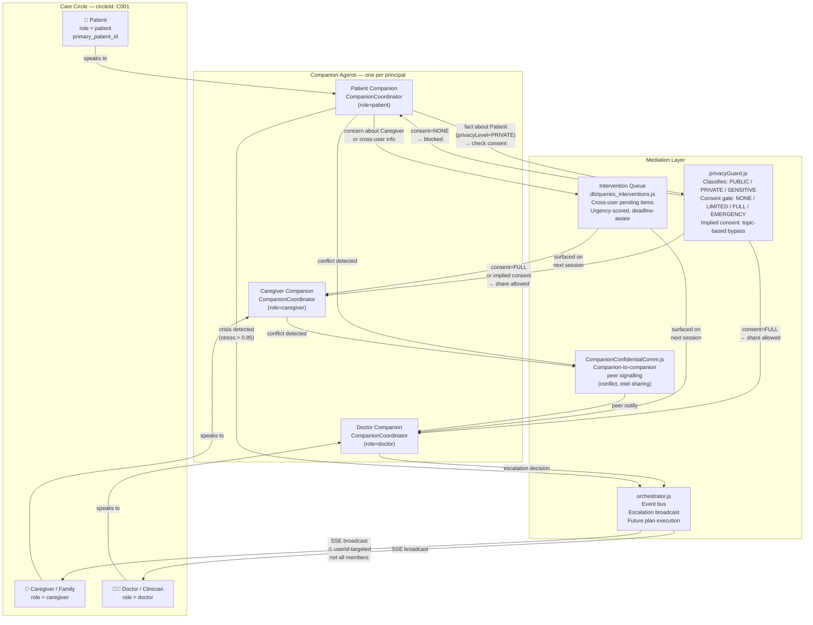
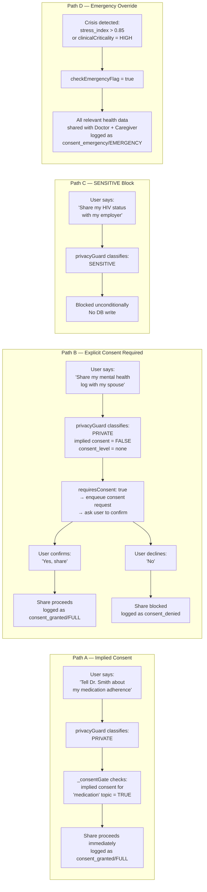

# Environment Diagram 5 — Care Circle Social Graph

> **View:** Logical / Domain View  
> **Purpose:** Models the care circle as a graph of human principals and
> their relationships, showing consent levels, information sharing
> permissions, and which agents mediate each edge.

## Care Circle Graph — Triad Example



## Consent Level Matrix (per circle_members row)

| Sharer | Recipient | `consent_level` | What can be shared |
|--------|-----------|-----------------|-------------------|
| Patient | Doctor | `full` | All health information including sensitive |
| Patient | Caregiver | `full` | All health information |
| Patient | Caregiver | `limited` | Subset only (medication adherence, appointments) |
| Patient | Caregiver | `none` | Nothing — explicit consent request required first |
| Caregiver | Patient | `full` | Caregiver's observations |
| Doctor | Patient | `full` | Clinical advice, assessments |

> Consent levels are stored per `(user_id, circle_id)` row in `circle_members`.
> The `consent_level` field is checked by `privacyGuard.js._consentGate()`.
> Topic-specific **implied consent** (`getImpliedConsent(userId, circleId, topic)`)
> can bypass the explicit consent gate for routine topics (medication,
> appointments, check-ins) that the user has consented to repeatedly.

## Information sharing paths



## V_int Social Coupling Matrix

The social prior `V_int ∈ ℝⁿˣⁿ` encodes initial alliance strength
between circle members. Current fixed priors in `shared_tensor_state.py`:

```
           Patient   Caregiver   Doctor
Patient  [  1.0       0.7         0.5  ]
Caregiver[ 0.7        1.0         0.6  ]
Doctor   [  0.5       0.6         1.0  ]
```

> **Planned extension (not yet implemented):** Hysteretic V_int that
> persists and evolves across sessions based on therapeutic alliance
> measurements. See `documentation/vision_goals.md §7.1`.

## Known Gaps (see `documentation/DISCREPANCIES.md`)

- `D1` — Escalation does not broadcast to all circle members; only `payload.userId` receives the SSE event.
- `D2` — No dedicated `consentManager.js`; consent logic is inside `privacyGuard.js`.
- `D3` — Conflict flags are per-fact-key, not per-conflict-event; multi-party disagreement history is not persisted.
