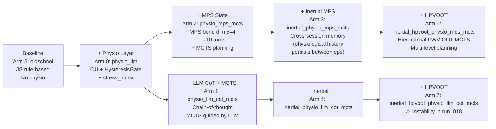

# Environment Diagram 6 — Multi-Episode Training Environment

> **View:** Process / Development View  
> **Purpose:** Shows how the 8 A3C training arms, the shared
> actor-critic, the FastAPI episode runner, and the checkpoint/episode
> artefacts relate to each other during training.

## Training Architecture Overview

```mermaid
graph TD
    subgraph config [Run Configuration]
        Manifest["run_manifest.json\ntotal_episodes: 4000\npatient_mode: llm\narms: [8 arm names]"]
    end

    subgraph arms_layer [8 A3C Arm Workers — run in parallel]
        Arm0["Exp 0 — arm_physio_llm\nPhysio + LLM only\nNo MCTS"]
        Arm1["Exp 1 — arm_physio_llm_cot_mcts\nPhysio + LLM + CoT + MCTS"]
        Arm2["Exp 2 — arm_physio_mps_mcts\nPhysio + MPS + MCTS"]
        Arm3["Exp 3 — arm_inertial_physio_mps_mcts\nInertial + Physio + MPS + MCTS"]
        Arm4["Exp 4 — arm_inertial_physio_llm_cot_mcts\nInertial + Physio + LLM + CoT + MCTS"]
        Arm5["Exp 5 — arm_oldschool (BASELINE)\nNo physio. No MCTS.\nJS rule-based stack"]
        Arm6["Exp 6 — arm_inertial_hpvoot_physio_mps_mcts\nInertial + HPVOOT + Physio + MPS"]
        Arm7["Exp 7 — arm_inertial_hpvoot_physio_llm_cot_mcts\nInertial + HPVOOT + Physio + LLM + CoT\n⚠ Instability detected in run_018"]
    end

    subgraph shared [Shared Components]
        SharedActor["Shared Actor\nactor_N.json\n(per arm, saved every 10 eps)"]
        SharedCritic["Shared Critic\ncritic_N.json\n(per arm, saved every 10 eps)"]
        RunState["run_state.json\nlast_completed_episode\nep_count · successful_eps\nlast_session_memory"]
    end

    subgraph episode_runner [Episode Runner — worker.py]
        ScenarioSampler["Scenario Sampler\nSamples from scenario pool\n(JS OPD, negotiation, social anxiety…)"]
        ArchetypeSampler["Archetype Sampler\nstandard / anxious / stoic"]
        PatientSim["Patient Simulator\nLLM-generated patient\n(patient_mode=llm)"]
        PhysioSim["Physiological Simulator\nOU process + HysteresisGate\nPK/PD drug model"]
        MCTSPlanner["MCTS Planner\n(skipped for Arm 0, 5)\nHPVOOT for Arms 6, 7"]
        LLMJudge["Maverick LLM Judge\ngoal_progress\ntrust_delta\nsafety_ok"]
    end

    subgraph artefacts [Artefacts — per arm]
        Episodes["episodes/\nepisode_UUID.jsonl\nOne file per completed episode\n~15–55 KB per episode"]
        Checkpoints["checkpoints/\nactor_N.json + critic_N.json\nSaved every 10 episodes"]
        RunStateFile["run_state.json\nLatest state snapshot\nResuming support"]
    end

    subgraph online_eval [Online Evaluation — during training]
        GenuineMetrics["Genuine metrics (per episode)\nchange_stage_delta\nstress_auc\nturns_to_goal\ngoal_achieved"]
        DiscrepancyFlag["discrepancy_flag\narm reward vs LLM scorer\ndivergence > 3.0"]
        PromptOptimizer["Prompt optimizer\n(rewrite if mean score < 0.50)"]
    end

    Manifest --> arms_layer
    arms_layer --> episode_runner
    episode_runner --> ScenarioSampler
    episode_runner --> ArchetypeSampler
    episode_runner --> PatientSim
    episode_runner --> PhysioSim
    episode_runner --> MCTSPlanner
    PatientSim --> LLMJudge
    LLMJudge --> GenuineMetrics
    GenuineMetrics --> DiscrepancyFlag
    episode_runner --> Episodes
    episode_runner --> Checkpoints
    episode_runner --> RunStateFile
    Arm0 --> SharedActor
    Arm1 --> SharedActor
    Arm2 --> SharedActor
    Arm3 --> SharedActor
    Arm4 --> SharedActor
    Arm5 --> SharedActor
    Arm6 --> SharedActor
    Arm7 --> SharedActor
    SharedActor --> shared
    SharedCritic --> shared
    RunState --> shared
```



## Capability Ladder — What each arm adds



## run_018 Status (as of 2026-06-02)

| Arm | ep_count | successful_eps | Success rate | Latest checkpoint |
|-----|----------|----------------|--------------|-------------------|
| Exp 0 physio_llm | 561 | 214 | 38.1% | actor_561 |
| Exp 1 physio_llm_cot_mcts | 500 | 193 | 38.6% | actor_500 |
| Exp 2 physio_mps_mcts | 541 | 191 | 35.3% | actor_541 |
| Exp 3 inertial_physio_mps_mcts | 551 | 203 | 36.8% | actor_551 |
| Exp 4 inertial_physio_llm_cot_mcts | 551 | 200 | 36.3% | actor_551 |
| Exp 5 oldschool (baseline) | 541 | 149 | **27.5%** | actor_541 |
| Exp 6 inertial_hpvoot_physio_mps_mcts | 551 | 205 | 37.2% | actor_551 |
| Exp 7 inertial_hpvoot_physio_llm_cot_mcts | 531 | 87 | **16.4% ⚠** | actor_100 |

> Physio arms (Exp 0–4, 6) all exceed the oldschool baseline by ~10 pp.
> Exp 7 anomaly under investigation — see `documentation/DISCREPANCIES.md §D4`.

## Episode JSONL schema (key fields)

```
episode_UUID.jsonl — one JSON object per line:
  { "turn": 1, "role": "assistant", "content": "...", 
    "action": "validate", "frames": "Responsibility",
    "physio": { "stress_index": 0.42, "hrv_ms": 38, ... },
    "reward": { "goal_r": 0.3, "stress_r": -0.1, "trust_r": 0.2,
                "goal_progress": 0.65, "trust_delta": 0.05 },
    "genuine_metrics": { "change_stage_delta": 0, "stress_auc": 12.4,
                         "turns_to_goal": null, "goal_achieved": false },
    "discrepancy_flag": false }
```

## Training loop (per worker, per episode)

```
1. reset() — sample scenario + archetype + initial physio state
2. loop turns:
   a. getLongitudinalHint() → cross-session MPS context
   b. MCTS / HPVOOT → selectedAction (or skip for arms 0, 5)
   c. patientOptimizer → Scout LLM → companion utterance
   d. patientSimulator → Scout LLM → patient reply
   e. PhysioSim → update stress_index, HysteresisGate zone
   f. Maverick judge → goal_progress, trust_delta, safety_ok
   g. compute reward_t = r_progress + r_stress + r_trust
   h. accumulate A3C gradient
3. if done: backprop → update shared actor/critic
4. save checkpoint (every 10 episodes)
5. write episode JSONL artefact
```
