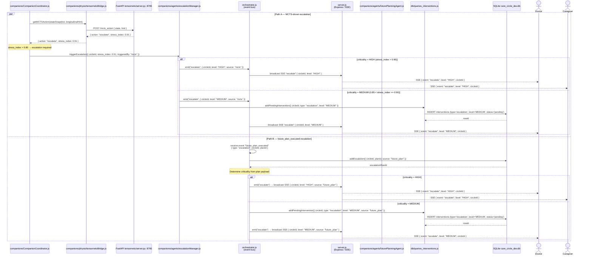

# Escalation Flow

## Sequence Diagram



## Key Interactions

1. **Path A — MCTS action `escalate`**: `tensornetsBridge` calls FastAPI `/mcts_action`; when the returned `stress_index` exceeds 0.85, `CompanionCoordinator` hands off to `escalationManager.js`.
2. **HIGH criticality (Path A)**: `escalationManager` emits `escalate/HIGH` on `orchestrator.js`; `server.js` immediately SSE-broadcasts to all connected Doctor and Caregiver clients.
3. **MEDIUM criticality (Path A)**: In addition to the broadcast, `escalationManager` writes a pending intervention row to `db/queries_interventions.js` so it appears in the intervention queue.
4. **Path B — `future_plan_executed`**: `orchestrator.js` independently receives this event (e.g. from `futurePlanningAgent.js` completing a scheduled plan). It calls `db.addEscalation` directly, then emits the same `escalate` event.
5. **Path B HIGH**: `server.js` broadcasts immediately to Doctor and Caregiver.
6. **Path B MEDIUM**: A pending intervention row is written first, then the broadcast is sent.
7. **`par` block**: Both paths can fire independently and concurrently — a MCTS spike and a future-plan completion can both escalate within the same time window.
8. **`orchestrator.js` as event bus**: Both paths converge on `orchestrator.js` for the final `escalate` event, ensuring a single broadcast point regardless of origin.

## Component Roles

| Module | Role |
|--------|------|
| `companions/CompanionCoordinator.js` | Detects MCTS escalation signal and delegates to escalationManager |
| `companions/physio/tensornetsBridge.js` | JS→Python bridge; returns MCTS action with `stress_index` |
| `FastAPI tensornets/server.py :8765` | Python inference server; runs MCTS and returns selected action |
| `companions/agents/escalationManager.js` | Escalation agent; applies criticality logic and emits events |
| `orchestrator.js` | Central event bus; dispatches `escalate` events and handles `future_plan_executed` |
| `companions/agents/futurePlanningAgent.js` | Emits `future_plan_executed` when a scheduled plan completes |
| `server.js` | Express HTTP server; SSE broadcaster to connected Doctor/Caregiver clients |
| `db/queries_interventions.js` | Writes MEDIUM-criticality escalations to the intervention queue |
| `SQLite care_circle_dev.db` | Persistent store; `escalations` and `interventions` tables |

## Data Flow

```
Path A — MCTS-driven
  CompanionCoordinator
    → tensornetsBridge → FastAPI :8765
    → { action: "escalate", stress_index }
    → escalationManager (stress_index > 0.85)
        HIGH  → orchestrator.emit("escalate/HIGH") → server.js SSE → Doctor + Caregiver
        MEDIUM → db/queries_interventions (pending) + orchestrator.emit("escalate/MEDIUM") → server.js SSE → Doctor

Path B — future_plan_executed
  orchestrator receives "future_plan_executed" { type: "escalation" }
    → db.addEscalation
    → orchestrator.emit("escalate")
        HIGH  → server.js SSE → Doctor + Caregiver
        MEDIUM → db/queries_interventions (pending) + server.js SSE → Doctor

Both paths fire independently via `par` block.
Criticality gate:
  HIGH   → immediate SSE broadcast (no queue write)
  MEDIUM → intervention queue write + SSE broadcast
```

---

> **Note:** This diagram uses real module file names from the codebase. Earlier versions of this diagram used fictional participant names (ActionExecutor, FactReportingHandler, CriticalEventsHandler, ConsentManager, SharingHandler) — those have been removed.
