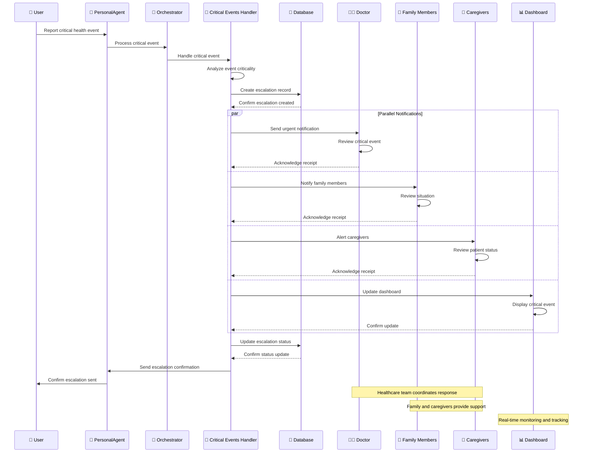

# Escalation Flow Sequence Diagram

This diagram shows the escalation process when critical health events are detected and need immediate attention from healthcare providers and family members.

## Sequence Diagram

## Key Interactions

### 1. Critical Event Detection
- **User** reports a critical health event to their **PersonalAgent**
- **PersonalAgent** forwards the event to the **Orchestrator**
- **Orchestrator** delegates to **Critical Events Handler**

### 2. Event Analysis and Escalation Creation
- **Critical Events Handler** analyzes the event criticality
- Creates escalation record in database
- Database confirms escalation creation

### 3. Parallel Notification System
The system simultaneously notifies multiple parties:

#### Doctor Notification
- **Critical Events Handler** sends urgent notification to **Doctor**
- **Doctor** reviews the critical event
- **Doctor** acknowledges receipt of notification

#### Family Notification
- **Critical Events Handler** notifies **Family Members**
- **Family Members** review the situation
- **Family Members** acknowledge receipt of notification

#### Caregiver Alert
- **Critical Events Handler** alerts **Caregivers**
- **Caregivers** review patient status
- **Caregivers** acknowledge receipt of alert

#### Dashboard Update
- **Critical Events Handler** updates the **Dashboard**
- **Dashboard** displays the critical event
- **Dashboard** confirms the update

### 4. Status Tracking and Confirmation
- **Critical Events Handler** updates escalation status in database
- Database confirms status update
- **Critical Events Handler** sends escalation confirmation to **PersonalAgent**
- **PersonalAgent** confirms escalation sent to **User**

### 5. Coordinated Response
- **Healthcare team** coordinates response based on criticality
- **Family and caregivers** provide support and monitoring
- **Dashboard** provides real-time monitoring and tracking

## Component Roles

- **User**: Patient or caregiver reporting the critical event
- **PersonalAgent**: User's personal AI agent
- **Orchestrator**: Central decision-making component
- **Critical Events Handler**: Manages critical event detection and escalation
- **Database**: Stores escalation records and status updates
- **Doctor**: Healthcare provider receiving urgent notifications
- **Family Members**: Family members who need to be informed
- **Caregivers**: Caregivers who need to be alerted
- **Dashboard**: Real-time monitoring and tracking system

## Criticality Levels

### HIGH Criticality
- **Immediate Escalation**: Bypasses all other logic
- **Multi-Channel Notification**: Doctor, family, caregivers, dashboard
- **Urgent Response**: Requires immediate attention
- **Status Tracking**: Continuous monitoring until resolved

### MEDIUM Criticality
- **Standard Escalation**: Follows normal escalation process
- **Selective Notification**: Based on event type and context
- **Timely Response**: Requires attention within reasonable time
- **Periodic Updates**: Regular status updates

### LOW Criticality
- **Information Sharing**: Standard information sharing process
- **Optional Notification**: May or may not require notification
- **Routine Response**: Standard care process
- **Basic Tracking**: Minimal status tracking

## Data Flow

1. **Critical Event**: User reports critical health event
2. **Event Analysis**: System analyzes event criticality
3. **Escalation Creation**: Escalation record created in database
4. **Parallel Notifications**: Multiple parties notified simultaneously
5. **Status Updates**: Escalation status tracked and updated
6. **Confirmation**: User receives confirmation of escalation
7. **Coordinated Response**: Healthcare team coordinates response

## Example Scenarios

### Chest Pain Escalation
- **User**: "My chest hurts. I want to talk to my doctor"
- **System**: Detects HIGH criticality for chest pain
- **Escalation**: Doctor notified immediately, family alerted, dashboard updated
- **Response**: Doctor contacts patient, family provides support

### Fall Incident Escalation
- **User**: "A fell down from the 3rd floor!"
- **System**: Detects HIGH criticality for fall incident
- **Escalation**: Emergency services notified, family alerted, caregivers informed
- **Response**: Emergency response coordinated, family provides support

### Medication Error Escalation
- **User**: "I think I took the wrong medication"
- **System**: Detects MEDIUM criticality for medication error
- **Escalation**: Doctor notified, family informed, dashboard updated
- **Response**: Doctor provides guidance, family monitors situation

## Escalation Tracking

### Real-Time Monitoring
- **Dashboard Updates**: Continuous status updates
- **Response Tracking**: Monitor response times and actions
- **Status Changes**: Track escalation status changes
- **Resolution Tracking**: Monitor until issue is resolved

### Communication Logs
- **Notification History**: Track all notifications sent
- **Response Logs**: Record responses from healthcare team
- **Status Updates**: Log all status changes
- **Resolution Notes**: Document resolution process
