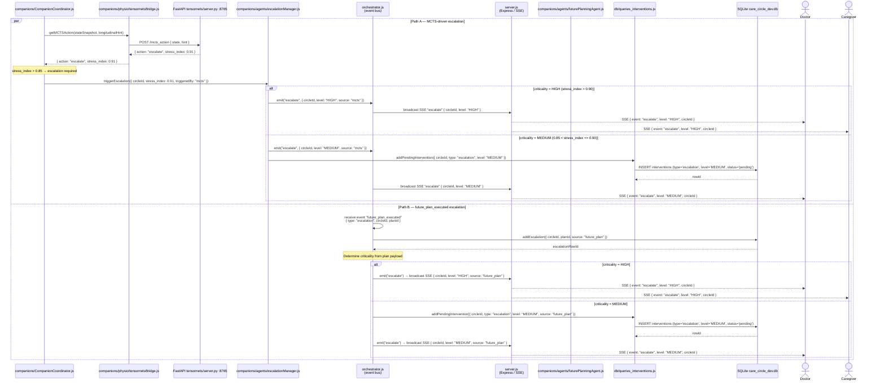

# Escalation Flow — v2 (real module names)

> **Supersedes:** `escalation_flow_v1_original.md`  
> **Original source:** Chat-output design sketch using role-abstraction / design-intent names.  
> **This version:** Rewritten to reflect actual codebase module paths verified against `companions/CompanionCoordinator.js`, `companions/agents/escalationManager.js`, `orchestrator.js`, `server.js`, `companions/physio/tensornetsBridge.js`, and `db/queries_interventions.js`.

## How v2 differs from v1

| Dimension | v1 (original) | v2 (this file) |
|-----------|--------------|----------------|
| Participant names | Role abstractions / design-intent names: `PersonalAgent`, `Orchestrator`, `CriticalEventsHandler`, `Doctor`, `Family`, `Caregivers`, `Dashboard`. Doctor/Caregiver/Family are real `role` values in `circle_members`; PersonalAgent/CriticalEventsHandler are conceptual names for real module functions. | Real module file paths: `companions/CompanionCoordinator.js`, `escalationManager.js`, `tensornetsBridge.js`, `orchestrator.js`, `server.js`, `db/queries_interventions.js` |
| Escalation trigger | User manually reports a critical event | MCTS returns `action: "escalate"` (Path A) or `orchestrator.js` receives `future_plan_executed` event (Path B) |
| Criticality source | Analyst/designer judgment ("HIGH/MEDIUM/LOW Criticality" section) | Numeric threshold: `stress_index > 0.90` → HIGH, `0.85 < stress_index ≤ 0.90` → MEDIUM |
| Notification channel | Generic "send urgent notification" | `server.js` SSE broadcast to connected Doctor and Caregiver clients |
| Intervention queue | Not modelled | MEDIUM escalations write a `pending` row to `db/queries_interventions.js` before SSE broadcast |
| Concurrency | `par` block in v1 shows parallel notifications | `par` block in v2 shows two independent escalation *paths* (MCTS vs future-plan) that can fire simultaneously |
| Python layer | Absent | `FastAPI tensornets/server.py :8765` explicitly shown as the source of MCTS action + stress_index |
| Family notification | Explicitly modelled | Not present — **gap identified (DISCREPANCIES.md §D1)**: the SSE broadcast currently targets `payload.userId` only; Caregiver/Family are not reliably reached. `getCircleMembers()` should be called on escalation to fan out to all circle members. |
| Manual / user-initiated escalation | User-triggered: `User->>Agent: Report critical health event` | **Not modelled in v2 — gap (DISCREPANCIES.md §D5)**: user-initiated escalation exists via `clinicalAgent.js` → `escalationManager.js` (HIGH/MEDIUM criticality from message content). This is Path C, absent from the v2 diagram. |

## How v1 and v2 align

Both versions model the same **conceptual flow**: a critical health signal triggers parallel notification of the care circle. The abstract components in v1 map to real modules in v2:

| v1 concept | v2 module |
|------------|-----------|
| `PersonalAgent` | `companions/CompanionCoordinator.js` |
| `Orchestrator` | `orchestrator.js` (event bus) + `server.js` (SSE broadcaster) |
| `CriticalEventsHandler` | `companions/agents/escalationManager.js` |
| `Database` | `SQLite care_circle_dev.db` via `db/queries_interventions.js` |
| `Dashboard` | Client-side SSE consumer (not a server-side module) |

## Sequence Diagram



## Key Interactions

1. **Path A — MCTS action `escalate`**: `tensornetsBridge` calls FastAPI `/mcts_action`; when the returned `stress_index` exceeds 0.85, `CompanionCoordinator` hands off to `escalationManager.js`.
2. **HIGH criticality (Path A)**: `escalationManager` emits `escalate/HIGH` on `orchestrator.js`; `server.js` immediately SSE-broadcasts to all connected Doctor and Caregiver clients.
3. **MEDIUM criticality (Path A)**: In addition to the broadcast, `escalationManager` writes a pending intervention row to `db/queries_interventions.js` so it appears in the intervention queue.
4. **Path B — `future_plan_executed`**: `orchestrator.js` independently receives this event (e.g. from `futurePlanningAgent.js` completing a scheduled plan). It calls `db.addEscalation` directly, then emits the same `escalate` event.
5. **Path B HIGH**: `server.js` broadcasts immediately to Doctor and Caregiver.
6. **Path B MEDIUM**: A pending intervention row is written first, then the broadcast is sent.
7. **`par` block**: Both paths can fire independently and concurrently — a MCTS spike and a future-plan completion can both escalate within the same time window.
8. **`orchestrator.js` as event bus**: Both paths converge on `orchestrator.js` for the final `escalate` event, ensuring a single broadcast point regardless of origin.

## Component Roles

| Module | Role |
|--------|------|
| `companions/CompanionCoordinator.js` | Detects MCTS escalation signal and delegates to escalationManager |
| `companions/physio/tensornetsBridge.js` | JS→Python bridge; returns MCTS action with `stress_index` |
| `FastAPI tensornets/server.py :8765` | Python inference server; runs MCTS and returns selected action |
| `companions/agents/escalationManager.js` | Escalation agent; applies criticality logic and emits events |
| `orchestrator.js` | Central event bus; dispatches `escalate` events and handles `future_plan_executed` |
| `companions/agents/futurePlanningAgent.js` | Emits `future_plan_executed` when a scheduled plan completes |
| `server.js` | Express HTTP server; SSE broadcaster to connected Doctor/Caregiver clients |
| `db/queries_interventions.js` | Writes MEDIUM-criticality escalations to the intervention queue |
| `SQLite care_circle_dev.db` | Persistent store; `escalations` and `interventions` tables |

## Data Flow

```
Path A — MCTS-driven
  CompanionCoordinator
    → tensornetsBridge → FastAPI :8765
    → { action: "escalate", stress_index }
    → escalationManager (stress_index > 0.85)
        HIGH  → orchestrator.emit("escalate/HIGH") → server.js SSE → Doctor + Caregiver
        MEDIUM → db/queries_interventions (pending) + orchestrator.emit("escalate/MEDIUM") → server.js SSE → Doctor

Path B — future_plan_executed
  orchestrator receives "future_plan_executed" { type: "escalation" }
    → db.addEscalation
    → orchestrator.emit("escalate")
        HIGH  → server.js SSE → Doctor + Caregiver
        MEDIUM → db/queries_interventions (pending) + server.js SSE → Doctor

Both paths fire independently via `par` block.
Criticality gate:
  HIGH   → immediate SSE broadcast (no queue write)
  MEDIUM → intervention queue write + SSE broadcast
```

---

> **Note:** This diagram uses real module file names from the codebase. Earlier versions used role-abstraction / design-intent names (ActionExecutor, FactReportingHandler, CriticalEventsHandler, ConsentManager, SharingHandler). Those names correctly represent the conceptual architecture — the v1 names like `PersonalAgent`, `CareAgent`, `Doctor`, `Caregiver` map to `role` values in the `care_circle_members` table, not to separate module files.
