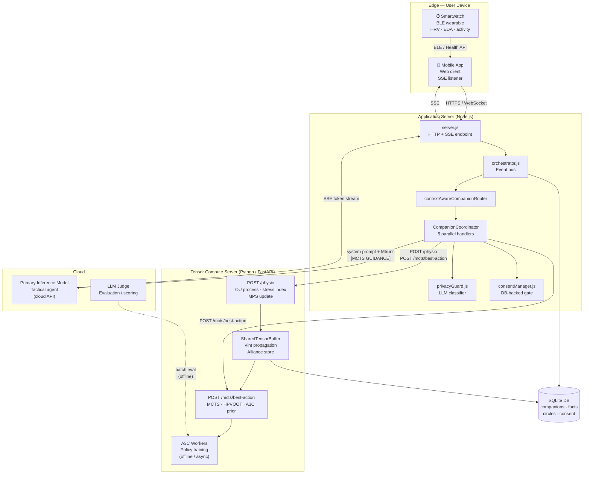
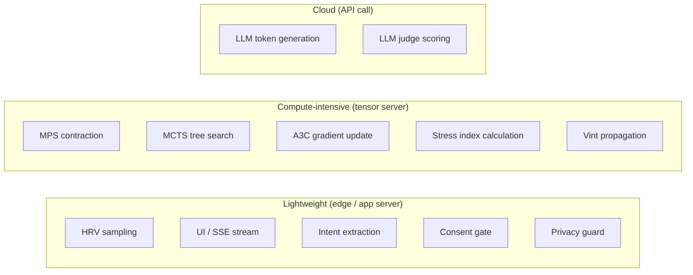

# Deployment Diagram — HTN Framework

**Scale:** Physical / deployment
**One idea:** Where each component runs and how nodes connect

The framework spans three physical tiers: a user edge tier (mobile app + smartwatch), an application server tier (Node.js orchestration + companion logic), and a compute tier (Python tensor bridge + A3C workers). Heavy compute never runs on the user device. The LLM call is the only cloud dependency at inference time.

## Node responsibilities

| Node | Tier | What runs there |
|---|---|---|
| Smartwatch | Edge | Raw sensor sampling (HRV, EDA). Sends to mobile via BLE. |
| Mobile app | Edge | UI, SSE stream display, health API bridge. No tensor compute. |
| server.js | App server | HTTP/SSE ingress, session management, response streaming. |
| orchestrator.js | App server | Event bus: escalation, future-plan routing, circle notifications. |
| CompanionCoordinator | App server | Per-request: 5 parallel handlers + role-specific optimizer. |
| privacyGuard.js | App server | Stateless LLM call classifying message as public/private/sensitive. |
| consentManager.js | App server | Stateful DB gate: emergency override → implied → explicit consent. |
| FastAPI /physio | Tensor server | OU process, stress index, MPS slot update, Vint propagation. |
| FastAPI /mcts | Tensor server | MCTS tree search (80–150 iter), action ranking, Mtrunc construction. |
| A3C workers | Tensor server | Async policy training. Offline or continuous background process. |
| SharedTensorBuffer | Tensor server | In-memory shared MPS slots + hysteretic alliance store per circle. |
| LLM (cloud) | Cloud | Tactical text generation guided by [MCTS GUIDANCE] system prompt. |
| SQLite | App server | Persistent store: companions, facts, circles, consent, alliances. |

## What runs on which tier

