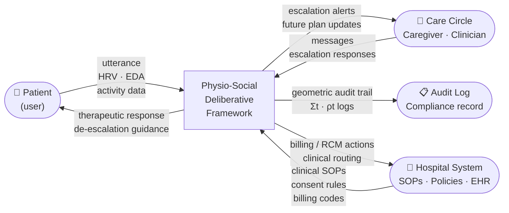

# DFD Level 0 — System Context

**Scale:** System context (highest level)
**One idea:** What goes in, what comes out, who the external actors are

The entire HTN framework is a single process. External entities are the patient (input: messages + physiology), the care circle (input: caregiver/clinician messages), and the hospital system (input: SOPs, policies; output: audit logs).

## External entities

| Entity | Sends to system | Receives from system |
|---|---|---|
| Patient | Text messages, wearable physiological signals (HRV, EDA, sleep, glucose, reactivity) | Therapeutic dialogue responses via SSE |
| Caregiver | Messages, acknowledgements of escalation alerts | Escalation notifications (anonymised per consent tier), future-plan updates |
| Clinician | Clinical notes, care plan updates | Anonymised consultation requests (T3), full escalation (T4) |
| Hospital system | SOPs (offline, compiled into tensor constraints), billing codes, formulary | RCM actions, clinical routing decisions, denial resolution |
| Audit log | — | Cryptographically hashed singular value spectrum Σt and reduced density matrix ρt at each decision step |
