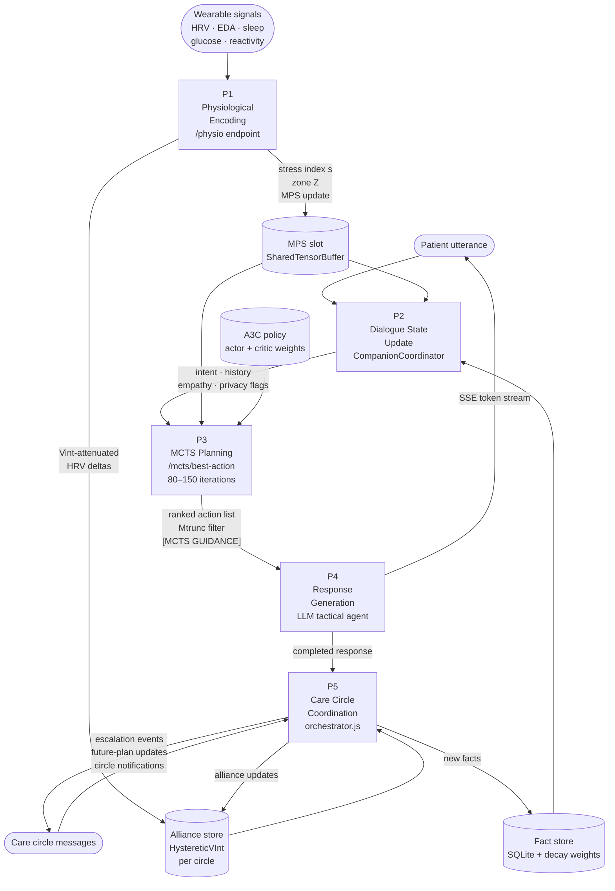

# DFD Level 1 — Main Processes

**Scale:** Architecture level
**One idea:** The five main processes and how data flows between them within one conversation turn

## Process descriptions

| Process | Input | Output | Key component |
|---|---|---|---|
| P1 Physiological Encoding | Raw wearable signals | Stress index s ∈ [0,1], zone Z ∈ {0..4}, updated MPS slot | `hrv.py`, `state.py`, `hysteresis_gate.py`, `mps.py` |
| P2 Dialogue State Update | Patient utterance, MPS, facts | Enriched context packet: intent, history, empathy signal, privacy class | `CompanionCoordinator.js` (5 parallel handlers) |
| P3 MCTS Planning | Enriched context, MPS, A3C policy | Top-3 action ranking, Mtrunc matrix, [MCTS GUIDANCE] prompt fragment | `worker.py`, HPVOOT in `arms.py` |
| P4 Response Generation | Action guidance, LLM context | SSE token stream (therapeutic response) | Primary inference model (cloud API), `privacyGuard.js` |
| P5 Care Circle Coordination | Completed response, circle state | Escalation alerts, future-plan triggers, Vint updates | `orchestrator.js`, `consentManager.js` |
