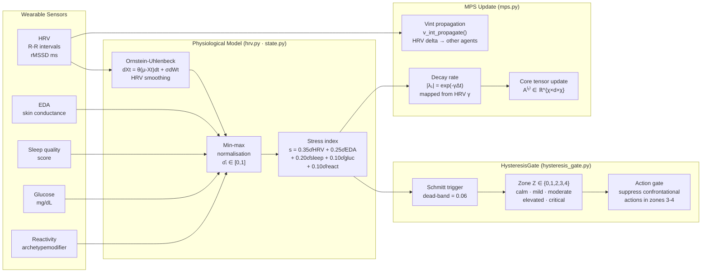

# Physiological Pipeline

**Scale:** Component level
**One idea:** How raw wearable signals become a HysteresisGate zone and an MPS update

## Zone table (ground truth from hysteresis_gate.py)

| Zone | Range | Name | Upward threshold | Downward threshold |
|---|---|---|---|---|
| 0 | [0.00, 0.25) | calm | s ≥ 0.25 | — |
| 1 | [0.25, 0.45) | mild tension | s ≥ 0.45 | s < 0.19 |
| 2 | [0.45, 0.60) | moderate | s ≥ 0.60 | s < 0.39 |
| 3 | [0.60, 0.78) | elevated | s ≥ 0.78 | s < 0.54 |
| 4 | [0.78, 1.00] | critical | — | s < 0.72 |

Dead-band = 0.06. Downward threshold = upward threshold − 0.06. This prevents rapid zone oscillation from small stress fluctuations.
