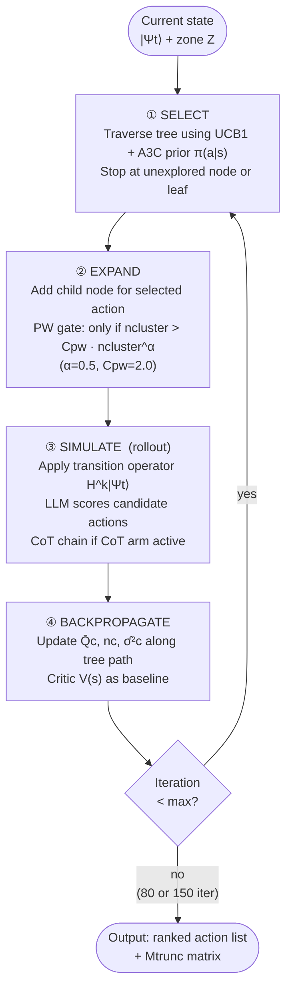
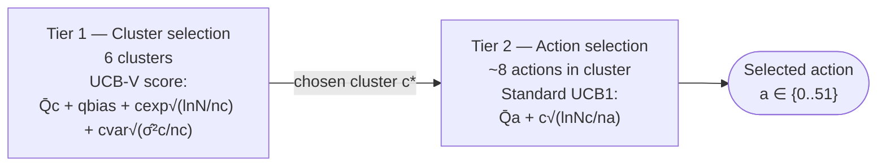

# MCTS Four-Phase Loop

**Scale:** Algorithm level
**One idea:** What happens in a single MCTS iteration (one of 80–150 per turn)

## Tier structure within SELECT (HPVOOT only)

## What each phase reads and writes

| Phase | Reads | Writes |
|---|---|---|
| Select | Q̄c, nc, σ̂²c, π(a\|s) from Actor | Tree path traversal |
| Expand | PW gate: nc, Cpw, α; LLM prior rank order | New child node |
| Simulate | H^k transition operator, LLM action scores | Rollout reward r |
| Backpropagate | r, V(s) from Critic | Q̄c ← (Q̄c·nc + r)/(nc+1), nc++, σ̂²c updated |
