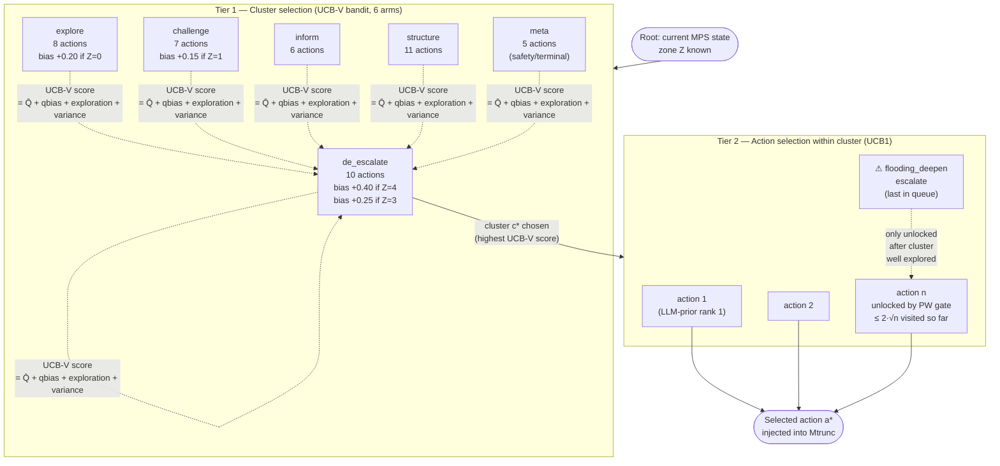
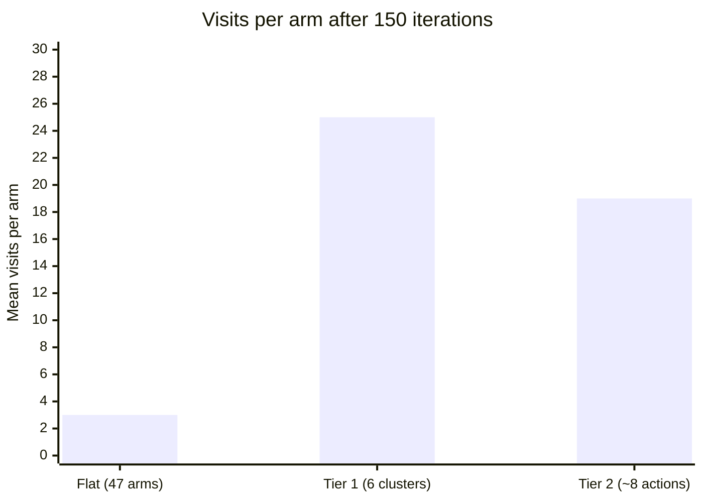

# HPVOOT Two-Tier Search Structure

**Scale:** Algorithm level
**One idea:** How 47 actions are searched in two tiers to avoid the branching-factor problem



## Why two tiers reduce the problem



Flat MCTS with 150 iterations gives ~3 visits per arm across 47 actions — too few to trust the mean. Two-tier search gives ~25 visits at Tier 1 and ~19 at Tier 2, producing statistically reliable estimates at both levels.

## UCB-V score at Tier 1 (full equation)

```
score(c) = Q̄c  +  qbias(c, Z)  +  1.414 · √(ln N / nc)  +  0.40 · √(σ̂²c / nc)
             ↑         ↑                    ↑                        ↑
           mean    zone shortcut      exploration bonus         variance bonus
           reward   (from physio)     (UCB1 term)            (UCB-V addition)
```

The variance bonus keeps high-variance clusters (e.g., `challenge`) under exploration longer even after many visits, preventing premature commitment to a therapeutic mode that has a wide outcome distribution with this patient type.
