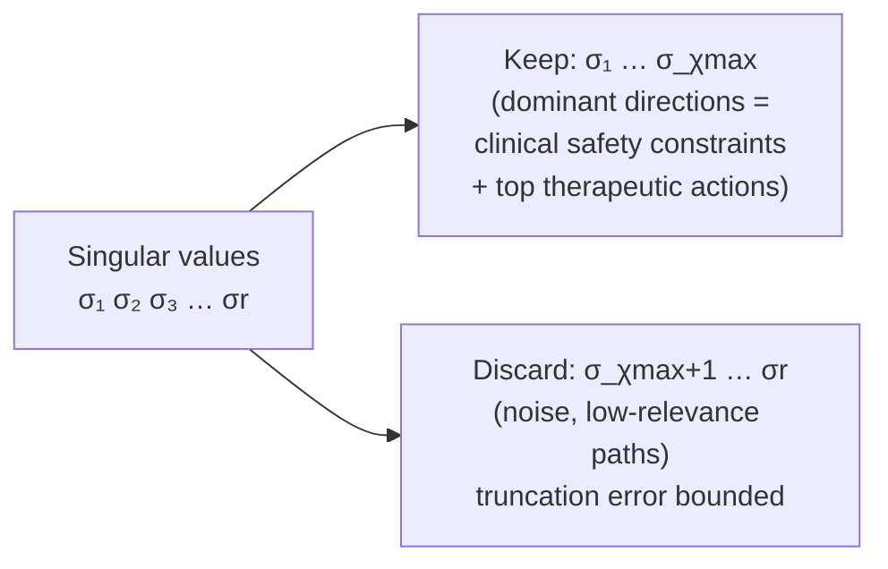

# Strategic–Tactical SVD Bridge

**Scale:** Component level
**One idea:** How the high-rank strategic plan is compressed and handed to the fast tactical agent

```mermaid
flowchart LR
    subgraph STRATEGIC["Strategic Agent  (tensor server)"]
        MPS_STATE["Current state\n|Ψt⟩  (MPS, χ=4)"]
        MCTS_TREE["MCTS tree search\n80–150 iterations\nH^k|Ψt⟩ forward simulation"]
        OPT_PATH["Optimal path W\nuncompressed tensor\n(too large for real-time)"]
        UNFOLD["Unfold W → matrix M\nm × n reshape"]
        SVD["SVD:\nM = UΣV†\nσ₁ ≥ σ₂ ≥ … ≥ 0"]
        TRUNC["Truncate at χmax\nMtrunc = Utrunc Σtrunc V†trunc\nerror ≤ Σᵢ>χmax σᵢ²"]
    end

    subgraph BRIDGE["Communication channel\n(prompt injection)"]
        GUIDANCE["[MCTS GUIDANCE] tag\ntop-3 actions\nnatural language hint\nin system prompt"]
    end

    subgraph TACTICAL["Tactical Agent  (cloud LLM)"]
        LLM_GEN["Autoregressive\ntext generation\nsub-200ms"]
        SSE["SSE token stream\nto patient device"]
    end

    MPS_STATE --> MCTS_TREE --> OPT_PATH --> UNFOLD --> SVD --> TRUNC --> GUIDANCE --> LLM_GEN --> SSE
```

## What the truncation discards

## Implementation status

| What the diagram shows | Current implementation | Planned |
|---|---|---|
| MCTS → Mtrunc | ✓ Implemented in `worker.py` | — |
| Mtrunc → [MCTS GUIDANCE] | ✓ Top-3 actions injected as structured system prompt fragment | — |
| Tactical agent uses guidance | ✓ LLM reads [MCTS GUIDANCE] tag and generates response | — |
| Direct logit-level tensor projection | ✗ Not implemented | Phase 3: tensor-level output manipulation |
| Hard probability zero on unsafe paths | ✗ Not implemented at token level; guidance is a soft prior | Phase 3 |

The SVD bridge currently operates at the **prompt level**, not the logit level. Mtrunc is a contextual prior, not a hard filter. The tactical agent remains free to deviate; the bridge makes deviation unlikely, not impossible.
