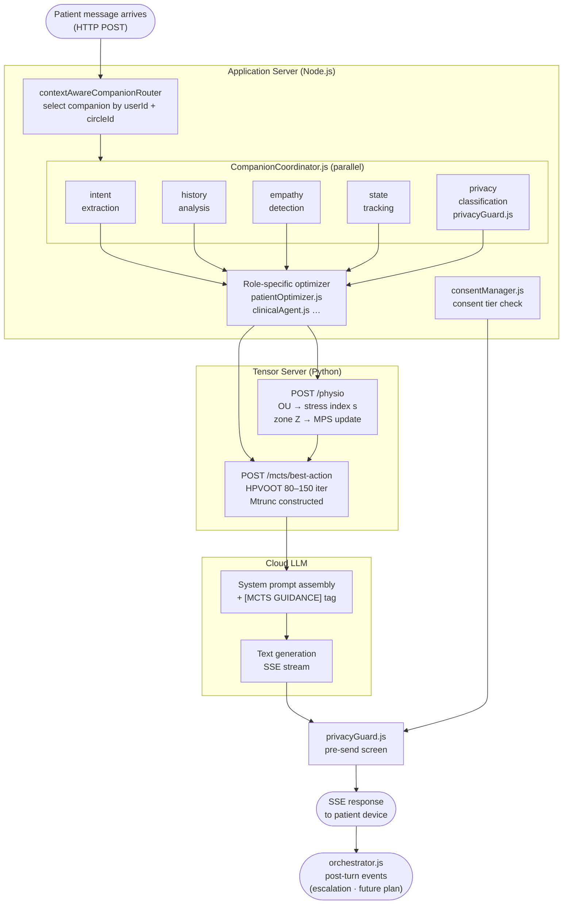

# Single Companion Conversation Turn

**Scale:** Component level
**One idea:** Every step that happens between a patient message arriving and the SSE response leaving

## Latency budget (approximate)

| Step | Typical latency |
|---|---|
| Router + coordinator fan-out | ~5 ms |
| POST /physio (OU + MPS update) | ~15–30 ms |
| POST /mcts/best-action (150 iter, HPVOOT) | ~200–400 ms |
| LLM system prompt assembly | ~5 ms |
| LLM first token (cloud API, TTFT) | ~200–500 ms |
| LLM stream to completion | ~1–3 s |
| privacyGuard pre-send screen | ~100–200 ms (LLM call) |
| **Total wall time** | **~1.5–4 s** |

The MCTS call and the LLM TTFT are the two dominant latencies. They can be parallelised: MCTS runs while the LLM context window is being assembled.
