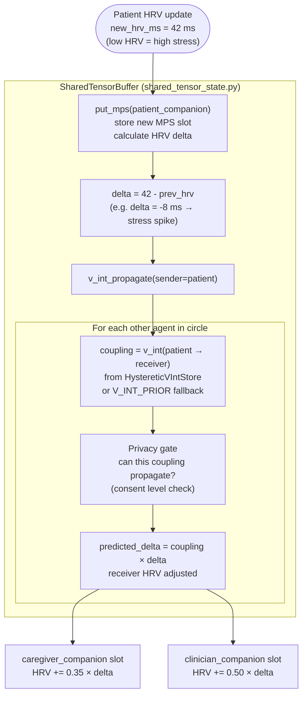
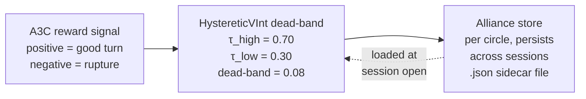

# Vint Social Coupling Propagation

**Scale:** Component level
**One idea:** How a change in one user's physiological state reaches the other companions in the care circle



## V_INT_PRIOR values (ground truth from shared_tensor_state.py)

```
          to patient   to caregiver   to clinician
patient      1.00          0.35           0.20
caregiver    0.40          1.00           0.15
clinician    0.60          0.25           1.00
```

Note: the paper's 3×3 matrix uses a simplified symmetric-ish form. The actual code has 6 directed pairs (no self-coupling stored explicitly). The asymmetry: `clinician → patient = 0.60` but `patient → clinician = 0.20`. Clinical authority flows down; patient feedback flows up weakly.

## Hysteretic alliance update



A well-established alliance (coupling > 0.70) resists a single bad turn. A damaged alliance (coupling < 0.30) does not snap back after one good turn. Same dead-band pattern as the physiological HysteresisGate.
