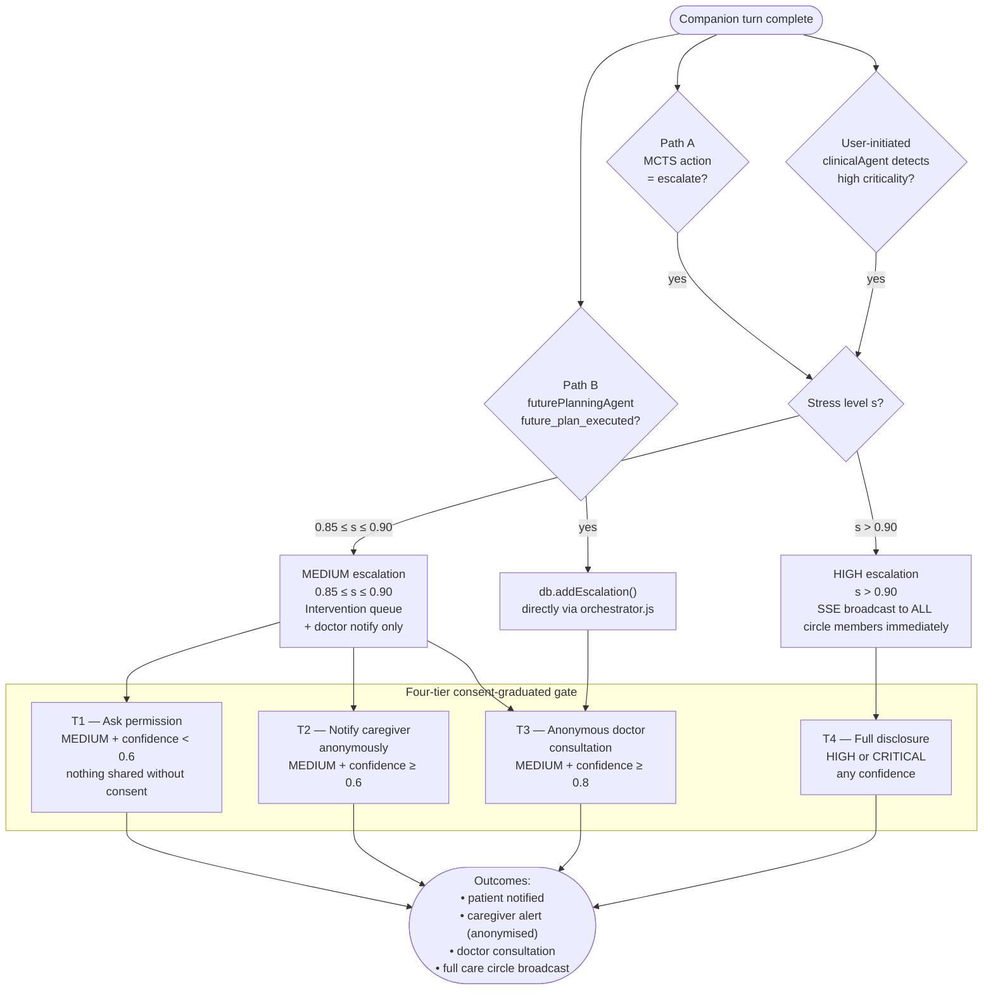
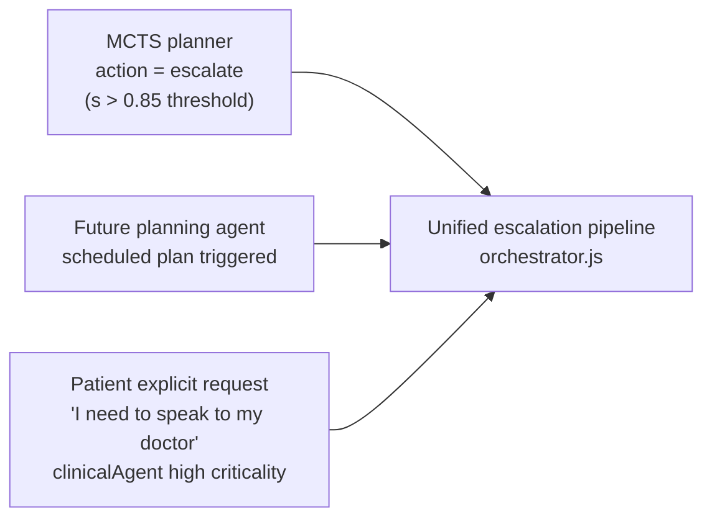

# Escalation Decision Tree

**Scale:** Component level
**One idea:** All paths that can trigger an escalation and how the consent tier gates information flow

## Consent tier summary

| Tier | Trigger | What is shared | With whom |
|---|---|---|---|
| T1 | MEDIUM, confidence < 0.6 | Nothing — system asks patient permission first | Patient only |
| T2 | MEDIUM, confidence ≥ 0.6 | Anonymised alert (no message content) | Caregiver |
| T3 | MEDIUM, confidence ≥ 0.8 | Anonymised consultation request | Clinician |
| T4 | HIGH or CRITICAL | Full context | All circle members |

## Escalation sources

All three sources route through the same pipeline. SRC3 (user-initiated) is detected by `clinicalAgent.js` classifying message criticality and then routing through Path A.
