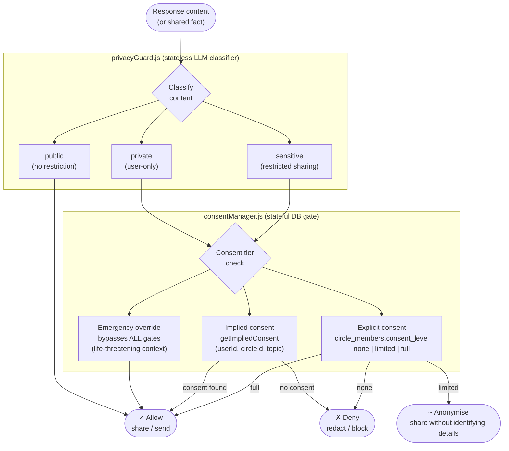
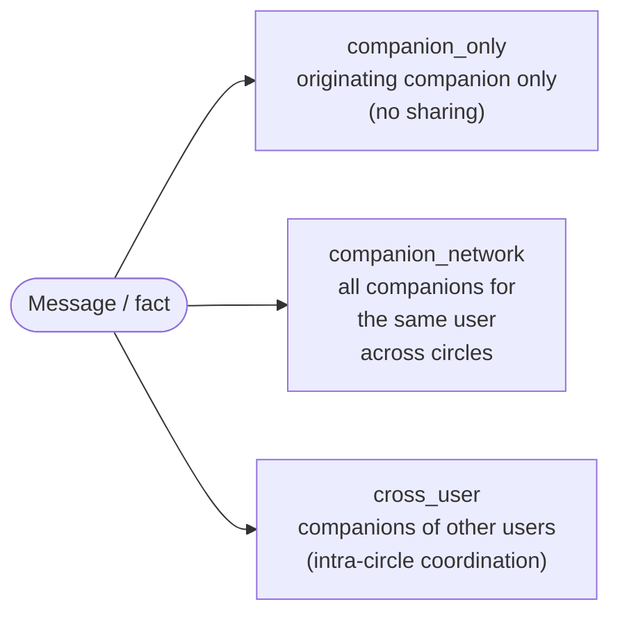

# Consent and Privacy Gate

**Scale:** Component level
**One idea:** How a single piece of information is classified and then gated before leaving a companion

## Three confidentiality channel levels

## How privacyGuard and consentManager differ

| Property | privacyGuard.js | consentManager.js |
|---|---|---|
| State | Stateless — each call is independent | Stateful — reads/writes DB per decision |
| Method | LLM classifier (single API call) | Rule-based tier lookup against DB schema |
| Output | Classification label: public / private / sensitive | Binary: allow / deny / anonymise |
| Runs | Once per response, pre-send screen | Once per sharing decision (escalation, fact sync, cross-circle) |
| Can be bypassed | No | Yes — emergency override bypasses all tiers |
