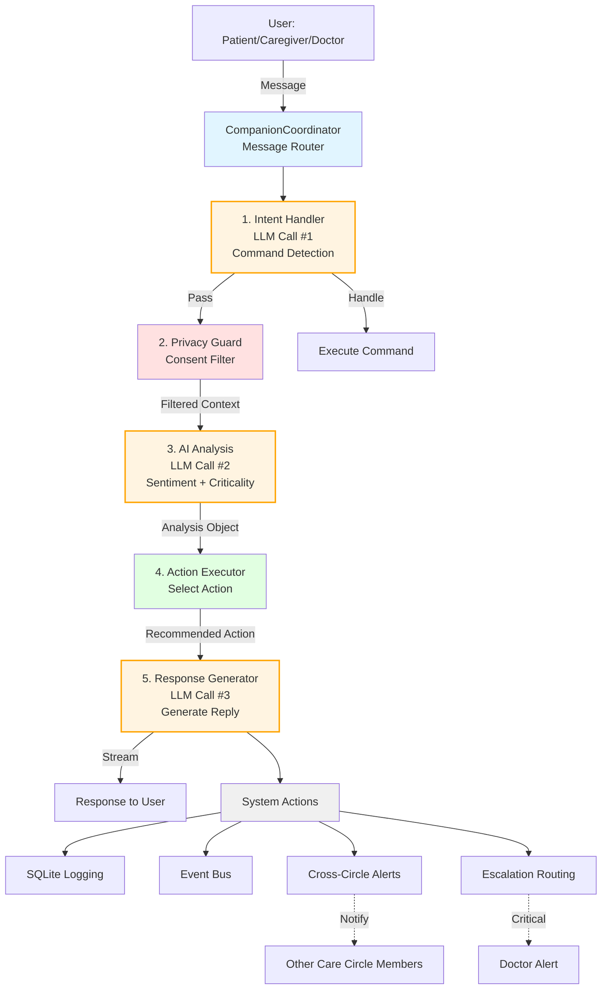
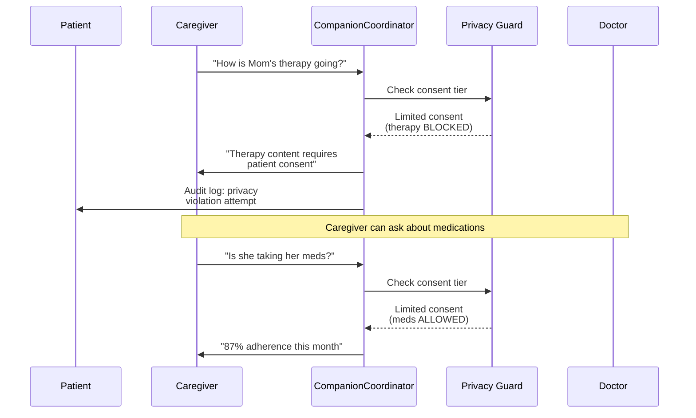
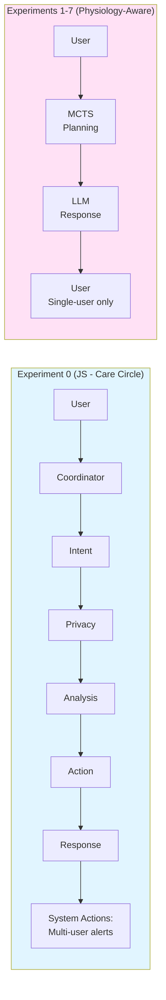
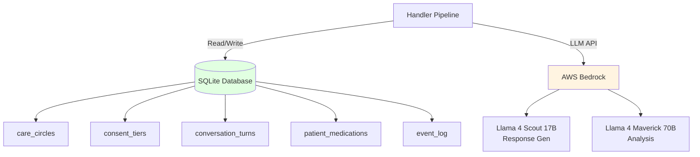

---

## Multi-User Coordination Flow



---

## Architecture Comparison: Exp 0 vs Exp 1-7



---

## Data Stores



---

## Usage

To render these diagrams:
1. Copy Mermaid code to https://mermaid.live/
2. Export as PNG/SVG
3. Include in thesis

Or use mermaid-cli:
```bash
npm install -g @mermaid-js/mermaid-cli
mmdc -i care_circle_architecture.md -o care_circle_flow.png
```
